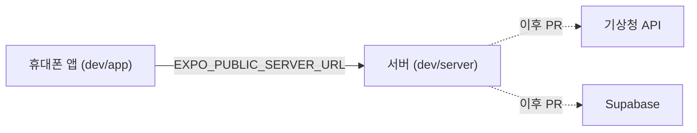

# dev/

- 앱·서버·DB 개발 폴더입니다. 작업 규칙은 [CLAUDE.md](CLAUDE.md)를 따릅니다.

## 폴더

| 폴더 | 내용 | 실행 |
|---|---|---|
| `app/` | Expo 앱 (휴대폰 화면) | `npm start` (개발 빌드 기준, Expo Go 아님) |
| `server/` | Node.js 서버 (날씨·규칙·추천) | `npm start` |
| `supabase/` | DB 구조(SQL) 기록 | Supabase SQL Editor에서 실행 |

- 앱은 DB와 외부 API에 직접 접속하지 않고 서버만 호출합니다.
- 비밀 키(`service role`, 기상청, LLM)는 서버 `.env`에만 둡니다.

## 처음 세팅 순서

1. **Supabase 프로젝트 만들기**: 방식(각자 vs 팀 공유)은 `[결정 필요]`. 정해지기 전에는 팀 안내를 따릅니다.
2. **SQL 실행**: `dev/supabase/migrations/`의 파일을 순서대로 실행합니다. 지금은 비어 있습니다.
3. **.env 만들기**
   - `dev/server/.env.example` → `dev/server/.env`
   - `dev/app/.env.example` → `dev/app/.env`
   - `.env`는 GitHub에 올리지 않습니다.
4. **서버 실행**: `cd dev/server` 후 `npm start`. (Node 22.9 이상 `[확인 필요: 팀원 PC 버전]`)
5. **연결 확인**
   - 같은 컴퓨터: 브라우저에서 `http://localhost:3000/health` → `{"status":"ok"}`
   - 휴대폰: 서버를 켜면 터미널에 나오는 `휴대폰에서 확인:` 주소를 휴대폰 브라우저로 엽니다.
6. **앱 실행**: `dev/app/.env`의 `EXPO_PUBLIC_SERVER_URL`을 4번에서 본 주소로 바꾼 뒤 `cd dev/app`, `npm install`, `npm start`.

## 휴대폰에서 서버에 안 열릴 때

- 휴대폰과 컴퓨터가 같은 Wi-Fi인지 확인합니다.
- Windows 방화벽에서 Node.js의 사설 네트워크 접속을 허용합니다.
- 학교·공용 Wi-Fi는 기기끼리 통신을 막을 수 있습니다. 이때는 개인 핫스팟을 씁니다.
- `[확인 필요]` 안드로이드 개발 빌드는 `http://` 통신을 막을 수 있습니다. 앱이 서버를 호출하는 PR에서 Expo SDK 58 공식 문서로 설정을 확인합니다.

## 구조 (PR 0 시점)

- 실선은 PR 0에서 만든 부분(`/health`), 점선은 이후 PR에서 연결합니다.

## 출처
- `dev/server/src/app.js`, `dev/server/.env.example`, `dev/app/.env.example`
- `plan/spec/treagent_tech_spec_v1.md` F-23 (좌표 미저장)
