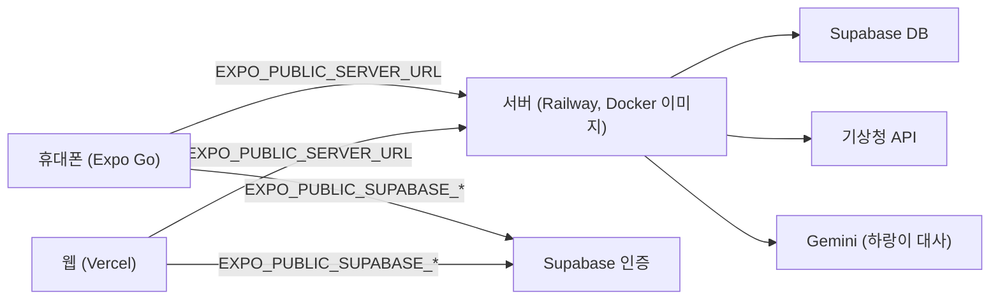

# dev/

- 앱·서버·DB 개발 폴더입니다. 작업 규칙은 [CLAUDE.md](CLAUDE.md)를 따릅니다.
- 서버는 Railway, 웹은 Vercel에 배포돼 있습니다. **앱만 개발한다면 서버를 직접 띄울 필요가 없습니다.**
- 새 컴퓨터나 새 팀원은 [team_setup_guide_v1.md](team_setup_guide_v1.md)의 순서대로 세팅합니다 (패키지를 새로 설치했을 때 전달 방법 포함).

## 한눈에 보기



- 앱은 DB와 외부 API에 직접 접속하지 않고 서버만 호출합니다. 로그인(인증)만 Supabase에 직접 요청합니다 (`dev/app/src/lib/supabase.ts`).
- 비밀 키(`service role`, DB 주소, 기상청, LLM)는 서버 쪽(`Railway Variables` 또는 `dev/server/.env`)에만 둡니다.

## 폴더

| 폴더 | 내용 | 실행 |
|---|---|---|
| `app/` | Expo 앱 (폰과 웹) | `npm install` 후 `npx expo start -c` |
| `server/` | Node.js 서버 (날씨·규칙·추천·코스) | `npm start` 또는 `docker compose up --build` |
| `supabase/` | DB 구조(SQL) 기록 | Supabase SQL Editor에서 실행 (순서는 `supabase/README.md`) |

## 배포

| 대상 | 주소 | 어디서 | 방식 |
|---|---|---|---|
| 서버 | `https://treagent-production.up.railway.app` | Railway | `dev/server/Dockerfile`로 빌드. Root Directory는 `dev/server` |
| 웹 | `https://treagent-web.vercel.app` | Vercel | `dev/app`을 `npx expo export --platform web`으로 빌드, 출력은 `dist` |

- 둘 다 `main`을 보고 자동으로 다시 배포됩니다.
- `dev → main`은 `.github/workflows/promote-dev-to-main.yml`이 매일 18:00(한국 시간)에 자동으로 올립니다 (승인 없음). 규칙은 [git-convention.md](../git-convention.md)를 따릅니다.
- 새 작업은 `dev`에 병합한 시점이 사실상 배포 전 마지막 확인입니다.
- 서버 확인: 브라우저에서 `https://treagent-production.up.railway.app/health` → `{"status":"ok"}`.

## 앱 개발 시작 (대부분의 팀원)

1. Git과 Node(22 이상 권장)를 설치합니다. Docker는 필요 없습니다.
2. 저장소를 받고 `dev` 브랜치로 이동합니다.
3. `dev/app/.env.example`을 `dev/app/.env`로 복사해 **3개만** 채웁니다.

| 변수 | 값 |
|---|---|
| `EXPO_PUBLIC_SERVER_URL` | `https://treagent-production.up.railway.app` (끝에 `/`, 포트 없음) |
| `EXPO_PUBLIC_SUPABASE_URL` | Supabase 프로젝트 주소 (팀에서 받음) |
| `EXPO_PUBLIC_SUPABASE_ANON_KEY` | Supabase anon(공개) 키 (팀에서 받음) |

4. 실행합니다. 실행 위치는 `dev/app`입니다.
```
npm install
npx expo start -c
```
5. 폰은 Expo Go로 QR을 스캔합니다. 같은 Wi-Fi여야 합니다. 안 되면 `npx expo start --tunnel`을 씁니다 (Expo 계정 로그인 필요).
6. 웹은 배포 주소로 확인하거나, 로컬에서 `npx expo start --web`을 씁니다 (아래 "PC 브라우저로 개발").

- `.env`는 GitHub에 올리지 않습니다. `EXPO_PUBLIC_` 값은 앱에 그대로 들어가므로 비밀 값을 넣지 않습니다.
- 앱 `.env`에 서버용 키(`SUPABASE_SERVICE_ROLE_KEY`, `DATABASE_URL`, `KMA_SERVICE_KEY` 등)를 넣지 않습니다.
- `.env`를 고친 뒤에는 Expo를 끄고 `npx expo start -c`로 다시 시작합니다.
- 지금 화면은 Expo Go로 열립니다 (확인함). 백그라운드 위치(H 단계)는 개발 빌드가 필요합니다 (`dev/CLAUDE.md`).

## 환경변수가 놓이는 곳

| 위치 | 넣는 값 | 비고 |
|---|---|---|
| `dev/app/.env` (내 PC) | `EXPO_PUBLIC_*` 3개 | 폰·로컬 웹용 |
| Vercel Environment Variables | `EXPO_PUBLIC_*` 3개 | 웹 빌드 때 번들에 들어가므로 바꾸면 다시 배포 |
| Railway Variables | `DATABASE_URL`, `SUPABASE_URL`, `SUPABASE_SERVICE_ROLE_KEY`, `GOOGLE_API_KEY`, `GEMINI_MODEL`, `WEATHER_SOURCE`, `KMA_SERVICE_KEY`, `CORS_ORIGIN` | `PORT`는 Railway가 넣으므로 쓰지 않음 |
| `dev/server/.env` (내 PC) | 위 서버 값 | 서버를 로컬에서 돌릴 때만 |

- 비밀 값은 채팅, GitHub, 스크린샷에 올리지 않고 안전한 방법으로 전달합니다. 노출된 적이 있으면 새로 발급합니다.
- `CORS_ORIGIN`은 **주소 하나**를 글자 그대로 적습니다 (예: `https://treagent-web.vercel.app`). 쉼표로 여러 개를 적으면 어느 주소도 허용되지 않습니다 (`dev/server/src/app.js`).

## 서버를 직접 띄울 때 (선택)

- 서버 코드를 고치거나 로컬에서 시험할 때만 씁니다.
1. `dev/server/.env.example`을 `dev/server/.env`로 복사해 값을 채웁니다.
2. 둘 중 하나로 실행합니다. 실행 위치는 `dev/server`입니다.

| 방법 | 준비 | 명령 |
|---|---|---|
| Node 직접 | Node 22.9 이상 (`package.json` engines) | `npm install` 후 `npm start` |
| Docker | Docker Desktop (CPU 가상화 필요) | `docker compose up --build` |

3. 확인: `http://localhost:3000/health` → `{"status":"ok"}`.
4. 끝낼 때 Docker는 Ctrl+C 후 `docker compose down`.

- 이미지에는 `.env`를 넣지 않고 실행할 때만 주입합니다 (`.dockerignore`).
- 3000 포트가 이미 쓰이면 `docker ps`로 떠 있는 컨테이너를 찾아 `docker stop`합니다.
- Docker는 선택입니다. 안 되는 PC는 `npm start`로 하면 됩니다.
- 로컬 서버를 쓰면 `dev/app/.env`의 `EXPO_PUBLIC_SERVER_URL`을 그 서버 주소로 바꿉니다. 같은 컴퓨터는 `http://localhost:3000`, 폰은 서버 컴퓨터의 Wi-Fi 주소입니다.

## PC 브라우저로 개발 (선택)

- 배포된 서버는 `https://treagent-web.vercel.app`만 허용해서, `http://localhost:8081`에서 접속하면 CORS로 막힙니다.
- 코드를 고치며 PC 브라우저에서 바로 보려면 **서버도 로컬에서** 띄웁니다.
1. `dev/server/.env`에 `CORS_ORIGIN=http://localhost:8081`을 적고 서버를 실행합니다 (위 "서버를 직접 띄울 때").
2. `dev/app/.env`에 `EXPO_PUBLIC_SERVER_URL=http://localhost:3000`을 적습니다.
3. `dev/app`에서 `npx expo start -c --web`을 실행합니다.
- 폰은 CORS와 무관하므로 Railway 서버를 그대로 써도 됩니다. 다 쓴 뒤에는 `EXPO_PUBLIC_SERVER_URL`을 Railway 주소로 되돌립니다.
- `[확인 필요]` 배포 웹과 로컬 웹을 한 서버로 같이 쓰려면 서버가 여러 주소를 허용하도록 코드를 고쳐야 합니다 (별도 PR).

## Supabase 로그인 메일 주소

- 가입 인증 메일의 링크는 Supabase **Site URL**로 돌아옵니다. 대시보드 Authentication → URL Configuration에서 Site URL을 `https://treagent-web.vercel.app`으로, Redirect URLs에 `https://treagent-web.vercel.app/**`를 둡니다.
- Site URL이 `localhost`이면 폰에서 링크를 눌렀을 때 연결되지 않습니다.
- `[확인 필요]` 폰 앱(Expo Go)에서 가입했을 때 앱으로 돌아오는 주소(`treagent://`)는 아직 정하지 않았습니다.

## 막혔을 때

| 증상 | 확인 |
|---|---|
| 앱에 "서버에 연결하지 못했어요" | `dev/app/.env`의 서버 주소가 Railway 주소인지, 저장 후 `npx expo start -c`로 다시 시작했는지 |
| 웹에서만 서버 오류 | Railway `CORS_ORIGIN`이 웹 주소와 글자 그대로 같은지 (`/`, 공백, 쉼표 없음) |
| 폰에서 Expo가 안 열림 | 같은 Wi-Fi인지, Windows 방화벽에서 Node.js 허용, 안 되면 `--tunnel` |
| Vercel 웹에서 `/login`이 404 | `dev/app/vercel.json`이 `main`에 있는지 |
| Docker가 안 켜짐 | CPU 가상화(BIOS)와 WSL2. 안 되면 `npm start`로 대신 |
| 3000 포트 충돌 | `docker ps`, `docker stop <이름>` |

## 결정 필요

- DB 공유 방식: 팀원별 Supabase / 팀 공유 프로젝트 (`dev/CLAUDE.md`)
- 개발용과 배포용 Supabase 분리 여부 (분리하지 않으면 데이터가 섞임)
- Node 팀 기준 버전 (권장 22)
- 폰 앱 인증 메일의 복귀 주소(`treagent://`)
- Railway·Vercel 요금과 무료 한도 `[확인 필요]`
- 로컬 웹 개발을 위한 서버의 다중 주소 허용 (별도 PR)

## 출처
- `dev/server/package.json`, `dev/server/Dockerfile`, `dev/server/docker-compose.yml`, `dev/server/src/app.js`, `dev/server/.env.example`
- `dev/app/package.json`, `dev/app/vercel.json`, `dev/app/src/lib/server_api.ts`, `dev/app/src/lib/supabase.ts`, `dev/app/.env.example`
- `.github/workflows/promote-dev-to-main.yml`, `git-convention.md`
- `plan/spec/treagent_tech_spec_v1.md` F-23 (좌표 미저장)
