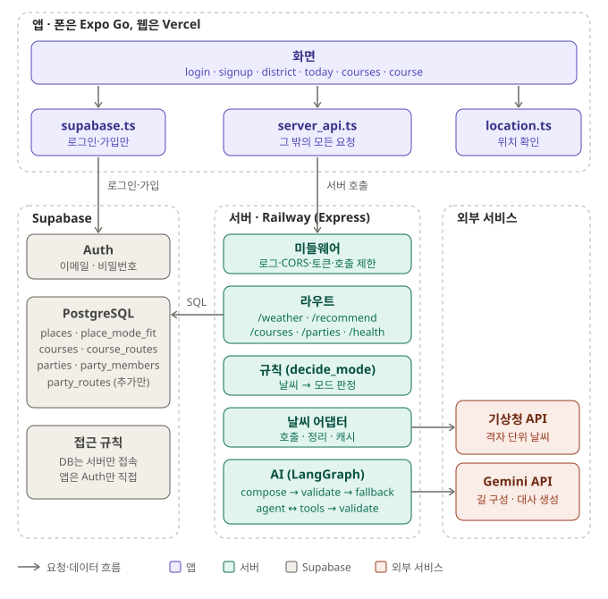
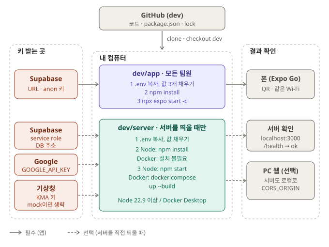
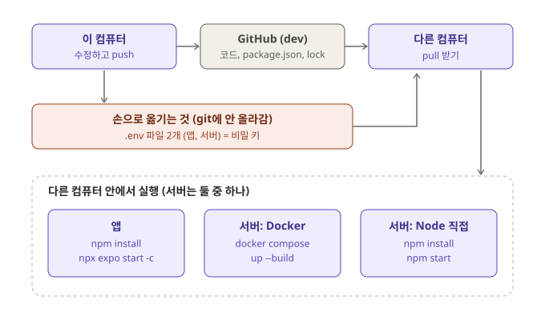

# 팀원 세팅 가이드 v1

- 새 컴퓨터나 새 팀원이 앱과 서버를 돌리기까지의 순서입니다.
- 환경변수 표와 막혔을 때 표는 [README.md](README.md)가 기준입니다. 이 문서는 "처음 하는 사람의 순서"만 다룹니다.
- 작업 규칙(브랜치, 커밋, PR)은 루트 `git-convention.md`를 따릅니다.

## 한눈에 보기

### 1. 서비스 구조



- 앱은 DB에 직접 접속하지 않습니다. 로그인(Auth)만 Supabase에 직접 요청하고, 나머지는 모두 서버를 거칩니다.
- DB 접속 정보와 service role 키, Google 키, 기상청 키는 서버에만 둡니다.
- `location.ts`가 하는 일은 파일 이름만 보고 적었습니다 `[확인 필요]`.

### 2. 세팅 순서



- 실선은 앱 개발에 필수인 길이고, 점선은 서버를 직접 띄울 때만 쓰는 길입니다.
- Google 키를 어디서 발급받는지는 확인하지 못했습니다 `[확인 필요]`. 팀에서 받습니다.

### 3. 코드와 비밀 값이 옮겨지는 길



- 코드와 패키지 목록(`package.json`, `package-lock.json`)은 GitHub로 갑니다.
- 패키지 본체(`node_modules/`)는 올라가지 않습니다. 각자 컴퓨터(또는 Docker 이미지)에서 목록을 보고 설치합니다.
- 비밀 키가 든 `.env`는 올라가지 않습니다. 따로 전달받아야 합니다.

## 나는 어디까지 해야 하나

| 내가 하는 일 | 필요한 것 | 서버를 띄워야 하나 |
|---|---|---|
| 앱 화면 개발 (`dev` 기준) | Git, Node 22.9 이상, `dev/app/.env`, `dev/server/.env` | **예.** Railway는 `main`을 배포해서, `dev`에만 있는 서버 API(프로필, 후보 길 `count`)가 아직 없을 수 있습니다 |
| 앱 화면만 개발 (서버 변경이 전부 `main`에 반영된 때) | Git, Node 22 이상, `dev/app/.env` | 아니요. Railway 서버를 그대로 씁니다 |
| 서버 코드 수정·시험 | 위 + `dev/server/.env` | 예 |
| PC 브라우저로 앱 개발 | 위 + 로컬 서버 | 예 (CORS 때문, 아래 "PC 브라우저" 참고) |

- 판단 기준: `git log origin/main..origin/dev -- dev/server dev/supabase`에 커밋이 나오면 로컬 서버를 띄웁니다. 아무것도 안 나오면 Railway를 써도 됩니다.
- 서버는 `npm start`로 띄웁니다. Docker는 필수가 아닙니다.

## 1. 공통 준비

1. Git과 Node(22 이상)를 설치합니다. 설치 직후에는 터미널을 새로 엽니다.
2. 저장소를 받고 `dev` 브랜치로 이동합니다.

```powershell
git clone https://github.com/k-1026/TREAGENT.git
```

```powershell
cd TREAGENT; git checkout dev
```

## 2. 앱 세팅 (모든 팀원)

1. `.env`를 만듭니다. 실행 위치는 `dev/app`입니다.

```powershell
cd dev/app; copy .env.example .env
```

2. `dev/app/.env`에 3개를 채웁니다. 값은 팀에서 받습니다.

| 변수 | 값 |
|---|---|
| `EXPO_PUBLIC_SERVER_URL` | `https://treagent-production.up.railway.app` (끝에 `/`, 포트 없음) |
| `EXPO_PUBLIC_SUPABASE_URL` | Supabase 프로젝트 주소 |
| `EXPO_PUBLIC_SUPABASE_ANON_KEY` | Supabase anon(공개) 키 |

3. 설치하고 실행합니다.

```powershell
npm install
```

```powershell
npx expo start -c
```

4. 폰은 Expo Go로 QR을 스캔합니다. 같은 Wi-Fi여야 하고, 안 되면 `npx expo start --tunnel`을 씁니다.

- 앱 `.env`에는 서버용 키(`SUPABASE_SERVICE_ROLE_KEY`, `DATABASE_URL`, `KMA_SERVICE_KEY`, `GOOGLE_API_KEY`)를 넣지 않습니다.
- `.env`를 고친 뒤에는 Expo를 끄고 `npx expo start -c`로 다시 시작합니다.

## 3. 서버 세팅 (`dev` 코드로 앱을 개발할 때 필요)

1. `.env`를 만듭니다. 실행 위치는 `dev/server`입니다.

```powershell
cd dev/server; copy .env.example .env
```

2. `dev/server/.env`에 값을 채웁니다. 값은 팀에서 받습니다 (비밀 값 전달 방법은 아래 "비밀 값").

| 변수 | 비고 |
|---|---|
| `SUPABASE_URL`, `SUPABASE_SERVICE_ROLE_KEY`, `DATABASE_URL` | Supabase 대시보드 |
| `GOOGLE_API_KEY`, `GEMINI_MODEL` | 하랑이 대사(AI)용 |
| `WEATHER_SOURCE`, `KMA_SERVICE_KEY` | `WEATHER_SOURCE=mock`이면 기상청 키 없이 가짜 날씨로 동작 |
| `CORS_ORIGIN` | PC 브라우저로 볼 때만 `http://localhost:8081` |
| `PORT` | 비우면 3000 |

3. 둘 중 하나로 실행합니다.

| 방법 | 준비 | 명령 |
|---|---|---|
| Node 직접 | Node 22.9 이상 | `npm install` 후 `npm start` |
| Docker | Docker Desktop (CPU 가상화 필요) | `docker compose up --build` |

4. 확인: 브라우저에서 `http://localhost:3000/health` → `{"status":"ok"}`.

- Docker는 선택입니다. CPU 가상화가 안 되는 PC는 설치하지 말고 `npm start`를 씁니다.
- `profiles` 표 SQL(`dev/supabase/migrations/create_profiles.sql`)이 Supabase에 실행돼 있어야 프로필 API가 동작합니다. 공유 프로젝트면 한 번만 실행하면 됩니다.
- 로컬 서버를 쓰면 `dev/app/.env`의 `EXPO_PUBLIC_SERVER_URL`을 `http://localhost:3000`(같은 컴퓨터) 또는 `http://<서버 컴퓨터 Wi-Fi IP>:3000`(폰)으로 바꿉니다. 다 쓴 뒤에는 Railway 주소로 되돌립니다.

## 4. PC 브라우저로 개발할 때

- 배포된 서버는 `https://treagent-web.vercel.app`만 허용해서 `http://localhost:8081`은 CORS로 막힙니다.
- 로컬 서버를 같이 띄웁니다.
1. `dev/server/.env`에 `CORS_ORIGIN=http://localhost:8081`을 적고 서버를 실행합니다.
2. `dev/app/.env`에 `EXPO_PUBLIC_SERVER_URL=http://localhost:3000`을 적습니다.
3. `dev/app`에서 `npx expo start -c --web`을 실행합니다.

## 5. 패키지를 새로 설치했을 때

- 설치한 사람:
1. 설치하는 폴더(`dev/app` 또는 `dev/server`)에서 설치합니다. 앱은 `npx expo install 이름`, 서버는 `npm install 이름`입니다.
2. 바뀐 `package.json`과 `package-lock.json`을 **둘 다** 커밋하고 PR로 `dev`에 올립니다.
- 받는 사람 (`dev`를 pull한 뒤):

| 대상 | 할 일 |
|---|---|
| 앱 | `dev/app`에서 `npm install` |
| 서버 (Node 직접) | `dev/server`에서 `npm install` |
| 서버 (Docker) | `docker compose up --build` (이미지가 목록을 보고 다시 설치) |

- pull만 하고 설치를 안 하면 "Cannot find package" 오류가 납니다.
- `node_modules/`를 USB나 압축 파일로 옮기지 않습니다. OS가 다르면 깨질 수 있습니다.
- 서버의 Railway 배포는 `package-lock.json`으로 설치합니다(`npm ci`). lock 파일을 빼고 올리면 배포가 실패할 수 있습니다.
- 배포 서버에서 쓰는 패키지는 개발용(`-D`)으로 설치하지 않습니다. Railway는 개발용 패키지를 설치하지 않습니다 (`--omit=dev`).

## 6. 비밀 값(.env) 다루기

- `.env`는 GitHub에 올라가지 않으므로 컴퓨터마다 직접 만듭니다.
- 키는 채팅, GitHub, 스크린샷에 올리지 않습니다. USB 같은 안전한 방법으로 전달하거나, Supabase 대시보드에서 다시 복사합니다.
- 노출된 적이 있는 키는 새로 발급합니다.
- 새 환경변수가 생기면 `.env.example`에도 이름을 적고, Railway Variables와 Vercel Environment Variables에도 반영합니다.

## 7. DB (Supabase)

- 같은 Supabase 프로젝트를 쓰면 SQL을 다시 실행할 필요가 없습니다.
- 팀원마다 자기 프로젝트를 쓰면 `dev/supabase/README.md`의 "실행 순서"대로 SQL Editor에서 실행합니다.
- `[확인 필요]` 팀 공유 프로젝트와 개인 프로젝트 중 어느 쪽을 쓰는지는 아직 정해지지 않았습니다 (`dev/CLAUDE.md` 결정 필요).

## 8. 막혔을 때

| 증상 | 확인 |
|---|---|
| `npm`, `node`를 찾을 수 없음 | 설치 후 터미널을 새로 열었는지 |
| Cannot find package | pull 후 `npm install`(또는 Docker `--build`)을 했는지 |
| 앱에 "서버에 연결하지 못했어요" | `dev/app/.env`의 서버 주소, 저장 후 `npx expo start -c`로 재시작했는지 |
| 웹에서만 서버 오류 | `CORS_ORIGIN`이 웹 주소와 글자 그대로 같은지 |
| 3000 포트 충돌 | `docker ps`로 떠 있는 컨테이너 확인 후 `docker stop <이름>` |
| Docker가 안 켜짐 | CPU 가상화(BIOS), WSL2. 안 되면 `npm start` |

- 더 많은 증상은 [README.md](README.md)의 "막혔을 때"를 봅니다.

## 결정 필요

- DB 공유 방식 (팀 공유 프로젝트 / 팀원별 프로젝트)
- Node 팀 기준 버전 (권장 22)
- 비밀 값을 팀원에게 전달하는 표준 방법

## 출처

- `dev/README.md` (환경변수 위치, 서버 실행, PC 브라우저 개발)
- `dev/server/package.json` (`engines`, `scripts`), `dev/server/Dockerfile` (`npm ci --omit=dev`), `dev/server/docker-compose.yml`
- `dev/app/.env.example`, `dev/server/.env.example`
- `dev/supabase/README.md` (실행 순서)
- `.gitignore`, `dev/app/.gitignore` (`.env`, `node_modules/` 제외)
- `git remote get-url origin` (저장소 주소)
