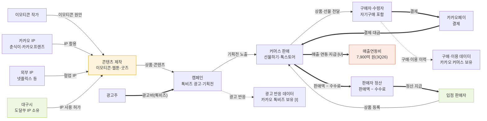

# 카카오 흐름도 v0 — 상품·돈·데이터

작성일: 2026-11-06 · 입력: [stakeholders.md](stakeholders.md), [activities_v0.md](activities_v0.md), [onepager.md](../onepager.md)

## 표기 약속
| 선 | 뜻 | 라벨 |
|---|---|---|
| `A --> B` 실선 | 상품·활동의 흐름 | 무엇이 넘어가는지 |
| `B ==> A` 굵은 선 | 돈의 흐름 | 수수료·정산 |
| `B -.-> A` 점선 | 데이터의 흐름 | 데이터 이름과 보유자 |

색 상자: 주황 = 병목 · 연두 = 기회 · 빨강 = 비용

겹침을 막으려고 같은 두 노드 사이에 화살표가 양방향으로 가지 않게 했다. 판매 수수료·정산은 `정산 처리` 노드를 따로 두고, 구매·이용 데이터와 광고 반응 데이터는 보유자를 담은 데이터 노드로 보냈다.

## 색 상자가 뜻하는 것
| 색 | 노드 | 이유 | 근거 |
|---|---|---|---|
| 병목 (주황) | 콘텐츠 제작 | 웹툰·웹소설 성장 둔화, 스토리 매출 −17% | [출처 03][출처 13][출처 14] |
| 기회 (연두) | 입점 판매자 | 선물하기·톡스토어 입점, 지역 상품이 들어갈 자리 | [출처 01] [I] |
| 기회 (연두) | 대구시 | 도달쑤 IP 협업 가능성. 상업 이용은 서면 확인 전까지 불가 | [출처 12] |
| 비용 (빨강) | 매출연동비 | 3Q26 7,900억 원. 지급 상대는 원페이지에 없음 | [출처 03] [U] |

## 점검
- 실선·굵은 선·점선 세 종류를 모두 썼다.
- 판매 수수료 요율, 매출연동비 수취인, 판매자가 보는 데이터 범위는 원페이지에 없어 [U]로 표시했다. 판매자가 보는 데이터 화살표는 겹침을 피하려고 뺐다.
- 광고 반응 데이터는 원페이지에 근거가 없어 [I]로 표시했다.
- 도달쑤 상업 이용은 서면 확인 전 판매·협업이 가능하다고 쓰지 않는다 [CLAUDE.md 1절].
