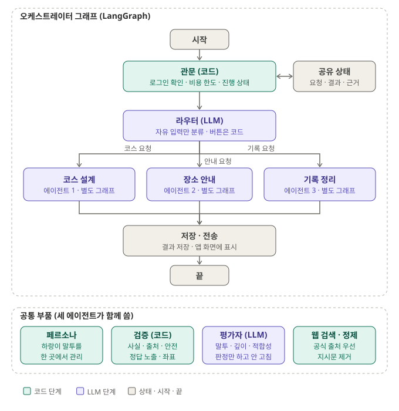
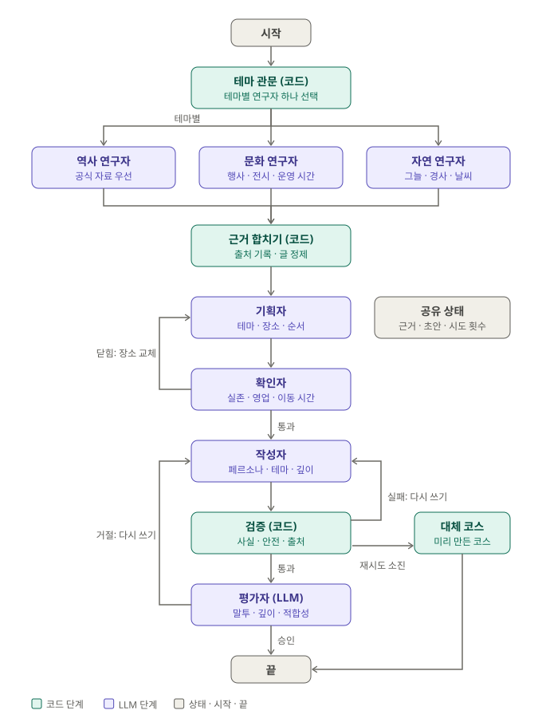
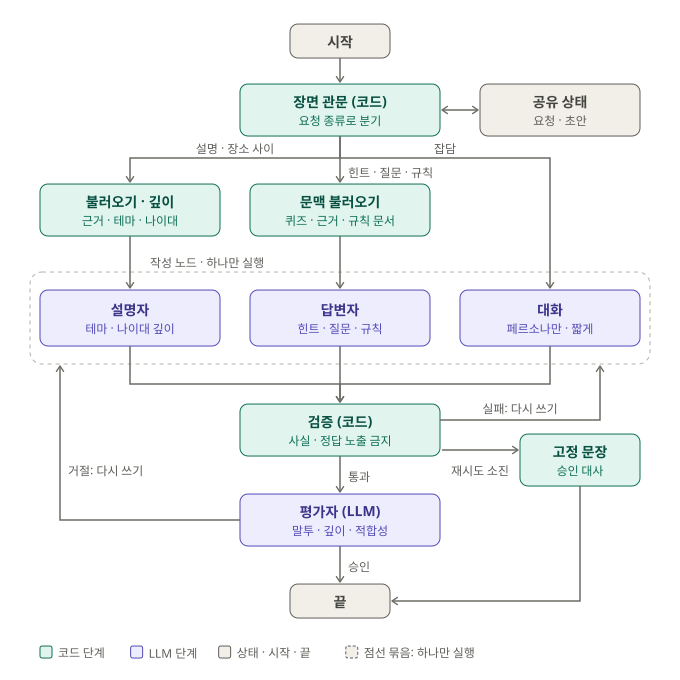
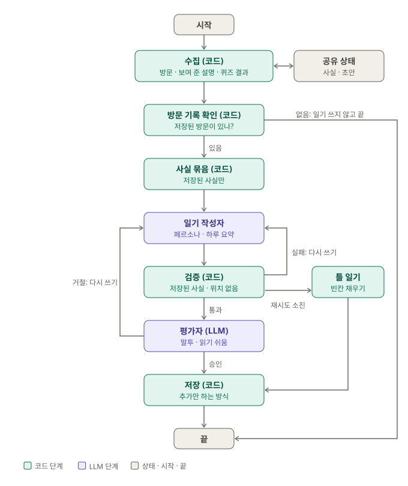
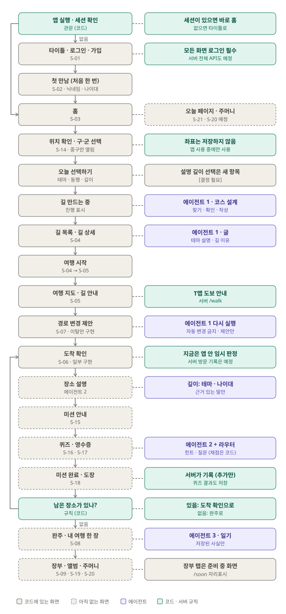
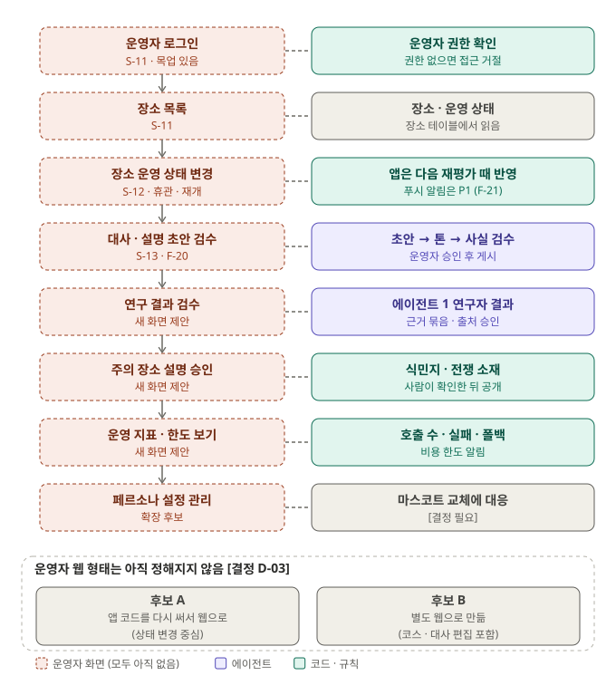
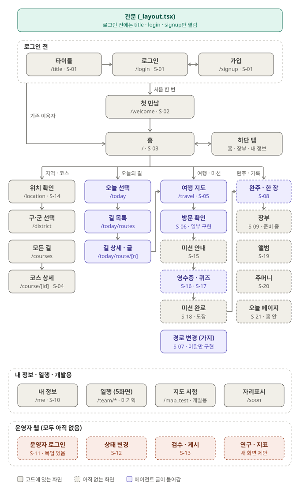
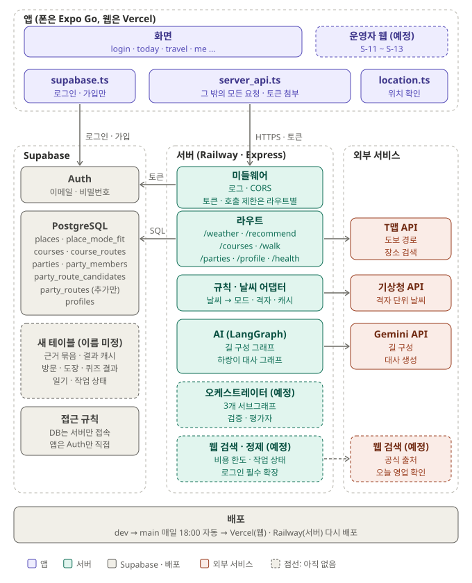

# 에이전트 구조 설계 v1

- 작성일: 2026-11-23
- 상태: 초안. 팀 확인 전입니다. `[결정 필요]`, `[확인 필요]`가 붙은 항목은 확정이 아닙니다.
- 기준 코드: `origin/dev` 066ae43 (2026-11-23에 가져온 시점)
- 이 문서의 위치: 기능·기술 명세 [treagent_tech_spec_v1.md](treagent_tech_spec_v1.md) 15장(에이전트·LLM 기술 스택)을 **이어서 구체화하고, 일부를 바꾸자고 제안**하는 문서입니다. 바꾸는 점은 2장에 모았습니다.
- 그림은 모두 SVG이고 `agent_architecture_v1_images/` 폴더에 있습니다.

## 1. 한눈에 보기

- 에이전트는 3개입니다 (사용자 결정 2026-11-23, 팀 확인 전).
  - 에이전트 1 코스 설계: 웹·지도로 장소를 찾고, 오늘 영업을 확인해 길을 짭니다.
  - 에이전트 2 장소 안내: 장소 설명, 장소 사이 설명, 힌트, 질문 답변, 게임 규칙 답변을 합니다.
  - 에이전트 3 기록 정리: 방문 기록으로 일기를 씁니다.
- 공통 부품: 라우터(LLM), 검증(코드), 평가자(LLM), 페르소나, 웹 검색·정제.
- 원칙: **LLM이 찾고 쓰고, 코드가 거부권을 가집니다.** 안전·점수·도장·인증은 LLM이 판정하지 않습니다.
- 퀴즈 문항·정답·채점은 고정 데이터로 두고 에이전트가 만들지 않습니다.
- 어느 단계가 실패해도 마지막에는 미리 만든 안전한 결과(대체 코스, 승인 대사, 틀 일기)로 내려갑니다.

## 2. 기획서 15장과의 관계

### 2-1. 이어받는 것

| 항목 | 기획서 | 이 문서 |
|---|---|---|
| 모든 생성문은 검증을 통과해야 보임 | 15-1 | 같음 |
| LLM은 서버에서만 호출, 키는 앱에 두지 않음 | 15-1 | 같음 |
| 안전·인증·기본 안내는 승인 대사 | 15-1 | 같음 (안전 안내는 고정 문장) |
| 아무것도 못 하면 승인 대사로 내려감 | 15-1 | 같음 (폴백) |
| 검증 2단: 코드 규칙 → 필요할 때만 판정 LLM | 15-7 | 같음 (검증 코드 + 평가자) |
| 작성자와 검증자는 서로 다른 지침 | 15-7 | 같음 |
| 정답 문자열은 LLM 입력에서 제외 | 15-7 미스터리 | 같음 (힌트 답변) |
| 조회 도구는 읽기 전용 | 15-5, dev/CLAUDE.md | 같음 |
| 상태 그래프(LangGraph)로 분기·재시도·폴백 | 15-6 | 같음 (코드에 이미 있음) |

### 2-2. 달라지는 점 (팀 확인 필요)

| 기획서의 원칙 | 이번 제안 | 영향 | 결정 |
|---|---|---|---|
| 경로 결정은 규칙 엔진이 하고 에이전트를 쓰지 않음 (15-1, 15-7 "에이전트를 쓰지 않는 곳") | **LLM이 웹·지도로 장소를 찾아 코스를 설계**하고, 실존·영업·안전은 코드가 검증해 거부 | 기획서의 핵심 원칙이 바뀜. 틀린 장소·휴관 위험이 새로 생김 | `[결정 필요]` |
| P0는 LLM 없이 승인 대사로 시연, LLM은 P1 (15장 첫머리) | 지금 구현에 포함 | 이미 코드에 길 구성·대사 그래프가 있음 (3장) | `[결정 필요]` |
| 하랑이 질의 에이전트 3개: 근거 수집·대사 작성·검증 (15-7, D-15) | 에이전트 3개(코스 설계·장소 안내·기록 정리) 아래에 서브에이전트를 둠 | 지연·비용·장애 지점 증가 (15-7이 경고한 점) | `[결정 필요]` |
| 자유 입력은 D-16 B로 허용할 때 다시 검토 (15-7) | 질문·힌트·잡담 자유 입력을 라우터로 받음 | 안전 분기와 비용 한도가 더 중요해짐 | `[결정 필요]` |
| 대사 초안은 운영자가 승인한 문장만 게시 (F-20, 15-7) | 실시간 생성문은 자동 검증·평가자를 통과하면 표시. 운영자 승인은 `주의` 장소와 연구 결과 검수에 둠 | 승인 전 노출이 생김. 폴백은 승인 대사 | `[결정 필요]` |
| 장소 근거는 검수된 자료(RAG) (15-4) | 웹 검색으로 근거를 모으고, 출처 없는 말은 하지 않음 | 근거의 신뢰도가 검수 자료보다 낮음 | `[결정 필요]` |

- 위험의 완충: 코드 검증, 평가자, 폴백, 운영자 승인(`주의` 장소), 출처 필수.
- 이 6개가 팀 결정을 받기 전에는 구현을 시작하지 않는 것이 안전합니다. 구현 순서는 12장에 있습니다.

## 3. 현재 구현 상태 (코드 확인)

| 구분 | 내용 | 근거 |
|---|---|---|
| 있음 | LangGraph 길 구성 그래프 (구성 → 검증 → 재시도 → 규칙 폴백) | dev/server/src/ai/compose_graph.js:61-69 |
| 있음 | 하랑이 대사 그래프 (에이전트 ↔ 조회 도구 → 검증 → 폴백) | dev/server/src/ai/harangi_graph.js:91-101 |
| 있음 | 조회 전용 도구 2개 (장소 정보, 오늘 상황) | dev/server/src/ai/harangi_tools.js:49 |
| 있음 | 방문 순서와 소요 시간은 코드가 정함 | dev/server/src/ai/compose_route.js:85-88 |
| 있음 | 하랑이 페르소나 프롬프트 | dev/server/src/ai/harangi_persona.js:7 |
| 있음 | 앱 로그인 관문 (로그인 전에는 title·login·signup만 열림) | dev/app/src/app/_layout.tsx:59-62 |
| 있음 | `/parties`, `/profile`의 토큰 검증 | dev/server/src/app.js:102-106 |
| 있음 | T맵 도보 경로와 장소 검색 서버 API | dev/server/src/app.js:108 (`/walk`) |
| 있음 | 여행 화면: T맵 길 안내, 이탈하면 새 경로 제안, 도착 판정(30m, 앱 안 임시값) | dev/app/src/app/travel.tsx:20-23, 136-176 |
| 일부 | 도착 확인 뒤 "미션 자리"는 비어 있고 서버의 방문 기록·도장은 아직 없음 | dev/app/src/app/travel.tsx:45, 159 (`TODO(PR F)`) |
| 없음 | `/weather`, `/recommend`, `/courses`, `/walk`는 로그인 없이 호출 가능 | dev/server/src/app.js:100-108 |
| 없음 | 방문·도장·퀴즈 결과·일기 테이블 | dev/supabase/migrations/ (places, courses, place_mode_fit, parties, party_route_candidates, profiles 만 있음) |
| 없음 | 웹 검색, 웹 글 정제, 연구자, 확인자, 평가자, 라우터, 장소 안내, 기록 정리, 진행 표시, 일일 비용 상한 | 이 문서의 제안 |

- 현재 페르소나는 하랑이 그래프(시작·도착·브리핑 장면)에만 있고, 길 구성 에이전트의 이유 문장은 중립 문장입니다 (prompt.js:33).
- 현재 페르소나는 "장소의 사연이나 유래는 넣지 않는다"로 묶여 있어 장소 설명과 맞지 않습니다 (harangi_persona.js:19).

## 4. 오케스트레이션과 LangGraph (용어와 읽는 법)

| 용어 | 뜻 | 이 문서에서 |
|---|---|---|
| LangChain | 모델 호출·프롬프트·도구 정의 같은 부품 모음 | 도구와 메시지 형식에 사용 중 |
| LangGraph | 단계(노드)와 연결(엣지)을 그래프로 그리고 공유 상태를 들고 다니며 분기·재시도를 맡는 실행기 | 모든 에이전트가 서브그래프 |
| 노드 / 엣지 / 조건부 엣지 | 한 단계 / 다음 단계로 가는 길 / 상태를 보고 코드가 고르는 갈림길 | 그림의 상자 / 화살표 / 갈라지는 화살표 |
| 서브그래프 | 자기 노드와 상태를 가진 작은 그래프 | 에이전트 1·2·3 |
| 오케스트레이션 | 여러 단계와 에이전트를 순서·병렬·분기·실패 처리까지 조율하는 계획 | 최상위 그래프(그림 1장) |
| 서브에이전트 | 한 가지 역할만 맡는 LLM 노드 | 연구자, 기획자, 확인자, 작성자 등 |
| 라우터 | 자유 입력이 어느 에이전트의 일인지 나누는 노드 | LLM 1개. 버튼 요청은 코드가 바로 분기 |
| 평가자 | 코드가 못 보는 말투·깊이·적합성을 판정하는 LLM | 판정과 이유만 돌려주고 고치지 않음 |

- 오케스트레이터는 **순서가 정해진 그래프**입니다. LLM이 다음 단계를 정하는 감독자형이 아니라서 결과를 예측할 수 있습니다.
- 모든 되돌이(재시도, 다시 쓰기)에는 횟수 제한이 있고, 다 쓰면 폴백으로 갑니다. 횟수 상한은 `[결정 D-19]`입니다 (기획서 15-6).
- 장소별 병렬 조사 기능은 설치된 LangGraph 버전의 공식 문서로 사용법을 확인한 뒤 씁니다 `[확인 필요]` (dev/CLAUDE.md 절대 규칙 7).

## 5. 에이전트별 설계

### 5-1. 에이전트 1 · 코스 설계

| 항목 | 내용 |
|---|---|
| 실행 시점 | 이용자가 "오늘 선택하기"를 확정했을 때. 서버에서 비동기 작업으로 돌고 앱은 진행 표시를 보여 줌. 같은 날·같은 조건의 결과는 저장해서 재사용 |
| 입력 | 날씨 모드(코드가 판정), 시각·요일, 구·군, 테마, 동행, 설명 깊이. **좌표는 LLM·외부 검색에 보내지 않음** (절대 규칙 1) |
| 도구 | 웹 검색, 웹 글 정제, 지도 장소 검색, 도보 경로·시간(T맵), 저장된 장소 자료 조회 |
| 출력 | 길 3곳(코스 3곳은 기존 결정, 기획서 1-3절 #4), 테마 설명, 길 이유, 근거 묶음(출처, 확인일) |
| 검증(코드) | 장소 수, 지도에서 실존 확인, 오늘 영업(공식 휴관 공지 없음 + DB 정규 시간대), 모드 규칙(폭염이면 실내 위주 등), 이동 시간 상한, 출처 존재, 금칙어 |
| 폴백 | 미리 만든 대체 코스 (지금의 검수된 코스) |
| 저장 | 근거 묶음, 생성 결과 (새 테이블, 12장) |

- 연구자는 테마마다 프로필이 다릅니다 (6장). 선택된 테마의 연구자 하나만 실행합니다.
- 확인자는 안전한 쪽으로만 믿습니다.
  - 공식 출처의 휴관 공지가 있으면 후보에서 뺍니다.
  - 못 찾으면 DB의 정규 운영 시간대로 판단합니다.
  - 열려 있다는 글이 있어도 DB가 닫힘이면 닫힌 것으로 봅니다.
- 경로가 바뀌어야 할 때(날씨 변화, 휴관)는 에이전트 1을 새 조건으로 다시 실행하고, 이용자에게 **제안**만 합니다. 자동으로 바꾸지 않습니다 (dev/CLAUDE.md).

### 5-2. 에이전트 2 · 장소 안내

| 항목 | 내용 |
|---|---|
| 실행 시점 | 장소 설명·장소 사이 설명은 코스를 만들 때 미리 만들어 저장하고 도착 때 보여 줌. 힌트·질문·규칙·잡담은 이용자가 누를 때 실시간 |
| 입력 | 장소 id, 근거 묶음, 테마, 설명 깊이, 장면, 현재 퀴즈 문항(**정답 문자열은 제외**) |
| 도구 | 읽기 전용 조회(장소 정보, 오늘 상황), 장소 id로 한정한 근거 검색, 게임 규칙 문서 |
| 출력 | 하랑이 말투 문장과 사용한 근거 id |
| 검증(코드) | 근거 id 존재, 금칙어, 정답 노출 금지, 안전 문구, 길이 |
| 폴백 | 고정 문장(승인 대사) |
| 퀴즈 | 문항·정답·채점은 고정 데이터와 서버 코드. 에이전트는 힌트 말투와 질문 답변만 |

- 설명 깊이는 같은 근거에서 사실의 양·어휘·배경 설명을 다르게 하는 것입니다 (7장).
- 근거가 없는 질문에는 "그건 잘 모르겠어요"라고 답합니다. 지어내지 않습니다.
- 대화 노드는 사실을 말하지 않고 페르소나로 짧게만 답합니다.

### 5-3. 에이전트 3 · 기록 정리

| 항목 | 내용 |
|---|---|
| 실행 시점 | 완주(여행 종료) 직후 1회. 결과를 저장 |
| 입력 | 사실 묶음: 방문한 장소와 시각, 그날 보여 준 설명, 퀴즈 결과, 도장. 호칭(닉네임 또는 길동무) |
| 검증(코드) | 사실 묶음 밖의 문장 금지, 좌표·이동 경로 금지, 금칙어, 길이 |
| 폴백 | 사실을 빈칸에 채우는 틀 일기 |
| 저장 | 일기. 추가만 하는 방식 (절대 규칙 3) |

- 방문 기록이 없으면 일기를 쓰지 않고 끝납니다.
- 이 에이전트가 동작하려면 **방문·도장·퀴즈 결과가 서버에 저장되어 있어야** 합니다. 지금은 없습니다 (3장). 따라서 기존 계획의 PR F(방문 기록·도장)가 선행입니다 (dev/CLAUDE.md PR 순서).
- 퀴즈 결과를 일기에 어디까지 쓸지는 `[결정 필요]`입니다.

### 5-4. 공통 부품

| 부품 | 역할 | 비고 |
|---|---|---|
| 라우터 (LLM) | 자유 입력을 코스·안내·기록 중 하나로 나누고, 안내 안에서는 질문·힌트·규칙·잡담으로 나눔. 위험한 표현은 고정 안내로 보냄 | 버튼 요청은 라우터를 거치지 않고 코드가 분기 |
| 검증 (코드) | 사실·출처·안전·금칙어·정답 노출·좌표를 검사 | 기존 검증기를 재사용·확장 (validate_composition.js, harangi_validate.js) |
| 평가자 (LLM) | 말투·깊이·적합성을 판정해 {통과/거절, 이유}만 돌려줌 | 고치지 않음. 거절하면 작성자가 다시 씀. 안전은 평가자가 통과시켜도 코드가 최종 판단 |
| 페르소나 | 하랑이 말투를 한 곳에서 관리하고 모든 작성 노드가 같이 씀 | 설명용 규칙은 따로 둠 (3장). 안전 안내는 페르소나를 쓰지 않음 |
| 웹 검색·정제 | 공식 출처 우선 검색, 본문만 뽑고 지시문처럼 보이는 문구 제거 | 웹 글은 데이터로만 읽음 (프롬프트 인젝션 방어) |

## 6. 테마별 연구자 프로필

- 연구자는 틀 하나에 테마별 프로필(지시문, 검색 전략, 믿을 출처, 확인 항목)을 끼우는 방식입니다. 테마가 늘면 프로필만 추가합니다.
- 테마 3개(역사, 문화, 자연)는 코드에서 "후보 A, 팀 확정 전"입니다 (dev/server/src/ai/route_options.js:9-11) `[결정 필요]`.

| 테마 | 찾는 방식 | 특히 확인할 것 |
|---|---|---|
| 역사 | 공식 기관·박물관·자치단체 자료 위주. 근거 없는 사연은 쓰지 않음 | 사실마다 출처. 식민지·전쟁 소재는 `주의`로 표시하고 사람이 검수 (CLAUDE.md 민감한 소재) |
| 문화 | 전시·공연·행사 일정 | 오늘 열었는지, 전시 기간, 요금 |
| 자연 | 날씨·그늘·경사·계단·쉴 곳 | 폭염·한파·우천 때 실내 대안 |

- 믿을 출처 목록은 아직 없습니다 `[확인 필요]`.

## 7. 설명 깊이와 페르소나

- 깊이는 같은 근거에서 **사실의 양, 어휘, 배경 설명**을 다르게 하는 것입니다. 나이에 따라 다른 사실을 말하지 않습니다. 검증은 같은 근거 범위로 합니다.
- 축: 테마(무엇을 강조), 나이대(10대~60대 이상, route_options.js:4-7), 동행(혼자·친구와·아이와 함께, route_options.js:14-15).
- 기존 규칙과 충돌합니다. 길 구성 프롬프트는 "나이대는 걷는 양과 말투를 조절하는 데만 쓰고 나이로 취향을 단정하지 않는다"입니다 (prompt.js:41).
- 제안: 깊이를 이용자가 고르는 선택지로 하고, 나이대와 아이 동행은 **기본값**만 정합니다 `[결정 필요]`.
- 깊이 단계 이름 (창작, 후보 2개, 결정은 팀)
  - 후보 1: 쉽게 / 보통 / 자세히
  - 후보 2: 가볍게 / 알차게 / 깊이
- 페르소나는 한 곳에 두고 길 이유, 테마 설명, 장소 설명, 장소 사이 설명, 대화, 일기가 같이 씁니다.
- 말투를 입힌 뒤의 문장을 검증합니다. 사실을 먼저 쓰고 말투만 바꾸는 2단 호출은 호출이 두 배가 되고 사실이 바뀔 수 있어 쓰지 않습니다.
- 페르소나를 교체 가능한 설정으로 분리해 두면, 납품처가 다른 마스코트를 요청하는 경우 설정만 바꿔 대응할 수 있습니다 (plan/feedback/20261113_presentation_feedback_v1.md 9장). 캐릭터 생성 에이전트 자체는 이번 구현에서 제외합니다 `[결정 필요]`.

## 8. 에이전트 운영 방식

| 항목 | 내용 | 상태 |
|---|---|---|
| 호출 시점 | 설명류는 코스를 만들 때 미리, 질문·힌트·일기는 그때그때 | 제안 |
| 진행 표시 | 코스 설계는 수십 초가 걸릴 수 있어 작업 id와 상태(찾는 중, 확인 중, 쓰는 중)를 저장하고 앱이 주기적으로 확인 | 없음. 새로 필요 |
| 결과 저장(캐시) | 같은 날·같은 조건의 코스와 설명은 재사용. 이용자별 결과(일기)는 따로 | 기존 캐시의 저장 방식 `[확인 필요]` (route_cache.js) |
| 비용 가드 | 이용자별 횟수 제한, 일일 상한, 한 번의 코스 생성에 쓸 수 있는 호출 수 상한, 시간 제한 | 요청 횟수 제한은 `/recommend`에 일부. 나머지는 새로 필요 |
| 로그인 필수 | 서버 모든 API에 토큰 검증. 로그인 없이 부르면 LLM 비용을 아무나 쓰게 됨 | 3장 참고. 선행 작업 |
| 추적·로그 | 단계별 성공·실패·폴백 이유를 기록. **좌표와 계정 식별자는 남기지 않음** (절대 규칙 1) | 일부 |
| 평가용 테스트 모음 | 장소 몇 곳 × 날씨 모드 × 테마 × 깊이로 매번 통과율·폴백 비율을 비교 | 기획서 15-9의 질문 세트와 연결 |
| 호출 수와 한도 | 테마별 연구, 설계, 확인, 작성, 평가로 호출이 늘어남. 무료 한도에 걸릴 수 있음 | `[확인 필요]` |
| 모델 | LLM 제공자·모델은 `[결정 D-13]`. 현재 코드는 Gemini | dev/README.md (GOOGLE_API_KEY, GEMINI_MODEL) |

## 9. 이용자 유저 플로우

- 근거: 스토리보드 [app_screen_storyboard_v1.md](../../storyboard/app_screen_storyboard_v1.md) 1장, [game_flow_story_v1.md](../../storyboard/game_flow_story_v1.md), 앱 코드 (_layout.tsx:59-62, index.tsx:153, today.tsx:45, today/routes.tsx:69, today/route/[n].tsx:97).
- 실선은 코드에 있는 화면이고 점선은 아직 없는 화면입니다. 일부만 구현된 화면은 부제에 적었습니다.
- 에이전트가 들어가는 곳

| 단계 | 에이전트 | 들어가는 것 |
|---|---|---|
| 길 만드는 중 | 1 | 진행 표시, 찾기·확인·작성 |
| 길 목록·상세 | 1 | 테마 설명, 길 이유 |
| 경로 변경 제안 | 1 | 같은 에이전트를 새 조건으로 다시 실행, 이용자가 고름 |
| 장소 설명 | 2 | 테마와 깊이에 맞춘 설명 |
| 퀴즈·영수증 | 2 + 라우터 | 힌트, 질문 (채점은 코드) |
| 완주·내 여행 한 장 | 3 | 일기 |

- 홈의 "쉼터"와 "주머니" 바로가기는 지금 `/soon` 자리표시 화면으로 갑니다 (index.tsx:162-163).
- 첫 화면 순서(가입 → 첫 만남 → 위치 → 홈)는 스토리보드와 앱이 다릅니다 (plan/app_mockup_gap_check_v1.md 1장) `[확인 필요]`.

## 10. 운영자(공급자) 플로우

- **우리에게도 운영자 쪽이 필요합니다.**
  - 기획서에 운영자 웹(F-18)과 화면 S-11~S-13이 이미 있고, 휴관 시연이 이 기능에 달려 있습니다 (treagent_tech_spec_v1.md 3장, 4-9).
  - 앱에는 운영자 화면이 없고, 목업만 있습니다 (storyboard/operator_web_mockup_v1.html).
- 에이전트 설계에서 운영자의 일이 늘어납니다.
  - 연구자가 모은 근거 묶음과 출처를 검수하고 승인합니다 (새 화면 제안).
  - `주의` 장소(식민지·전쟁 소재)의 설명은 사람이 확인한 뒤 공개합니다.
  - 대사·설명 초안은 톤 검수 → 사실 검수 → 운영자 승인 순서로 게시합니다 (F-20).
  - 호출 수·실패·폴백 비율과 비용 한도를 봅니다 (새 화면 제안).
- 장소 운영 상태를 바꾸면 이용자 앱은 **다음 재평가 때** 반영합니다. 즉시 푸시는 P1(F-21)입니다 (treagent_tech_spec_v1.md 4-9, F-08).
- 결정할 것
  - 운영자 웹의 형태 `[결정 D-03]`: 앱 코드를 다시 써서 웹으로(상태 변경 중심) / 별도 웹(코스·대사 편집 포함).
  - 장소를 운영하는 가게·시설이 직접 상태를 입력하는 **외부 공급자 화면**은 기획서에 없습니다 `[결정 필요]`.
  - 일정이 빠듯하면 운영자 화면은 목업으로 보여 주고, 상태 변경만 최소 기능으로 만드는 안이 있습니다 `[결정 필요]`.

## 11. 앱 화면 구조

- 화면 코드(S-xx)는 기획서 5장 화면 목록(treagent_tech_spec_v1.md:401-423)과 스토리보드를 따릅니다.
- 앱 경로는 `dev/app/src/app/` 폴더 기준입니다.

| 코드 | 화면 | 앱 경로 | 상태 | 에이전트 |
|---|---|---|---|---|
| S-01 | 로그인·가입 | /title, /login, /signup | 구현 | — |
| S-02 | 첫 만남 | /welcome | 구현 | — |
| S-03 | 홈 | / | 구현 (세부 항목은 plan/app_mockup_gap_check_v1.md 3장에서 확인 안 함) | — |
| S-14 | 주변 추천(위치·날씨) | /location, /district | 구현 | — |
| S-04 | 코스 상세·오늘의 길 | /courses, /course/[id], /today, /today/routes, /today/route/[n] | 구현 | 1 |
| S-05 | 여행 지도·진행 | /travel | 구현 (T맵 길 안내) | 2 (글 연결 예정) |
| S-07 | 경로 변경·보류 | /travel 안 | 일부 (이탈 시 새 경로 제안만. 날씨·휴관에 의한 대체 길은 없음) | 1 |
| S-06 | 장소 상세·방문 확인 | /travel 안 | 일부 (도착 판정은 앱 안 임시값 30m, 서버 방문 기록 없음) | 2 |
| S-15 | 미션 안내 | — | 없음 | — |
| S-16 | 영수증 인증 | — | 없음 (에이전트 범위 밖) | — |
| S-17 | 퀴즈 | — | 없음 | 2 (힌트) |
| S-18 | 미션 완료 | — | 없음 (도장 이미지는 앱에 있음, travel.tsx:17) | — |
| S-08 | 완주·내 여행 한 장 | — | 없음 | 3 |
| S-09 | 장부 | /soon (자리표시) | 없음 | — |
| S-19 | 앨범 | — | 없음 | — |
| S-20 | 주머니 | /soon (자리표시) | 없음 | — |
| S-21 | 오늘 페이지(홈 방 안) | — | 없음 | — |
| S-10 | 내 계정 | /me | 구현 | — |
| S-11~S-13 | 운영자 웹 | — | 없음 (목업만) | 연구 결과·초안 검수 |
| — | 일행(팀) | /team, /team/create, /team/join, /team/[id], /team/[id]/candidates | 구현. 기획서 화면 목록에는 없음 `[확인 필요]` | — |
| — | 지도 시험 | /map_test | 개발용 | — |
| — | 자리표시 | /soon | 구현 (장부·쉼터·주머니가 여기로 옴) | — |

- 새로 필요한 화면(제안): 코스 생성 진행 표시, 장소 설명 카드, 질문·힌트 입력(하랑이 말풍선), 일기 화면.

## 12. 앱 · 서버 · DB 연동

- 근거: [dev/README.md](../../dev/README.md), dev/images/service_architecture.svg, dev/server/src/app.js, dev/supabase/migrations/.
- 요청 흐름
  1. 앱이 로그인·가입을 Supabase Auth에 직접 요청합니다 (supabase.ts).
  2. 그 밖의 모든 요청은 server_api.ts가 서버(Railway)로 보내고, 보호된 API에는 토큰을 붙입니다.
  3. 서버는 DB(Supabase PostgreSQL)에 SQL로만 접속합니다. 앱은 DB에 직접 접속하지 않습니다.
  4. 서버가 기상청, T맵, Gemini 같은 외부 서비스를 호출합니다. 비밀 키는 서버에만 있습니다 (dev/README.md).
  5. 새로 필요한 것: 웹 검색, 오케스트레이터와 서브그래프, 작업 상태, 새 테이블 (점선).

### 12-1. 서버 API의 로그인 검사 (현재와 목표)

| 경로 | 현재 | 목표 |
|---|---|---|
| /health | 없음 | 공개 유지 |
| /weather | 없음 | 로그인 필수 |
| /recommend | 없음 (요청 횟수 제한이 일부 있음) | 로그인 필수 |
| /courses | 없음 | 로그인 필수 |
| /walk | 없음 | 로그인 필수 |
| /parties | 토큰 검증 있음 | 유지 |
| /profile | 토큰 검증 있음 | 유지 |

- 근거: dev/server/src/app.js:97-108.
- 서버를 막으면 앱의 server_api.ts에서 코스·경로·오늘의 길·도보 요청 함수가 토큰을 보내도록 함께 고쳐야 합니다. 서버 테스트도 가짜 검증기를 넣어야 합니다.
- 앱 관문(_layout.tsx)은 로그인 전에 이동 화면과 보호 화면을 동시에 그립니다. 이동만 그리도록 보강해야 합니다 (보호 화면이 잠깐 마운트되어 호출이 나갈 수 있음).
- 앱 화면 가드는 표시용이고, 진짜 보호는 서버가 합니다.

### 12-2. 새 테이블 (제안, 이름과 항목은 BE가 정함)

| 용도 | 주요 항목 | 규칙 |
|---|---|---|
| 근거 묶음 | 장소 id, 테마, 요약 문장, 출처 주소, 확인일, 검수 상태 | 좌표를 넣지 않음 |
| 생성 결과 캐시 | 종류(테마·장소·장소 사이), 조건 키, 문장, 근거 id, 검증 결과, 만든 시각 | 이용자 식별자를 넣지 않음 (공용) |
| 방문·도장 | 이용자, 여행, 장소, 시각 | (여행, 장소) 유니크 (절대 규칙 4), 추가만 (절대 규칙 3) |
| 퀴즈 결과 | 이용자, 여행, 장소, 맞힌 수, 힌트 사용 수 | 서버가 계산, 추가만 |
| 일기 | 이용자, 여행, 본문, 사용한 사실 id | 추가만, 좌표 없음 |
| 작업 상태 | 작업 id, 종류, 단계, 시작·끝 시각 | 좌표 없음 |

- DB 구조 변경은 항상 새 SQL 파일로 추가하고 이미 올린 파일은 고치지 않습니다 (dev/CLAUDE.md).

## 13. 구현 순서 (제안)

| 순서 | 할 일 | 선행·메모 |
|---|---|---|
| 1 | 로그인 필수화 (서버 전 API + 앱 관문 보강) | 비용 보호. 가장 먼저 |
| 2 | 페르소나 공용화 + 장소 설명 한 줄기 (코스 C01 3곳, 저장된 자료로) | 설명용 규칙 결정 필요 |
| 3 | 방문·도장·퀴즈 결과 저장 (기존 PR F) | 기록 정리의 선행 |
| 4 | 웹 검색·정제 + 연구자(테마 프로필) | 무료 한도 확인 |
| 5 | 확인자 (실존·영업·이동 시간) | T맵 API 재사용 |
| 6 | 오케스트레이터 + 라우터 + 장소 사이 설명 + 힌트·질문 | 진행 표시와 비용 한도 함께 |
| 7 | 기록 정리 + 평가자 | 3번 이후 |
| 8 | 운영자 화면(최소) | 형태 D-03 결정 후 |

- 한 줄기를 끝까지 먼저 만들면, 폴백 덕분에 어느 단계에서 멈춰도 동작합니다.
- 일정과 호출 수는 추정입니다. 제출(11/30)까지 어디까지 할지는 팀이 정합니다 `[결정 필요]`.

## 14. 결정 필요

- [ ] 2-2장의 6가지 변경(경로 결정을 LLM에게, 지금 구현에 포함, 에이전트 구성, 자유 입력, 운영자 승인 범위, 웹 근거)
- [ ] 테마 3개(역사, 문화, 자연) 확정 여부
- [ ] 설명 깊이 단계 이름과 나이대·동행 연결 방식 (7장)
- [ ] 새로 찾은 장소의 퀴즈 처리 (퀴즈 있는 장소만 코스에 / 설명만 / 퀴즈도 생성하되 검수 전에는 도장과 연결하지 않음)
- [ ] 일기에 퀴즈 결과를 어디까지 쓸지, 일기 길이
- [ ] `주의` 장소의 말투 수위와 검수 방식
- [ ] 설명의 글자 수·문장 수 상한 (현재 대사는 100자 이내, harangi_config.js)
- [ ] 웹 검색의 믿을 출처 목록
- [ ] 이동 시간 상한과 한 코스의 호출 수 상한
- [ ] 재시도 횟수 상한 (D-19)
- [ ] LLM 제공자·모델 (D-13), 판정용 모델을 작성용과 나눌지
- [ ] 운영자 웹의 형태 (D-03)와 외부 공급자 화면 여부
- [ ] 제출(11/30)까지 구현할 범위
- [ ] 캐릭터 생성 에이전트의 범위

## 15. 확인 필요

- [ ] LLM과 웹 검색의 무료 한도
- [ ] 설치된 LangGraph 버전의 병렬 실행 사용법
- [ ] 코스 캐시의 저장 방식 (서버를 다시 켜면 사라지는지)
- [ ] 장소 설명·퀴즈 결과의 DB 저장 위치
- [ ] `/team`(일행) 화면의 진입 경로와 기획서 근거
- [ ] 홈 화면 세부 구현 (plan/app_mockup_gap_check_v1.md 3장이 확인하지 않은 항목)
- [ ] 코스 C01의 장소 수와 장소별 근거 자료 유무
- [ ] 기획서 15장의 D-13~D-19 현재 결정 상태

## 출처

- dev/server/src/ai/compose_graph.js:61-69, harangi_graph.js:91-101, harangi_tools.js:49, compose_route.js:85-88, prompt.js:33·41, harangi_persona.js:7·19, route_options.js:4-15
- dev/server/src/app.js:97-108
- dev/app/src/app/_layout.tsx:59-62, index.tsx:153·161-163, today.tsx:45, today/routes.tsx:69, today/route/[n].tsx:97, travel.tsx:17·20-23·45·136-176·159, components/bottom_tab.tsx:16-18
- dev/README.md, dev/images/service_architecture.svg, dev/supabase/migrations/
- plan/spec/treagent_tech_spec_v1.md (3장, 4-9, 5장 401-423행, 15장 15-1~15-7)
- storyboard/app_screen_storyboard_v1.md, storyboard/game_flow_story_v1.md, storyboard/operator_web_mockup_v1.html
- plan/app_mockup_gap_check_v1.md, plan/daeprica_hidden_quest_plan.md 8장
- plan/feedback/20261113_external_feedback_v1.md, plan/feedback/20261113_presentation_feedback_v1.md 9장
- brand/quiz_free_places_v1.md
- dev/CLAUDE.md (절대 규칙 1~4·7, PR 순서), CLAUDE.md (민감한 소재, 개인정보)
- 사용자가 채팅으로 정한 방향 (2026-11-23)
