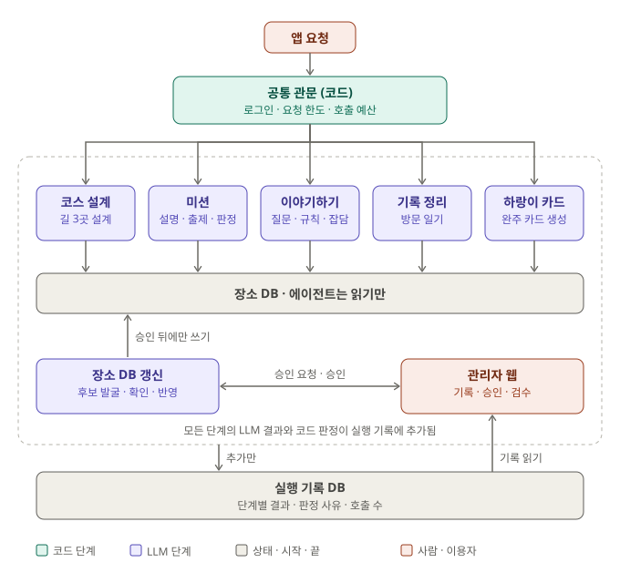
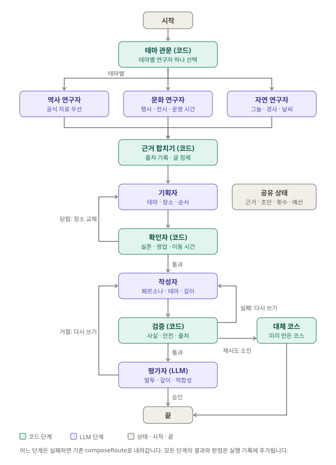
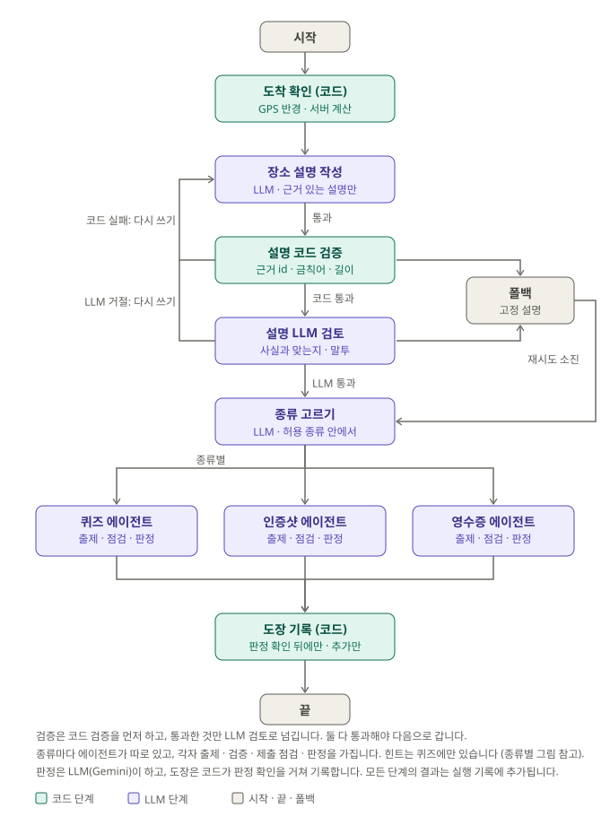
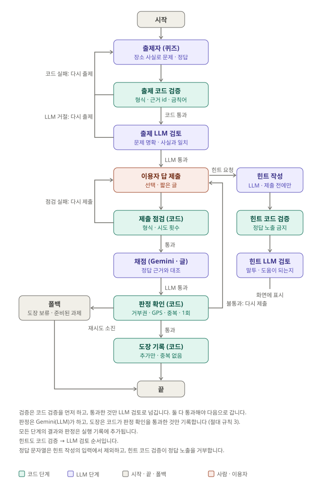
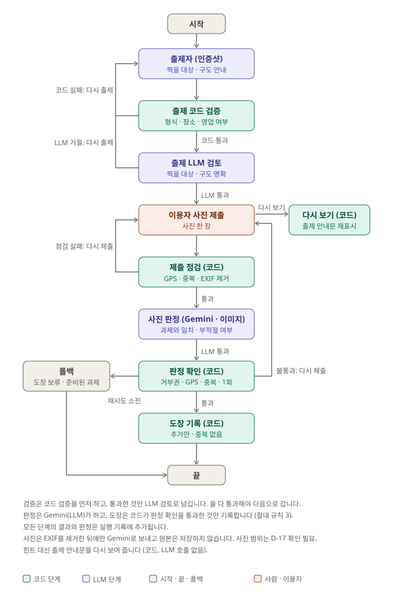
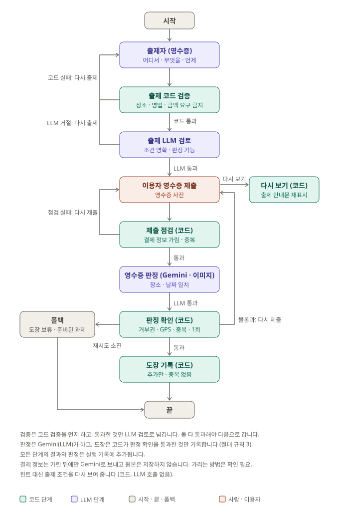
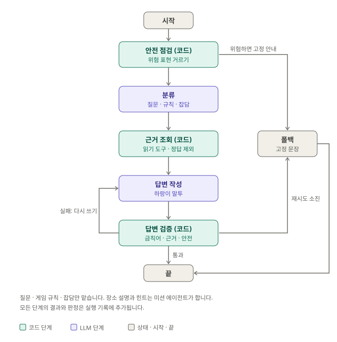
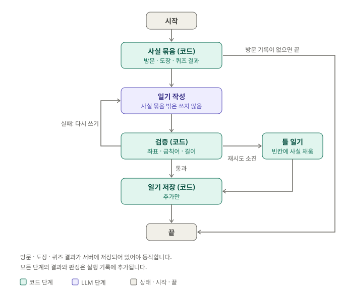
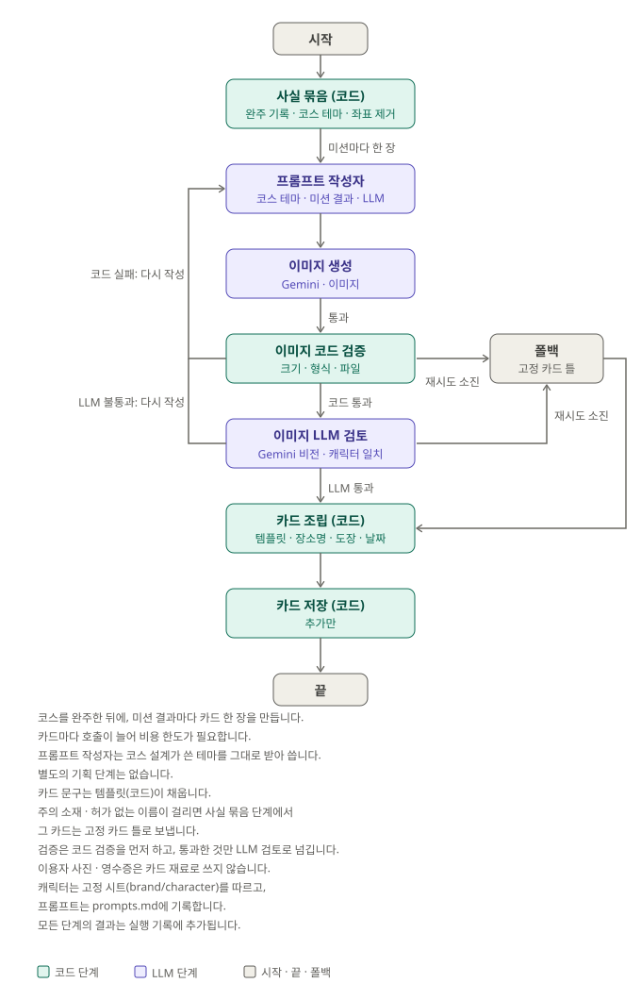
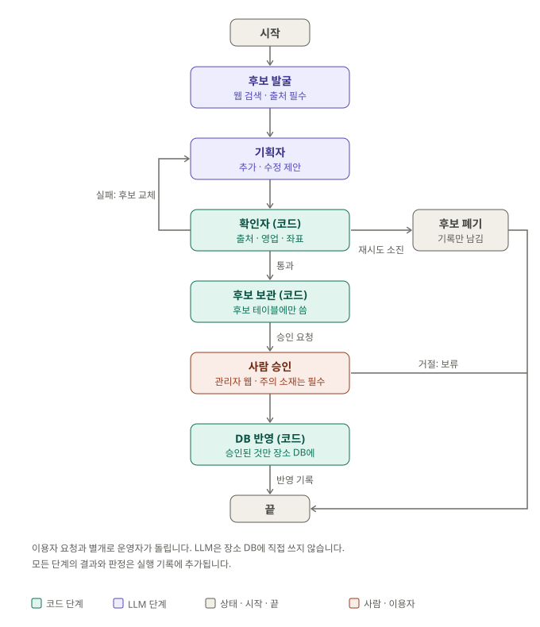

# 에이전트 구조 설계 v2

- 작성일: 2026-11-24
- 상태: 초안. 팀 확인 전입니다. `[결정 필요]`, `[확인 필요]`가 붙은 항목은 확정이 아닙니다.
- v1 대비: [agent_architecture_v1.md](agent_architecture_v1.md)에서 **구조만 바꿉니다.** 바뀌지 않은 장(현재 구현 상태, 용어, 앱 화면, 서버 연동, 테마 프로필, 설명 깊이)은 v1을 따릅니다.
- 코스 설계 에이전트의 구현 단위 설계는 [course_agent_design_v1.md](course_agent_design_v1.md)에 있고, 이 문서의 구조를 따릅니다.
- 그림은 모두 SVG이고 `agent_architecture_v2_images/` 폴더에 있습니다 (v1과 같은 방식).

## 1. 한눈에 보기

- 에이전트는 6개입니다 (사용자 결정 2026-11-24, 팀 확인 전).
  - 코스 설계: 길 3곳을 짭니다.
  - 미션: 장소 설명을 하고, 종류(퀴즈, 인증샷, 영수증)를 골라 종류별 에이전트가 출제·검증·판정하고 힌트를 줍니다. 출제와 판정은 LLM(판정은 Gemini)이 하고 도장은 코드가 기록합니다.
  - 하랑이와 이야기하기: 질문, 게임 규칙, 잡담 같은 자유 대화를 맡습니다.
  - 기록 정리: 방문 기록으로 일기를 씁니다.
  - 하랑이 카드: 코스를 완주했을 때, 미션 결과마다 하랑이 카드(이미지 생성)를 한 장씩 만듭니다.
  - 장소 DB 갱신: 장소 자료를 늘리고 고치는 별도 에이전트입니다. 운영자가 돌립니다.
- 원칙: **LLM이 찾고 쓰고, 코드가 거부권을 가집니다.** 안전·점수·도장·인증은 코드가 판정합니다.
- 새 원칙: **모든 단계의 LLM 결과와 코드 판정을 실행 기록에 남깁니다.** 관리자 웹이 이 기록을 보여 줍니다 (5장).
- 에이전트마다 자기 오케스트레이터가 있고, 순서가 정해진 그래프에 분기를 둡니다. 최상위 라우터와 감독자 LLM은 두지 않습니다.
- 어느 단계가 실패해도 마지막에는 미리 만든 안전한 결과(대체 코스, 승인 대사, 틀 일기)로 내려갑니다.

구조 (위에서 아래로)

- 공통 관문 (서버 미들웨어): 로그인, 요청 한도, 일일 한도, 호출 예산
- 에이전트 (각자 오케스트레이터)
  - 코스 설계: 테마 관문 → 연구자(LLM, 테마별) → 근거 합치기 → 기획자 ⇄ 확인자 → 작성자 → 검증 → 평가자 → 끝 (실패 시 대체 코스)
  - 미션: 도착 확인 → 장소 설명(LLM) → 설명 코드 검증 → 설명 LLM 검토 → 종류 고르기(LLM) → 종류별 에이전트(퀴즈·인증샷·영수증: 출제 → 코드 검증 → LLM 검토 → 제출 → 제출 점검 → 판정(Gemini) → 판정 확인) → 도장 기록(코드), 힌트 가지
  - 하랑이와 이야기하기: 안전 점검(코드) → 분류(LLM) → 근거 조회 → 답변 작성(LLM) → 답변 검증(코드), 폴백은 고정 문장
  - 기록 정리: 사실 묶음 → 일기 작성(LLM) → 검증(코드) → 일기 저장, 폴백은 틀 일기
  - 하랑이 카드: 사실 묶음(코스 테마 포함) → 프롬프트 작성자(LLM) → 이미지 생성(Gemini) → 이미지 코드 검증 → 이미지 LLM 검토 → 카드 조립(코드) → 카드 저장, 폴백은 고정 카드 틀
  - 장소 DB 갱신: 후보 발굴(LLM) → 기획자 ⇄ 확인자 → 후보 보관 → 사람 승인 → DB 반영(코드)
- 장소 DB: 장소 DB 갱신을 뺀 에이전트는 읽기만 합니다.
- 실행 기록 DB: 모든 에이전트의 모든 단계가 추가만 합니다.
- 관리자 웹: 실행 기록 보기, 승인, 검수. 기록은 고치지 못합니다.

## 2. v1에서 바뀐 점 (팀 확인 필요)

| v1 | v2 | 영향 | 결정 |
|---|---|---|---|
| 에이전트 3개 (코스 설계, 장소 안내, 기록 정리) | 6개 (코스 설계, 미션, 하랑이와 이야기하기, 기록 정리, 하랑이 카드, 장소 DB 갱신) | 장소 안내가 둘로 갈리고 카드·DB 갱신이 새로 생김 | `[결정 필요]` |
| 이미지는 생성하지 않음 (캐릭터 생성 에이전트는 이번 구현에서 제외, v1 7장) | 하랑이 카드는 Gemini 이미지 생성으로 만듦 | 캐릭터 일관성, 무료 한도, 검수 부담 | `[결정 필요]` |
| 최상위 라우터가 자유 입력을 나눔 (5-4) | 라우터 없음. 자유 입력은 하랑이와 이야기하기 안에서 분류 | 최상위 그래프가 필요 없음 | `[결정 필요]` |
| 퀴즈 문항·정답·채점은 고정 데이터, 에이전트는 만들지 않음 (1장, 5-2) | 종류별 미션 에이전트가 출제하고, 판정도 LLM(Gemini)이 함. 도장은 코드가 확인한 뒤 기록 | 새 장소의 미션은 검수 전에는 도장과 연결하지 않음 | `[결정 필요]` |
| 안전·인증·판정은 규칙 코드가 하고 LLM은 판정에 관여하지 않음 (dev/CLAUDE.md 34행, 1장 원칙) | 미션 판정은 LLM이 의견을 내고, 도장·점수는 코드가 확인한 뒤 기록 | 규칙 문구를 바꿔야 함. 사진·영수증이 Gemini로 나감 (D-17) | `[결정 필요]` |
| 퀴즈·인증샷·영수증은 하나의 미션 흐름 | 종류 고르기 뒤 종류마다 에이전트가 따로 있음 | 그래프 3개, 이미지 판정에 Gemini | `[결정 필요]` |
| 장소 설명·질문 답변·힌트는 장소 안내 담당 | 장소 설명과 힌트는 미션 담당, 질문·규칙·잡담은 하랑이와 이야기하기 담당 | 장소 안내가 둘로 갈림. 장소 사이 설명은 4-2장 참고 | `[결정 필요]` |
| 장소 근거는 웹 검색에서 바로 (2-2) | 새 장소는 장소 DB 갱신을 거쳐 사람 승인 뒤 DB에 반영 | 웹 검색이 없어도 DB 밖 장소를 다룰 길이 생김 | `[결정 필요]` |
| 결과 저장은 캐시와 일기 위주 (8장) | 모든 단계의 결과와 판정을 추가만 하는 실행 기록에 저장 | 새 테이블, 단계마다 기록 호출 | `[결정 필요]` |

- v1 2-2장의 6가지 변경(경로 결정을 LLM에게, 지금 구현에 포함 등)은 그대로 팀 확인 대상입니다.

## 3. 공통 부품

| 부품 | 역할 | 비고 |
|---|---|---|
| 공통 관문 | 로그인, 요청 한도, 일일 한도, 호출 예산 | 서버 미들웨어. 그래프 노드가 아님. 기존 `requireLogin`, `createRateLimiter` 재사용 (dev/server/src/app.js) |
| 기록기 | 모든 노드의 시작·결과·판정을 실행 기록에 추가 | 노드를 감싸는 공통 함수. 기록이 실패했을 때 요청을 막을지는 `[결정 필요]` |
| 호출 예산 | 한 요청에서 쓸 LLM 호출 수·시간 상한 | 공유 상태에 저장. 상한은 `[결정 D-19]` |
| 페르소나 | 하랑이 말투를 한 곳에서 관리 | v1 7장 |
| 안전 점검 | 위험한 표현을 고정 안내로 보냄 | 코드 |
| 웹 검색·정제 | 공식 출처 우선, 지시문처럼 보이는 문구 제거 | 장소 DB 갱신에서 먼저 사용. 무료 한도 `[확인 필요]` |

## 4. 에이전트별 설계

- 검증 단계는 **코드 검증 → LLM 검토** 두 상자로 나눕니다.
  - 코드가 기계적으로 확인할 수 있는 것을 먼저 검사합니다. 실패하면 LLM은 부르지 않고 이유와 함께 되돌립니다 (호출 절약).
  - 코드를 통과한 것만 LLM이 의미를 검토합니다. LLM이 통과라고 해도 코드 실패는 뒤집지 못합니다.
  - 둘 다 통과해야 다음으로 갑니다. 한쪽이라도 거절하면 해당 LLM 노드로 되돌아가며, 횟수 상한은 `[결정 D-19]`입니다.

### 4-1. 코스 설계

- 흐름
  - 테마 관문(코드)이 테마에 맞는 연구자(LLM)를 하나 고릅니다 (역사·문화·자연 프로필) → 근거 합치기(코드)
  - → 기획자(LLM) ⇄ 확인자(코드) (확인 실패 시 장소 교체)
  - → 작성자(LLM) → 검증(코드) (실패 시 다시 쓰기) → 평가자(LLM) (거절 시 다시 쓰기) → 끝
- 공유 상태: 근거, 초안, 시도 횟수, 호출 예산.
- 확인자: 지금은 코드(T맵 이동 시간, 오늘 영업)입니다. 웹 검색을 붙이면 LLM 확인자를 더하고 최종 판정은 코드가 합니다.
- 구현 단위 설계는 [course_agent_design_v1.md](course_agent_design_v1.md)입니다.
- 실패 처리: 시도 횟수를 다 쓰면 대체 코스, 어디서든 막히면 기존 `composeRoute`로 내려갑니다.
- 지금은 DB에 있는 장소만 코스에 넣습니다. DB 밖 장소는 장소 DB 갱신을 거쳐 들어옵니다.
- 좌표는 LLM·외부 검색에 보내지 않습니다 (dev/CLAUDE.md 절대 규칙 1).
- T맵은 서버가 직접 호출합니다 (MCP 사용 안 함).

### 4-2. 미션

- 장소 한 곳마다 한 번 돕니다. 장소 설명과 미션이 한 에이전트 안에 있습니다.
- **미션 종류마다 에이전트가 따로 있습니다.** 종류 고르기가 먼저 갈라 보냅니다.
  - 퀴즈 에이전트, 인증샷 에이전트, 영수증 에이전트.
  - 각 에이전트는 출제 → 출제 코드 검증 → 출제 LLM 검토 → 이용자 제출 → 제출 점검 → 판정 → 판정 확인 → 도장 기록 순서입니다.
  - 힌트는 **퀴즈에만** 있습니다 (제출 전에 요청). 인증샷과 영수증에는 힌트 대신 출제 안내문·조건을 다시 보여 주는 "다시 보기"(코드, LLM 호출 없음)를 둡니다.
- 출제, 검증, 판정, 퀴즈 힌트는 **LLM이 합니다.** 도착 확인, 제출 점검, 판정 확인, 도장 기록은 코드가 합니다.
- 사진과 영수증을 보는 판정은 **Gemini(이미지 입력)** 로 합니다. 퀴즈 채점도 Gemini입니다.
- 전체 흐름 (위 그림)
  - 도착 확인(코드): 서버가 GPS 반경 안인지 계산합니다.
  - 장소 설명 작성(LLM) → 설명 코드 검증 → 설명 LLM 검토: 장소 DB의 근거로만 설명하고, 코드가 근거 id·금칙어·길이를 먼저 검사한 뒤 LLM이 사실과 맞는지 봅니다. 실패가 이어지면 고정 설명으로 내려갑니다.
  - 종류 고르기(LLM): 장소와 이용자 상황을 보고 퀴즈·인증샷·영수증 중 하나를 고릅니다. 코드가 그 장소에서 허용되는 종류만 남깁니다 (예: 영수증은 구매할 수 있는 곳만). 허용 종류를 어디에 저장할지는 `[확인 필요]`입니다.
  - 고른 종류의 에이전트가 돕니다. 끝나면 도장 기록(코드)으로 갑니다.
- 종류별 흐름

| 종류 | 출제 | 제출 | 제출 점검 (코드) | 판정 (Gemini) | 도움말 |
|---|---|---|---|---|---|
| 퀴즈 | 장소 사실로 문제와 정답을 냄 | 답 | 형식, 시도 횟수 | 글 채점. 정답 근거와 대조 | 힌트 (LLM, 코드 검증 → LLM 검토) |
| 인증샷 | 찍을 대상과 구도를 안내 | 사진 한 장 | GPS 반경, 중복, EXIF 제거 | 이미지가 과제와 맞는지, 부적절한지 | 안내문 다시 보기 (코드) |
| 영수증 | 어디서·무엇을·언제 샀는지 조건을 냄 | 영수증 사진 | 결제 정보 가림, 중복 | 이미지의 장소·날짜가 맞는지 | 조건 다시 보기 (코드) |

- 되돌이
  - 출제 코드 검증 실패 또는 출제 LLM 검토 거절: 다시 출제.
  - 제출 점검 실패: 이용자가 다시 제출 (횟수 제한).
  - 판정 확인 불통과: 이용자가 다시 제출 (횟수 제한). 횟수를 다 쓰면 폴백(도장 보류, 준비된 과제)으로 갑니다.
  - 횟수 상한은 `[결정 D-19]`입니다.
- 판정 확인(코드, 거부권)
  - Gemini가 통과라고 해도 코드가 GPS 반경, 중복 제출, 한 장소 한 번만 도장, 형식을 다시 확인합니다.
  - 확인을 통과한 것만 도장 기록(코드)이 추가만 하는 방식으로 씁니다 (절대 규칙 3, 4).
  - LLM이 판정하지 못하거나 시간이 지나면 도장을 보류합니다. 저절로 통과시키지 않습니다.
- 퀴즈 힌트: 정답 문자열은 힌트 작성의 입력에서 제외하고, 힌트 코드 검증이 정답 노출을 거부하고, 힌트 LLM 검토가 도움이 되는지 봅니다.
- 인증샷에서 대상이 찾기 어려운 장소에 한해 위치 단서를 LLM이 쓰게 할지는 `[결정 필요]`입니다. 지금은 두지 않습니다.
- 사진·영수증 처리
  - 서버에서만 Gemini로 보냅니다. 키는 앱에 두지 않습니다 (dev/CLAUDE.md).
  - 보내기 전에 코드가 EXIF를 제거하고 결제 정보를 가립니다. 가리는 방법은 `[확인 필요]`입니다.
  - 원본은 저장하지 않고, 판정 결과·이유·사유 코드만 실행 기록에 남깁니다.
  - 이용자 사진이 외부로 나가므로 "LLM에 보낼 개인 정보 범위" 결정(D-17)에 사진·영수증을 넣어 팀 확인을 받습니다 `[결정 필요]`.
  - 사진 입력이 되는 모델인지, 설치된 `@langchain/google-genai`에서 이미지 입력을 쓰는 방법은 공식 문서로 확인한 뒤 씁니다 (dev/CLAUDE.md 절대 규칙 7) `[확인 필요]`.
  - 이미지 호출은 글 호출보다 한도를 더 쓸 수 있습니다 `[확인 필요]`.
- 규칙 변경 제안 (팀 확인 필요)
  - `dev/CLAUDE.md` 34행은 "안전·인증·판정은 규칙 코드가 한다. LLM은 판정에 관여하지 않고 문장만 만든다"입니다.
  - 미션 판정을 LLM(Gemini)이 하려면 이 규칙을 "LLM은 판정 의견을 내고, 도장·점수는 코드가 확인한 뒤 기록한다"로 바꿔야 합니다 `[결정 필요]`.
  - 이 문서는 그 변경을 전제로 쓰였고, `dev/CLAUDE.md`는 아직 고치지 않았습니다.
- 폴백: 설명·출제·퀴즈 힌트가 실패하면 고정 설명과 준비된 과제로 내려갑니다. 판정이 실패하면 도장을 보류합니다.
- 장소 사이 설명(장소에서 다음 장소로 가는 길의 안내)은 이 에이전트가 맡는 안을 제안합니다 `[결정 필요]`.
- 설명 깊이와 테마별 말투는 v1 7장을 따릅니다.
- 현재 페르소나의 "장소의 사연이나 유래는 넣지 않는다" 규칙(dev/server/src/ai/harangi_persona.js:19)이 장소 설명과 맞지 않습니다 (v1 3장). 설명용 규칙을 따로 두는 것은 `[결정 필요]`입니다.
- 새 장소의 미션은 검수 전에는 도장과 연결하지 않습니다 `[결정 필요]` (v1 14장의 안과 같음).

### 4-3. 하랑이와 이야기하기

- 흐름: 안전 점검(코드) → 분류(LLM) → 근거 조회(코드, 읽기 도구만) → 답변 작성(LLM) → 답변 검증(코드) → 보내기.
- 위험한 표현이면 고정 안내로 바로 보냅니다. 답변 검증이 계속 실패하면 고정 문장으로 내려갑니다.
- 맡는 일: 질문 답변, 게임 규칙 답변, 잡담. 장소 설명과 힌트는 미션 에이전트가 맡습니다.
- 근거가 없는 질문에는 "그건 잘 모르겠어요"라고 답합니다. 지어내지 않습니다.
- 정답 문자열은 입력에서 제외합니다.
- 폴백은 고정 문장(승인 대사)입니다.
- 현재 페르소나의 "장소의 사연이나 유래는 넣지 않는다" 규칙(dev/server/src/ai/harangi_persona.js:19)은 질문 답변에도 영향을 줍니다. 장소 설명용 규칙을 따로 두는 것은 4-2장 `[결정 필요]`입니다.

### 4-4. 기록 정리

- v1 5-3과 같습니다: 완주 직후 1회, 사실 묶음 밖의 문장 금지, 폴백은 틀 일기.
- 방문·도장·퀴즈 결과가 서버에 저장된 뒤에 동작합니다 (v1 3장).

### 4-5. 하랑이 카드 (새)

- 코스를 완주했을 때 한꺼번에 돕니다 (사용자 결정 2026-11-24). 미션 결과마다 카드 한 장을 만듭니다.
- 기록 정리와 같은 시점에 시작하지만 서로 독립입니다. 둘이 동시에 돌 수 있는지는 설치된 LangGraph 문서로 확인한 뒤 정합니다 `[확인 필요]`.
- 흐름
  - 사실 묶음(코드): 완주 기록(장소, 미션 종류, 통과 여부, 날짜)과 **코스 설계가 쓴 코스 테마**를 모읍니다. 좌표·사진·영수증은 넣지 않습니다. `주의` 소재이거나 허가 없는 실존 인물·가게 이름이 걸리는 미션은 여기서 걸러 고정 카드 틀로 보냅니다.
  - 프롬프트 작성자(LLM): 코스 테마와 미션 결과를 받아 미션마다 이미지 생성 프롬프트를 씁니다. 별도의 카드 기획 단계는 없습니다. 캐릭터는 고정 시트(`brand/character/`)를 따르고, 프롬프트는 `brand/character/prompts.md`에 기록합니다 (CLAUDE.md).
  - 이미지 생성(Gemini): 카드 그림을 만듭니다.
  - 이미지 코드 검증 → 이미지 LLM 검토(Gemini 비전): 코드가 크기·형식을 먼저 확인하고, 통과한 것만 LLM이 캐릭터 모습이 맞는지, 글자나 간판이 들어갔는지, 안전한지 봅니다. 불통과면 프롬프트 작성자로 돌아갑니다.
  - 카드 조립(코드): 템플릿에 이미지, 장소명, 도장, 날짜를 합칩니다. 카드 문구는 템플릿이 채우고, 레이아웃과 도장은 LLM이 정하지 않습니다. 하랑이 한마디를 LLM이 쓰게 할지는 `[결정 필요]`입니다.
  - 카드 저장(코드): 추가만 하는 방식으로 저장합니다 (절대 규칙 3).
- 폴백: 이미지 검증이 재시도 소진되면 미리 만든 고정 카드 틀(하랑이 이미지 + 틀 문구)로 조립합니다. 이미지 생성이 실패해도 카드는 나옵니다.
- 주의할 점
  - 이미지 생성은 호출이 가장 비쌉니다. 미션 수만큼 늘어나므로 완주 한 번에 쓸 수 있는 호출 수 상한과 진행 표시(비동기)가 필요합니다 `[결정 D-19]`.
  - Gemini 이미지 생성이 설치된 `@langchain/google-genai`와 무료 한도에서 되는지, 기준 이미지를 넣어 캐릭터를 맞출 수 있는지는 확인이 필요합니다 `[확인 필요]`.
  - 이용자 사진은 카드 재료로 쓰지 않습니다. 카드에 사진을 넣고 싶은지는 `[결정 필요]`입니다.
  - 생성 이미지는 검수 전에 공개하지 않을 수 있습니다. 관리자 웹에서 샘플을 검수할지 `[결정 필요]`.
  - 폭염·한파 안전 정보나 민감한 역사 소재를 카드 소재로 쓰지 않습니다 (CLAUDE.md 민감한 소재).

### 4-6. 장소 DB 갱신 (새)

- 이용자 요청과 별개로 운영자가 돌리는 배치 에이전트입니다.
- 흐름: 후보 발굴(LLM, 웹 검색) → 기획자(LLM) ⇄ 확인자(코드: 출처·영업·좌표) → 후보 보관(코드) → 사람 승인(관리자 웹) → DB 반영(코드).
- 확인에 계속 실패한 후보는 폐기하고 기록만 남깁니다. 사람이 거절하면 보류합니다.
- **LLM은 장소 DB에 직접 쓰지 않습니다.** 후보 보관 테이블에 쓰고, 승인된 것만 코드가 `places`에 반영합니다.
- 식민지·전쟁 소재 장소는 `주의`로 표시하고 사람이 검수합니다 (CLAUDE.md 민감한 소재).
- 실존 인물과 실제 가게 이름은 허가 범위를 확인한 뒤 씁니다 (CLAUDE.md 브랜드·캐릭터 작업).

## 5. 실행 기록과 관리자 웹

### 5-1. 실행 기록에 남기는 것

| 항목 | 내용 |
|---|---|
| 실행 | 실행 id, 에이전트, 시작·끝 시각, 최종 결과(정상·대체·폴백), 폴백 사유 |
| 단계 | 순서, 노드 이름, 종류(LLM·코드·사람), 시도 번호 |
| LLM 단계 | 모델, 프롬프트 버전, 입력 요약, 출력 원문, 호출 수, 걸린 시간 |
| 코드 단계 | 검사 이름, 통과·실패, 사유 코드 (예: `NOT_OPEN`, `IDS_COUNT`, `WALK_TOO_LONG`) |
| 사람 단계 | 승인·거절, 사유, 처리 시각 |

- 추가만 하고 고치거나 지우지 않습니다 (절대 규칙 3).
- 좌표, 계정 식별자, 사진·영수증 원본, 결제 정보는 남기지 않습니다 (절대 규칙 1, CLAUDE.md 개인정보).
- 이용자와 실행을 어떻게 연결할지(익명 키, 해시 등)는 `[결정 필요]`입니다.
- 보관 기간은 `[결정 필요]`입니다.

### 5-2. 관리자 웹이 보여 주는 것 (새 화면 제안)

| 화면 | 내용 |
|---|---|
| 실행 목록 | 에이전트·결과·폴백 여부로 걸러 보기 |
| 실행 상세 | 단계별 타임라인: 무엇을 썼고, 어떤 코드 검사에서 왜 막혔는지 |
| 지표 | 통과율, 폴백 비율, 호출 수, 비용 한도 |
| 승인 대기 | 장소 DB 갱신 후보, 미션 출제 검수, `주의` 장소 설명 |

- 관리자 웹은 기록을 읽고 승인만 합니다. 기록을 고치지 못합니다.
- 기획서의 운영자 웹(F-18, S-11~S-13)과 이어집니다 (v1 10장). 형태는 `[결정 D-03]`입니다.

## 6. 새 테이블 (제안, 이름·항목은 BE가 정함)

| 용도 | 주요 항목 | 규칙 |
|---|---|---|
| 실행 | 실행 id, 에이전트, 시각, 결과, 폴백 사유 | 추가만 |
| 실행 단계 | 실행 id, 순서, 노드, 종류, 입력 요약, 출력, 판정, 사유 코드, 호출 수, 시간 | 추가만, 좌표 없음 |
| 장소 후보 | 장소 정보, 출처, 확인일, 검수 상태 | LLM이 쓰는 곳. `places`와 분리 |
| 미션 | 장소 id, 종류(퀴즈·인증샷·영수증), 문제 또는 과제, 근거 id, 검수 상태 | 정답은 서버만. 새 장소는 검수 전 도장 연결 없음 |
| 하랑이 카드 | 이용자, 여행, 미션 결과 id, 카드 이미지 위치, 문구, 폴백 여부 | 추가만, 좌표·사진 없음 |
| 미션 제출 결과 | 이용자, 여행, 장소, 종류, 판정(LLM) 결과와 이유, 판정 확인(코드) 결과, 사유 코드 | 추가만, 좌표·사진·영수증 원본 없음 |

- v1 12-2의 새 테이블(근거 묶음, 방문·도장, 퀴즈 결과, 일기, 작업 상태)은 그대로입니다.
- DB 구조 변경은 새 SQL 파일로만 추가합니다 (dev/CLAUDE.md).

## 7. 구현 순서 (제안)

| 순서 | 할 일 | 메모 |
|---|---|---|
| 1 | 로그인 필수화 | v1 13장 1번. 비용 보호 |
| 2 | 실행 기록 테이블과 기록기, 호출 예산 | 모든 에이전트의 공통 기반 |
| 3 | 코스 설계 뼈대(가짜 LLM 테스트) → 연구·기획·확인 → 작성·검증·평가 → `composeRoute` 연결(스위치 기본 꺼짐) | 폴백이 있어 단계마다 동작 |
| 4 | 방문·도장·퀴즈 결과 저장 | 기존 PR F. 미션과 기록 정리의 선행 |
| 5 | 미션: 판정 확인·도장 기록(코드) → 퀴즈 에이전트 → 장소 설명 → 종류 고르기 → 인증샷·영수증 에이전트(Gemini 이미지) | 코드 문이 먼저. 이미지 입력 확인 후 |
| 6 | 하랑이와 이야기하기 | 안전 점검과 비용 한도 함께 |
| 7 | 장소 DB 갱신 + 관리자 웹 승인 화면 | 형태 D-03 결정 후 |
| 8 | 기록 정리, 하랑이 카드(고정 카드 틀 먼저 → 이미지 생성), 웹 검색 연결 | 미션 결과 저장 뒤. 이미지 생성은 한도 확인 후 |

- 일정과 호출 수는 추정입니다. 제출(11/30)까지 어디까지 할지는 팀이 정합니다 `[결정 필요]`.

## 8. 결정 필요

- [ ] 2장의 6가지 변경
- [ ] 장소 사이 설명을 미션이 맡는지 (4-2장)
- [ ] 실행 기록의 이용자 연결 방식, 보관 기간, 기록 실패 시 동작
- [ ] GPS를 기록에 어디까지 남길지
- [ ] 미션 판정을 LLM(Gemini)이 하도록 dev/CLAUDE.md 34행을 바꿀지 (4-2장)
- [ ] 사진·영수증을 Gemini로 보내는 범위 (D-17), 결제 정보 가리는 방법
- [ ] 종류 고르기를 LLM으로 둘지, 종류별 허용 규칙을 어디에 둘지
- [ ] 새 장소 미션의 처리
- [ ] 한 요청의 호출 수·시간·재시도 상한 (D-19), 이동 시간 상한
- [ ] 에이전트를 기본으로 켤지 (스위치 기본값)
- [ ] LLM 제공자·모델 (D-13), 운영자 웹의 형태 (D-03)
- [ ] 하랑이 카드에 이용자 사진을 넣을지, 생성 이미지를 공개 전에 검수할지
- [ ] 제출(11/30)까지 구현할 범위

## 9. 확인 필요

- [ ] LLM·T맵·웹 검색의 무료 한도 (이미지 입력 포함)
- [ ] 설치된 `@langchain/google-genai`의 이미지 입력 사용법과 이미지를 지원하는 모델
- [ ] Gemini 이미지 생성(카드)의 사용 가능 여부, 무료 한도, 기준 이미지로 캐릭터를 맞추는 방법
- [ ] 설치된 LangGraph 버전의 도구·병렬 사용법
- [ ] 앱이 `picker` 값을 쓰는 방식 (dev/server/src/routes/recommend.js)
- [ ] `openHour`, `closedWeekdays`가 DB에 채워진 정도
- [ ] #238(로그인 필수화) 병합 여부와 동작

## 출처

- [agent_architecture_v1.md](agent_architecture_v1.md) (1장, 2-2장, 3장, 5장, 10장, 12장, 13장)
- [course_agent_design_v1.md](course_agent_design_v1.md)
- dev/server/src/ai/compose_graph.js, compose_route.js, validate_route.js, harangi_persona.js:19
- dev/server/src/app.js (`requireLogin`, `createRateLimiter`)
- dev/CLAUDE.md (절대 규칙 1·3·4), CLAUDE.md (민감한 소재, 개인정보, 브랜드·캐릭터 작업)
- 사용자가 채팅으로 정한 방향 (2026-11-24)
