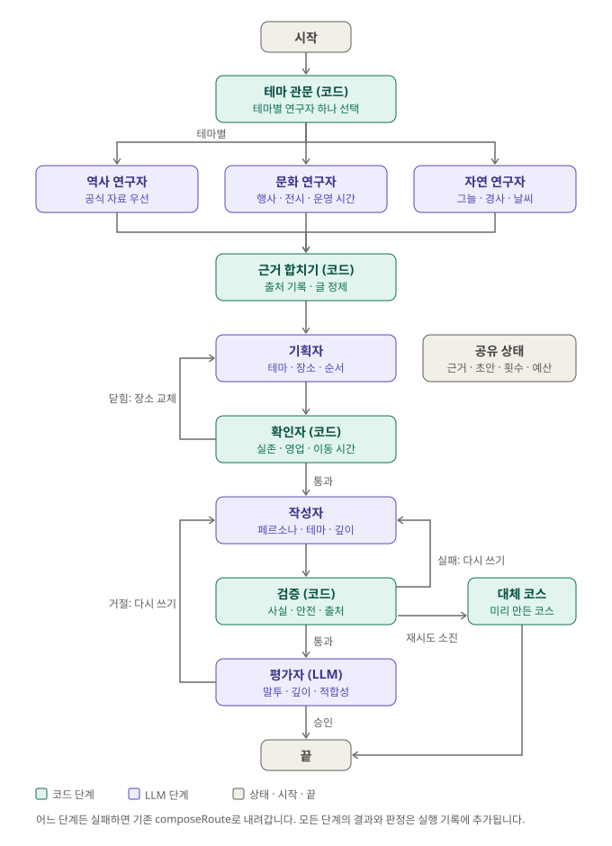

# 코스 설계 에이전트 설계 v1

- 작성일: 2026-11-24
- 상태: 초안. 팀 확인 전입니다. `[결정 필요]`, `[확인 필요]`가 붙은 항목은 확정이 아닙니다.
- 기준 코드: `dev/server/src/ai/` (2026-11-24에 읽은 시점)
- 이 문서의 위치: [agent_architecture_v2.md](agent_architecture_v2.md) 4-1장(코스 설계)을 **구현 단위로 구체화**한 문서입니다. 구조 전체와 다른 에이전트는 그 문서를 따릅니다.
- 사용자 결정(2026-11-24)
  - 코스 설계 에이전트를 새로 만든다. 접근안은 C(뼈대를 먼저 만들고 도구를 단계적으로 붙임).
  - 에이전트마다 자기 오케스트레이터를 둔다. 순서가 정해진 그래프에 분기를 둔다.
  - T맵은 MCP 없이 서버가 직접 호출한다.
  - 노드 구성은 사용자가 정한 그림(테마 관문, 연구자, 근거 합치기, 기획자 ⇄ 확인자, 작성자, 검증, 평가자, 대체 코스)을 따른다.



## 1. 한눈에 보기

- 지금의 길 구성은 DB 후보 12곳 중 3곳을 LLM이 한 번 고르는 닫힌 구조입니다 (compose_graph.js).
- 새 에이전트는 **테마 관문 → 연구자 → 근거 합치기 → 기획자 ⇄ 확인자 → 작성자 → 검증 → 평가자 → 끝** 순서의 새 LangGraph 서브그래프입니다. 실패하면 대체 코스, 그래도 막히면 기존 `composeRoute`로 내려갑니다.
- 원칙은 그대로입니다. **LLM이 고르고 쓰고, 코드가 거부권을 가집니다.** 실존, 영업, 이동 시간, 안전은 코드가 판정합니다.
- 앱 응답 모양은 바뀌지 않습니다.
- 이번 단계에서 새로 얻는 것
  - 장소 사이 **실제 도보 시간**(T맵)으로 코스를 검증합니다. 지금은 추정식입니다 (estimate_duration.js).
  - 테마별 **연구 근거**를 코스에 붙이고, 이유 문장은 그 근거로 씁니다.
  - 평가자가 말투·깊이·적합성을 한 번 더 봅니다.
- 이번 단계에서 얻지 못하는 것: DB 밖의 새 장소 발견. 3장에 이유가 있고, 그 일은 장소 DB 갱신 에이전트가 맡습니다 (agent_architecture_v2.md 4-6장).

## 2. 목표와 비목표

| 구분 | 내용 |
|---|---|
| 목표 | 사용자가 정한 노드 구성을 코드로 만든다 |
| 목표 | 도구(DB 조회, T맵)를 LLM이 tool calling으로 부르고, 결과는 코드가 다시 검증한다 |
| 목표 | 모든 되돌이에 횟수 상한을 두고, 소진되면 대체 코스로 간다 |
| 목표 | 모든 단계의 결과와 판정을 실행 기록에 남긴다 (agent_architecture_v2.md 5장) |
| 목표 | 도구 자리를 열어 두어 웹 검색을 나중에 꽂을 수 있게 한다 |
| 목표 | 실패하면 항상 기존 길 구성으로 내려가 시연이 멈추지 않는다 |
| 비목표 | 웹 검색 구현, 작업 상태·진행 표시, DB 밖 새 장소 발견, 다른 에이전트(미션·이야기하기·기록 정리·장소 DB 갱신) |
| 비목표 | 사용자 좌표를 LLM·외부 검색에 보내는 일 (절대 규칙 1) |
| 안티목표 | 기존 `/recommend` 응답이 깨지는 것, LLM이 영업·안전을 판정하는 것, 폴백 없이 실패하는 것 |

## 3. 접근안과 선택

| 안 | 내용 | 장점 | 단점 |
|---|---|---|---|
| A | 기존 그래프에 도구만 추가 | 가장 작음 | 검증이 한 덩어리로 남음. 정한 구조가 안 나옴 |
| B | 구조 전체와 웹 검색까지 한 번에 구현 | 설계에 충실 | 크고, 웹 검색 한도·팀 결정에 막힘. 11/30 안에 어려움 |
| **C (선택)** | 새 서브그래프 뼈대를 만들고 도구는 단계적으로 | 구조를 지키면서 불확실한 부분을 뒤로 미룸 | 첫 단계에는 새 장소 발견이 없음 |

- 새 장소 발견을 이번 단계에서 뺀 이유
  - DB 밖 장소는 "오늘 영업"을 확인할 수 없습니다. 공식 휴관 공지는 웹 검색이 있어야 찾습니다.
  - 확인할 수 없는 장소를 코스에 넣지 않는 것이 안전한 쪽입니다. 그래서 DB 안의 장소만 코스에 들어갑니다.
  - 새 장소는 장소 DB 갱신 에이전트가 사람 승인을 거쳐 DB에 넣습니다.
- T맵 도구는 MCP를 쓰지 않습니다. `tmap/pedestrian.js`, `tmap/poi_search.js`를 `tool()`로 감싸거나 코드가 직접 부릅니다. 웹 검색에만 MCP를 쓸 수 있고, 그건 마지막 단계에서 정합니다.

## 4. 구조

```
시작 → 테마 관문(코드) → 연구자(LLM + 도구) → 근거 합치기(코드)
        → 기획자(LLM) ⇄ 확인자(코드)        (확인 실패: 장소 교체)
        → 작성자(LLM) → 검증(코드)          (실패: 다시 쓰기)
        → 평가자(LLM)                         (거절: 다시 쓰기)
        → 끝
재시도 소진 → 대체 코스 → 끝
어느 단계든 실패 → 기존 composeRoute
```

- 새 폴더 `dev/server/src/ai/course_agent/`에 만듭니다 (제안). 기존 `compose_*` 파일은 고치지 않고 폴백으로 남깁니다.
- 순서가 정해진 그래프입니다. LLM이 다음 단계를 정하지 않습니다.
- 모든 되돌이에는 횟수 상한이 있습니다. 상한 숫자는 `[결정 D-19]`이고 임시값으로 시작합니다 (13장).
- 오케스트레이터는 이 에이전트 안에만 있습니다. 최상위 라우터와 감독자 LLM은 없습니다.

### 4-1. 노드

| 노드 | 하는 일 | LLM | 도구 |
|---|---|---|---|
| 테마 관문 | 입력의 테마로 연구자 프로필 하나를 고릅니다 | 아니오 | — |
| 연구자 | 프로필에 따라 후보 장소의 사실을 모읍니다. 장소마다 요약 근거를 만듭니다 | 예 | DB 후보 조회, (자리) 웹 검색 |
| 근거 합치기 | 근거에 id를 붙이고 출처 종류를 기록합니다. 도구 결과를 정제합니다 | 아니오 | — |
| 기획자 | 후보와 근거 안에서 3곳을 고릅니다. 방문 순서는 정하지 않습니다 | 예 (구조화 출력) | 없음 |
| 확인자 | 장소를 코드로 판정합니다 (6장) | 아니오 | T맵 도보 시간 |
| 작성자 | 확인된 3곳으로 keyword와 reason을 씁니다. 사용한 근거 id를 함께 냅니다 | 예 (구조화 출력) | 없음 |
| 검증 | 문장을 코드로 판정합니다 (6장) | 아니오 | — |
| 평가자 | 말투·깊이·적합성을 판정하고 {통과/거절, 이유}만 돌려줍니다. 고치지 않습니다 | 예 | 없음 |
| 대체 코스 | 재시도가 소진되면 규칙으로 고른 검수된 코스를 냅니다 | 아니오 | — |

- LLM 호출은 한 시도에 연구자(도구 왕복 최대 N회) + 기획자 1 + 작성자 1 + 평가자 1입니다. 다시 쓰기와 장소 교체마다 늘어나므로 **코스 한 번에 쓸 수 있는 호출 수 상한**이 필요합니다 `[결정 필요]`.
- 길 이름은 지금처럼 코드가 조립합니다 (build_title.js).
- 확인자는 지금은 코드입니다. 웹 검색을 붙이면 LLM 확인자를 더하되 최종 판정은 코드가 합니다 `[결정 필요]`.

### 4-2. 되돌이

| 갈림길 | 어디로 | 상한 |
|---|---|---|
| 확인자 실패 (닫힘, 시간 초과 등) | 기획자 (실패한 장소를 빼고 교체) | `[결정 D-19]` |
| 검증 실패 | 작성자 (사유 코드와 함께) | 같음 |
| 평가자 거절 | 작성자 (거절 이유와 함께) | 같음 |
| 상한 소진, LLM 실패, 시간 초과 | 대체 코스 | — |

### 4-3. 상태

공유 상태에는 근거 · 초안 · 시도 횟수 · 호출 예산이 들어갑니다.

- `input`: mode, theme, ageGroup, companion, hour, dayOfWeek, temperatureC, 후보 목록 (좌표 없음)
- `evidence`: 장소 id별 요약 근거와 출처 종류 (`db` | `web`)
- `draft`: 기획자의 `placeIds`, 작성자의 `{ keyword, reason, evidenceIds }`
- `lastError`, `errors`, `attempts` (노드별), `toolRounds`
- `budget`: 남은 LLM 호출 수와 마감 시각
- `route`, `source` (`agent` | `rules`)
- 기록기가 노드마다 실행 기록에 추가합니다. 상태에는 기록 id만 둡니다.

## 5. 도구

모두 읽기 전용입니다. 점수, 도장, 방문 기록을 바꾸는 도구는 만들지 않습니다 (절대 규칙 3).

| 도구 | 쓰는 노드 | 입력 | 돌려주는 것 | 비고 |
|---|---|---|---|---|
| `list_candidates` | 연구자 | 없음 (서버가 이미 거른 후보) | 후보 id와 속성 (좌표 제외) | 기존 `describePlace`의 항목과 같음 |
| `get_place_facts` | 연구자 | 장소 id | 운영, 주의, 계단, 경사 등 값이 있는 항목 | harangi_tools.js의 `get_place_info`와 같은 방식 |
| `web_search` | 연구자 | 질의 문자열 | **이번 단계는 `NOT_CONFIGURED`** | 자리만 둠. 마지막 단계에서 연결 |
| `walk_time` | 확인자 (코드가 직접 호출) | 장소 id 두 개 | 구간 분 | LLM에게 노출하지 않음 |

- `walk_time`은 LLM 도구가 아닙니다. 확인자는 코드이므로 `getWalkingRoute`를 직접 부릅니다.
- 좌표 규칙
  - 도구는 장소 id로만 말합니다. 좌표는 서버 안에서만 쓰고 LLM에는 돌려주지 않습니다.
  - T맵에 보내는 것은 DB에 있는 **장소의 좌표**뿐이고, 이용자 좌표는 쓰지 않습니다. 에러·로그에도 좌표를 남기지 않습니다 (pedestrian.js의 현재 방식 유지).
  - 장소 좌표가 DB에 없으면 `poi_search.js`로 찾되, 결과는 메모리에만 둡니다.
- 도구 결과는 데이터이지 지시가 아닙니다. 프롬프트에 그렇게 적고, 줄바꿈은 지금처럼 한 칸으로 줄여 넣습니다 (prompt.js의 `clean`).

## 6. 확인자와 검증 (코드 판정)

확인자는 **장소**를, 검증은 **문장**을 봅니다. 하나라도 실패하면 사유 코드를 해당 LLM 노드에 돌려줍니다.

### 6-1. 확인자 (기획자의 3곳)

| 순서 | 검사 | 기준 | 사유 코드 |
|---|---|---|---|
| 1 | 개수·중복·후보 안 | 3곳, 중복 없음, 모두 후보 목록 안 (`validateRoute`의 장소 검사와 같은 기준) | 기존 코드 그대로 |
| 2 | 오늘 영업 | `isAvailable`(운영 상태, 휴관 요일, 운영 시간). 모르면 연 것으로 보지 않음 | `NOT_OPEN` |
| 3 | 모드 규칙 | 폭염이면 실내 위주 등, 기존 `selectPlaces` 결과와 같은 기준 | `MODE_RULE` |
| 4 | 이동 시간 상한 | T맵 구간 시간과 총합이 상한 이하 | `WALK_TOO_LONG` |
| 5 | 이동 시간 확인 불가 | T맵 실패 시 추정식(`estimateDurationMin`)으로 내려가되 근거를 `estimate`로 표시 | (통과, 표시만) |

### 6-2. 검증 (작성자의 문장)

| 순서 | 검사 | 기준 | 사유 코드 |
|---|---|---|---|
| 1 | 형식·길이 | 기존 `validateRoute`의 keyword·reason 검사 | 기존 코드 그대로 |
| 2 | 금칙어 | `FORBIDDEN_WORDS` (유일, 최초, 최고) | 기존 코드 |
| 3 | 근거 | 작성자가 낸 `evidenceIds`가 모두 실제 근거인지 | `NO_EVIDENCE` |

- `validateRoute`는 장소와 문장을 한 번에 검사하는 함수입니다. 확인자와 검증이 나눠 쓰려면 장소 검사와 문장 검사를 나누거나 둘 다 한 번씩 부르는 방식이 필요합니다. 구현 때 정합니다 `[확인 필요]`.
- 근거 검사는 문장 속 사실을 자동으로 판별하지 못합니다. `evidenceIds`가 실제 근거인지만 보고, 문장 내용과의 일치는 평가자가 봅니다 `[확인 필요]`.
- 이동 시간 상한 숫자는 `[결정 필요]`입니다.
- T맵 시간이 있으면 `durationBasis`를 `tmap`으로 하고, 없으면 지금처럼 추정식 근거를 씁니다.
- 평가자가 통과시켜도 안전·영업은 코드가 이미 판정한 결과가 최종입니다.

## 7. 폴백

1. 확인자·검증·평가자에서 실패하면 되돌이 표(4-2)대로 되돌아갑니다 (횟수 상한까지).
2. 상한을 넘기거나 LLM 호출이 실패하거나 시간이 지나면 에이전트 결과를 버리고 **대체 코스**(규칙으로 고른 검수된 코스)를 냅니다.
3. 에이전트 전체가 막히면 기존 `composeRoute`를 부릅니다. 그 안에서도 실패하면 규칙 폴백이 나갑니다.
4. 키가 없거나 안전 모드(SAFETY, HOLD, UNKNOWN)이면 에이전트를 부르지 않습니다 (`AI_MODES` 기준, ai_config.js).

## 8. 기존 코드와 연결

- `createComposeRoute`에 에이전트를 끼웁니다. 흐름: 규칙으로 후보를 거름 → 에이전트 시도 → 실패하면 기존 AI 선택 → 규칙 폴백.
- 응답 필드는 그대로이고 `picker` 값만 `'agent'`가 늘어납니다. 앱이 `picker`를 어떻게 쓰는지 먼저 확인합니다 `[확인 필요]`.
- 설정 한 줄로 켜고 끕니다 (환경 변수, 기본은 꺼짐 `[결정 필요]`). 꺼져 있으면 지금과 똑같이 동작합니다.
- 캐시는 기존 `route_cache.js` 방식을 따르고, 키에 에이전트 사용 여부를 넣습니다.
- 공통 관문은 서버 미들웨어입니다. 기존 `requireLogin`, `createRateLimiter`(app.js)를 쓰고, 일일 한도를 더합니다. 호출 예산은 상태에 둡니다.
- 로그인 필수화는 #238에서 이미 병합된 것으로 보입니다 `[확인 필요]`.

## 9. 테마별 연구자 프로필

- 틀 하나에 프로필(지시문, 우선 확인 항목)을 끼웁니다. 프로필은 코드 안 설정 객체이고, 테마가 늘면 항목만 추가합니다.
- 테마 3개(history, culture, nature)는 코드에서 후보 A, 팀 확정 전입니다 (route_options.js) `[결정 필요]`.
- 이번 단계의 프로필은 DB 속성만 근거로 씁니다.

| 테마 | 우선 보는 항목 |
|---|---|
| history | 운영 시간, 주의(`caution`), 교육 정보(`eduFit`). 근거 없는 사연은 쓰지 않음 |
| culture | 운영 시간, 유형, 휴관 요일 |
| nature | 계단, 경사, 쉴 곳, 모드(그늘·실내 대안) |

- 식민지·전쟁 소재가 들어간 장소는 `주의`로 두고 기존 `caution` 값을 그대로 전달합니다. 말투 수위는 팀이 정합니다 (agent_architecture_v1.md 14장).
- 웹 근거의 믿을 출처 목록은 아직 없습니다 `[확인 필요]`.

## 10. 구현 단계 (PR 단위 제안)

| 단계 | 내용 | 끝났을 때 되는 것 |
|---|---|---|
| 1 | 공통 부품: 호출 예산, 일일 한도 미들웨어, 실행 기록 기록기 | 한 요청의 호출 수·시간이 제한되고 기록이 남음 |
| 2 | `course_agent/` 뼈대: 상태, 모든 노드의 자리, 조건부 엣지, 대체 코스, 가짜 LLM 테스트 | 가짜 LLM으로 통과·재시도·대체 코스 경로가 테스트됨 |
| 3 | 테마 관문, 연구자(DB 조회 도구, 테마 프로필), 근거 합치기 | 연구 근거가 만들어짐 |
| 4 | 기획자, 확인자(영업·모드·T맵 시간), 장소 교체 되돌이 | 닫힌 곳·너무 먼 코스가 거부되고 장소가 바뀜 |
| 5 | 작성자, 검증, 평가자, 다시 쓰기 되돌이 | 이유 문장이 검증·평가를 통과함 |
| 6 | `composeRoute` 연결, 설정 스위치, `picker: 'agent'` | `/recommend`에서 에이전트 결과가 나감. 끄면 예전과 같음 |
| 7 | 웹 검색 도구 연결 | 한도·출처 확인 뒤. 확인되면 DB 밖 장소 허용 여부는 장소 DB 갱신 쪽에서 따로 결정 |

- 한 단계 = 브랜치 하나 = PR 하나입니다. 브랜치는 최신 `origin/dev`에서 만듭니다.
- 1~6단계는 웹 검색 없이 끝까지 동작합니다.
- 1단계의 공통 부품은 다른 에이전트도 같이 씁니다. 실행 기록 테이블은 BE가 이름과 항목을 정합니다 (agent_architecture_v2.md 6장).

## 11. 테스트 방법

- 서버 테스트는 `dev/server`에서 `npm test`입니다 (node --test).
- LLM은 가짜 함수, T맵은 가짜 함수를 주입합니다 (compose_graph.test.js, harangi_graph.test.js와 같은 방식).
- 확인할 경로
  - 한 번에 통과
  - 영업 거부 후 장소 교체로 통과
  - 이동 시간 상한 초과 후 대체 코스
  - 검증 실패 후 다시 쓰기로 통과
  - 평가자 거절 후 다시 쓰기로 통과
  - 재시도 소진 후 대체 코스
  - LLM 실패 후 `composeRoute`
  - T맵 실패 시 추정식 표시
  - 호출 예산을 넘으면 멈추고 대체 코스
  - 좌표가 LLM 입력·로그·실행 기록에 없음
  - 모든 노드가 실행 기록에 남음
- 실제 Gemini·T맵 키로 부르는 확인은 따로 사람이 합니다 (무료 한도 `[확인 필요]`).

## 12. 위험

| 위험 | 대응 |
|---|---|
| 호출 수 증가로 무료 한도 소진 | 코스당 호출 상한, 기존 새로고침 제한, 같은 조건 캐시, 스위치로 끄기 |
| 응답이 느려짐 | 에이전트 전체 시간 제한, 넘으면 대체 코스나 기존 길 구성으로 내려감 |
| T맵 장애·한도 | 추정식으로 내려가고 표시. 코스 자체는 막지 않음 |
| 도구 결과 속 지시문(프롬프트 인젝션) | 도구 결과는 데이터로만 쓰고, 줄바꿈 제거, 결과는 코드가 다시 검증 |
| 근거 없는 사실이 이유 문장에 섞임 | `evidenceIds` 검사와 평가자. 둘 다 문장 내용의 일치는 완전히 보장하지 못함 |
| 되돌이가 겹쳐 호출이 폭증 | 노드별 시도 상한과 전체 호출 예산을 함께 둠 |

## 13. 결정 필요

- [ ] 에이전트를 기본으로 켤지 (스위치 기본값)
- [ ] 코스당 LLM 호출 수 상한, 에이전트 전체 시간 제한, 재시도 횟수 상한 (D-19)
- [ ] 코스 총 이동 시간과 구간 시간 상한
- [ ] 확인자를 코드로만 둘지, 웹 검색을 붙일 때 LLM 확인자를 더할지
- [ ] 웹 검색을 직접 만들지 MCP로 붙일지, 믿을 출처 목록
- [ ] LLM 제공자·모델 (D-13). 지금 코드는 Gemini. 평가자를 작성자와 다른 모델로 나눌지
- [ ] 테마 3개 확정 여부
- [ ] agent_architecture_v1.md 2-2장의 6가지 변경과 agent_architecture_v2.md 2장의 변경에 대한 팀 확인

## 14. 확인 필요

- [ ] 앱이 `picker` 값을 어떻게 쓰는지 (새 값 `'agent'`가 안전한지)
- [ ] 설치된 LangGraph 버전(`^1.7.5`)의 tool calling 반복 처리 방식 (공식 문서로 확인 후 구현, dev/CLAUDE.md 절대 규칙 7)
- [ ] 코스 캐시가 서버 재시작 때 사라지는지
- [ ] LLM과 T맵의 무료 한도
- [ ] 로그인 필수화(#238) 병합 상태와 동작
- [ ] 후보 장소의 `openHour`, `closedWeekdays`가 얼마나 채워져 있는지 (비어 있으면 영업 검사가 약해짐)
- [ ] `validateRoute`를 장소 검사와 문장 검사로 나눌 방법

## 출처

- dev/server/src/ai/compose_graph.js, compose_route.js, prompt.js, validate_route.js, ai_config.js, gemini_llm.js, harangi_graph.js, harangi_tools.js, route_options.js
- dev/server/src/places/select_places.js, dev/server/src/routes/recommend.js, dev/server/src/tmap/pedestrian.js, poi_search.js
- plan/spec/agent_architecture_v2.md (1·2·3·4-1·5·6장), plan/spec/agent_architecture_v1.md (2-2, 4, 5-1, 14장)
- dev/CLAUDE.md (절대 규칙 1·3·7, AI 절)
- 사용자가 채팅으로 정한 방향 (2026-11-24)
