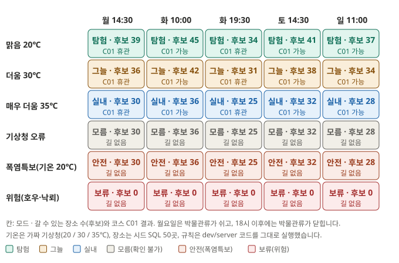

# 서비스 시뮬레이션 v1: 날씨와 시각에 따른 모드와 코스

- 작성일: 2026-11-24
- 상태: 초안. 팀 확인 전입니다. 이 문서는 **실제 서버 규칙 코드를 가짜 날씨와 가짜 시각으로 실행한 결과**입니다. 목표 수치는 없습니다.
- 목적: 기획서의 "날씨·시간·휴관에 맞춰 길을 바꾼다"가 지금 코드에서 어떻게 동작하는지 표로 확인하고, 에이전트가 메워야 할 빈칸을 찾습니다.
- 관련 문서: [agent_architecture_v1.md](agent_architecture_v1.md) (에이전트 구조), [treagent_tech_spec_v1.md](treagent_tech_spec_v1.md) (기능·기술 명세)

## 1. 방법

### 1-1. 무엇을 돌렸나

| 구분 | 내용 | 근거 |
|---|---|---|
| 날씨 | 가짜 기상청의 시나리오 3개(맑음 20℃, 더움 30℃, 매우 더움 35℃)와 기상청 오류, 폭염특보 켜짐(기온 20℃), 위험(호우·낙뢰) 켜짐 | dev/server/src/weather/mock_source.js, rules/decide_mode.js |
| 시각 (한국 시간) | 월 14:30, 화 10:00, 화 19:30, 토 14:30, 일 11:00 (2026-11-16 ~ 22) | dev/server/src/routes/recommend.js의 `koreaClock` |
| 장소 | 시드 SQL로 만든 중구 50곳 (방문 장소 48곳, 이동 허브 2곳)과 모드별 적합도 50행 | dev/supabase/migrations/seed_places.sql, seed_places_jung.sql, seed_place_mode_fit.sql |
| 코스 | 시드 SQL의 코스 C01 (탐험 경로 J03·J04·J01, 실내 경로 J01·J21·J09) | dev/supabase/migrations/seed_courses.sql |
| 실행한 코드 | 날씨 서비스(가짜 기상청), `decideMode`, `selectPlaces`, `buildRoute`, 규칙 폴백 `composeRoute` (AI 키 없이) | dev/server/src/ |

- 날씨·시각·장소가 각각 다른 조합 30개를 모두 돌렸습니다 (날씨 6 × 시각 5).
- AI(LLM)는 호출하지 않았습니다. 그래서 이 결과는 **규칙과 폴백 코스**의 동작이고, 에이전트가 더하는 부분은 포함하지 않습니다.

### 1-2. 한계

- DB의 현재 값이 아니라 **시드 SQL 값**입니다. 담당자가 DB에서 고친 값은 반영되지 않았습니다 `[확인 필요]`.
- 가짜 기상청은 체감온도를 주지 않아(`apparentTemperatureC` 없음) 기온으로 판정했습니다. 실제 기상청 연결 때는 체감온도가 쓰입니다 (decide_mode.js `useApparent`).
- 모드 경계 28℃·33℃와 히스테리시스 1.0℃는 **임시 값**입니다 (dev/server/src/rules/rule_config.js: `[확인 필요]`, 결정 D-06).
- 호우·낙뢰와 폭염특보는 실제 특보 API가 아니라 입력 플래그로 흉내 냈습니다. 실제 특보 연결은 아직 없습니다 (rule_config.js 주석).
- 사용자 좌표는 쓰지 않았습니다 (절대 규칙 1).

## 2. 결과 1: 날씨와 시각에 따른 모드

| 날씨 | 모드 | 사유 코드 | 갈 수 있는 장소(후보) 수: 월 14:30 / 화 10:00 / 화 19:30 / 토 14:30 / 일 11:00 |
|---|---|---|---|
| 맑음 20℃ | 탐험 (EXPLORE) | TEMPERATURE | 39 / 45 / 34 / 41 / 37 |
| 더움 30℃ | 그늘 (SHADE) | TEMPERATURE | 36 / 42 / 31 / 38 / 34 |
| 매우 더움 35℃ | 실내 (INDOOR) | TEMPERATURE | 30 / 36 / 25 / 32 / 28 |
| 기상청 오류 | 모름 (UNKNOWN) | WEATHER_UNAVAILABLE | 30 / 36 / 25 / 32 / 28 |
| 폭염특보 켜짐 (기온 20℃) | 안전 (SAFETY) | HEAT_ALERT | 30 / 36 / 25 / 32 / 28 |
| 위험 켜짐 (호우·낙뢰) | 보류 (HOLD) | HAZARD | 0 / 0 / 0 / 0 / 0 (MODE_NO_PLACES) |

- 모드 판정은 설계 의도대로입니다. 20℃는 탐험, 30℃는 그늘, 35℃는 실내입니다.
- 위험 입력이 켜지면 날씨와 상관없이 보류이고, 추천 장소는 0곳입니다. 기획서의 "위험이 겹치면 이 규칙을 먼저 적용"과 같습니다 (plan/treagent_customer_strategy_v1.md 추천 규칙).
- 기상청 오류, 폭염특보, 위험은 시각이 달라도 같은 모드입니다. 후보 수만 시각(영업시간)에 따라 달라집니다.
- 같은 모드에서도 시각에 따라 후보가 달라집니다. 맑은 날 화 10:00(45곳)과 화 19:30(34곳)은 11곳 차이입니다. 박물관·도서관이 저녁에 닫히기 때문입니다.

## 3. 결과 2: 기온이 오르내릴 때 모드가 깜박이지 않는가 (히스테리시스)

기온 열(℃) 26, 27, 28, 29, 32, 33, 34, 33, 32.5, 32, 31, 30, 29.5, 28, 27.5, 27, 26을 차례로 넣었습니다. 이전 모드를 기억하는 경우와 기억하지 않는 경우를 비교했습니다.

| 기온 | 이전 모드를 기억함 | 기억하지 않음 | 차이 |
|---|---|---|---|
| 32.5℃ (내려가는 중) | 실내 | 그늘 | 있음 |
| 32℃ (내려가는 중) | 실내 | 그늘 | 있음 |
| 27.5℃ (내려가는 중) | 그늘 | 탐험 | 있음 |
| 27℃ (내려가는 중) | 그늘 | 탐험 | 있음 |
| 그 밖의 13개 기온 | 같음 | 같음 | 없음 |

- 기억하는 쪽은 경계값(33℃, 28℃)에서 1.0℃ 더 내려가야 풀립니다. 그래서 경계 근처에서 모드가 오가지 않습니다.
- 기억하지 않으면 33℃ 부근에서 실내와 그늘이 번갈아 나올 수 있습니다.
- 근거: dev/server/src/rules/decide_mode.js `applyHysteresis`, rule_config.js `hysteresisC`.

## 4. 결과 3: 코스 C01은 언제 갈 수 있나

| 날씨(모드) | 쓰는 경로 | 월 14:30 | 화 10:00 | 화 19:30 | 토 14:30 | 일 11:00 |
|---|---|---|---|---|---|---|
| 맑음 (탐험) | explore (J03 동성로, J04 근대골목, J01 약령시박물관) | 불가: 약령시박물관 휴관 | 가능 | 불가: 약령시박물관 마감 | 가능 | 가능 |
| 더움 (그늘) | indoor로 대신 (J01, J21, J09) | 불가: 3곳 모두 월요일 휴관 | 가능 | 불가: 3곳 마감 | 가능 | 가능 |
| 매우 더움 (실내) | indoor (J01 약령시박물관, J21 향토역사관, J09 국채보상운동기념관) | 불가: 3곳 모두 월요일 휴관 | 가능 | 불가: 3곳 마감 | 가능 | 가능 |
| 기상청 오류, 폭염특보, 위험 | 경로 없음 | WEATHER_UNAVAILABLE / SAFETY / HOLD | 같음 | 같음 | 같음 | 같음 |

- **월요일 폭염에는 실내 대체 코스 C01 전체를 갈 수 없습니다.** 실내 경로의 3곳이 모두 월요일 휴관(closed_weekdays {1})이라서, 대체 경로가 같은 휴관일에 함께 걸려 있습니다.
- 저녁(18시 이후)에는 실내 경로 3곳이 모두 닫힙니다 (J01·J21 18시, J09 17시 마감).
- 이때 코드는 `PLACE_CLOSED`를 돌려주고 다른 길을 만들어 주지는 않습니다. "닫힌 곳을 대신할 장소를 찾는 일"은 지금 없습니다 (dev/server/src/courses/build_route.js).

## 5. 결과 4: 규칙 폴백 코스 (AI 없이)

AI 키가 없거나 AI가 실패할 때 쓰는 규칙 코스입니다 (테마 역사, 30대, 혼자, 중구). 같은 모드끼리 묶었습니다.

| 모드 | 시각 | 규칙 폴백 코스 (3곳) |
|---|---|---|
| 탐험 | 월 14:30 | 동성로 · 대구 근대골목 · 서문시장 |
| 탐험 | 화 10:00 | 대구약령시한의약박물관 · 동성로 · 대구 근대골목 |
| 탐험 | 화 19:30 | 동성로 · 대구 근대골목 · 약전골목 (약령시 거리) |
| 탐험 | 토 14:30, 일 11:00 | 대구약령시한의약박물관 · 동성로 · 대구 근대골목 |
| 그늘, 실내, 모름, 안전 | 월 14:30 | 동성로 · 서문시장 · 청라언덕·선교사 스윗즈 주택 |
| 그늘, 실내, 모름, 안전 | 화 10:00, 토 14:30, 일 11:00 | 대구약령시한의약박물관 · 동성로 · 서문시장 |
| 그늘, 실내, 모름, 안전 | 화 19:30 | 동성로 · 청라언덕·선교사 스윗즈 주택 · 스파크랜드 (동성로 옥상 기종 포함) |
| 보류 | 모든 시각 | 없음 (MODE_NO_PLACES) |

- 월요일에는 휴관인 박물관이 빠지고, 저녁에는 18시 이전에 닫는 곳이 빠집니다. 영업 요일·시간을 아는 장소에는 규칙이 맞게 동작합니다.
- 코스 제목은 모드 단어와 테마 단어로 만들어집니다 (예: 맑은날 근대골목길, 실내 문화길). 모드가 모름·안전이면 모드 단어가 빠집니다.

## 6. 발견과 에이전트 설계로 이어지는 점

| # | 발견 | 사실인 근거 | 설계에 주는 의미 |
|---|---|---|---|
| 1 | 영업시간을 아는 방문 장소는 48곳 중 **17곳(35%)** 입니다. 나머지 31곳은 시간을 몰라서 **열려 있다고 보고** 추천합니다. | select_places.js `isOpenAt`: "시간을 모르는 장소(openHour가 null)는 시간 검사를 건너뜀" | 닫은 곳으로 헛걸음할 위험이 남습니다. 에이전트 1의 확인자(오늘 영업 확인)와 장소 자료 보강이 필요한 이유입니다. 헛걸음은 VOC에서 강도 3(가장 큰 불편)입니다 (painpoint/voc_classified.csv id 7·8·9) |
| 2 | 월요일 폭염에는 실내 코스 C01이 전부 닫혀 있습니다. 규칙은 "불가"만 돌려주고 대신할 장소를 찾지 않습니다. | 3장·4장 표 | 코스 설계 에이전트의 "닫힘 → 장소 교체" 단계(기획자·확인자)가 메우는 빈칸입니다 |
| 3 | 영업시간을 아는 17곳 중 **14곳(82%)** 이 19시까지(19시 포함) 문을 닫습니다 (도서관·박물관·화랑 등). | 시드 SQL의 close_hour | 저녁 시간대에는 실내 후보가 크게 줄어듭니다. 시간대별 추천이 중요합니다 |
| 4 | 테마(역사·문화·자연)를 바꿔도 규칙 폴백 코스의 **장소는 그대로**이고 제목만 바뀝니다. 30개 조합 모두 같았습니다. | 5장 표, 코스 제목 규칙 | 규칙만으로는 테마별 코스가 나뉘지 않습니다. 테마별 연구자(에이전트 1)가 더하는 가치입니다 |
| 5 | 그늘·실내·모름·안전 모드의 폴백 코스가 **서로 같습니다.** | 5장 표 | 모드 구분이 코스 구성에 거의 반영되지 않습니다. 모드별 코스 구성 규칙을 정해야 합니다 `[결정 필요]` |
| 6 | 폭염 계열 모드(그늘·실내·안전)에서도 폴백 코스에 동성로·서문시장·청라언덕이 들어갑니다. 이 장소의 유형은 "야외(outdoor)"인데 실내 적합도가 "좋음·대체로"로 적혀 있기 때문입니다. | select_places.js `judge`: 적합도(②)가 유형(③)보다 우선 | 기획서의 "폭염: 야외 미션 중지"와 어긋날 수 있습니다 `[확인 필요]`. 적합도 값이 맞는지(예: 동성로 실내 상가 경유 가정, seed_places.sql의 노트) 담당자가 확인해야 합니다 |
| 7 | 폭염특보(안전)와 날씨 확인 불가(모름)에서도 규칙 폴백은 코스를 만듭니다. | 5장 표 | 기획서는 "기상·현장 상태를 확인하지 못하면 야외 추천을 보류한다"입니다. 앱이 이때 코스를 보여 주는지는 확인하지 못했습니다 `[확인 필요]` (dev/server/src/routes/recommend.js) |
| 8 | 야간 코스에 "스파크랜드 (동성로 옥상 기종 포함)"가 나옵니다. 영업시간이 없는 장소라서 저녁에도 열린 것으로 봅니다. | 5장 표, 발견 1 | 발견 1과 같은 원인입니다. 시간 자료가 없는 장소를 저녁에 추천하지 않는 규칙이 필요합니다 |

## 7. 이번 시뮬레이션이 보여 주지 않는 것

- AI가 만드는 길·설명의 품질. LLM을 호출하지 않았습니다. 에이전트가 만든 결과는 별도 평가가 필요합니다 (agent_architecture_v1.md 8장).
- 실제 기상청 응답, 실제 폭염특보·호우 특보.
- 현장 혼잡, 그늘 구간, 걷는 시간. 이 값은 코드에 없습니다.
- 사용자가 실제로 겪는 시간. 측정이 아니라 규칙 실행입니다.

## 8. 재현 방법

1. `dev/supabase/migrations/`의 시드 SQL 3개(장소, 장소 추가분, 모드 적합도)를 읽어 서버가 쓰는 장소 객체로 바꿉니다 (VALUES 줄의 열 순서는 각 SQL에 적혀 있습니다).
2. `dev/server`에서 Node로 위 함수들을 불러 날씨 6 × 시각 5 조합을 돌립니다. 시각은 `koreaClock(new Date('2026-11-16T05:30:00Z'))`처럼 UTC로 주고, 날씨는 `createWeatherService({ source: 'mock', scenario, now })`로 만듭니다.
3. 폭염특보·위험은 `decideMode(weather, { heatAlert: true })`, `decideMode(weather, { hazard: true })`로 흉내 냅니다.
4. 실행용 스크립트는 저장소에 넣지 않았습니다. 팀이 보관하길 원하면 위치를 정해야 합니다 `[결정 필요]`.

## 결정 필요

- [ ] 모드별 코스 구성 규칙: 그늘·실내·안전·모름이 지금은 같은 코스입니다 (발견 5)
- [ ] 폭염 계열 모드에서 "야외 유형인데 실내 적합도가 좋음"인 장소를 추천에 넣을지 (발견 6)
- [ ] 영업시간을 모르는 장소를 저녁에 추천에서 뺄지 (발견 1·8)
- [ ] 시뮬레이션 스크립트를 저장소에 둘지, 둘 곳

## 확인 필요

- [ ] DB의 현재 장소 값과 시드 SQL 값의 차이
- [ ] 폭염특보·날씨 확인 불가일 때 앱이 코스를 보여 주는지 (발견 7)
- [ ] 동성로·서문시장·청라언덕의 실내 적합도 근거 (발견 6)
- [ ] 모드 경계 28℃·33℃와 히스테리시스 1.0℃ (결정 D-06)

## 출처

- dev/server/src/rules/decide_mode.js, rules/rule_config.js
- dev/server/src/places/select_places.js, courses/build_route.js, ai/compose_route.js, ai/pick_by_rules.js
- dev/server/src/weather/mock_source.js, weather/index.js, routes/recommend.js
- dev/supabase/migrations/seed_places.sql, seed_places_jung.sql, seed_place_mode_fit.sql, seed_courses.sql, alter_places.sql
- research/painpoint/voc_classified.csv (id 7·8·9)
- plan/treagent_customer_strategy_v1.md (추천 규칙), plan/spec/treagent_tech_spec_v1.md
- 실행 결과: 2026-11-24 로컬에서 위 코드를 직접 실행 (Node, dev/server)
