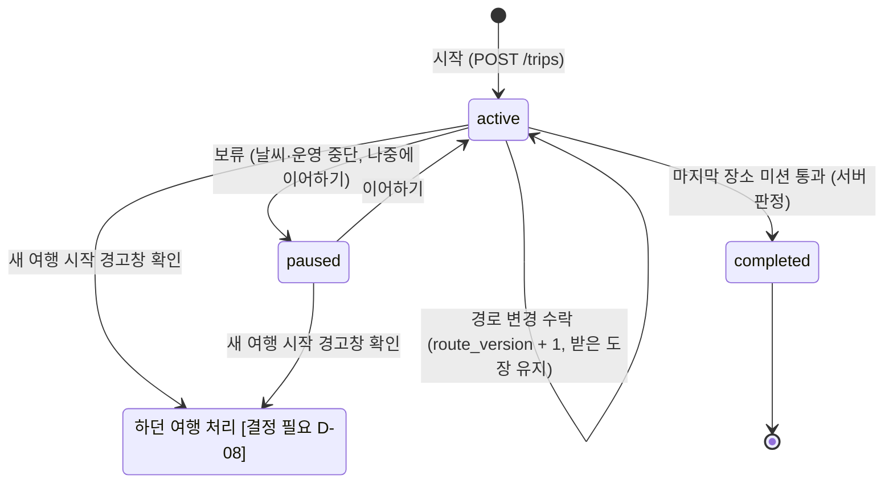
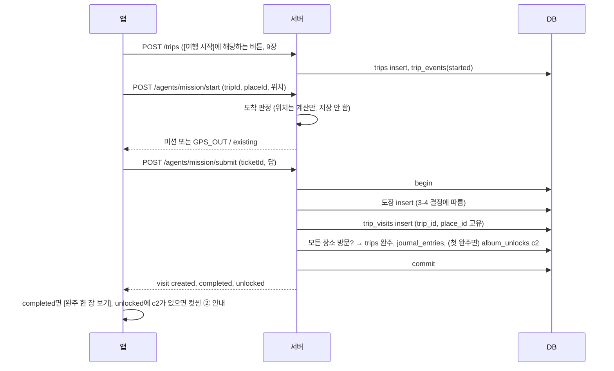

# 여행 저장 · 방문 인증 · 완주 설계 v1 (초안)

F-06 여행 시작·이어하기, F-09 방문 인증, F-10 스탬프·완주, F-11 장부를 서버에 저장하기 위한 설계안입니다.
지금 앱은 이 기록을 서버에 두지 않아서, 장부 [내 여행]과 앨범이 늘 비어 있고 앱을 다시 켜면 걷던 여행이 사라집니다.

- 상태: **초안**. 결정이 필요한 항목은 9장 `결정 필요`에 모았습니다. 팀이 정하기 전까지 구현하지 않습니다.
- 범위: 데이터 표, 상태 전이, API, 앱 연결 지점, 구현 순서. 수치(반경·정확도 등)는 쓰지 않습니다 (명세 D-05).
- 읽는 사람: BE(서버·DB), FE(앱), PM(결정).

---

## 1. 지금 상태 (근거)

- **여행 표가 없습니다.** DB 표는 profiles, places, courses, course_routes, parties, agent_* 등이고 `trips`·`visits`·`journal_entries`는 없습니다 (`dev/supabase/migrations/` 파일 목록).
- **도착 확인과 도장은 이미 미션 API 안에 있습니다.**
  - `POST /agents/mission/start`: 장소와 내 위치를 받아 도착을 확인하고, 멀면 `GPS_OUT`을 돌려줍니다 (`dev/server/src/routes/agents.js` 29~39행).
  - `POST /agents/mission/submit`: 판정을 통과하면 도장을 기록합니다 (같은 파일 41~48행).
  - 위치는 계산에만 쓰고 저장하지 않습니다 (같은 파일 5행).
- **도장 표는 "이용자 × 장소에 1개"입니다.** `agent_stamps`의 고유 제약이 `(user_id, place_id)`입니다 (`dev/supabase/migrations/create_agent_game_tables.sql` 8~17행). 여행(trip)과는 연결되어 있지 않습니다.
- **여행 식별자는 자유 글자뿐입니다.** 일기·카드 표에 `trip_ref text`가 있지만, 가리킬 여행 표가 없습니다 (같은 파일 36행, 46행).
- **오늘의 길에는 id가 없습니다.** `/recommend`가 돌려주는 길은 제목·장소 목록·소요 시간이고 고정 코스 id가 없습니다 (`dev/app/src/lib/server_api.ts` 139~147행). 그래서 여행은 `course_id`만으로는 어떤 길인지 알 수 없습니다.
- **앱은 도착 판정을 화면 안에서 셉니다.** `reached`를 앱 상태로 들고 있고, 코드에 `TODO(PR F): 서버의 방문 기록·도장으로 바꾼다`가 있습니다 (`dev/app/src/app/travel.tsx`).
- **서버는 DB에 SQL을 직접 보냅니다** (`query('... $1', [...])`, `dev/server/src/agents/stores/game_stores.js` 61~73행). 그래서 트랜잭션을 서버에서 걸 수 있습니다 `[확인 필요: query 함수가 같은 연결로 begin/commit을 지원하는지]`.

## 2. 지켜야 할 규칙

| 규칙 | 이 설계에서 하는 일 | 근거 |
|---|---|---|
| 사용자 좌표를 DB·로그·이벤트에 남기지 않음 | 방문 표에 좌표 열을 두지 않음. 도착 판정 결과만 남김 | `dev/CLAUDE.md` 절대 규칙 1 |
| 도장·점수는 서버가 트랜잭션으로, 장부는 추가만 | 방문·도장·완주 기록은 insert-only. 완주 판정은 도장 기록과 같은 트랜잭션 | `dev/CLAUDE.md` 절대 규칙 3, 명세 F-10 |
| 방문은 (세션, 장소) 고유 | 여행 × 장소 고유 제약 | `dev/CLAUDE.md` 절대 규칙 4, 명세 9장 `visits` |
| 재경로 제안은 경로 버전으로 확인 | 여행에 `route_version`을 두고, 다르면 `route_changed` | `dev/CLAUDE.md` 절대 규칙 5, 명세 F-08 |
| 방문 인증 = 미션 수행 | GPS만으로는 도장 없음. 미션 통과가 방문 저장 | 명세 1-3장 결정 2, F-09 |
| 시즌 ID는 P0부터 | 여행·방문에 `season_id`(비어 있어도 됨) | 명세 F-17, 9장 |
| 다른 계정 기록 조회 금지 | 모든 조회에 `user_id = 로그인 계정` 조건 | 명세 F-11 수용 기준 |

## 3. 데이터 표 (안)

명세 9장의 후보 표를 지금 코드에 맞춰 고친 안입니다. 열 이름은 예시이고 BE가 정합니다.

### 3-1. `trips` — 여행 1회

| 열 | 내용 |
|---|---|
| `id` | uuid |
| `user_id` | 여행 주인 (agent_stamps와 같은 형식) |
| `source` | `today`(오늘의 길) / `course`(모든 길) / `party`(친구와 함께) |
| `course_id` | 고정 코스에서 시작했을 때만. 오늘의 길은 비어 있음 |
| `party_id` | 친구와 함께일 때만 |
| `title` | 시작할 때의 길 이름 (나중에 코스 이름이 바뀌어도 카드는 그날 이름) |
| `place_ids` | 지금 따라가는 장소 id 순서 (text 배열) |
| `route_version` | 경로를 바꿀 때마다 1씩 증가 |
| `status` | `active`(진행) / `paused`(보류) / `completed`(완주) / 하던 여행 처리 값 `[결정 필요: D-08]` |
| `season_id` | 비어 있어도 됨 (F-17 대비) |
| `started_at`, `completed_at` | 시각 |

- **진행 중 여행 1개 제한**: `user_id`에 `status = 'active'`인 행은 하나만 있도록 부분 고유 인덱스를 둡니다. 새로 시작할 때 하던 여행을 어떻게 할지는 D-08 미정입니다 (9장).
- `title`·`place_ids`는 **시작 시점의 사본**입니다. 오늘의 길은 다시 만들 수 없어서, 사본이 없으면 카드와 장부를 그릴 수 없습니다.
- 상태가 바뀌는 표라서, 바뀐 이력은 3-2의 추가만 하는 표에 남깁니다.

### 3-2. `trip_events` — 여행 상태 변경 이력 (추가만)

| 열 | 내용 |
|---|---|
| `trip_id`, `kind` | `started` / `paused` / `resumed` / `rerouted` / `completed` / D-08 처리 |
| `route_version` | 그때의 경로 버전 |
| `place_ids` | 경로를 바꿨을 때만 새 장소 순서 |
| `created_at` | 시각 |

- 절대 규칙 3(장부는 추가만)을 지키면서 `trips.status`를 바꾸기 위한 표입니다. `trips`만 두고 이력을 버리는 안도 있습니다 `[결정 필요]`.

### 3-3. `trip_visits` — 여행 안 방문 (= 미션 통과, 추가만)

| 열 | 내용 |
|---|---|
| `trip_id`, `place_id` | **(trip_id, place_id) 고유** |
| `stamp_id` | 이 방문으로 찍힌 도장 (3-4 결정에 따라 달라짐) |
| `order_no` | 몇 번째로 들렀는지 |
| `route_version` | 방문 당시 경로 버전 |
| `season_id` | 비어 있어도 됨 |
| `visited_at` | 미션 통과 시각 |

- **좌표 열은 두지 않습니다.** 명세 9장 후보에는 `lat, lng, accuracy`가 있지만, 절대 규칙 1과 부딪힙니다. 도착 판정은 미션 시작 때 서버가 계산만 하고 버립니다 `[결정 필요: 명세 9장 수정]`.
- 같은 요청이 두 번 와도 고유 제약 때문에 1건만 남습니다 (F-09 수용 기준 ①). 서버는 이미 있으면 `existing`을 돌려줍니다.

### 3-4. 도장 표와의 관계 — 가장 먼저 정해야 함

지금 `agent_stamps`는 "이용자 × 장소에 1개"입니다. 명세 F-10은 "코스 3곳, 도장 3개"이고 절대 규칙 4는 "(세션, 장소) 고유"입니다. 같은 장소를 두 번째 여행에서 다시 들르면 지금 구조로는 도장이 새로 생기지 않습니다.

| 안 | 내용 | 좋은 점 | 걸리는 점 |
|---|---|---|---|
| A | 도장은 지금처럼 이용자 × 장소 1개. 여행 완주는 `trip_visits`(미션 통과)로 셈 | `agent_stamps`를 그대로 둠 | 두 번째 여행에서 같은 장소는 "도장 없음"으로 보임. 카드·장부의 "도장 3개"와 어긋날 수 있음 |
| B | 도장을 여행 × 장소로 바꿈 (`trip_id` 열 추가, 고유 제약 변경) | 명세 F-10, 절대 규칙 4와 맞음 | 이미 만든 표·트리거·조회 코드를 바꿔야 함. 에이전트 설계 v2의 "한 장소 한 번만 도장"과 다름 |

- `plan/spec/agent_architecture_v2.md` 125행("한 장소 한 번만 도장")과 명세 F-10이 서로 다릅니다. 이 문서는 어느 쪽도 고르지 않습니다 `[결정 필요]`.

### 3-5. `journal_entries` — 내 여행 한 장 (추가만)

| 열 | 내용 |
|---|---|
| `trip_id` | 고유 (여행 1회 = 1장) |
| `user_id` | 주인 |
| `title`, `place_ids` | 완주 시점의 사본 (대체 길로 바뀐 경우도 실제 들른 장소) |
| `completed_at` | 완주 시각 |
| `diary_id` | 하랑이 일기(`agent_diaries`)가 있으면 연결 |

- 완주 카드의 날짜·장소·도장은 이 표에서 읽습니다. 지금 카드의 `[시각]`, `[완주 날짜]` 자리표시가 여기서 채워집니다 (`dev/app/src/lib/trip_card_data.ts`).
- 기존 `agent_diaries.trip_ref`, `agent_cards.trip_ref`는 `trips.id`를 담도록 맞춥니다 `[확인 필요: 기존 행 처리]`.

### 3-6. `album_unlocks` — 앨범 해금 (추가만)

| 열 | 내용 |
|---|---|
| `user_id`, `cut_id` | **(user_id, cut_id) 고유**. `cut_id`는 `c1`, `c2` |
| `unlocked_at` | 해금 시각 |

- **저장하는 값은 계정, 컷씬 번호, 해금 시각뿐입니다.** 게임 흐름 9-2절의 확정 결정("로그인한 계정 기준으로 컷씬 번호와 해금 시각만 저장하며 좌표는 없습니다", 2026-11-16)과 명세 S-19를 따릅니다. 어느 여행에서 해금됐는지는 남기지 않습니다 (`storyboard/game_flow_story_v1.md` 361행, 명세 413행).
- 건너뛰어도 해금됩니다 (게임 흐름 7-17행, 524행 `[x]`). 그래서 해금은 컷씬 재생과 상관없이 서버가 조건을 만족했을 때 넣습니다.
- **컷씬 ①**: 조건은 정해져 있습니다. "두 번째 여행의 중반, 두 번째 곳의 도장을 찍은 뒤 다음 곳으로 가기 전에 한 번"입니다 (게임 흐름 6-6행 271행, 9-1절 323행, 결정 2026-11-23). 서버는 도장 기록 트랜잭션에서 "이 이용자의 두 번째 여행"이고 "그 여행의 두 번째 방문"이면 `c1`을 넣습니다. 이미 있으면 고유 제약으로 넘어갑니다.
  - 두 번째 여행을 어떻게 셀지 `[결정 필요]`: 시작한 여행 순서 / 완주한 여행 수 + 1. 첫 여행을 완주하지 않고 새로 시작한 경우(D-08)에 결과가 달라집니다 (9장 #8).
- **컷씬 ②**: 재생 시점은 아직 정해지지 않았습니다. 후보는 "첫 여행 완주 직후(추천)" / "두 번째 여행 시작 때"입니다 (게임 흐름 9-1절 320~327행, 523행 `[ ]`). 추천안을 따르면 완주 트랜잭션에서 이 이용자의 `journal_entries`가 처음 생길 때 `c2`를 넣습니다. 지금 앱이 "앱을 켜 둔 동안만" 기억하는 임시 방식(PR #314, 추천안과 같은 시점)을 이것으로 바꿉니다.

## 4. 상태 전이

- 완주는 **서버만** 정합니다. 앱이 "완주했다"고 보내는 API는 두지 않습니다 (절대 규칙 3).
- 완주 조건: 지금 경로(`place_ids`)의 모든 장소에 `trip_visits`가 있을 때. 대체 길로 바뀐 경우 이미 들른 장소를 어떻게 셀지는 명세 F-10 `[결정]`과 같습니다.
- 방문 순서를 강제할지는 D-07 미정입니다. 정해지기 전에는 순서를 검사하지 않고 `order_no`만 기록하는 안을 제안합니다 `[결정 필요]`.

## 5. API (안)

명세 10장 후보를 지금 서버 구조(`/agents/mission/*`)에 맞춘 안입니다.

| 메서드·경로 | 하는 일 | 응답 (예) | 기능 |
|---|---|---|---|
| `POST /trips` | 여행 시작. 본문: `source`, `title`, `placeIds`, (`courseId` / `partyId`), `confirmReplace` | 새 여행. 진행 중 여행이 있고 `confirmReplace`가 없으면 `409 ACTIVE_TRIP_EXISTS` (앱이 경고창을 띄움) | F-06, D-08 |
| `GET /trips/active` | 진행·보류 중 여행과 방문한 장소 | 여행 + `visitedPlaceIds` | F-03 이어하기, F-06 |
| `PATCH /trips/:id` | 보류·이어하기 | 바뀐 상태 | F-06 |
| `GET /trips/:id/visits` | 이 여행의 방문 목록 (응답 누락 복구용) | 방문 목록 | F-09 |
| `POST /agents/mission/start` | 지금처럼 도착 확인. 본문에 `tripId` 추가 | 지금과 같음 + 이미 방문했으면 `existing` | F-09 |
| `POST /agents/mission/submit` | 지금처럼 판정. 통과하면 **한 트랜잭션에서** 도장 → `trip_visits` → 완주 판정 → (완주면) `journal_entries`·`album_unlocks` | 지금 응답 + `visit: created/existing`, `completed: true/false`, `journalId`, `unlocked: ['c2']` | F-09, F-10 |
| `GET /journal`, `GET /journal/:id` | 내 여행 목록·한 장 | 카드 데이터 | F-10, F-11 |
| `GET /album` | 해금한 컷씬 번호·시각 | `[{ cutId, unlockedAt }]` | S-19 |

- 방문 응답 코드는 명세 10장을 따릅니다: `created`, `existing`, `too_far`(지금 `GPS_OUT`), `low_accuracy`, `route_changed`, `auth_required`. 지금 서버 이름(`GPS_OUT`)과 명세 이름(`too_far`) 중 무엇으로 맞출지 `[결정 필요]`.
- 모든 경로는 로그인 필수이고, `trip.user_id = 로그인 계정`이 아니면 `404`로 돌려줍니다 (다른 계정 여행이 있는지도 알리지 않음).
- 멱등: `submit`은 `ticketId`가 이미 같은 역할을 합니다. 같은 `ticketId`로 다시 오면 처음 결과를 돌려줍니다 `[확인 필요: 지금 ticket 저장 방식]`.
- 경로 변경(`/trips/:id/route-check`, `/reroute/accept`)은 F-08 작업으로 따로 둡니다. 이 설계에서는 `route_version`과 `trip_events.rerouted`만 준비합니다.

## 6. 흐름 (도착 → 미션 → 도장 → 완주)

- 응답이 끊기면 앱은 `GET /trips/:id/visits`를 먼저 보고, 기록이 없을 때만 다시 제출합니다 (명세 4-5장).
- **여행 시작 시점**: 자료에는 "[여행 시작]을 누르면 여행 상태가 '진행'이 된다"고 정해져 있습니다 (게임 흐름 4-15행 165행, 5-1행 206행, 명세 F-06). 버튼 문구는 [같이 걸어요!] / [여행 시작] 창작 후보입니다 (게임 흐름 510행).
  - 그런데 지금 앱에는 이 이름의 버튼이 없습니다. 길을 고르면 브리핑 [확인] → 홈 → 현관문 → [여행 지도 보기] 순서로 갑니다 (PR #314).
  - 그래서 남은 질문은 "앱의 어느 버튼을 [여행 시작]으로 볼지"입니다: 브리핑 [확인] / 현관문 `[결정 필요]` (9장 #4).
  - 이벤트 `trip_start`가 첫 인증률·완주율의 분모라서 이 기준을 먼저 정해야 합니다 (명세 16-2장).

## 7. 앱에서 바뀌는 곳

| 파일 | 지금 | 바뀌는 것 |
|---|---|---|
| `dev/app/src/app/today/route/[n].tsx` 또는 `index.tsx` | 고른 길을 메모리에만 둠 | 6장 결정 시점에 `POST /trips` |
| `dev/app/src/app/index.tsx`, `dev/app/src/lib/home_state.ts` | 이어하기 카드는 자리표시 | `GET /trips/active`로 이어하기 |
| `dev/app/src/app/travel.tsx` | `reached`를 앱이 셈, 첫 완주 컷씬은 앱 메모리 | 서버 방문 목록으로 `reached`, `unlocked`로 컷씬 ② |
| `dev/app/src/components/live_mission.tsx`, `dev/app/src/lib/agents_api.ts` | 미션 시작·제출에 여행 정보 없음 | `tripId` 전달, 응답의 `completed`·`unlocked` 처리 |
| `dev/app/src/app/trip_card.tsx`, `dev/app/src/lib/trip_card_data.ts` | 날짜·시각 자리표시 | `GET /journal/:id` |
| `dev/app/src/app/ledger.tsx` | 내 여행·앨범 늘 빈 상태 | `GET /journal`, `GET /album` |

## 8. 구현 순서 (PR 단위 제안)

날짜는 정하지 않습니다. 앞 단계가 끝나야 다음 단계를 할 수 있는 순서입니다.

1. **결정**: 9장의 D-08 처리, 3-4 도장 안, 시작 시점, 좌표 열 여부.
2. **DB**: `trips`, `trip_events`, `trip_visits`, `journal_entries`, `album_unlocks` 마이그레이션 (insert-only 트리거는 `agent_runs_forbid_change()` 재사용). 3-4가 B안이면 `agent_stamps` 변경 마이그레이션.
3. **서버 여행 API**: `POST /trips`, `GET /trips/active`, `PATCH /trips/:id`, `GET /trips/:id/visits` + 소유권 시험.
4. **미션 연결**: `mission/start`·`submit`에 `tripId`, 한 트랜잭션 처리, 완주 판정·앨범 해금 + 시험 (같은 요청 2번 → 1건).
5. **장부 API**: `GET /journal`, `GET /journal/:id`, `GET /album`.
6. **앱 연결**: 7장 표 순서대로.
7. **시나리오 시험**: 명세 F-06 수용 기준(앱을 껐다 켜도 같은 여행·같은 도장), F-09 ①③, F-11(다른 계정 조회 불가).

## 9. 결정 필요

| # | 항목 | 선택지 | 근거 |
|---|---|---|---|
| 1 | 도장 단위 | A 이용자 × 장소 (지금) / B 여행 × 장소 | 3-4장, `agent_architecture_v2.md` 125행, 명세 F-10, `dev/CLAUDE.md` 절대 규칙 4 |
| 2 | 진행 중 여행이 있을 때 새 여행 시작 시 하던 여행 처리 | 보관(paused로 둠) / 종료(별도 상태) | 명세 D-08 "하던 여행 처리는 미정" |
| 3 | 방문 표 좌표 열 | 두지 않음(이 문서 안) / 명세 9장대로 두고 보관 기간 정함 | `dev/CLAUDE.md` 절대 규칙 1, 명세 9장 922행 |
| 4 | 앱의 어느 버튼을 [여행 시작]으로 볼지 (자료 기준은 [여행 시작] 버튼) | 브리핑 [확인] / 현관문 | 6장, 게임 흐름 165행·206행, 명세 F-06·16-2장 `trip_start` |
| 5 | 방문 순서 강제 | 강제 / 자유 (순서만 기록) | 명세 D-07 |
| 6 | 상태 이력 표 | `trip_events` 둠 / `trips`만 | 3-2장, 절대 규칙 3 |
| 7 | 대체 길 완주 조건 | 바뀐 경로 기준 / 처음 경로 기준 / 들른 장소 수 기준 | 명세 F-10 `[결정]` |
| 8 | 컷씬 ①의 "두 번째 여행"을 세는 기준 (조건 자체는 결정됨: 두 번째 여행, 두 번째 도장 뒤) | 시작한 여행 순서 / 완주한 여행 수 + 1 | 3-6장, 게임 흐름 271행·323행 |
| 9 | 응답 코드 이름 | 지금 서버(`GPS_OUT`) / 명세(`too_far`) | 5장 |
| 10 | 컷씬 ② 재생 시점 (자료에서도 미정) | 첫 여행 완주 직후(추천) / 두 번째 여행 시작 때 | 3-6장, 게임 흐름 320~327행·523행 |

## 10. 확인 필요

- 서버 `query` 함수로 트랜잭션(begin/commit)을 같은 연결에서 걸 수 있는지 (`dev/server/src/agents/stores/game_stores.js`).
- 미션 `ticketId`가 어디에 저장되고, 같은 제출이 두 번 와도 같은 결과를 돌려주는지.
- 기존 `agent_diaries`·`agent_cards`의 `trip_ref` 값 처리.
- 친구와 함께(`parties`)의 여행을 사람마다 `trips` 1개로 둘지, 파티 1개로 둘지.
- 도장 이미지·카드 문구 등 콘텐츠는 이 설계 범위 밖입니다 (승인 대사는 F-13).

## 출처

- `plan/spec/treagent_tech_spec_v1.md` 1-3장(결정 2·3), 4-5장, 4-6장, F-06, F-08~F-11, F-17, 9장, 10장, 13장(D-05, D-07, D-08), 16-2장
- `plan/spec/agent_architecture_v2.md` 6장, 125행
- `storyboard/game_flow_story_v1.md` 4-15행(165행), 5-1행(206행), 6-6행(271행), 7-17행(353행), 9-1절(312~327행), 9-2절(358~361행), 체크리스트(510행, 523~524행)
- `dev/CLAUDE.md` 절대 규칙 1~5
- `dev/supabase/migrations/create_agent_game_tables.sql`, `create_courses.sql`
- `dev/server/src/routes/agents.js`, `dev/server/src/agents/stores/game_stores.js`
- `dev/app/src/lib/server_api.ts`, `dev/app/src/app/travel.tsx`, `dev/app/src/app/cutscene.tsx`, `dev/app/src/lib/trip_card_data.ts`
