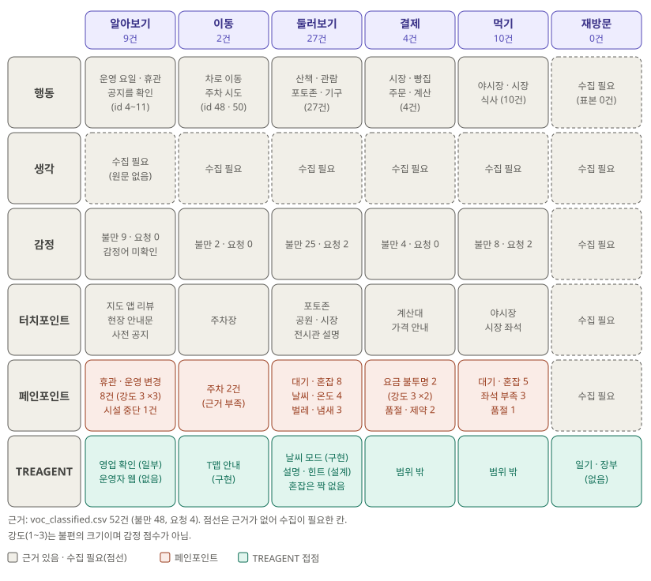
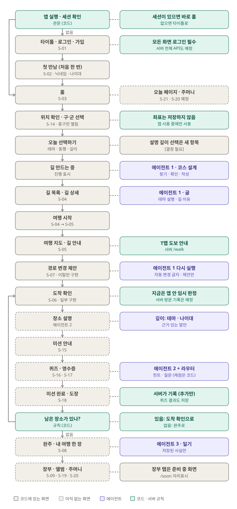
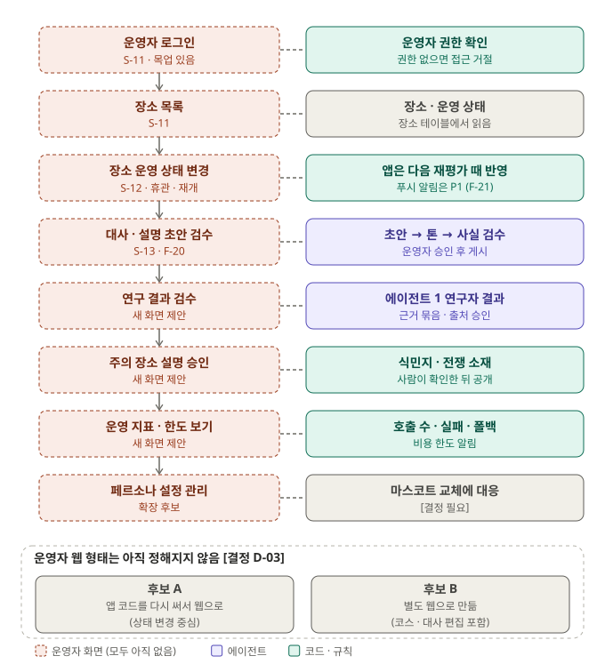
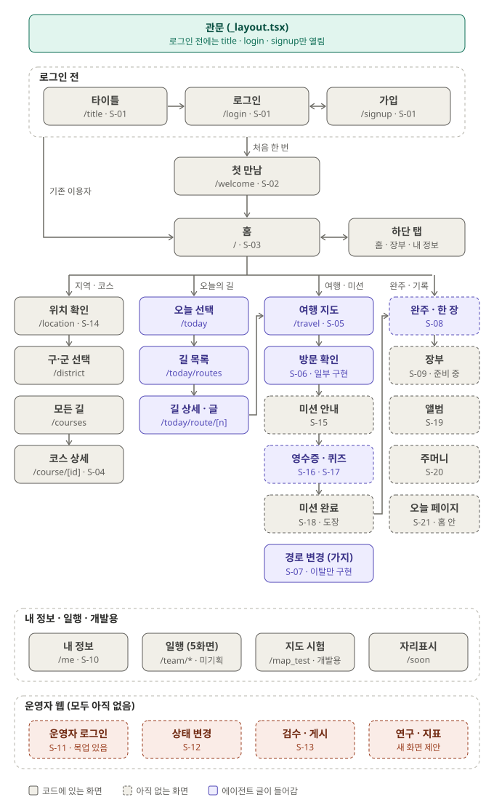
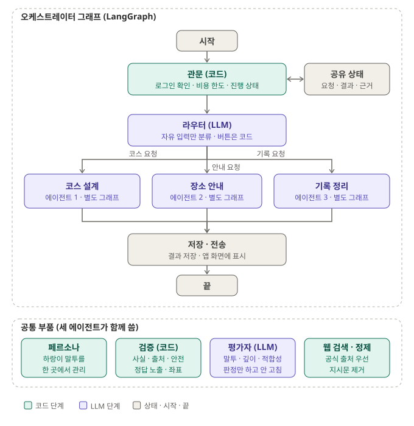
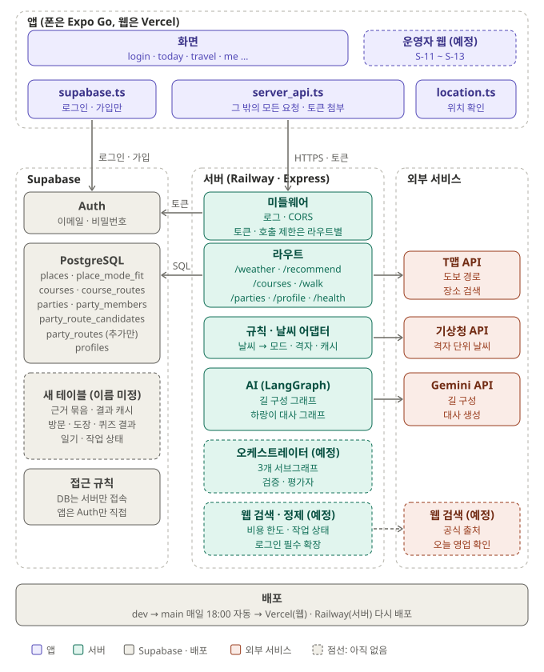
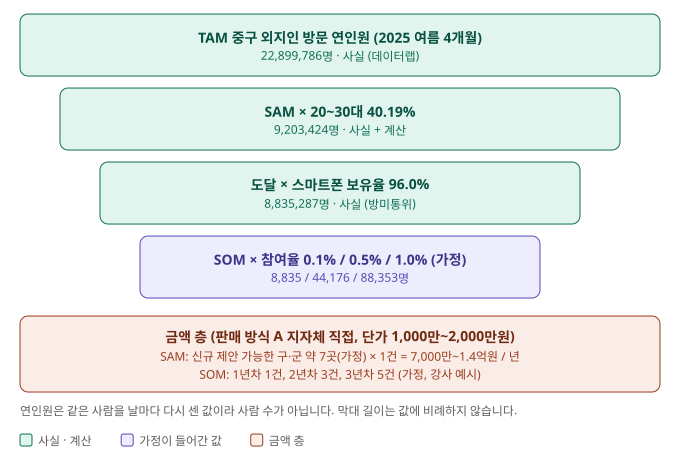
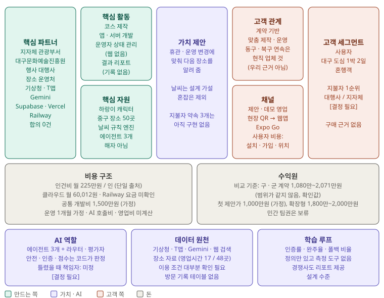
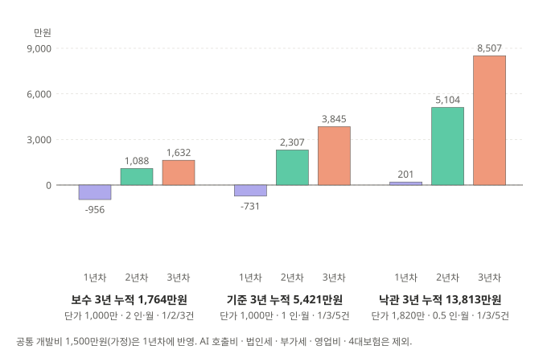
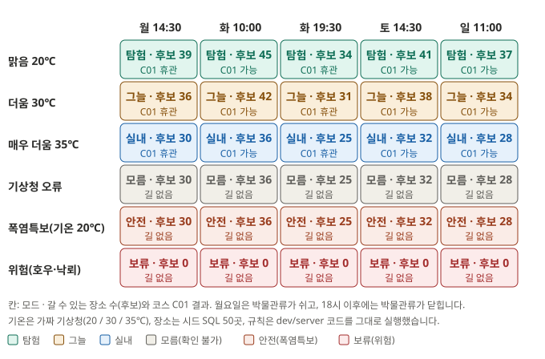

# TREAGENT 기획서 v1

- 작성일: 2026-11-24
- 상태: 초안. 팀 확인 전입니다. `[결정 필요]`, `[확인 필요]`, `가정`, `미검증`이 붙은 값은 확정이 아닙니다.
- 이 문서의 역할: 흩어져 있는 근거 문서를 **한 문서로 묶고, 빠져 있던 비즈니스 모델 캔버스와 시뮬레이션 3개를 더한** 기획서입니다. 새 수치는 만들지 않았고, 모든 수치는 근거 문서를 따릅니다. 기획 단계라 목표 숫자는 쓰지 않습니다.
- 발표용 한 장 요약: [treagent_planning_summary_v1.html](treagent_planning_summary_v1.html)
- 용어: 현재 용어는 **길(코스)과 스탬프**이고 게임 요소는 최소입니다. "미션·퍼즐·단서"는 구컨셉 용어입니다 (plan/treagent_customer_strategy_v1.md 주의 문구).

## 0. 문서 구성과 근거 문서

| 항목 | 이 문서 | 자세한 근거 |
|---|---|---|
| VOC | 2장 | [voc_classified.csv](../research/painpoint/voc_classified.csv), [review_log.md](../research/data/reviews/review_log.md) |
| 페인포인트 | 3장 | [candidates.md](../research/painpoint/candidates.md) |
| 페르소나 | 4장 | [고객 전략 v4](treagent_customer_strategy_v1.md) 4장, [페르소나 이용 시뮬레이션](../research/painpoint/persona_simulation_v1.md) |
| 고객 여정 | 5장 | [여정 지도 v2 (5층)](../research/painpoint/journey_map_v2.md), [고객 전략 v4](treagent_customer_strategy_v1.md) 5장 |
| 유저 플로우 · 화면 구조 | 6장 | [에이전트 구조 설계 v1](spec/agent_architecture_v1.md) 9~11장 |
| 서비스 구조 (에이전트) | 7장 | [에이전트 구조 설계 v1](spec/agent_architecture_v1.md) |
| TAM · SAM · SOM | 8장 | [jung_summer_tam_sam_som_v3.md](../research/bm/jung_summer_tam_sam_som_v3.md), [jung_summer_experience_pricing_pnl_v2.md](../research/bm/jung_summer_experience_pricing_pnl_v2.md) |
| 비즈니스 모델 캔버스 (12블록) · 가치 제안 · 가격 가설 | 9장 | [bm_canvas_v2.md](../research/bm/bm_canvas_v2.md), [vpc_v2.md](../research/bm/vpc_v2.md) |
| 레드팀 검증 기록 | 9장 | [redteam_log_v1.md](../research/bm/redteam_log_v1.md), 관점별 원문 [redteam/](../research/bm/redteam/) |
| 수익 구조 · 손익 | 10장 | [jung_summer_experience_pricing_pnl_v2.md](../research/bm/jung_summer_experience_pricing_pnl_v2.md) |
| 경쟁 | 11장 | [고객 전략 v4](treagent_customer_strategy_v1.md) 3장 |
| 시뮬레이션 3개 | 12장 | [사업](../research/bm/jung_summer_simulation_v1.md), [서비스](spec/service_simulation_v1.md), [페르소나 이용](../research/painpoint/persona_simulation_v1.md) |

## 1. 한눈에 보기

- **무엇을 하나**: 대구 중구에서 날씨·시간·장소의 운영 상태에 맞춰 길(코스)을 바꿔 안내하고, 하랑이(능금 모티프 다람쥐 캐릭터)가 안내와 기록을 맡는 서비스입니다 (brand/game_concept.md, plan/spec/treagent_tech_spec_v1.md 1장).
- **누구의 어떤 문제인가**: 방문객은 가려는 장소가 지금 열려 있는지, 날씨에 맞는지 모르고 헛걸음하거나 더위·혼잡에 막힙니다. 행사를 운영하는 쪽은 계획이 바뀔 때 참가자에게 알리고 결과를 보고해야 합니다 (고객 전략 1장).
- **어떻게 푸나**: 규칙 엔진이 날씨로 모드를 정하고(탐험·그늘·실내·안전·보류), 에이전트 3개(코스 설계, 장소 안내, 기록 정리)가 길을 짜고 설명하고 기록합니다. 안전·판정·점수는 규칙과 서버가 하고, LLM은 찾고 쓰는 일을 맡습니다 (7장).
- **누가 돈을 내나**: 지자체 관광부서·관광기관과 행사 대행사가 코스 제작·운영 과업으로 계약합니다. 민간 직접 판매(팀권)는 보류입니다 (고객 전략 6장, 2026-11-19 기준).
- **범위**: MVP는 **중구만**, 한 코스는 장소 3곳, 도장은 미션 완료 때, 인증은 GPS + 미션입니다 (treagent_tech_spec_v1.md 1-3절, 2026-11-17 팀 결정).
- **지금 어디까지 왔나**: 로그인·첫 만남·홈·오늘의 길·여행 지도(T맵 길 안내)가 앱에 있습니다. 도착 인증 서버 기록, 미션·퀴즈, 도장 저장, 일기, 장부, 운영자 화면은 아직 없습니다 (6장 표).

## 2. 문제와 VOC

- 자료: 지도 리뷰 43건과 블로그 9건에서 불만·요청 **52건**을 분류했습니다 ([voc_classified.csv](../research/painpoint/voc_classified.csv)).

| 구분 | 내용 |
|---|---|
| 유형 | 불만 48건, 요청 4건 |
| 여정 단계 | 알아보기 9, 이동 2, 둘러보기 27, 결제 4, 먹기 10, 재방문 0 |
| 원인 상위 | 대기·혼잡 13건(강도 합 21), 휴관·공사·운영 변경 10건(강도 합 20), 날씨·온도 4건(강도 합 5), 좌석 부족 3, 시설 노후·운영 중단 3, 벌레·냄새 3 |
| 가장 몰린 칸 | 둘러보기×대기·혼잡 8건, **알아보기×휴관·공사·운영 변경 8건**, 먹기×대기·혼잡 5건 |

- 강도: 1 = 짧은 불편, 2 = 반복 불편·시간 손해, 3 = 포기·헛걸음·돈 손해 (candidates.md).
- **한계**: 52건은 불만·요청 중심으로 모은 분류표라 전체 관광객의 불편률로 바꿔 말할 수 없습니다. 요약문 기준이고 원문 대조는 표본 10건뿐입니다. 축제 기간 글(치맥페스티벌, 막창축제 등)이 섞여 대기·혼잡이 과대일 수 있습니다 (candidates.md, 고객 전략 2장).
- 재방문 단계 리뷰는 표본에 0건입니다. 지역 이야기가 다음 장소로 이동할 이유가 되는지는 확인되지 않았습니다 (고객 전략 2장).

## 3. 페인포인트

진술문 후보 3개입니다 (candidates.md, 확정 전 `[결정 필요]`). 같은 원인 3건 이상, 출처 2종 이상일 때만 후보로 올렸습니다.

| # | 누가 · 언제 | 무엇을 하려는데 | 왜 막히나 | 근거 |
|---|---|---|---|---|
| 1 | 주말·축제 시간대의 방문객 | 인기 먹거리·기구·포토존·좌석 이용 | 줄이 길어 1시간 안팎 기다리거나 자리가 없어 서서 먹음 | VOC 13건 (축제 글 포함) |
| 2 | 특정 시간에 맞춰 방문하려는 방문객, 방문 직전 | 전시관·건물 내부·음악분수·야시장 관람 | 운영 정보가 현장과 다르거나 사전 공지가 없어 **헛걸음** (헛걸음 3건, 강도 3) | VOC 10건 (id 1, 3~11) |
| 3 | 한여름 낮, 바람 센 날, 빙상장 정빙 시간의 방문객 | 산책, 실내 체험, 빙상장 이용 | 덥고 습하거나 바람·냉기 때문에 오래 머물기 어려움 | VOC 4건 (id 22, 32, 36, 45) |

- 첫 파일럿은 **운영 변경 → 대체 장소 선택 → 인증·진행 복구**에 집중합니다. 운영자가 상태를 바꿀 수 있어 동작과 효과를 직접 확인하기 쉽기 때문입니다 (고객 전략 2장).
- 대기·혼잡은 점수가 가장 높지만 혼잡 데이터가 코드에 없습니다. 데이터가 확보되면 대체 거점 안내로 다룹니다 (고객 전략 2장, 페르소나 이용 시뮬레이션 4장).
- 서비스 시뮬레이션 결과, 이 페인포인트 2번(헛걸음)은 **영업시간을 아는 방문 장소가 48곳 중 17곳(35%)뿐**이라 규칙만으로는 일부만 막힙니다 (spec/service_simulation_v1.md 6장 발견 1).

## 4. 페르소나

| 역할 | 페르소나 | 상태 |
|---|---|---|
| 1차 이용자 | **1박 2일 대구 혼행객**: 귀가 일정 사이 여유 시간에 중구에서 짧게 대구다운 장소를 둘러봄. 현장에서 휴대폰으로 운영시간과 길을 확인함. 연령은 20~30대를 모집 가설로 둠 | 가설. 인구통계·대표 한 문장은 **수집 필요** (인터뷰) |
| 1차 구매·운영 | **지역 관광 행사 대행사 PM**: 여러 장소 운영 담당자와 일정을 맞추고 당일 변경에 대응하며 종료 후 발주처에 보고함 | 가설. 인터뷰 전 |
| 예산·성과 승인 | 지자체 관광부서, 관광·문화 유관기관 행사 담당자 | 대행사 납품 가설의 최종 예산원 (고객 전략 4장) |
| 민간 유료 고객 | 대구 거주자·친구·커플 | **보류** (팀권 판매 보류) |

**이용자 페르소나의 불만·장벽 (VOC로 채움)**

| 장벽 | 내용 | 근거 |
|---|---|---|
| 운영 정보가 현장과 다름 | 알아보기 단계에서 휴관·운영 요일을 잘못 알고 헛걸음함 | VOC 10건, 알아보기 8건, 강도 3은 id 7·8·9 |
| 기다림과 혼잡 | 줄서기, 주말 혼잡, 정빙 시간 대기 | VOC 13건 |
| 날씨 | 더위·습도·강바람·실내 추위 | VOC 4건 |

- 성공 기준: 지금 갈 수 있는 다음 장소와 도착 후 할 일이 분명하고, 앱을 닫거나 장소가 바뀌어도 기록이 유지됩니다.
- 옛 초안 [brand/customer_persona.md](../brand/customer_persona.md)(근거 칸 "수집 필요")는 같은 선택(혼행객)이고, 이 문서와 [페르소나 이용 시뮬레이션](../research/painpoint/persona_simulation_v1.md)이 불만·장벽 칸을 채웠습니다.
- 검증할 가설: 혼행객이 하랑이를 실용적인 안내자로 받아들이는지, 현장에서 앱 이용을 감수할 만큼 경험이 매력적인지 (고객 전략 4장).

## 5. 고객 여정

**여정 지도 (VOC 52건, 5층: 행동·생각·감정·터치포인트·페인포인트)**

- 전체 표와 근거 id: [journey_map_v2.md](../research/painpoint/journey_map_v2.md). 모든 칸에 VOC id를 붙였고, 근거가 없는 칸(생각 층, 재방문)은 지어내지 않고 비웠습니다.
- 알아보기 9건은 모두 불만이고 그중 8건이 운영 정보 문제입니다. 서비스가 가장 먼저 개입할 지점입니다.
- 둘러보기의 대기·혼잡은 지금 풀 수 없고, 결제·먹기(VOC 14건)는 서비스 범위 밖입니다 `[결정 필요]`.

**이용자 여정 (현재 관찰 → 목표 경험)**

| 단계 | 현재 행동·장벽 | TREAGENT 접점 | 측정 |
|---|---|---|---|
| 발견 | 블로그·행사 안내·현장 홍보로 후보를 찾음 | 현장 QR에서 코스 주제·예상 소요시간·참가 조건 확인 | QR 진입 → 첫 시작률, 설치 단계 이탈 |
| 선택·시작 | 장소가 열려 있는지, 날씨에 맞는지 확인 | 운영 상태와 실내 대체 옵션 확인. 하랑이가 시작과 첫 목적지 안내 | 선택 → 시작 시간 |
| 이동 | 지도 확인, 휴관·혼잡·기상 변화 시 우회 | 하랑이 안내. 바뀌면 이용 가능한 대체 거점과 사유 안내 | 변경 영향 사용자의 대체 시작률 |
| 현장 인증 | 현장에서 무엇을 할지 파악하고 수행 | 행동·인증 방법과 실패 시 재시도 안내 | 첫 인증률, 실패 사유 |
| 이어하기 | 다른 일정이나 앱 종료 뒤 코스를 잃을 수 있음 `[가설]` | 저장된 기록 복구, 다음 행동 안내 | 복귀 세션의 정상 이어하기 비율 |
| 완주·기록 | 완료 후 결과 확인. 재방문 근거는 수집 필요 | 완료 안내, 도장과 일기 | 완주율, 완료 후 만족도 |

**행사 대행사 여정**: 상담·견적 → 제작·검수 → 행사 운영 → 결과 제출·재계약 (고객 전략 5장).

- 초안(블로그 20건 기준) 그림은 [customer_journey_map_v1.html](../research/painpoint/customer_journey_map_v1.html)에 있습니다. 52건 기준은 위 지도입니다.
- 측정 항목의 정의(첫 인증률, 완주율, 변경 후 재개율)는 고객 전략 7장을 따릅니다. 지금은 측정 도구가 없습니다.

## 6. 유저 플로우와 화면 구조

### 6-1. 이용자 유저 플로우

- 실선은 코드에 있는 화면, 점선은 아직 없는 화면입니다.
- 에이전트가 들어가는 곳: 길 만드는 중·길 상세(에이전트 1), 장소 설명·퀴즈 힌트(에이전트 2), 완주·일기(에이전트 3).

### 6-2. 운영자(공급자) 유저 플로우

- **운영자 쪽이 필요합니다.** 운영자 웹(F-18)과 화면 S-11~S-13이 기획서에 있고, 휴관 시연이 이 기능에 달려 있습니다. 앱에는 없고 목업만 있습니다 (storyboard/operator_web_mockup_v1.html).
- 에이전트 설계로 운영자의 일이 늘어납니다: 연구 결과 검수, `주의` 장소 설명 승인, 호출·비용 한도 보기.
- 운영자 웹의 형태(앱 코드 재사용 / 별도 웹)는 `[결정 D-03]`이고, 가게·시설이 직접 상태를 입력하는 외부 공급자 화면은 기획서에 없습니다 `[결정 필요]`.

### 6-3. 앱 화면 구조 (구현·미구현 전체)

| 구분 | 화면 | 상태 |
|---|---|---|
| 있음 | S-01 로그인·가입, S-02 첫 만남, S-03 홈, S-14 위치 확인·구·군 선택, S-04 코스·오늘의 길, S-05 여행 지도(T맵 길 안내), S-10 내 정보 | 코드에 있음 |
| 일부 | S-06 도착 확인(앱 안 임시 판정 30m, 서버 기록 없음), S-07 경로 변경(이탈 시 새 경로 제안만) | travel.tsx |
| 없음 | S-15 미션 안내, S-16 영수증, S-17 퀴즈, S-18 미션 완료, S-08 완주·내 여행 한 장, S-09 장부, S-19 앨범, S-20 주머니, S-21 오늘 페이지, 운영자 S-11~S-13 | 스토리보드·명세에만 있음 |
| 기획서 밖 | 일행(팀) 화면 5개, 지도 시험 | 코드에 있으나 기획서 화면 목록에 없음 `[확인 필요]` |

## 7. 해결 방식: 서비스 구조

- 규칙 엔진이 날씨로 모드를 정합니다 (탐험 28℃ 미만, 그늘 28℃ 이상, 실내 33℃ 이상, 안전 폭염특보, 보류 위험). 경계값 28℃·33℃는 임시 값입니다 `[확인 필요]` (dev/server/src/rules/rule_config.js).
- 에이전트 3개
  - **코스 설계**: 웹·지도로 장소를 찾고 오늘 영업을 확인해 길을 짬. 테마(역사·문화·자연)별 연구자가 다르게 찾음
  - **장소 안내**: 장소 설명, 장소 사이 설명, 힌트, 질문, 게임 규칙 답변. 퀴즈 문항·정답·채점은 고정 데이터
  - **기록 정리**: 방문 기록(방문한 장소, 보여 준 설명, 퀴즈 결과)으로 하랑이 일기를 씀
- 공통 부품: 라우터, 검증(코드), 평가자(LLM), 페르소나, 웹 검색·정제, 로그인 필수, 비용 한도.
- 원칙: 안전·점수·도장·인증은 LLM이 판정하지 않습니다. LLM이 고르고 코드가 거부권을 가지며, 실패하면 미리 만든 안전한 결과로 내려갑니다.
- **기획서 15장과 달라지는 점**: 경로 결정까지 LLM이 맡는 것(기획서는 "경로 결정은 규칙 엔진"), 지금 구현에 포함하는 것 등 6가지를 [에이전트 구조 설계 v1](spec/agent_architecture_v1.md) 2-2장에 적었습니다. 팀 확인이 필요합니다.

- 앱은 DB와 외부 API에 직접 접속하지 않고 서버만 호출합니다. 로그인은 Supabase에 직접 요청합니다. 비밀 키는 서버에만 둡니다 (dev/README.md).
- 서버는 `/health`만 로그인 없이 열고 나머지는 로그인 토큰이 필요하게 하는 변경이 PR로 올라가 있습니다 (PR #238, 2026-11-24 기준 병합 전).

## 8. 시장 규모 (TAM · SAM · SOM)

**이용자 규모 (판매 방식과 무관, 매출 아님)**

| 단계 | 여름 4개월 | 월 평균 | 구분 | 근거 |
|---|---|---|---|---|
| TAM: 중구 외지인 방문 연인원 (2025 여름) | 22,899,786 | 5,724,947 | 사실 | 한국관광 데이터랩 월별 합산 |
| SAM: × 20~30대 40.19% | 9,203,424 | 2,300,856 | 사실 + 계산 | 데이터랩 성/연령 화면 (2025.6~9) |
| 도달: × 스마트폰 보유율 96.0% | 8,835,287 | 2,208,822 | 사실 | 방미통위 원문 (2025) |
| SOM 보수 (참여율 0.1%) | 약 8,835 | 약 2,209 | **참여율 가정** | 군산 완주 기준 약 0.047% 참고 |
| SOM 기준 (참여율 0.5%) | 약 44,176 | 약 11,044 | **참여율 가정** | |
| SOM 낙관 (참여율 1.0%) | 약 88,353 | 약 22,088 | **참여율 가정** | |

- 연인원은 같은 사람을 날마다 다시 센 값이라 사람 수가 아닙니다. 20~30대는 모집 가설이고, 대구 거주 20~30대는 이 TAM에 없습니다 (v2 4-1).
- 연간 기준 TAM은 69,024,662명입니다 (jung_som_inputs_v1.csv R_tam_annual_2025).

**금액 층 (판매 방식 A: 지자체 직접, 단가 1,000만~2,000만원)**

| 단계 | 값 | 구분 |
|---|---|---|
| SAM | 신규 제안 가능한 구·군 약 **7곳** × 1건 × 단가 = **7,000만~1.4억원 / 년** | 7곳은 **가정** (앱 운영 중인 동구·북구 제외) |
| SOM | 1년차 1건 / 2년차 3건 / 3년차 5건 = 1,000만~2,000만 / 3,000만~6,000만 / 5,000만~1억원 | 건수는 **가정** (강사 예시) |
| 약점 | 3년차 5건은 7곳 중 5곳(71%). 대행사나 시 산하 기관 경로가 함께 있어야 설명됨 | v2 4-2 |

- 판매 방식 B(행사 대행사 경유)의 SAM·SOM은 접근 가능한 대행사 수가 **자료 없음**이라 비워 둡니다 (v2 4-2).
- TAM의 예산 쪽(대구시 관광 스탬프·앱 사업 예산)은 **자료 없음**이 많습니다. 항목별 값과 열람 여부는 v3 표 1에 있습니다.
- **곱셈 항 중 가장 약한 것**: 참여율(0.1~1.0%), 7곳 전제, 계약 건수 (v2 4-4).

## 9. 비즈니스 모델 캔버스 · 가치 제안 · 레드팀 검증

- 기본 9블록에 AX 3블록(AI 역할, 데이터 원천, 학습 루프)을 더한 **12블록**입니다. 블록별 근거 파일과 `▶ v2 변경`은 [bm_canvas_v2.md](../research/bm/bm_canvas_v2.md)에 있습니다.
- 아래 내용은 **레드팀 검증을 반영한 제안**이고 팀 확인 전입니다.

**가치 제안 (사용자 / 지불자)** — 짝 맞추기 전체는 [vpc_v2.md](../research/bm/vpc_v2.md)

| 구분 | 고객 쪽 근거 | 우리의 제안 | 상태 |
|---|---|---|---|
| 사용자 | VOC 휴관·공사·운영 변경 10건 (강도 3은 3건, 모두 서문야시장) | 오늘 갈 수 있는 다음 장소와 대체 길 안내 | 규칙 일부 (영업시간 아는 곳 17/48) |
| 사용자 | 날씨 VOC 4건 | 날씨 모드 전환 | 구현. 단 **근거 장소가 중구 밖**이라 설계 가설 |
| 사용자 | 대기·혼잡 13건 | 없음 | **범위에서 제외** |
| 지불자 | 근거 없음 (전부 가설, 미측정) | 변경 한 번 입력, 거점별 집계 | **없음** (운영자 웹·방문 기록 없음) |

**가격 가설 (강의 형식)**

- [지불자] 지자체 관광·문화 부서 또는 행사 대행사 (1순위 `[결정 필요]`)
- [과금 단위] 코스·운영 용역 1건
- [금액] 1,000만~2,000만원을 낼 것이다 (**가정값**, 첫 제안가 1,000만원, VAT 여부 `[확인 필요]`)
- 왜냐하면 구·군이 비슷한 범위의 용역에 낸 공개 계약 금액이 1,080만~2,071만원이기 때문이다. 단, **같은 일의 대안 비용이 아니라 범위가 다른 비교 기준**이다 (동구·북구는 스탬프 앱 운영, 평창·태안은 미션형 여부 미확인).
- [확인 방법] 구청 담당자·대행사 PM 견적 수용 인터뷰, 과업지시서 확인, 단가 ±20% 재계산

**레드팀 검증 (서브에이전트 3개 동시 실행)** — 기록 전체는 [redteam_log_v1.md](../research/bm/redteam_log_v1.md)

| 항목 | 내용 |
|---|---|
| 방법 | 투자자·고객·경쟁사 관점 에이전트 3개가 읽기 전용으로 캔버스를 검증 ([정의 파일](../.claude/agents/)). 지적 21건 → 11개 묶음, 두 관점 이상이면 한 단계 상향 |
| 가장 큰 약점 | 돈을 내는 쪽의 구매 이유에 근거가 없고, 가격 근거가 우리 상품과 같은 일이 아님 |
| 반영한 것 | 가격 근거 문장, 재계약 선례 정정, 약속과 구현 현황 분리, 비용 구조에 Railway·운영 개월 가정, 사용자 비용 |
| 팀이 정할 것 | 1순위 지불자(대행사/지자체), AI 오류 책임 소재(후보 A/B), 구매 신호 인터뷰 |
| 에이전트가 틀린 것 | 큐알스탬프 가격·영업시간 17/48 "확인 불가" 주장은 근거 파일과 시드 파싱으로 반박 |

- 이 기록의 결정은 **제안**이며 팀 확인 전입니다. 책임자 칸은 비워 두었습니다.

## 10. 수익 구조와 손익

**판매 방식 후보** (v2 5장)

| 후보 | 누가 사나 | 단가 앵커 | 근거 수준 |
|---|---|---|---|
| A. 지자체에 코스·운영 용역 | 구청 관광·문화 부서 | 동구 운영 10.8M(2023~2026 연속), 북구 11.0M, 평창 18.2M, 태안 20.71M (모두 수의계약) | 높음 (실제 계약 6건) |
| B. 행사 대행사에 체험 항목 | 지자체 사업을 맡는 행사 대행사 | 체험 항목 1건 약 990만~1,820만원 (비공개 참고 자료) | 중간 (앱 사례는 아님) |
| C. 도구로 구독 | 코스를 직접 만드는 대행사·지자체 | 큐알스탬프 100만~200만원~ | 낮음 |
| D. 민간 팀권 | 시민·방문객 | 14,900원 가설 | 낮음, **보류** |

- 제안: 근거가 가장 두터운 A를 1순위, B를 2순위 가설로 두고 C·D는 보류. 정하는 것은 팀입니다.
- 단가: 첫 제안가 **1,000만원**(구청 운영 수준), 확장형 약 1,800만~2,000만원. 3,000만원은 근거가 없어 쓰지 않습니다 (v2 6장).

**손익 시나리오** (공통 개발비 1,500만원·인건비 월 225만원·클라우드 월 60,012원 **가정**)

| | 보수 | 기준 | 낙관 |
|---|---|---|---|
| 단가 | 1,000만원 | 1,000만원 | 1,820만원 |
| 건당 투입 | 2 인·월 | 1 인·월 | 0.5 인·월 |
| 계약 수 1/2/3년차 | 1 / 2 / 3 | 1 / 3 / 5 | 1 / 3 / 5 |
| 1년차 손익 | -9,560,012원 | -7,310,012원 | +2,014,988원 |
| 3년 누적 | +17,639,928원 | +54,209,892원 | +138,134,892원 |

- 손익분기 계약 수는 단가 1,000만원에서 건당 투입 0.5/1/2/3 인·월일 때 2/2/3/5건, 단가 1,820만원에서 1/1/2/2건입니다 (v2 7장).
- 민감도 1위는 단가와 계약 수이고, 둘 다 근거가 가장 약합니다 (±20%에서 3년 누적 변화 폭 3,600만 / 2,768만원).
- **제외**: AI 호출비, 법인세, 부가세 정산, 영업비, 4대보험, 계약이행보증. 실제 손익은 더 낮을 수 있고, 비공개 참고 자료의 사업 수익률(20%대)보다 위 마진이 높아 낙관 쪽입니다.
- 구청 운영 용역만 받는 것은 위험합니다: 동구 조건(월 196만원)에 1명을 5.5개월 투입하면 -1,905,066원입니다.

## 11. 경쟁

| 층 | 선택지 | 가격·내용 | 근거 |
|---|---|---|---|
| 직접 경쟁 | 퀘스투어 | 개발 라이트 1,500만원~, 프리미엄 3,000만원~(회사 공개가), 1인 10,000원 | 회사 공개 자료 |
| 직접 경쟁 | 리얼월드 | 티켓 14,900원(얼리버드) / 35,900원(정가). AI NPC·분기·실시간 변경이 공개 제안 범위에 있음 | 공개 티켓가 |
| 직접 경쟁 | 큐알스탬프 | 이지 100만원~, 데일리 200만원~ (도구형) | 회사 공개가 |
| 간접 경쟁 | 구청 모바일 스탬프 투어 운영 업체 | 동구 10.8M(2023~2026 연속), 북구 11.0M | 수의계약 현황 |
| 현상 유지 | 종이 스탬프북·기념품 | 중구 2026 물품 12,582,500원, 앱 운영 용역 없음 | 중구 수의계약 |

- 차별점 가설: 날씨에 맞춰 길을 바꾸고 이야기·기록이 있는 코스를 제작까지 포함해 제공합니다. 찾은 범위에서 날씨 분기 서비스는 없었습니다 `[가설]`. 경쟁사도 AI NPC·분기·인증·실시간 변경을 공개 제안하고 있어, 검증 대상은 **운영자가 거점을 중단한 뒤 대체 길을 안내하고 진행을 이어가는 전체 흐름의 편의와 운영 비용**입니다 (고객 전략 3장).
- 2026년 대구에서 공공 스탬프 투어 3건이 운영됐습니다(동구, 북구, 진흥원 스탬프 로드 20). 참여자 수와 예산은 공개되지 않았습니다 (v2 3장).

## 12. 시뮬레이션

세 가지를 모두 돌렸습니다. 각각 **전망이 아니라 가정이나 규칙을 바꿔 본 결과**입니다.

### 12-1. 사업 시뮬레이션

- 내용: 판매 방식(A / B 대행사 마진 0·10·15%), 단가(1,000만 / 1,820만원), 건당 투입(0.5~3 인·월), 계약 건수(연 0~5건)를 바꿔 손익분기와 3년 누적을 계산. 새 입력값은 만들지 않았고, v2의 숫자를 같은 식으로 모두 재현해 계산식을 확인했습니다.
- 알게 된 것
  - 단가 1,000만원에서는 **연 2건부터 1년차가 흑자**이고, 연 1건이면 3년 누적에서야 +807만원입니다.
  - 판매 방식 B는 마진 15%(가정)만으로 손익분기가 A보다 소수 기준 0.2~4.2건 늘어납니다.
  - 계약이 없는 해의 손실은 공통 개발비(가정) 1,500만원입니다.
- 자세한 표: [jung_summer_simulation_v1.md](../research/bm/jung_summer_simulation_v1.md)

### 12-2. 서비스 시뮬레이션

- 내용: 실제 서버 규칙 코드를 가짜 날씨 6가지 × 시각 5가지로 돌려, 모드와 코스 C01의 결과를 확인했습니다. AI는 호출하지 않았습니다.
- 알게 된 것
  - 모드 판정은 의도대로입니다 (20℃ 탐험, 30℃ 그늘, 35℃ 실내, 기상청 오류 모름, 폭염특보 안전, 위험 보류).
  - **월요일 폭염에는 실내 코스 C01의 3곳이 모두 월요일 휴관**이라 갈 곳이 없고, 저녁(18시 이후)에도 3곳이 닫힙니다. 규칙은 "불가"만 돌려주고 대신할 장소를 찾지 않습니다.
  - 영업시간을 아는 방문 장소는 48곳 중 17곳(35%)이라 나머지는 열린 것으로 보고 추천합니다.
  - 테마를 바꿔도 규칙 폴백 코스의 장소는 같고 제목만 바뀝니다.
  - 폭염 계열 모드에서도 야외 유형 장소(동성로·서문시장·청라언덕)가 코스에 들어갑니다 `[확인 필요]`.
- 자세한 표: [service_simulation_v1.md](spec/service_simulation_v1.md)

### 12-3. 페르소나 이용 시뮬레이션

- 내용: 페르소나(혼행객, 행사 대행사 PM)가 4개 상황(월 14:30 맑음, 월 14:30 폭염, 화 19:30, 토 14:30)에서 유저 플로우를 따라가며 VOC 페인포인트가 풀리는지 점검했습니다. 실제 사용자 관찰이 아닌 논리적 점검입니다.
- 알게 된 것

| 페인포인트 | 판정 |
|---|---|
| 휴관·공사·운영 변경 (VOC 10건) | **일부** (영업시간을 아는 장소만 걸러짐) |
| 대기·혼잡 (VOC 13건) | **미해소** (혼잡 데이터 없음) |
| 날씨·온도 (VOC 4건) | **일부, 새 위험** (모드는 맞게 전환되나 폭염에 야외 유형 장소가 포함됨) |

- 행사 대행사 PM 흐름(상태 변경 → 반영 → 대체 코스 → 결과 보고)은 운영자 화면과 방문 기록이 없어 지금은 시연할 수 없습니다.
- 자세한 표: [persona_simulation_v1.md](../research/painpoint/persona_simulation_v1.md)

### 12-4. 세 시뮬레이션이 같은 방향을 가리키는 점

- 가장 큰 불편인 헛걸음은 **영업 정보의 빈칸**에서 나옵니다. 에이전트 1의 오늘 영업 확인과 장소 자료 보강이 가장 직접적인 해결입니다.
- 사업 쪽에서는 단가와 계약 수가 결과를 가장 크게 흔들고 둘 다 근거가 약해, 판매 방식과 제안 가능한 구·군 수를 먼저 확인해야 합니다.
- 이 점검은 설계가 맞다는 증명이 아니라 **무엇을 먼저 확인해야 하는지 보여 주는 표**입니다.

## 13. 리스크와 가정

| 가정·리스크 | 약한 정도 | 먼저 할 확인 |
|---|---|---|
| 참여율 0.1~1.0% | **높음** (근거 없음) | 파일럿 참여·완주 기록 |
| 신규 제안 가능한 구·군 7곳, 계약 건수 | **높음** | 구·군별 앱 운영 현황 확인 |
| 단가 1,000만~2,000만원 | 중간 (VAT 여부 미확인) | 과업지시서·견적 |
| 행사 대행사의 구매 의사 | 미검증 | 대행사 인터뷰 |
| 혼행객의 앱 이용 의사 | 미검증 | 현장 인터뷰·파일럿 |
| 장소 영업 정보의 빈칸 (31곳 시간 모름) | 높음 | 장소 자료 보강, 오늘 영업 확인 |
| LLM·웹 검색의 무료 한도와 응답 시간 | 확인 필요 | 한도 조회 |
| LLM이 만든 문장·코스의 정확도 | 확인 필요 | 검증·평가자·평가용 테스트 모음 |
| 폭염·한파 안전 책임 | 법률 검토 필요 (plan/daeprica_hidden_quest_plan.md 9장) | 면책 문구, 법률 검토 |

## 14. 결정 필요

- [ ] 판매 방식 1순위 (A 지자체 직접 / B 행사 대행사 경유)와 B일 때 대행사 마진
- [ ] 1차 고객과 민간 타깃의 우선순위 (고객 전략 문서 상단에 "팀 결정 필요")
- [ ] 페인포인트 진술문 1~3 확정, 축제 기간 글을 따로 셀지
- [ ] 페르소나의 인구통계를 정하는 방법 (인터뷰 설계)
- [ ] 에이전트 구조의 6가지 변경과 구현 범위 ([에이전트 구조 설계 v1](spec/agent_architecture_v1.md) 14장)
- [ ] 운영자 웹의 형태(D-03)와 외부 공급자 화면 여부
- [ ] 폭염 모드에서 야외 유형 장소를 코스에 넣을지, 영업시간을 모르는 장소를 저녁에 뺄지
- [ ] 제출(11/30)까지 구현할 범위
- [ ] AI가 만든 설명·코스가 틀렸을 때의 책임 소재 (후보 A/B, [bm_canvas_v2.md](../research/bm/bm_canvas_v2.md) 10블록)
- [ ] 구매 신호 확보 인터뷰(구청 담당자·대행사 PM)와 경쟁사 시연 확인 담당
- [ ] 가치 제안 범위를 "운영 정보"로 좁힐지, 결제·먹기 단계를 범위에 넣을지

## 15. 확인 필요

- [ ] 단가의 VAT 포함 여부, 행사 대행사 마진, 신규 제안 가능한 구·군 수
- [ ] 대구시·중구의 관광 스탬프·앱 사업 예산 (자료 없음)
- [ ] LLM·웹 검색 무료 한도, LangGraph 병렬 실행 사용법
- [ ] DB의 현재 장소 값과 시드 SQL 값의 차이
- [ ] 폭염특보·날씨 확인 불가일 때 앱이 코스를 보여 주는지
- [ ] 일행(팀) 화면의 진입 경로와 기획서 근거
- [ ] 이 문서의 시뮬레이션 결과를 발표에서 말해도 되는 범위

## 출처

- plan/treagent_customer_strategy_v1.md (1~7장), plan/daeprica_hidden_quest_plan.md, plan/spec/treagent_tech_spec_v1.md (1-3절, 5장, 15장)
- plan/spec/agent_architecture_v1.md (2-2, 3, 5, 9~14장), plan/spec/service_simulation_v1.md
- research/painpoint/voc_classified.csv, candidates.md, journey_map.md, persona_simulation_v1.md, customer_journey_map_v1.html
- research/bm/jung_summer_tam_sam_som_v3.md, jung_summer_experience_pricing_pnl_v2.md, jung_summer_simulation_v1.md, jung_som_inputs_v1.csv
- brand/customer_persona.md, brand/game_concept.md, storyboard/operator_web_mockup_v1.html
- dev/README.md, dev/server/src/rules/rule_config.js, dev/app/src/app/travel.tsx
