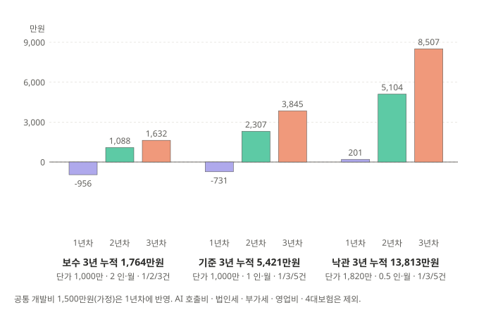

# 중구 코스 사업 시뮬레이션 v1: 판매 방식·단가·계약 건수별 손익

- 작성일: 2026-11-24
- 상태: 초안. 팀 확인 전입니다. 판매 목표나 매출 전망이 아니라 **가정을 바꿨을 때 손익이 어떻게 달라지는지** 보는 시나리오 표입니다. 목표 숫자는 쓰지 않습니다.
- 원칙: 새 입력값을 만들지 않습니다. 식과 입력은 [jung_summer_experience_pricing_pnl_v2.md](jung_summer_experience_pricing_pnl_v2.md)(이하 v2)와 [jung_som_inputs_v1.csv](jung_som_inputs_v1.csv)의 값만 씁니다. 조합만 늘렸습니다.
- 구분 범례: **사실**(공개 자료·페이지에서 확인) / **계산**(사실 값으로 직접 계산) / **가정**(팀 가설, 근거 없음) / **미검증**

## 1. 입력값

| 입력 | 값 | 구분 | 출처 |
|---|---|---|---|
| 인건비 | 월 2,250,000원 / 인 | 단일 출처 (비공개 참고 자료 평균, 개월 수는 추정, 4대보험 포함 여부 미확인) | v2 2장 |
| 클라우드 | 월 60,012원 = (Supabase Pro $25 + Vercel Pro $20) × 1,333.6원 | 사실 + 계산 | jung_som_inputs_v1.csv C2·R_fx_usd_krw, v2 7장 |
| 공통 개발비 | 15,000,000원 (1년차에 반영) | **가정** (근거 없음) | jung_som_inputs_v1.csv C6_dev_cost |
| 계약 단가 | 10,000,000원 / 18,200,000원 | 구청·군 계약 사례와 단일 출처의 구간 | v2 6장 (동구 10.8M, 북구 11.0M, 평창 18.2M) |
| 건당 투입 | 0.5 / 1 / 2 / 3 인·월 | **가정** | v2 7장 |
| 계약 수 | 1 / 3 / 5건 (1~3년차) 또는 연 0~5건 | **가정** (강사 예시) | v2 4-2 |
| 판매 방식 B의 대행사 마진 | 0% / 10% / 15% | **가정, 미검증** (팀이 들은 관행. 근거 1건: 크몽 "행사 전체 금액의 10%") | jung_som_inputs_v1.csv R_agency_fee_ref |
| 방문 연인원 · 20~30대 · 스마트폰 보유율 | 22,899,786 · 40.19% · 96.0% | 사실 | v2 4-1 |
| 참여율 | 0.1% / 0.5% / 1.0% | **가정** (군산 완주 기준 약 0.047% 참고) | v2 4-1 |

## 2. 계산식

- 건당 비용 = 건당 투입 인·월 × 2,250,000원 + 클라우드 60,012원 × 운영 개월(1로 둠)
- 한 해 손익 = 계약 수 × (단가 × 우리 몫 − 건당 비용) − (1년차만) 공통 개발비 15,000,000원
- 우리 몫 = 판매 방식 A(지자체 직접)는 100%, B(행사 대행사 경유)는 100% − 대행사 마진
- 손익분기 계약 수 = 공통 개발비 ÷ (단가 × 우리 몫 − 건당 비용)
- 제외: AI 호출비, 법인세, 부가세 정산, 영업비, 4대보험, 계약이행보증 (v2 7장과 같음)

## 3. 계산이 맞는지 확인 (재현)

v2에 적힌 숫자를 같은 식으로 다시 계산해 모두 일치하는지 확인했습니다.

| 확인 항목 | v2의 값 | 이번 계산 | 결과 |
|---|---|---|---|
| 기준 시나리오 3년 누적 | +54,209,892원 | +54,209,892원 | 일치 |
| 보수 / 낙관 3년 누적 | +17,639,928 / +138,134,892원 | 같음 | 일치 |
| 손익분기 계약 수 8칸 (단가 2 × 투입 4) | 1.70, 1.95, 2.76, 4.70 / 0.88, 0.94, 1.10, 1.32건 | 같음 | 일치 |
| 동구 운영 용역 단독 (1명, 5.5개월) | -1,905,066원 | -1,905,066원 | 일치 |
| 북구 운영 용역 단독 (1명, 4.5개월) | +604,946원 | +604,946원 | 일치 |
| ±20% 민감도: 단가 / 계약 수 변화 폭 | 36,000,000 / 27,683,957원 | 같음 | 일치 |

## 4. 시나리오 1: 기존 3개 (v2 그대로)

| | 보수 | 기준 | 낙관 |
|---|---|---|---|
| 단가 | 10,000,000 | 10,000,000 | 18,200,000 |
| 건당 투입 | 2 인·월 | 1 인·월 | 0.5 인·월 |
| 계약 수 1 / 2 / 3년차 | 1 / 2 / 3 | 1 / 3 / 5 | 1 / 3 / 5 |
| 1년차 손익 | -9,560,012 | -7,310,012 | +2,014,988 |
| 2년차 손익 | +10,879,976 | +23,069,964 | +51,044,964 |
| 3년차 손익 | +16,319,964 | +38,449,940 | +85,074,940 |
| **3년 누적** | **+17,639,928** | **+54,209,892** | **+138,134,892** |

## 5. 시나리오 2: 판매 방식 × 단가 × 건당 투입

칸의 값: **손익분기 계약 수(소수 → 올림) · 3년 누적(계약 1/3/5건 기준, 만원)**

| 판매 방식 | 단가 | 0.5 인·월 | 1 인·월 | 2 인·월 | 3 인·월 |
|---|---|---|---|---|---|
| A 지자체 직접 | 1,000만원 | 1.70 → 2건 · +6,433만 | 1.95 → 2건 · +5,421만 | 2.76 → 3건 · +3,396만 | 4.70 → 5건 · +1,371만 |
| A 지자체 직접 | 1,820만원 | 0.88 → 1건 · +13,813만 | 0.94 → 1건 · +12,801만 | 1.10 → 2건 · +10,776만 | 1.32 → 2건 · +8,751만 |
| B 대행사 경유 (마진 10%) | 1,000만원 | 1.92 → 2건 · +5,533만 | 2.24 → 3건 · +4,521만 | 3.38 → 4건 · +2,496만 | 6.85 → 7건 · +471만 |
| B 대행사 경유 (마진 10%) | 1,820만원 | 0.99 → 1건 · +12,175만 | 1.07 → 2건 · +11,163만 | 1.27 → 2건 · +9,138만 | 1.57 → 2건 · +7,113만 |
| B 대행사 경유 (마진 15%) | 1,000만원 | 2.05 → 3건 · +5,083만 | 2.42 → 3건 · +4,071만 | 3.81 → 4건 · +2,046만 | 8.88 → 9건 · +21만 |
| B 대행사 경유 (마진 15%) | 1,820만원 | 1.05 → 2건 · +11,356만 | 1.14 → 2건 · +10,344만 | 1.37 → 2건 · +8,319만 | 1.73 → 2건 · +6,294만 |

- 같은 계약 건수(1/3/5)에서 비교한 값이라 칸마다 건수가 다른 것이 아니라 **계약을 1/3/5건 얻었다고 가정한 3년 누적**입니다.
- 1년차에 흑자가 되는 칸은 단가 1,820만원에서 건당 투입이 작고(A: 0.5·1 인·월, B 10%: 0.5 인·월) 마진이 작은 경우뿐입니다. 나머지는 공통 개발비 때문에 1년차는 적자입니다.

## 6. 시나리오 3: 연 계약 건수 × 단가 (건당 1 인·월, 판매 방식 A)

칸의 값: **1년차 손익 / 3년 누적** (만원, 매년 같은 건수를 얻는다고 가정)

| 연 계약 수 | 단가 1,000만원 | 단가 1,820만원 |
|---|---|---|
| 0건 | -1,500 / -1,500 | -1,500 / -1,500 |
| 1건 | -731 / +807 | +89 / +3,267 |
| 2건 | +38 / +3,114 | +1,678 / +8,034 |
| 3건 | +807 / +5,421 | +3,267 / +12,801 |
| 4건 | +1,576 / +7,728 | +4,856 / +17,568 |
| 5건 | +2,345 / +10,035 | +6,445 / +22,335 |

- 계약이 0건이면 손실은 공통 개발비(가정) 1,500만원입니다. 이 값은 팀 인건비로 이미 반영했다면 0으로 둘 수 있습니다 (v2 7장).
- 단가 1,000만원에서는 **연 2건부터 1년차가 흑자**입니다. 연 1건이면 3년 누적에서야 +807만원입니다.

## 7. 시나리오 4: 이용자 규모와 인당 환산

| 참여율 (가정) | 여름 4개월 이용자 수(연인원) | 월 평균 | 인당 환산 (A 3건 = 3,000만원 기준) |
|---|---|---|---|
| 0.1% | 8,835 | 2,209 | 약 3,396원 |
| 0.5% | 44,176 | 11,044 | 약 679원 |
| 1.0% | 88,353 | 22,088 | 약 340원 |

- 도달 인원 8,835,287명(= 22,899,786 × 40.19% × 96.0%)에 참여율을 곱한 값입니다. 연인원이라 같은 사람을 날마다 다시 센 값입니다.
- 인당 환산이 낮아서 단가가 이용자 규모에 비해 과하지 않다고 볼 수 있으나, 참여율이 가정이라 방향 확인용입니다 (v2 4-3).
- 계약 건수의 시장 점유: 신규 제안 가능한 구·군 약 7곳(**가정**) 대비 1건 14%, 3건 43%, 5건 71% (계산). 5건은 대행사나 시 산하 기관 경로가 함께 있어야 설명됩니다 (v2 4-2).

## 8. 시나리오 5: 민감도 (기준 시나리오 3년 누적 +54,209,892원)

| 가정 | -20% 결과 | +20% 결과 | 변화 폭 |
|---|---|---|---|
| 단가 | +36,209,892 | +72,209,892 | 36,000,000 |
| 계약 수 | +40,367,914 | +68,051,870 | 27,683,957 |
| 건당 투입 인·월 | +58,259,892 | +50,159,892 | 8,100,000 |
| 인건비 단가 | +58,259,892 | +50,159,892 | 8,100,000 |
| 공통 개발비 | +57,209,892 | +51,209,892 | 6,000,000 |

## 9. 읽고 알게 된 것

- **결과를 가장 크게 흔드는 것은 단가와 계약 수이고, 둘 다 근거가 가장 약합니다.** 먼저 검증할 대상입니다 (민감도 1·2위).
- **손익분기는 단가와 건당 투입에 크게 좌우됩니다.** 단가 1,820만원에서는 거의 1~2건이면 되지만, 단가 1,000만원에 건당 3 인·월이면 5건(A)에서 9건(B, 마진 15%)까지 늘어납니다.
- 판매 방식 B는 마진 15%(가정)만으로도 손익분기가 A보다 소수 기준 0.2~4.2건 늘어납니다 (단가 1,820만원은 0.2~0.4건, 단가 1,000만원은 0.4~4.2건). 단가가 낮고 투입이 많을수록 차이가 큽니다.
- 구청 운영 용역만 받는 것은 위험합니다. 동구 조건(월 196만원)에 1명을 5.5개월 투입하면 적자입니다.
- 계약이 없는 해의 손실은 공통 개발비(가정)입니다. 개발비를 어떻게 볼지가 1년차 손익을 가릅니다.
- 먼저 확인할 것 2가지: ① 실제 제안 가능한 구·군이 몇 곳인지, ② 건당 투입 인·월이 몇인지 (v2 4-4, 7장).

## 10. 한계

- 이 표는 **전망이 아닙니다.** 가정이 많은 시나리오이고, 가정 값은 팀이 정한 것이 아닙니다.
- 제외 항목(AI 호출비, 법인세, 부가세, 영업비, 4대보험, 계약이행보증) 때문에 실제 손익은 더 낮을 수 있습니다. 비공개 참고 자료의 사업 수익률은 20%대이고 위 마진은 이보다 높게 나와 낙관 쪽입니다 (v2 7장).
- 단가 구간은 구청 수의계약 등 4건과 비공개 참고 자료 1건에 기댑니다. VAT 포함 여부가 사례마다 다를 수 있습니다 (v2 6장).
- 비공개 참고 자료는 사용한 범위와 비율만 적었고, 세부 금액·업체명은 쓰지 않았습니다 (v2 원칙).
- 운영 개월은 1로 두었습니다. 4개월로 늘면 클라우드가 건당 180,036원 더 들지만 손익분기는 거의 같습니다 (v2 7장).

## 11. 재현 방법

- 식은 2장에, 입력은 1장에 모두 적었습니다. 3장의 일치 확인은 같은 식을 코드로 옮겨 v2의 숫자와 모두 같은지 대조한 것입니다.
- 계산 코드는 저장소에 넣지 않았습니다. 필요하면 위치를 정해야 합니다 `[결정 필요]`. 엑셀 [jung_som_model_v1.xlsx](jung_som_model_v1.xlsx)와 값이 같은지는 이번에 열어 보지 않았습니다 `[확인 필요]`.

## 결정 필요

- [ ] 판매 방식 1순위 (A 지자체 직접 / B 행사 대행사 경유). B를 쓰면 대행사 마진 값
- [ ] 건당 투입 인·월과 공통 개발비를 손익에 넣을지
- [ ] 발표에서 쓸 시나리오 (이 표의 어느 칸을 보여 줄지)

## 확인 필요

- [ ] 신규 제안 가능한 구·군 수 (7곳 가정)
- [ ] 단가의 VAT 포함 여부
- [ ] 행사 대행사 마진 (자료 없음)
- [ ] 엑셀 모델과 이 표의 일치

## 출처

- research/bm/jung_summer_experience_pricing_pnl_v2.md (식, 입력, 시나리오, 민감도)
- research/bm/jung_som_inputs_v1.csv (입력값 행과 출처 URL: C2, C6, R_fx_usd_krw, R_agency_fee_ref, R_daegu_dong_2026, R_daegu_buk_2026, R_case_01, R_ref_gunsan_*)
- research/bm/jung_summer_tam_sam_som_v3.md (시장 규모 근거)
- 계산 확인: 2026-11-24 위 식을 코드로 옮겨 v2 숫자 재현
