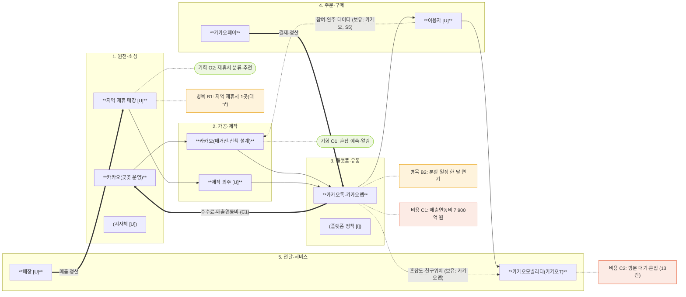

# 밸류체인 맵 v1 · 지역 상권 플랫폼 (카카오 곳곳 기준)

- 표기: 실선 `-->` 상품·활동 흐름 · 굵은선 `==>` 돈 흐름 · 점선 `-.->` 데이터 흐름
- 마커: 병목(주황) · 비용(코랄) · 기회(라임)
- 숫자: 출처가 있는 것만 ([n] 참조, analysis.md)
- 팀 자산(대구약령시, 후보)은 틸 표시

## 단계별 근거 표
| 단계 | 활동 | 이해관계자 | 돈 흐름 (차감) | 데이터 (생성·보유) | 마커 | 근거 |
|---|---|---|---|---|---|---|
| 1 원천·소싱 | 제휴 매장 모집 | 카카오, 지역 매장 [U] | 매장 정산 | 제휴 매장 명단 (카카오) | B1, O2 | [13] |
| 2 가공·제작 | 매거진·산책 설계 | 카카오, 제작 외주 [U] | 제작비 | 참여·완주 기록 (카카오) | — | [13] |
| 3 플랫폼·유통 | 카카오톡·카카오맵 배포 | 카카오톡, 카카오맵 | 수수료·매출연동비 (C1) | 혼잡도, 친구위치 (카카오맵) | B2, C1, O1 | [1][3][5] |
| 4 주문·구매 | 결제·선물하기 | 이용자 [U], 카카오페이 | 결제 수수료 | 결제·선호 (카카오페이) | C2 | [1][2] |
| 5 전달·서비스 | 이동·방문 | 카카오모빌리티, 매장 [U] | 이동 수수료 | 방문 기록 (카카오) | C2, O1 | [1][2] |

## 한계
- 이용자 수, 참여 수치, 지역 매장 정산 비율은 공개되지 않음. 맵에 숫자로 넣지 않음.
- 카카오맵·곳곳의 소속 법인은 증권신고서 공개 후 재확인 (분할 후 귀속).
- HTML 발표용 맵은 아직 만들지 않음 (과제 시간 항목).
