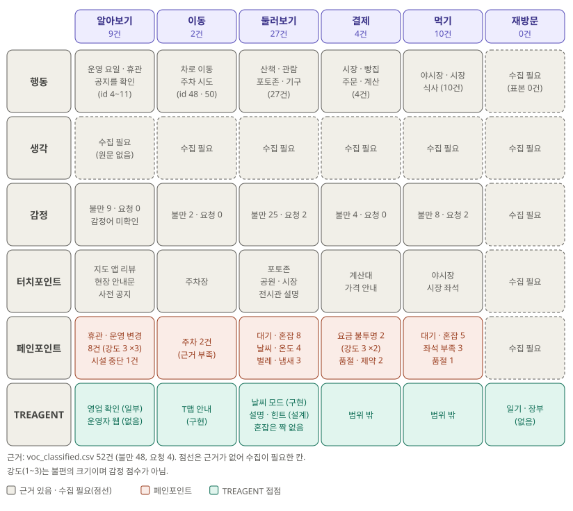

# 고객 여정 지도 v2 (VOC 52건 기준): 1박 2일 대구 혼행객

- 작성일: 2026-11-24
- 상태: 초안. 팀 확인 전입니다.
- 이 문서의 역할: 옛 [journey_map.md](journey_map.md)(블로그 20건 기준, 2026-11-18에 대체됨)를 **VOC 52건 기준**으로 다시 쓴 것입니다. 강의의 5층 형식(행동·생각·감정·터치포인트·페인포인트)을 따르고 모든 칸에 근거 id를 적었습니다.
- 행위자: 1박 2일 대구 혼행객 한 명의 시점 (brand/customer_persona.md 후보 2, 고객 전략 4장). 연령 20~30대는 모집 가설입니다.
- 단계 (팀 확정 6개): 알아보기 → 이동 → 둘러보기 → 결제 → 먹기 → 재방문
- 근거 원칙
  - 근거 id는 [voc_classified.csv](voc_classified.csv)의 `id`입니다 (52건: 지도 43, 블로그 9, 불만 48, 요청 4).
  - **VOC는 요약문**이라 원문 질문·감정어가 없습니다. "생각" 층은 근거가 없으면 **수집 필요**로 비워 두고, 요약문에서 읽히는 어긋남만 `[요약문 기반 추정]`으로 표시했습니다.
  - 감정 층은 "불만 n건 / 요청 n건"만 씁니다. 강도(1~3)는 **불편의 크기**이지 감정 점수가 아닙니다. 감정 점수 환산식은 팀이 정하지 않았습니다 `[결정 필요]`.
  - 한계: 52건은 불만·요청 중심의 분류표라 전체 관광객의 불편률로 바꿔 말할 수 없습니다. 원문 대조는 표본 10건뿐이고, 대기·혼잡은 축제 기간 글이 섞여 과대일 수 있습니다 (candidates.md).

## 1. 한눈에 보기

| 단계 | 건수 | 불만 / 요청 | 불편 강도 합 | 출처 | 가장 많은 원인 |
|---|---|---|---|---|---|
| 알아보기 | 9 | 9 / 0 | 20 | 지도 8, 블로그 1 | 휴관·공사·운영 변경 8건 |
| 이동 | 2 | 2 / 0 | 2 | 지도 2 | 주차 2건 |
| 둘러보기 | 27 | 25 / 2 | 34 | 지도 23, 블로그 4 | 대기·혼잡 8건 |
| 결제 | 4 | 4 / 0 | 8 | 지도 2, 블로그 2 | 가격·요금 불투명 2건 |
| 먹기 | 10 | 8 / 2 | 17 | 지도 8, 블로그 2 | 대기·혼잡 5건 |
| 재방문 | 0 | - | - | - | **표본 없음** |

- 불편이 가장 몰린 칸: 둘러보기 × 대기·혼잡 8건, **알아보기 × 휴관·공사·운영 변경 8건**, 먹기 × 대기·혼잡 5건.
- **알아보기 단계의 9건은 모두 불만이고, 그중 8건이 운영 정보 문제**입니다. 방문 전에 막히는 칸이라, 서비스가 개입하기 가장 이른 지점입니다.
- 재방문 단계는 근거가 0건입니다. 지역 이야기가 재방문 이유가 되는지는 확인되지 않았습니다 (고객 전략 2장).

## 2. 단계별 5층

### 2-1. 알아보기 (9건)

| 층 | 내용 | 근거 id |
|---|---|---|
| 행동 | 방문 전에 운영 요일·휴관·공사 안내를 확인하려 함 | 4, 5, 6, 7, 8, 9, 10, 11, 44 |
| 생각 | **수집 필요** (원문 질문 없음). `[요약문 기반 추정]` 평일에도 하는 줄 알았다(7), 운영 시간이라 들었는데(9)처럼 확인한 정보와 현장이 어긋남 | 7, 8, 9 |
| 감정 | 불만 9건 / 요청 0건. 감정어는 요약문에 없어 **미확인** | 4~11, 44 |
| 터치포인트 | 지도 앱의 운영 시간 표기와 리뷰, 현장 안내문·공사 공지, 사전 공지, 블로그 | 7·8·9(지도), 4·6(안내), 44(사전 공지 없음), 11(블로그) |
| 페인포인트 | 휴관·공사·운영 변경 8건 (헛걸음 3건, 강도 3), 시설 노후·운영 중단 1건 (운영 변경 사전 공지 없음) | 4~11, 44 |

### 2-2. 이동 (2건)

| 층 | 내용 | 근거 id |
|---|---|---|
| 행동 | 차로 이동해 장소 근처에 주차하려 함 | 48, 50 |
| 생각 | **수집 필요** | - |
| 감정 | 불만 2건 / 요청 0건 | 48, 50 |
| 터치포인트 | 장소 주차장 (달성공원, 향촌문화관) | 48, 50 |
| 페인포인트 | 주차 2건 (달성공원 주차 어려움, 건물에 주차장 없음). 근거 부족 | 48, 50 |

### 2-3. 둘러보기 (27건)

| 층 | 내용 | 근거 id |
|---|---|---|
| 행동 | 공원·시장·전시관·유원지를 걷고 관람함. 포토존 줄서기, 인기 기구 대기 | 1~3, 17, 22, 23, 25~32, 34~36, 40~43, 45~47, 49, 51, 52 |
| 생각 | **수집 필요** | - |
| 감정 | 불만 25건 / 요청 2건 (요청: 47 시설 관리, 52 콘텐츠). 감정어 **미확인** | - |
| 터치포인트 | 포토존, 인기 기구, 야외 공원·강변, 시장, 전시관 설명 | 2, 30, 31, 22·23·26, 17, 52 |
| 페인포인트 | 대기·혼잡 8건 (2, 17, 30, 31, 40, 41, 43, 46), 날씨·온도 4건 (22, 32, 36, 45), 벌레·냄새 3건 (23, 26, 49), 휴관·공사 2건 (1, 3), 시야 제약 2건 (25, 35), 콘텐츠·경관 아쉬움 2건 (27, 52), 시설 노후 2건 (28, 29), 공포·안전 2건 (34, 42), 시설 관리 1건 (47), 안내 오류 1건 (51) | 위와 같음 |

### 2-4. 결제 (4건)

| 층 | 내용 | 근거 id |
|---|---|---|
| 행동 | 시장·빵집에서 주문하고 계산함 | 12, 13, 38, 39 |
| 생각 | **수집 필요**. `[요약문 기반 추정]` 안내와 다른 금액이 나옴 (12: 모둠으로 바뀌어 5천원 추가, 13: 계산 시 1만원 모둠으로 바뀜) | 12, 13 |
| 감정 | 불만 4건 / 요청 0건 | 12, 13, 38, 39 |
| 터치포인트 | 계산대, 가격 안내, 판매 시간 | 12, 13, 38 |
| 페인포인트 | 가격·요금 불투명 2건 (강도 3), 품절·메뉴 제한 1건, 서비스 제약 1건 (택배 불가) | 12, 13, 38, 39 |

### 2-5. 먹기 (10건)

| 층 | 내용 | 근거 id |
|---|---|---|
| 행동 | 야시장·시장·공원에서 식사함 | 14, 15, 16, 18~21, 24, 33, 37 |
| 생각 | **수집 필요** | - |
| 감정 | 불만 8건 / 요청 2건 (요청: 16 먹거리 다양, 19 테이블). 감정어 **미확인** | - |
| 터치포인트 | 야시장, 시장 좌석, 치킨집 등 대기 줄, 야외 좌석 | 14, 15, 18, 19, 20, 21, 37 |
| 페인포인트 | 대기·혼잡 5건 (14, 18, 21, 24, 33), 좌석 부족 3건 (15, 19, 20: 20은 강도 3, 퇴장 요구), 품절·메뉴 제한 1건 (16), 흡연·위생 1건 (37) | 위와 같음 |

### 2-6. 재방문 (0건)

- 행동·생각·감정·터치포인트·페인포인트 모두 **수집 필요**입니다. 표본에 재방문 글이 없습니다.

## 3. TREAGENT 접점과 구현 상태

| 단계 | TREAGENT 접점 | 상태 | 짝이 되는 근거 |
|---|---|---|---|
| 알아보기 | 오늘 영업 확인: 요일·시간 규칙(영업시간을 아는 장소는 48곳 중 17곳), 에이전트 1 확인자, 운영자 상태 변경 | 규칙 **일부**, 확인자 **설계**, 운영자 웹 **없음** | 휴관·운영 변경 8건 |
| 이동 | T맵 도보 길 안내, 이탈 시 새 경로 제안 | **구현** | (VOC에 이동 불편 없음. 주차는 범위 밖) |
| 둘러보기 | 날씨 모드(탐험·그늘·실내·안전·보류), 장소 설명·힌트 | 날씨 모드 **구현** (폭염에 야외 유형이 코스에 들어가는 새 위험), 설명·힌트 **설계** | 날씨 4건. 혼잡 8건은 **짝 없음** |
| 결제 | 해당 없음 | **범위 밖** (장소 요금 정보는 장소 자료에 있음) | 가격 불투명 2건 |
| 먹기 | 해당 없음 | **범위 밖** (음식·좌석 안내 기능 없음) | 대기·혼잡 5건, 좌석 3건 |
| 재방문 | 일기·장부·앨범 | **없음** | **근거 0건** |

- 근거: [서비스 시뮬레이션](../../plan/spec/service_simulation_v1.md), [에이전트 구조 설계 v1](../../plan/spec/agent_architecture_v1.md) 9~11장, plan/treagent_customer_strategy_v1.md 5장.

## 4. 이 여정 지도가 알려 주는 것

- **가장 이른 개입 지점은 알아보기 단계입니다.** 헛걸음(강도 3)이 여기에 모여 있고, 서비스가 풀 수 있는 원인(운영 정보)입니다. 첫 파일럿을 "운영 변경 → 대체 장소 선택 → 진행 복구"로 잡은 판단과 맞습니다.
- **둘러보기의 대기·혼잡 8건은 지금 풀 수 없습니다.** 혼잡 데이터가 없고 축제 글이 섞여 있습니다.
- **결제·먹기 단계는 서비스 범위 밖**입니다. 이 두 단계의 VOC 14건(불만 12건, 요청 2건)은 길 안내 서비스가 풀지 못하는 문제입니다. 쉼터·음식 안내를 범위에 넣을지는 팀이 정해야 합니다 `[결정 필요]`.
- **재방문과 "생각" 층은 비어 있습니다.** 인터뷰 없이는 채울 수 없고, 지어내지 않았습니다.

## 5. 한계와 다음 확인

- [ ] 생각 층: 원문 질문형 문장 확보 (인터뷰 또는 원문 리뷰 재수집)
- [ ] 재방문 단계 리뷰 수집
- [ ] 단계별 3건 이상 확보 (이동 2건)
- [ ] 감정 점수 환산식 `[결정 필요]`
- [ ] 결제·먹기 단계를 범위에 넣을지 `[결정 필요]`

## 출처

- research/painpoint/voc_classified.csv (id 1~52), candidates.md, journey_map.md (옛 초안, 20건 기준)
- research/data/reviews/review_log.md (원문 대조 표본 10건)
- plan/treagent_customer_strategy_v1.md (2·4·5장), plan/spec/service_simulation_v1.md, plan/spec/agent_architecture_v1.md
- 강의 기준: Day11 페인포인트 도출 (D:\CJ_AX\CJ_AX_lecture_note\1. 강의 자료\Day11_1109_페인포인트_도출_v3.md) 고객 여정 지도 5층
