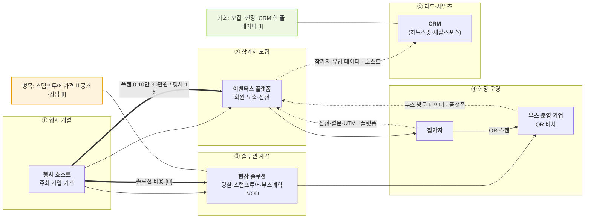

# 이벤터스 — 행사 플랫폼 속 스탬프 투어 밸류체인 v1

- 작성일: 2026-11-12 · 유형: **행사 모집 플랫폼 + 현장 솔루션 묶음 · 행사 1회 플랜**
- 근거: `research/company/eventus/onepager.md`, [n] = `research/company/eventus/sources.md` 번호

## 단계별 네 층

| 층 | ① 행사 개설 | ② 참가자 모집 | ③ 솔루션 계약 | ④ 현장 운영 | ⑤ 리드·세일즈 |
|---|---|---|---|---|---|
| 활동 | 호스트센터에서 채널·행사 개설 [4] | 플랫폼 노출, 행사 광고, 신청·설문 [3][4] | 명찰·스탬프투어·부스예약·VOD 상담 [2] | 명찰 QR 체크인, 부스 QR 스캔 스탬프 [1][2] | 유입 경로·참가자 데이터, CRM 연동 [3] |
| 이해관계자 | **행사 호스트**(주최 기업·기관) | **이벤터스** · (플랫폼 회원 "30만 명") [4] | **이벤터스** · (대행사 [U]) | **참가자** · **부스 운영 기업** [1] | **호스트** · (허브스팟·세일즈포스) [3] |
| 돈 ⇐ | 베이직 무료 [3] | 스탠다드 10만·프로 30만 원/행사 1회 [3], 행사 광고 [4] | 스탬프투어 가격 [U] (상담) [2] | 참가자 혜택 비용 [U] | — |
| 데이터 ⇢ | 행사 정보 · 이벤터스 | 신청·설문·UTM · 플랫폼 [3] | 행사 요건 · 이벤터스 | 부스 방문·스탬프 내역 · 플랫폼 [1][2] | 유입 경로 다운로드·CRM · **호스트** [3] |

## 흐름도

## 마커 (병목 1 · 기회 1)
| 마커 | 단계 | 내용 | 신호 | 근거 |
|---|---|---|---|---|
| 병목 [I] | ③ | 스탬프 투어 가격이 공개 안 됨 → 소규모 행사는 비교·결정이 늦어짐 | 대기·지연 | [2], pricing 페이지 미표시 |
| 기회 [I] | ② → ⑤ | 신청 데이터와 부스 방문 데이터가 한 플랫폼에 있어 리드로 이어짐 | (데이터 단절 없음) | [1][3] |
- 비용 마커: 근거 자료 없음 → 붙이지 않음

## 관찰
- [I] 다른 두 곳과 달리 스탬프 투어는 **미끼가 아니라 부품** — 돈은 행사 플랜·광고·솔루션 묶음에서 나옴
- [U] "행사 대행사 대상 판매·가격 정책"은 이번 원문에서 확인 못 함. 확인하려면 상담 신청 또는 가격안내 페이지를 브라우저로 직접 열어야 함

## 출처
- `research/company/eventus/sources.md` 1~6
