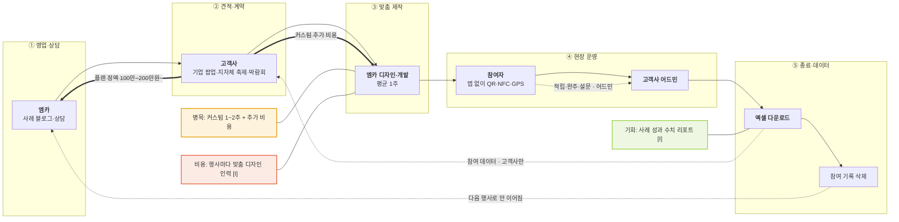

# 큐알스탬프(엠카) — B2B QR 스탬프 투어 솔루션 밸류체인 v1

- 작성일: 2026-11-12 · 유형: **B2B 솔루션 + 맞춤 디자인 제작 · 정액 플랜**
- 근거: `research/company/qrstp/onepager.md`, [n] = `research/company/qrstp/sources.md` 번호
- 시점: 솔루션 판매사 기준. 공공 사업 체인(`../valuechain_v1.md`)의 ② 인증 도구 제작 단계를 맡는 업체

## 단계별 네 층

| 층 | ① 영업·상담 | ② 견적·계약 | ③ 맞춤 제작 | ④ 현장 운영 | ⑤ 종료·데이터 |
|---|---|---|---|---|---|
| 활동 | 상담 신청서·전화·채팅, 사례 블로그 [1] | 플랜·스탬프 수·기간·리워드·커스텀으로 견적 [1] | 디자인 100% 맞춤, 평균 1주·커스텀 1~2주 [1] | 참여자 QR·NFC·GPS 적립, 리워드 게임, 고객사가 어드민 운영 [1] | 엑셀 다운로드 후 참여 기록 삭제 [1] |
| 이해관계자 | **엠카 영업** · (사례 고객사) | **고객사**(기업·지자체·공공) · (대행사 [U]) | **엠카 디자인·개발** | **참여자** · **고객사 현장 운영자** | **고객사** |
| 돈 ⇐ | — | 플랜 100만~200만원~ (시작점) [1] | 커스텀 디자인 추가 비용 [1] | 경품·리워드 비용 — 부담 주체 [U] | 부가: 모바일 페이지 11만원~/쪽, 샵플랜 수수료 [1] |
| 데이터 ⇢ | 상담 문의 · 엠카 | 행사 요건 · 엠카 | 스탬프·리워드 설정 · 어드민 | 적립·완주·설문·(리드 플랜) 개인정보 · 어드민 | 엑셀 · **고객사** / 엠카 쪽은 삭제 [1] |

## 흐름도

## 마커 (병목 1 · 비용 1 · 기회 2)
| 마커 | 단계 | 내용 | 신호 | 근거 |
|---|---|---|---|---|
| 병목 | ③ | 커스텀 요청 시 1~2주, 기능 수정은 추가 비용 | 대기·지연 | [1] |
| 비용 [I] | ③ | 행사마다 디자인을 새로 만드는 인력형 구조 | 한 사람 의존 | [1] "100% 맞춤 제작" |
| 기회 [I] | ⑤ | 사례 글에 참여자 수·완주율이 없음 → 성과 리포트 상품화 | 데이터 단절 | [3] |
| 기회 [I] | ⑤ → ① | 종료 시 기록 삭제 → 회차 간 비교·재방문 분석이 없음 | 데이터 단절 | [1] FAQ |

## 관찰
- [F] 돈의 시작점이 고객사 정액이고 참여자는 무료 [1] — 참여자가 늘어도 매출은 그대로, 대신 대형 행사에 유리한 가격
- [I] 공공 고객(행정안전부·국가유산진흥원 등 로고 [1])은 용역 발주로 들어올 가능성 — 계약 경로 [U]

## 출처
- `research/company/qrstp/sources.md` 1~4
