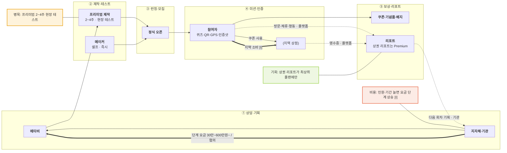

# 퀘스투어(메타비) — 미션형 관광 스탬프 투어 밸류체인 v1

- 작성일: 2026-11-12 · 유형: **셀프 제작 + 기관 맞춤 제작 · 인원·기간 단계 요금**
- 근거: `research/company/questour/onepager.md`, [n] = `research/company/questour/sources.md` 번호

## 단계별 네 층

| 층 | ① 상담·기획 | ② 제작·테스트 | ③ 런칭·모집 | ④ 미션·인증 | ⑤ 보상·리포트 |
|---|---|---|---|---|---|
| 활동 | 목적·타깃·지역 특성 분석 (프리미엄) / 메이커는 생략 [3] | 위치·디자인·보상 설정, 현장 테스트 2~4주 / 메이커 즉시 [3] | 정식 오픈, 실시간 모니터링 [3] | 문제·QR·GPS·인증샷, 랭킹·레벨 [1][2][4] | 기념품·할인 쿠폰·디지털 배지, 리포트 [1][3] |
| 이해관계자 | **메타비** · **지자체·기관** [3] | **메타비** / **개인·단체 제작자** | **주최 기관** | **참여자** · (전통시장·관광지 상권 [I]) | **주최 기관** · (지역 상점 쿠폰 [2]) |
| 돈 ⇐ | Premium 별도 협의 [1] | Starter 30만·Basic 200만·Standard 600만 원~ [1] | — | 참여자 지역 소비 (영수증 분석 대상) [1] | 쿠폰·기념품 비용 — 부담 주체 [U] |
| 데이터 ⇢ | 지역 특성 · 메타비 | 코스·장소 · 플랫폼 | 참여 현황 · 플랫폼 | 방문 지점·체류 시간·행동 패턴 · 플랫폼 [2] | 최종·월간 리포트, 상권 리포트(Premium) · **주최 기관** [1] |

## 흐름도

## 마커 (병목 1 · 비용 1 · 기회 2)
| 마커 | 단계 | 내용 | 신호 | 근거 |
|---|---|---|---|---|
| 병목 | ② | 프리미엄·다국어 제작 2~4주, 현장 테스트 필요 | 대기·지연 | [3] |
| 비용 [I] | ① | 참여 인원 100→300→1,000명 단계마다 요금 상승 — 대형 축제는 협의 | 중간 차감 | [1] |
| 기회 [I] | ⑤ | 상권·영수증 분석이 Standard 이상에만 → 소규모 지자체엔 안 닿음 | 데이터 단절 | [1] |
| 기회 [I] | ④ | 랭킹·레벨 등 게임 장치는 있으나 이야기(세계관)는 제작자가 채움 | 경험 단조 | [2][3] |

## 관찰
- [F] 5곳 이하 무료 플랜이 있어 개인·소규모가 먼저 써 보고 기관 플랜으로 올라가는 구조 [1]
- [I] 데이터가 ⑤ → ① 기획으로 돌아가는 피드백 화살표가 세 곳 중 가장 분명 (월간 리포트·상권 리포트 [1])

## 출처
- `research/company/questour/sources.md` 1~5
