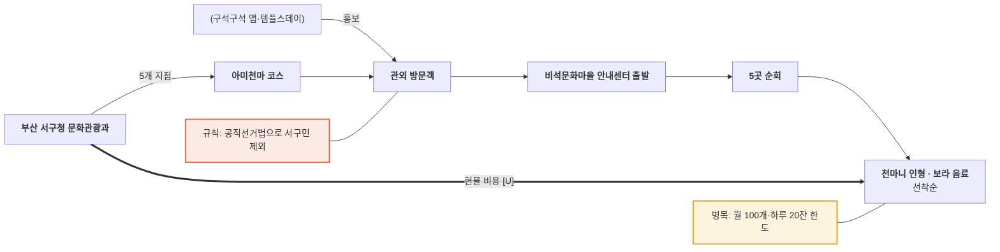

# 부산 서구청 — 아미천마 보라 스탬프 투어 밸류체인

- 작성일: 2026-11-11 · 유형: **기초 지자체 · 마을형 오프라인 · 현장 기념품·음료**
- 근거: R5 (`research/stamp_tour_operator_sources.md`, 부산일보 2026-05-24)

## 단계별 네 층

| 층 | ① 기획 | ② 제작 | ③ 모집·홍보 | ④ 방문·인증 | ⑤ 보상 |
|---|---|---|---|---|---|
| 활동 | 아미동·천마산 5개 지점, 6.9~7.31 화~토 | 기념품(천마니 인형)·보라 음료(아미베리스무디) 준비 | 템플스테이·청소년수련관·한국관광공사 '구석구석' 앱 연계 홍보 | 비석문화마을 안내센터 출발, 5곳 순회 | 인형 월 100개, 음료 하루 20잔, 선착순 |
| 이해관계자 | **서구청 문화관광과** | (기념품·음료 공급처 [U]) | (한국관광공사 구석구석, 내원정사 템플스테이) | **방문객**, **비석방·사진관·최민식갤러리·천마산복합전망대** | **안내센터** [I] |
| 돈 ⇐ | 구 예산 [U] | 기념품·음료 비용 [U] | — | 현장 소비 [U] | 현물 보상 (끝점) |
| 데이터 ⇢ | 성과 수치 없음 | — | — | 현장 확인 [I] | 지급 수량 (월·일 한도) |

## 흐름도

## 마커
- 병목: 보상 한도 (인형 월 100개, 음료 하루 20잔) (R5)
- 규칙: "공직선거법에 따라 서구민은 기념품 지급 대상에서 제외" (R5)
- 관찰 [I]: 지역 문화 자산(BTS 관련 '보라' 테마)을 기념품·음료로 만든 마을형 구조. 앱 없음

## 출처
- https://v.daum.net/v/20260524164926737
- `research/stamp_tour_operator_sources.md` R5
