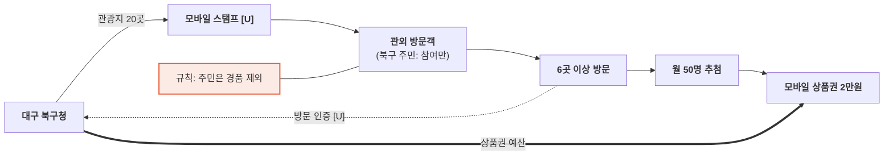

# 대구 북구청 — 스탬프로 채우는 북구 관광지도 밸류체인

- 작성일: 2026-11-11 · 유형: **기초 지자체 · 모바일 스탬프 · 모바일 상품권 추첨**
- 근거: R3 (`research/stamp_tour_operator_sources.md`, 쿠키뉴스 2026-07-14)

## 단계별 네 층

| 층 | ① 기획 | ② 제작 | ③ 모집 | ④ 방문·인증 | ⑤ 보상 |
|---|---|---|---|---|---|
| 활동 | 북구 관광지 20곳 (금호강 하중도, 구암서원, 칠성시장 야시장 등) | 모바일 스탬프 (앱 이름 [U]) | 7.15~11.30, 1인 1회 | 20곳 중 6곳 이상 방문 | 2만원 상당 모바일 상품권, 매월 50명 추첨 |
| 이해관계자 | **북구청** | (앱 운영사 [U]) | (언론) | **방문객** (북구 주민은 참여만) | **북구청**, (상품권 발행사 [U]) |
| 돈 ⇐ | 구 예산 [U] | 앱 비용 [U] | — | 현장 소비 [U] | 상품권 2만원 × 월 50명 (끝점) |
| 데이터 ⇢ | 성과 공개 수치 없음 | — | 참여자 명단 [I] | 방문 인증 [U] | 당첨자 [I] |

## 흐름도

## 마커
- 비용·규칙: 주민 경품 제외 — 보상 예산을 관외 방문객에게만 씀 (R3)
- 관찰 [I]: 완주(20곳)가 아니라 6곳 이상이 보상 기준 → 진입 장벽을 낮춘 설계

## 출처
- https://www.kukinews.com/article/view/kuk202607140042
- `research/stamp_tour_operator_sources.md` R3
