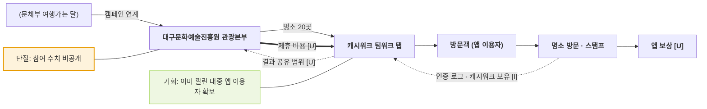

# 대구문화예술진흥원 관광본부 — 스탬프 로드 20 밸류체인

- 작성일: 2026-11-11 · 유형: **광역 · 민간 걷기 앱(캐시워크) 제휴 · 앱 보상**
- 근거: R2 (`research/stamp_tour_operator_sources.md`, 대구MBC 2026-09-22)

## 단계별 네 층

| 층 | ① 기획 | ② 제작 | ③ 모집·홍보 | ④ 방문·인증 | ⑤ 보상 |
|---|---|---|---|---|---|
| 활동 | 9개 구·군별 대표 명소 20곳 선정 | 자체 앱 없이 캐시워크 '팀워크' 탭에 투어 개설 | 문체부 "여행가는 달" 캠페인 연계 | 앱에서 투어 선택 후 방문해 스탬프 | 캐시 지급 방식 기사에 없음 [U] |
| 이해관계자 | **대구문화예술진흥원 관광본부** (대구시, 9개 구·군) | **캐시워크(민간 앱)** | (문화체육관광부, 행정안전부, 농림축산식품부) | **방문객**, (명소 운영 주체 [U]) | **캐시워크** [I] |
| 돈 ⇐ | 예산 [U] | 제휴·광고비 [U] | — | 현장 소비 [U] | 앱 포인트 [U] |
| 데이터 ⇢ | 성과 공개 수치 없음 | 참여·인증 로그 **캐시워크 보유** [I] | — | 방문 인증 · 캐시워크 [I] | — |

## 흐름도

## 마커
- 데이터 단절 [I]: 인증 데이터가 민간 앱에 쌓이는 구조. 기관이 받는 범위는 공개 자료에 없음. 참여·완주 수치 없음 (`research/daegu_history_tour_cases.md` 99행)
- 기회 [I]: 앱 개발 없이 기존 이용자 기반에 얹는 방식이라 제작 단계가 짧음

## 확인 필요
- 인증 방식(GPS 여부), 캐시 지급 기준 — 다른 기사(koreadaily)는 원문을 못 열어 `[미확인]`
- '대구 모바일 스탬프투어 (2026)'과 같은 사업인지

## 출처
- https://dgmbc.com/NewsArticle/863722
- `research/stamp_tour_operator_sources.md` R2
- `research/daegu_history_tour_cases.md` 89, 92, 99행
