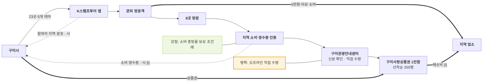

# 구미시 — 구미홀릭 스탬프투어 밸류체인

- 작성일: 2026-11-11 · 유형: **기초 지자체 · 전용 앱(K스탬프투어) · 지역화폐 + 영수증 인증**
- 근거: R4 (`research/stamp_tour_operator_sources.md`, 위키트리 2026-08-03)

## 단계별 네 층

| 층 | ① 기획 | ② 제작 | ③ 모집 | ④ 방문·인증 | ⑤ 보상 |
|---|---|---|---|---|---|
| 활동 | 5개 테마 코스, 23곳 | K스탬프투어 앱 이벤트 페이지 | 8.1~11.15, 지역 시민 제외 | 8곳 방문 + **1만원 이상 지역 소비 영수증 인증** | 선착순 250명 구미사랑상품권 1만원, 23곳 달성자 중 10명 기념품 추첨 |
| 이해관계자 | **구미시** | **K스탬프투어 앱** (운영사 [U]) | (언론) | **관외 방문객**, **지역 업소** | **구미관광안내센터** (신분 확인 후 직접 수령) |
| 돈 ⇐ | 시 예산 [U] | 앱 비용 [U] | — | **방문객 → 지역 업소 1만원 이상** | 상품권 1만원 → 다시 지역 소비 [I] |
| 데이터 ⇢ | 상반기 참여 138명 (대구·경북 62, 부산·경남 18, 울산 10) | — | 지역별 참여자 | 소비 영수증 · 시 [I] | 수령자 신분 확인 |

## 흐름도

## 마커
- 병목 [I]: 상품권을 안내센터에서 신분 확인 후 직접 받아야 함 (R4)
- 강점: 영수증 인증으로 **돈이 지역 상권에 남았는지**를 보상 조건으로 확인 — 다른 사례에 없는 데이터 회수 경로
- 데이터: 참여자 출신 지역을 공개 (상반기 138명)

## 출처
- https://www.wikitree.co.kr/articles/1150096
- `research/stamp_tour_operator_sources.md` R4
