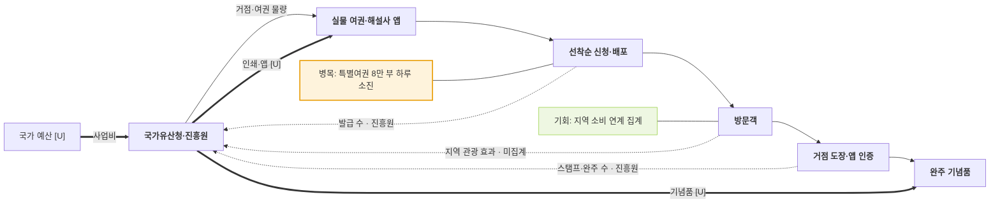

# 국가유산청 — 국가유산 방문자 여권 밸류체인

- 작성일: 2026-11-11 · 유형: **중앙기관 · 실물 여권 + 앱 · 기념품 보상**
- 근거: R1 (`research/stamp_tour_operator_sources.md`) = `research/daegu_history_tour_cases.md` 78·150·151·155·157행

## 단계별 네 층

| 층 | ① 기획 | ② 제작 | ③ 신청·배포 | ④ 방문·인증 | ⑤ 보상·기록 |
|---|---|---|---|---|---|
| 활동 | 76개 거점·10개 길, 2026 세계유산 특별코스 30곳 (:150) | 실물 여권·도장 용지, "나만의 국가유산 해설사" 앱 (:78) | 온라인 선착순 신청, 오프라인 거점 배포 (:151) | 셀프 도장·직접 날인·앱 인증 병행 (:78) | 완주 기념품 신청, 특별여권 5곳 인증 시 키링 (:157) |
| 이해관계자 | **국가유산청 · 국가유산진흥원** (국회 자료 요구 :150) | **앱** (인쇄 업체 [U]) | **진흥원 신청 페이지** (인스타그램·카카오 채널) | **방문객, 거점 체험존** | **진흥원** (K-Heritage House 수령 :157) |
| 돈 ⇐ | 국가 예산 [U] | 인쇄·앱 비용 [U] | 참여비 [U] | 거점 입장료 [U] | 기념품 비용 [U] |
| 데이터 ⇢ | 지역 관광 효과 **미집계** (:150) | — | 발급 수: 2023 6만1912권 → 2025 20만7370권 (:150) | 스탬프 3개 이상 4만5931명 (:150) | 전체 완주 1,146명 (2026.8 누적, :150) |

## 흐름도

## 마커
- 병목: 배포 물량 소진 — 특별여권 "8만 부가 하루 만에 모두 소진" (:151), 여권1 5,000부 소진·2026 신청 마감 (:155)
- 비용 [I]: 실물 여권·도장 용지. 2027년 이후 도장 용지 미지급 안내 (:78)
- 기회 [I]: 방문 데이터는 있으나 지역 효과는 미집계 (:150) → 지역 소비 연계 지표

## 특징
- 공개된 참여 수치가 가장 많은 사례. 대신 완주는 전체 거점 기준이라 매우 적음 (발급 63만28권 대비 완주 1,146명, 같은 기사 2026.8 누적, 참고값)

## 출처
- `research/daegu_history_tour_cases.md` 78, 150, 151, 155, 157행
- `research/stamp_tour_operator_sources.md` R1
