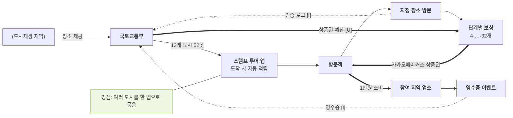

# 국토교통부 — 도시재생 스탬프 투어 밸류체인

- 작성일: 2026-11-11 · 유형: **중앙부처 · 여러 도시 공동 · 자동 인증 앱 · 단계별 상품권 + 영수증 이벤트**
- 근거: R6 (`research/stamp_tour_operator_sources.md`, Korea Times 2026-08-18)

## 단계별 네 층

| 층 | ① 기획 | ② 제작 | ③ 모집 | ④ 방문·인증 | ⑤ 보상 |
|---|---|---|---|---|---|
| 활동 | 13개 도시 52곳 (작년 40곳) | 스탬프 투어 앱, 도착 시 자동 적립 | ~11.15 | 지정 장소 도착 + 참여 지역 업소 1만원 소비 영수증 (별도 이벤트) | 4개: 카카오메이커스 3만원 월 500명 추첨, 단계별 5·7·10만원, 32개 이상 스마트폰 1명, 영수증 이벤트 월 100명 3만원 |
| 이해관계자 | **국토교통부**, (13개 도시 도시재생 지역) | **스탬프 투어 앱** (운영사 [U]) | (언론) | **방문객**, **도시재생 지역 업소** | (카카오메이커스 상품권) |
| 돈 ⇐ | 국가 예산 [U] | 앱 비용 [U] | — | 방문객 → 지역 업소 | 상품권 (끝점) |
| 데이터 ⇢ | 작년 참여 1,526명 (10개 지역 40곳) | 자동 인증 로그 [I] | — | 영수증 · 부처 [I] | 당첨자 |

## 흐름도

## 마커
- 강점: 여러 도시를 한 앱·한 보상 체계로 묶고, 지역 소비를 별도 이벤트로 연결 (R6)
- 비용 [I]: 보상 상품권이 지역화폐가 아닌 전국 쇼핑몰 상품권 → 보상 돈이 지역 밖으로 나감
- 데이터: 작년 참여자 수(1,526명) 공개

## 출처
- https://www.koreatimes.co.kr/lifestyle/people-events/20260818/turning-alleyways-into-attractions-korea-launches-urban-renewal-stamp-tour
- `research/stamp_tour_operator_sources.md` R6
