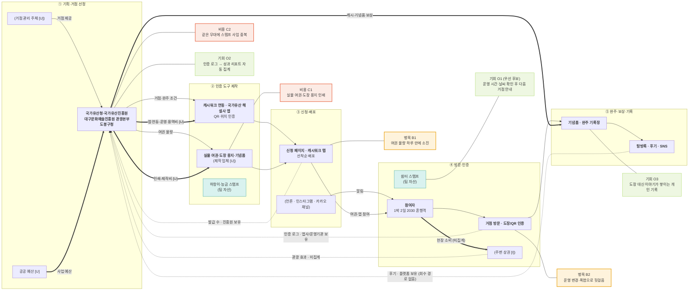

# 지자체 스탬프 투어 밸류체인 맵 v1

- 작성일: 2026-11-11
- 입력: [stakeholders.md](stakeholders.md), [signals.md](signals.md), `research/daegu_history_tour_cases.md`
- 단계: 기획·거점 선정 → 인증 도구 제작 → 신청·배포 → 방문·인증 → 완주·보상·기록
- 상태: Claude Code 초안을 자료와 대조한 v1. **팀 검토 전** (검증 기록은 [analysis.md](analysis.md) 4절)

## 표기 약속
| 선 | 뜻 | 라벨 |
|---|---|---|
| `A --> B` 실선 | 활동·참여자의 흐름 | 무엇이 넘어가는지 |
| `A ==> B` 굵은 선 | 돈의 흐름 | 예산·용역비·보상 (금액은 자료에 없어 쓰지 않음) |
| `A -.-> B` 점선 | 데이터의 흐름 | 데이터 이름 · 보유자 |

색: 주황 = 병목 · 코랄 = 비용 · 라임 = 기회 · 틸 = 팀 자산

> 돈의 방향: 커머스와 달리 **시작점이 공공 예산**이고, 참여자 쪽으로 보상이 흘러간다 `[I]`. 참여자가 내는 돈(참여비)은 자료에 없음 `[U]`. 주변 상권으로 가는 소비는 **집계되지 않음** (signals S6).

## 층별 요약표

| 층 | ① 기획·거점 선정 | ② 인증 도구 제작 | ③ 신청·배포 | ④ 방문·인증 | ⑤ 완주·보상·기록 |
|---|---|---|---|---|---|
| 활동 | 거점·완주 조건 결정 | 앱 QR·실물 여권 | 선착순 신청·홍보 | 방문·도장/QR 인증 | 기념품·기록장·후기 |
| 이해관계자 | **국가유산청·진흥원, 대구문화예술진흥원, 도봉구청** (거점 관리 주체 [U]) | **캐시워크, 해설사 앱** (제작 업체 [U]) | **신청 페이지·캐시워크 탭** (언론·SNS) | **참여자, 거점 운영자** (주변 상권 [I]) | **운영 기관, 참여자** (블로그·SNS) |
| 돈 ⇒ | 공공 예산 [U] (시작점) | 용역비·제작비 [U] | — | 현장 소비 (미집계) | 캐시·기념품 보상 (끝점) |
| 데이터 ⇢ | 성과 데이터 받는 곳 (관광 효과 미집계) | 인증 로그 (앱사/운영기관) | 발급 수 (진흥원) | 방문 인증 로그 (운영기관) | 후기 (블로그·SNS 플랫폼), 기획으로 피드백 없음 |
| 마커 | 비용 C2 · 기회 O2 | 비용 C1 · 🟦 하랑이·능금 스탬프 | 병목 B1 | 병목 B2 · 기회 O1 · 🟦 쉼터 스탬프 | 기회 O3 |

## 단계별 근거

| 단계 | 근거 (파일:행) |
|---|---|
| ① 기획·거점 선정 | `tour_cases.md:73`, `:89`, `:90`, `:150` (거점 수 20·10·76→115) |
| ② 인증 도구 제작 | `tour_cases.md:73` (캐시워크), `:78` (해설사 앱, 도장 용지), `:90` (앱 QR) |
| ③ 신청·배포 | `tour_cases.md:151` (8만 부 하루 소진), `:155` (여권1·2 소진) |
| ④ 방문·인증 | `tour_cases.md:78` (직접 날인), `research/painpoint/candidates.md` 진술문 2·3 |
| ⑤ 완주·보상·기록 | `tour_cases.md:78` (기념품 신청), `:90` (완주 기록장·탐방록), `:150` (완주 1,146명, 2026.8 누적) |

## 출처
- `research/daegu_history_tour_cases.md` 3-2절, 3-2-1절, 4절, 5절 (`tour_cases.md`로 줄여 씀)
- `research/painpoint/candidates.md`
- `brand/game_items_v1.md` 17~18행
- `plan/daeprica_hidden_quest_plan.md` 239행
