# TREAGENT 기능·기술·담당 명세 v1

- 작성일: 2026-11-13 · 팀 검토용 초안 (기획 단계)
- 범위: 무료 MVP(P0)와 후속(P1·P2)을 기능 → 기술 → 필요한 자산 → 담당 순서로 정리합니다.
- 기준 문서: 유저 플로우 v1 (`TREAGENT_User_Flow_v1.md`), 고객 전략 시각화 (`plan/treagent_customer_strategy_visualization_v1.html`), 서비스 명세 v0 (`_local_drafts/spec/spec.md`)
- 표기: `[확인 필요]` 미확인, `[미검증]` 근거 미확보, `[창작]` 팀 결정 전 후보, `[결정]` 팀이 정해야 함
- 담당은 **역할**로 적었습니다. 이름은 팀이 채웁니다 (2장).

---

## 1. 지금 어디서부터 시작하나

### 1-1. 현재 상태

| 영역 | 있는 것 | 없는 것 |
|---|---|---|
| 기획 | 기획서, 고객 전략 v1, 유저 플로우 v1, 화면 구조 도식 7장 (`design/user_flow_images/`) | 첫 코스 확정, 인증 방식 확정 |
| 스토리보드 | 게임 스토리보드 v1 (`storyboard/20261110_game_storyboard_v1.md`) | 앱 화면 기준 스토리보드 (유저 플로우 v1 반영본) |
| 캐릭터·에셋 | 하랑이 시트·표정·픽셀 전신·능금 스탬프·스티커 (`brand/character/images/`) | 앱용 분리 에셋(투명 PNG), 화면별 일러스트, 아이콘 세트 |
| 앱 | Expo 데모(코스 A, 4개 장소, 버튼 완료 방식) (`app/`) | 로그인, 서버, GPS 인증, 여행 저장, 장부 |
| 서버·DB | 없음 | 전부 |
| 운영자 웹 | 없음 (도식만 있음) | 전부 |
| 명세 | 서비스 명세 v0(로컬 초안), 이 문서 | 기능 명세 최종본(외부 `TREAGENT 무료 MVP 기능 명세`는 이 저장소에서 확인하지 못함) `[확인 필요]` |

### 1-2. 시작 순서 (이 순서를 권장)

| 순서 | 할 일 | 이유 | 담당 | 끝났다고 보는 기준 |
|---|---|---|---|---|
| 1 | 13장 결정 항목 중 **D-01~D-06**을 회의에서 확정 (AI 관련 D-13~D-20은 P1 시작 전) | 이 6개가 정해져야 DB·API·화면이 정해짐 | PM, 전원 | 결정 결과가 13장 표에 기록됨 |
| 2 | 첫 코스 1개와 실내 대안 1개의 장소 사실 확인 | 모든 기능의 데이터 기반 | 리서치·검수 | 장소 5~6곳의 운영시간·인증 지점·출처·확인일이 기록됨 |
| 3 | Figma 화면 10종 제작 (5장 화면 표 기준) | 개발이 같은 화면을 보고 시작 | 디자인 | 화면별 정상·오류 상태 포함 |
| 4 | 백엔드 선택과 DB 스키마 확정 | 앱·운영자 웹이 공유 | 백엔드 | 9장 테이블이 생성되고 시드 데이터가 들어감 |
| 5 | 승인 대사 세트 작성 | 하랑이 안내의 기본 안전망 | 콘텐츠 | 7-3 표의 장면 × 상황 칸이 모두 채워짐 |
| 6 | 앱: 로그인 → 홈 → 코스 → 여행 지도 → GPS 인증 → 완주 | P0 본체 | 프론트 + 백엔드 | 14장 시연 검수 6개 통과 |
| 7 | 운영자 웹: 상태 변경 → 앱 반영 | 휴관 시연의 핵심 장면 | 프론트(웹) + 백엔드 | 상태 저장 후 앱 새로고침 시 대체 길 안내 |
| 8 | P1: 하랑이 질의, 미스터리 | P0 이후 | AI, 콘텐츠 | P0 통과 후 착수 |

> 1~3번은 병렬로 진행할 수 있습니다. 4번은 1번 결정 후 시작합니다.

---

## 2. 역할 정의

한 사람이 여러 역할을 겸할 수 있습니다. 이름 칸은 팀이 정합니다.

| 코드 | 역할 | 맡는 일 | 이름 |
|---|---|---|---|
| PM | 기획·프로젝트 관리 | 범위·우선순위, 수용 기준, 결정 기록, 일정·이슈 관리 | `[확인 필요]` |
| DES | 디자인·UX | Figma 화면, 컴포넌트, 하랑이 표정 배치, 에셋 규격 | `[확인 필요]` |
| FE | 앱·운영자 웹 개발 | Expo 앱, 운영자 웹 화면, 위치 권한, 상태 관리 | `[확인 필요]` |
| BE | 서버·데이터 개발 | 인증, DB, API, GPS 검증, 규칙 엔진, 날씨 연동 | `[확인 필요]` |
| AI | 하랑이·에이전트 | 대사 생성 프롬프트, 조회 도구, 검증 로직, 검수 자료 검색 (P1) | `[확인 필요]` |
| CON | 콘텐츠·스토리·에셋 | 하랑이 대사, 미션·퀴즈, 스탬프·일러스트 제작, 브랜드 톤 | `[확인 필요]` |
| RES | 리서치·검수·QA | 장소 사실 확인, 현장 답사, 출처 기록, 테스트 시나리오 실행 | `[확인 필요]` |

- 기존 서비스 명세 v0의 담당 구분(기획·검증 / 스토리·에셋 / 개발)은 위 7개 역할로 나눴습니다 (`_local_drafts/spec/spec.md` 데이터와 담당).
- 최소 인원으로 겸임할 경우 BE+AI, FE+DES, CON+RES 조합이 일을 나누기 쉽습니다 `[창작: 제안일 뿐]`.

---

## 3. 기능 목록과 우선순위

범위 구분은 유저 플로우 v1 6장을 따릅니다.

| ID | 기능 | 우선순위 | 한 줄 설명 |
|---|---|---|---|
| F-01 | 로그인·가입 | P0 | 세션 확인, 로그인·가입, 실패 시 재시도 |
| F-02 | 하랑이 첫 만남 | P0 | 첫 방문 시 소개, 닉네임 선택 또는 ‘길동무’ |
| F-03 | 홈 | P0 | 진행 중 여행·코스·장부 진입 |
| F-04 | 코스 목록·상세 | P0 | 테마·소요시간·출발 장소 |
| F-05 | 오늘의 길 확인 | P0 | 날씨·특보·운영시간 확인 후 경로 추천, 사유·기준 시각 표시 |
| F-06 | 여행 시작·이어하기 | P0 | 진행 중 여행 복구, 스탬프 보존 |
| F-07 | 여행 지도·길찾기 | P0 | 다음 장소, 진행률, 외부 지도 앱 연결 |
| F-08 | 이동 중 경로 변경 | P0 | 조건 변경 시 대체 길 안내·수락·보류 |
| F-09 | GPS 방문 인증 | P0 | 위치 전송 → 서버 검증 → 방문 저장(중복 없음) |
| F-10 | 스탬프·완주 | P0 | 능금 스탬프, 완주 판정, ‘내 여행 한 장’ |
| F-11 | 장부·주머니 | P0 | 지난 여행 기록, 수집 스탬프 |
| F-12 | 내 계정 | P0 | 닉네임, 로그아웃 |
| F-13 | 하랑이 대사 엔진 | P0 | 상황별 승인 대사 표시 (생성은 F-14에서 확장) |
| F-14 | 하랑이 질의 (내 진행·장소 이야기) | P1 | 조회 도구 + 검수 자료 검색 + 생성 + 검증 |
| F-15 | 미스터리 코스 | P1 | 현장 단서 → 선택형 퀴즈 → 힌트 → 인증 |
| F-16 | QR 인증 | P2 | 장소 인증의 후속 분기 |
| F-17 | 권역 배지·시즌 공동 장부·도사 인정 | 규칙 정의는 지금, 구현 P2 (시즌 연결 데이터는 P0부터) | 전체 스팟 중 채워진 비율로 하랑이 도사 인정 판정. 여행 1회 완주와 별도 (6장 F-17) |
| F-18 | 운영자 웹 | P0 | 장소·경로·대사 검수·게시, 운영 중단·재개 |
| F-19 | 규칙 엔진·날씨 연동 | P0 | 모드 결정, 특보·예보·운영 상태 반영 |
| F-20 | 대사 초안 제작 파이프라인 | P1 | 운영자가 쓰는 대사·장소 이야기 초안 생성 → 톤·사실 검수 → 승인 (15장) |
| F-21 | 푸시 알림 | P1 | 운영자가 장소를 중단하면 영향받는 진행 중 여행에 알림 → 탭하면 경로 재평가 (16장) |
| F-22 | 이벤트 분석 | P1 (이벤트 정의표는 P0에서 확정) | 고객 전략의 첫 인증률·변경 후 재개율·완주율 측정 (16장) |
| F-23 | 위치·날씨 기반 추천 | P0 | 현재 위치 또는 선택한 구·군과 날씨 모드에 맞는 장소·코스를 추천하고 사유를 표시 |
| F-24 | 앱 내 코스 지도·내 위치·스탬프 연출 | P0 (도보 경로선은 P1) | 코스 순서와 내 위치를 지도에 표시, 인증 성공 시 스탬프 ‘쿵’ 연출 (17-2) |
| F-25 | 인증 대체 수단 | P0 단서 입력 · P2 QR | GPS가 안 될 때의 대안과 건너뛰기 규칙 (17-4) |
| F-26 | 하랑이 표정·방향 연출 | P0 표정 · P1 방향 | 안내 중 하랑이 표정 변화, 다음 장소 방향을 보는 연출 (17-5) |
| F-27 | 디지털 팀권·결제 | P2 (D-11 결정 후) | 팀 단위 이용권 구매·초대 (17-6) |
| F-28 | 마스코트 교체 구조·캐릭터 생성 에이전트 | 구조 P1 · 생성 에이전트 P2 | 발주처가 다른 마스코트를 요청할 때의 대응 (17-8) |

- 운영자 웹(F-18)과 규칙 엔진(F-19)은 화면이 아니어도 P0입니다. 휴관 시연이 이 두 기능에 달려 있습니다 (유저 플로우 v1 6장, 고객 전략 pilot 절).

---

## 4. 시스템 구성과 플로우

- 4-1 시스템 구성 · 4-2 앱 전체 · 4-3 로그인·첫 만남 · 4-4 코스·경로 변경 · 4-5 GPS 인증 · 4-6 스탬프·완주·장부 · 4-7 하랑이 안내·질문 · 4-8 미스터리 · 4-9 운영자 웹 · 4-10 도식과 기능 대응
- 각 흐름은 **Mermaid 한 번만** 싣습니다 (같은 흐름의 이미지·중복 도식은 넣지 않음). 원본 도식 파일 위치는 4-10 표에만 적습니다.
- 에이전트·LLM 기술 스택은 **15장**에 모았습니다.

### 4-1. 시스템 구성·기술 선택

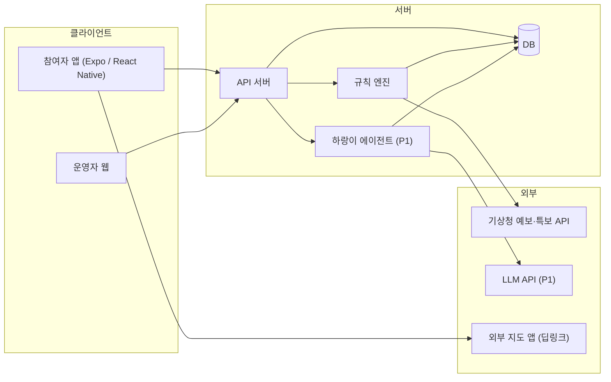

**기술 선택 (확정 / 후보)**

| 영역 | 현재 상태 | 근거·비고 |
|---|---|---|
| 앱 | **Expo + React Native + TypeScript** (확정) | `app/package.json` (expo ~58, react-native 0.88), `_local_drafts/spec/spec.md` |
| 웹 미리보기 | react-native-web 설치됨 | `app/package.json` |
| 위치 | 기기 위치 API (expo 제공 모듈) `[확인 필요: 모듈·권한 문구]` | 위치는 앱 사용 중에만 수집 (`plan/daeprica_hidden_quest_plan.md` 8장) |
| 길찾기 | 외부 지도 앱 열기(유저 플로우 v1 2장, 열 수 없으면 주소·인증 지점 설명)는 유지. **피드백 반영: 앱 내 코스 지도(순서·내 위치·스탬프)를 P0에 추가 검토** `[결정 D-27]` | 17-2 (피드백 2). 지도 SDK 후보는 17-2 표, 모두 `[확인 필요]` |
| 서버·DB·인증 | **미정** `[결정 D-02]` | 후보 A: Firebase (인증+Firestore). 후보 B: Supabase (인증+Postgres). 아래 비교 |
| 규칙 엔진 | 서버 코드 안의 순수 함수 + 설정표 | 안전 규칙은 AI가 바꾸지 못함 (기획서 8장) |
| 날씨 | 기상청 단기예보·특보·관측 공공데이터 API `[확인 필요: 신청 방법·호출 한도]` | 링크는 시각화 HTML의 출처 절 (`data.go.kr` 15084084, 15000415, 15139432). 직접 열어 확인하지는 않음 |
| LLM·에이전트·RAG·페르소나 | **미정** `[결정 D-13~D-20]` (P1) | 서버에서만 호출, 앱에 키를 넣지 않음. 상세는 **15장** |
| 푸시 알림 | **미정** `[결정 D-21]` (P1) | 상세는 **16장** |
| 이벤트 분석 | **미정** `[결정 D-22]` (P1, 이벤트 정의는 P0) | 상세는 **16장** |
| 운영자 웹 | 후보 A: Expo web 재사용. 후보 B: 별도 웹 앱 `[결정 D-03]` | A는 코드 공유, B는 화면 자유도 |

**서버·DB 후보 비교** `[미검증: 팀 기술 숙련도 반영 필요]`

| 기준 | 후보 A Firebase | 후보 B Supabase |
|---|---|---|
| 방문 중복 방지(같은 여행·장소 1건) | 문서 ID를 `tripId_placeId`로 고정해 처리 | 고유 제약조건 1줄 |
| 검수 자료 검색(P1) | 별도 검색·벡터 구성 필요 | DB 확장으로 같은 곳에서 처리 가능 |
| 운영자 권한 | 보안 규칙 + 커스텀 클레임 | 행 단위 보안 정책 |
| 진행 속도 | 앱 SDK 연동이 빠름 | SQL 숙련자에게 유리 |

### 4-2. 앱 전체 구조

홈에서 코스·이어하기·장부에 접근합니다. 새 여행은 코스 선택에서, 재방문은 홈의 ‘이어하기’에서 시작합니다.

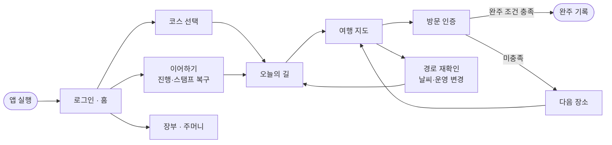

- 대응 기능: F-03, F-04, F-05, F-06, F-07, F-08, F-09, F-10, F-11

### 4-3. 로그인·첫 만남

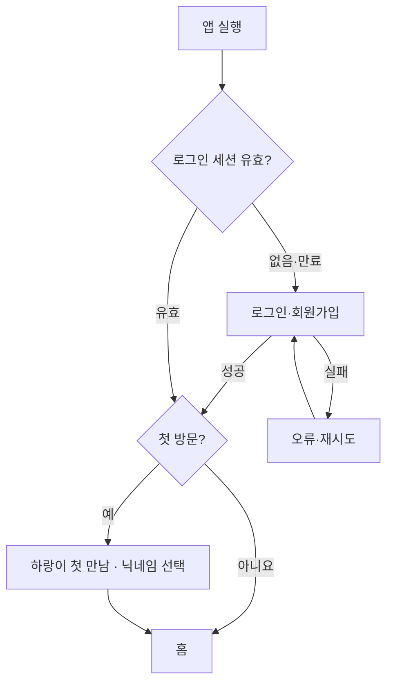

- 닉네임을 건너뛰면 하랑이가 ‘길동무’라고 부릅니다. 로그인 실패 시 다시 시도합니다.
- 대응 기능: F-01, F-02, F-12 · 화면: S-01, S-02

### 4-4. 코스 추천·선택과 경로 변경

**① 위치·날씨 기반 추천 (F-23)**

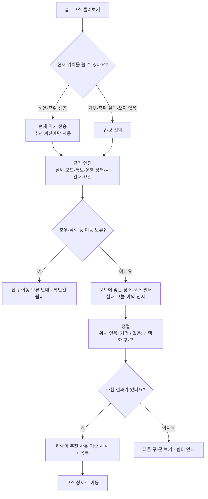

- 위치 권한 없이도 구·군 선택으로 추천을 받을 수 있어야 합니다 (위치 권한 부담, 기획서 9장).
- 좌표는 추천 계산에만 쓰고 저장하지 않습니다 (F-23).
- 상세는 6장 F-23.

**② 코스 선택과 오늘의 길**

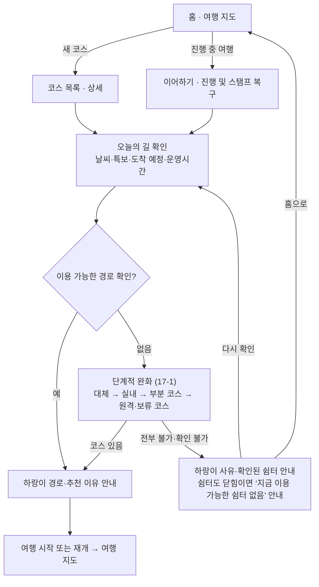

이동 중 변경은 다음과 같습니다.

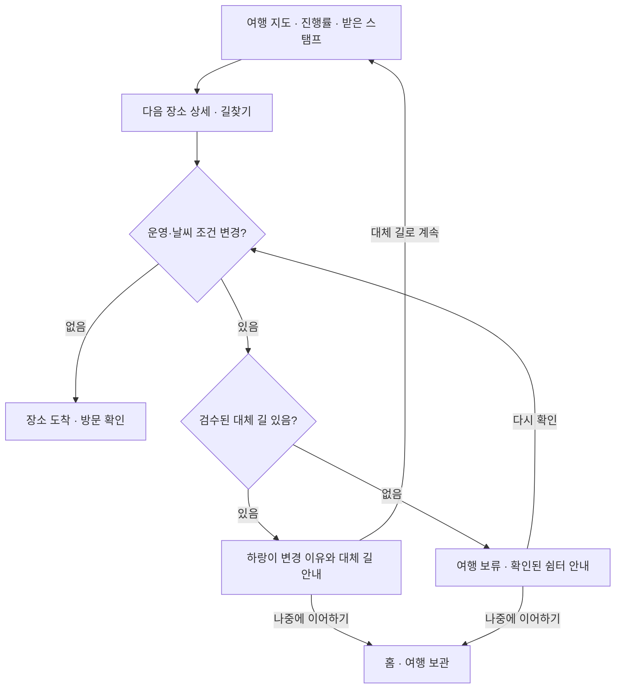

- 대체 길을 수락하면 **남은 경로만** 바뀌고 기존 스탬프는 유지됩니다.
- 대응 기능: F-04, F-05, F-06, F-07, F-08, F-19 · 화면: S-03, S-04, S-05, S-07

### 4-5. GPS 방문 인증

사용자 쪽 흐름과 서버 처리를 한 도식으로 봅니다.

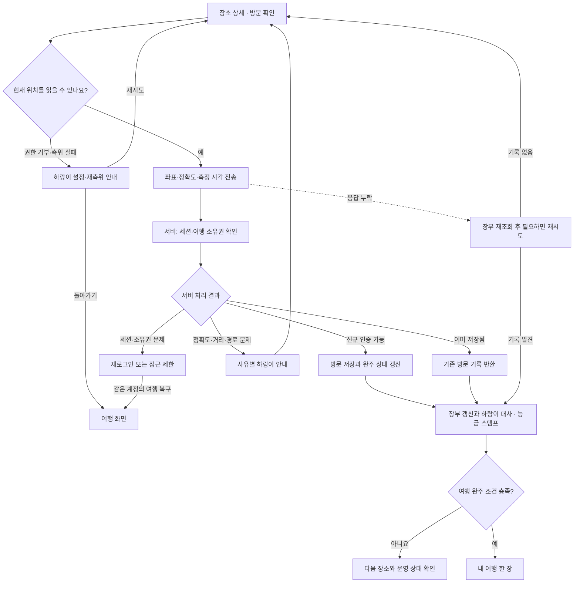

- 같은 여행·장소를 다시 요청하면 기존 방문을 반환합니다 (멱등). 응답이 누락되면 장부를 먼저 조회하고, 기록이 없을 때만 재시도합니다.
- 대응 기능: F-09, F-10, F-01(세션 복구) · 화면: S-06 · 서버 응답 코드는 10장
- 서버 처리 결과 → 응답 코드 대응: 신규 인증 가능 = `created`, 이미 저장됨 = `existing`, 정확도 = `low_accuracy`, 거리 = `too_far`, 경로 변경 = `route_changed`, 세션·소유권 = `auth_required`

### 4-6. 스탬프·완주·장부

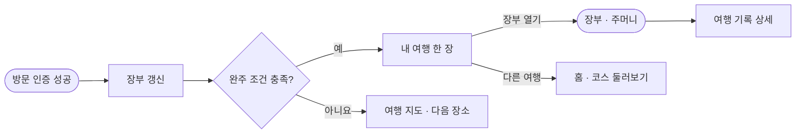

- 홈에서 이전 여행과 받은 스탬프를 다시 확인할 수 있습니다.
- 대응 기능: F-10, F-11 · 화면: S-08, S-09

### 4-7. 하랑이 안내와 질문

장면·질문을 받아 안전·인증·기본 안내는 승인 대사로, 개인 진행·장소 이야기는 조회·검색 후 생성해 검증합니다. 실패·시간 초과 시 승인 대사로 돌아갑니다.

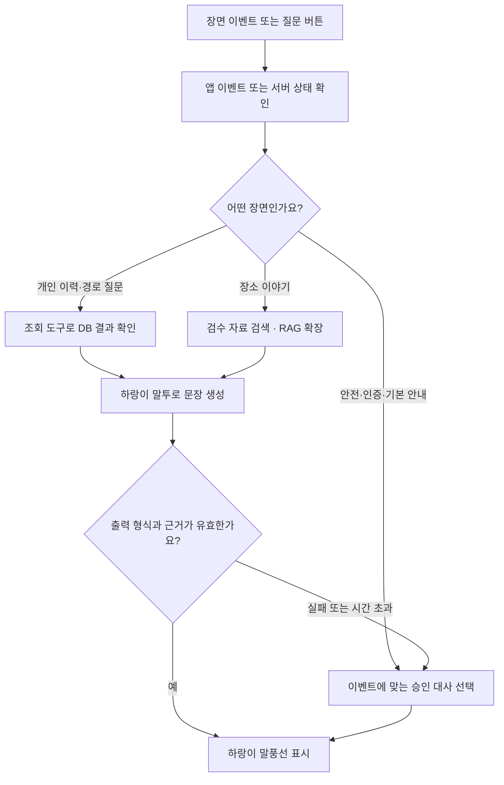

- **P0는 승인 대사만**으로 시연 가능합니다. 생성·조회·검색 경로(D, E, F)는 P1입니다 (도식 하단 안내: 질문 기능은 P1 시연 범위).
- 대응 기능: F-13(P0), F-14(P1) · 대사 표는 7-3

### 4-8. 미스터리 퀘스트 (P1)

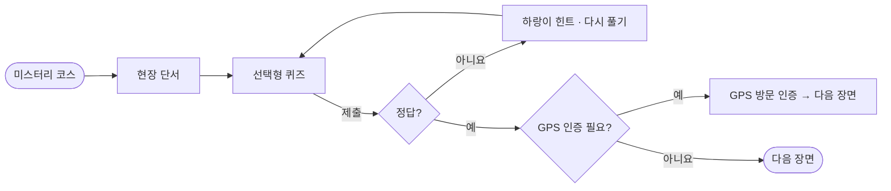

- 미스터리 포함 범위와 인증 방식은 팀 결정 항목입니다 (D-09, D-05).
- 대응 기능: F-15

### 4-9. 운영자 웹 워크플로우 (초안)

> 제공된 도식에는 운영자 웹 흐름이 없습니다. 유저 플로우 v1 6장(“운영자가 장소·경로·대사를 검수·게시하고 운영 중단·재개를 반영”)과 서비스 명세 v0 F-05·F-06에서 정리한 **초안**입니다. 팀이 확인한 뒤 Figma 도식으로 확정합니다 `[확인 필요]`.

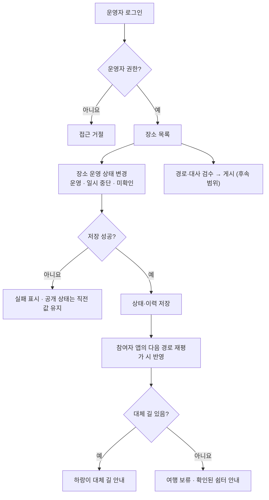

- 대응 기능: F-18, F-19, F-08 · 화면: S-11~S-13
- 참여자 반영은 실시간 푸시가 아니라 **재평가 시점** 기준입니다 (F-08).

### 4-10. 도식·기능·화면 대응표

| 도식 | 파일 | 기능 | 화면 | 우선순위 |
|---|---|---|---|---|
| 앱 전체 (앱 실행 로직 포함) | `design/user_flow_images/00_App_Structure.png` | F-01, F-03~F-11 | S-01~S-09 | P0 |
| 로그인·첫 만남 | `01_Login.png` | F-01, F-02, F-12 | S-01, S-02, S-10 | P0 |
| 코스·경로 변경 | `02_Route.png` | F-04~F-08, F-19 (F-23 추천은 이 도식에 없어 4-4 ①로 추가) | S-03~S-05, S-07, S-14 | P0 |
| GPS 인증 (서버 처리 포함) | `03_GPS.png` | F-09, F-10 | S-06 | P0 |
| 스탬프·완주·장부 | `04_Journal.png` | F-10, F-11 | S-08, S-09 | P0 |
| 하랑이 안내·질문 (로직 포함) | `05_Harangi.png` | F-13 (P0), F-14 (P1) | 전 화면 말풍선 | P0/P1 |
| 미스터리 | `06_Mystery.png` | F-15 | 단서·퀴즈 화면 | P1 |
| 운영자 웹 | (도식 없음, 4-9 초안) | F-18 | S-11~S-13 | P0 |

---

## 5. 화면 목록과 필요한 것

화면은 유저 플로우 v1 5장 기준입니다. 도식은 `design/user_flow_images/` 7장.

| 코드 | 화면 | 필요한 상태 화면 | 필요한 데이터·API | 필요한 에셋 | 담당 |
|---|---|---|---|---|---|
| S-01 | 로그인·가입 | 입력 오류, 로그인 실패, 세션 만료 | 인증 | 하랑이 표정(차분), 앱 로고 `[확인 필요: 로고 없음]` | DES, FE, BE |
| S-02 | 첫 만남 | 닉네임 건너뛰기 | 프로필 저장 | 하랑이 인사 일러스트, 대사 | DES, CON, FE |
| S-03 | 홈 | 진행 여행 없음/있음, 코스 없음 | 프로필, 진행 여행, 코스 목록 | 코스 썸네일, 하랑이 | DES, FE |
| S-04 | 코스 상세·오늘의 길 | 경로 확인 중, 확인 불가, 쉼터 안내 | 코스, 경로 추천, 기준 시각 | 장소 사진, 실내·야외 아이콘 | DES, FE, BE, RES |
| S-14 | 주변 추천 (위치·날씨) | 위치 권한 요청, 거부 시 구·군 선택, 이동 보류, 추천 없음, 날씨 확인 불가 | 추천 API, 구·군 목록, 기준 시각 | 모드별 아이콘(실내·그늘·야외·전시), 하랑이(놀람·차분), 쉼터 아이콘 | DES, FE, BE |
| S-05 | 여행 지도·진행 | 외부 지도 열기 실패 | 여행, 방문 목록, 운영 상태 | 진행률 바, 스탬프 슬롯 | DES, FE |
| S-06 | 장소 상세·방문 확인 | 권한 거부, 측위 실패, 거리·정확도 문제, 응답 누락 | 장소, 인증 지점 설명, 방문 API | 인증 지점 사진·설명, 하랑이 표정 | DES, FE, BE, RES |
| S-07 | 경로 변경·보류 | 대체 길 있음/없음 | 재평가 API, 쉼터 정보 | 하랑이(놀람·차분), 쉼터 아이콘 | DES, FE, BE |
| S-08 | 완주·내 여행 한 장 | — | 방문 기록, 완주 판정 | 능금 스탬프, 한 장 카드 템플릿 | DES, CON, FE |
| S-09 | 장부·주머니 | 기록 없음 | 여행 목록, 스탬프 목록 | 스탬프 이미지, 빈 상태 일러스트 | DES, FE |
| S-10 | 내 계정 | — | 프로필 | — | FE |
| S-11 | 운영자 로그인·장소 목록 | 권한 없음 | 운영자 인증, 장소 목록 | — | DES, FE |
| S-12 | 운영자 장소 상태 변경 | 저장 실패 | 상태 변경 API | — | DES, FE, BE |
| S-13 | 운영자 경로·대사 검수·게시 | 반려 사유 | 검수 API | — | DES, FE, BE, CON |

공통 요건
- 오류·로딩·빈 상태는 화면마다 Figma에 포함합니다.
- 하랑이 말풍선 컴포넌트를 1개 만들어 모든 화면에서 재사용합니다.

---

## 6. 기능별 상세: 누가 무엇을 해야 하나

각 기능마다 **동작 → 기술 → 필요한 자산·데이터 → 담당별 할 일 → 수용 기준** 순서입니다.

### F-01 로그인·가입 (P0)

- 동작: 앱 실행 시 세션 확인 → 없음·만료면 로그인·가입 → 성공 시 첫 방문 여부 판단. 실패하면 오류와 재시도 버튼.
- 기술: 서버 인증 서비스, 토큰 저장(기기 보안 저장소), 세션 만료 시 재로그인 후 같은 계정의 여행 복구.
- `[결정 D-01]` 로그인 방식: 후보 A 이메일·비밀번호, 후보 B 소셜 로그인 1종. 둘 다 구현 범위와 심사 부담이 다릅니다 `[확인 필요]`.

| 담당 | 할 일 |
|---|---|
| PM | 로그인 방식 결정 기록, 개인정보 수집 항목 최소화 확인 |
| DES | 로그인·가입·오류·세션 만료 화면 |
| FE | 세션 확인 부트 로직, 입력 검증, 오류·재시도 UI, 토큰 저장 |
| BE | 인증 설정, `users`·`profiles` 생성, 첫 방문 플래그 |
| CON | 로그인 실패·세션 만료 하랑이 승인 대사 |
| RES | 시나리오 실행: 오류, 만료, 재로그인 후 복구 |

- 수용 기준: ① 앱 재실행 후 세션이 유효하면 로그인 화면이 나오지 않는다. ② 실패 시 오류와 재시도가 보인다. ③ 세션 만료 후 재로그인하면 같은 계정의 여행이 복구된다.

### F-02 하랑이 첫 만남 (P0)

- 동작: 첫 방문이면 하랑이 소개 → 닉네임 선택 또는 건너뛰기(‘길동무’).
- 기술: 프로필 `nickname`(빈 값 허용), 첫 방문 플래그 갱신.
- 자산: 하랑이 인사 표정, 소개 대사. 캐릭터 이름은 가칭입니다 (`brand/character/prompts.md`의 ‘하랑이(가칭)’).

| 담당 | 할 일 |
|---|---|
| CON | 소개 대사 2안 `[창작: 후보 2개]`, 닉네임 규칙(길이·금지어) |
| DES | 첫 만남 화면, 하랑이 일러스트 배치 |
| FE | 닉네임 입력·건너뛰기, 호칭 규칙(없으면 ‘길동무’) |
| BE | 닉네임 저장 API, 금칙어 필터 `[확인 필요]` |

- 수용 기준: 닉네임을 건너뛰면 이후 모든 하랑이 대사의 호칭이 ‘길동무’다.

### F-03 홈 (P0)

- 동작: 진행 중 여행(있으면 ‘이어하기’), 공개 코스 목록, 장부 진입.
- 기술: 프로필·진행 여행·게시된 코스 조회 API. 진행 중 여행 신규 시작 허용 여부 `[결정 D-08]`.

| 담당 | 할 일 |
|---|---|
| DES | 홈 화면, 진행 여부별 변형 |
| FE | 홈 데이터 로드, 이어하기·코스 보기·장부 열기 연결 |
| BE | `GET /trips/active`, `GET /courses` |

- 수용 기준: 진행 중 여행이 있으면 이어하기가 보이고, 없으면 코스 보기가 주 버튼이다.

### F-04 코스 목록·상세 (P0)

- 동작: 테마, 예상 소요시간, 출발 장소 확인.
- 데이터: `courses`, `places`, `course_routes` (정상 경로·대체 경로 변형).
- 첫 코스 `[결정 D-04]`: 기존 데모는 **코스 A 「사라진 대구의 비밀 레시피」(중구, 30분)** — 동성로 → 근대골목 → 약령시 박물관 → 서문시장 (`app/src/data/courseA.ts`, 기획서 5-1장). 폭염 경로는 약령시 → 동성로 → 서문시장 `[추정]`.
- 파일럿 코스(생활권 하나)와 일치시킬지 `[확인 필요]` (고객 전략 pilot 절: 코스·소요시간은 현장 답사 후 결정).

| 담당 | 할 일 |
|---|---|
| RES | 코스 장소의 운영시간·휴관일·주소·인증 지점 확인, 출처·확인일 기록 |
| CON | 코스 소개문, 장소별 한 줄 소개 |
| DES | 코스 카드·상세 |
| BE | 코스·장소 스키마, 시드 입력 |
| FE | 목록·상세 화면 |

- 수용 기준: 코스 상세에 테마·소요시간·출발 장소가 표시되고, 모든 장소에 출처와 확인일이 있다.

### F-05 오늘의 길 확인 (P0)

- 동작: 날씨·특보·요일·장소별 예상 도착시각·운영시간 확인 → 방문 순서·추천 사유·기준 시각을 경로 카드에 표시. 경로가 없으면 확인된 쉼터 표시, 다시 확인 또는 홈으로.
- 기술: 규칙 엔진(F-19)이 모드를 정하고 검수 DB에서 경로를 고름. 응답에 `기준 시각`과 `사유 코드`를 포함. 사유 문장은 승인 대사에서 고름(생성 아님).
- 규칙 기준: 28℃ 미만 탐험 / 28~33℃ 그늘 / 33℃ 이상 실내 / 폭염특보 안전 (기획서 6-1장). **기준 수치는 기상청·보건 기준 확정 전** `[확인 필요]`.

| 담당 | 할 일 |
|---|---|
| PM | 모드별 규칙표 확정 결정 `[결정 D-06]` |
| RES | 특보·폭염 행동요령 기준 확인, 쉼터 목록·운영시간 확인 (고객 전략 출처의 폭염·호우 행동요령 링크) |
| BE | 규칙 엔진 함수, 날씨·특보 조회, 경로 선택 API, 기준 시각 기록 |
| FE | 경로 카드, 확인 중·확인 불가 상태 |
| CON | 모드별 추천 사유 승인 대사 |
| DES | 경로 카드 레이아웃, 기준 시각 표기 |

- 수용 기준: ① 시연 입력(일반·더움·특보·확인 불가)마다 경로가 다르게 나온다. ② 모든 경로 카드에 기준 시각이 보인다. ③ 확인 불가면 AI 추측이 아닌 승인 대사와 쉼터가 나온다. ④ 경로가 없어 보여도 17-1의 단계적 완화 순서로 **코스를 먼저 제시**하고, 모든 단계가 불가할 때만 ‘이용 가능한 쉼터 없음’ 안내가 나온다 (빈 화면 없음).

### F-23 위치·날씨 기반 추천 (P0)

- 동작: 홈의 ‘코스 둘러보기’(S-14)에서 사용자의 **현재 위치 또는 선택한 구·군**과 **날씨 모드**에 맞는 장소·코스를 추천합니다. 각 추천에 사유와 기준 시각을 표시합니다. 위험이 겹치면 안전 규칙이 먼저입니다.
- 근거: 고객 전략 문서의 “대구 7개 구와 달성군·군위군에서 출발 위치와 날씨에 맞춰 인접 거점 추천” 설계. 단, 해당 문서의 날씨·구 선택은 **설계 시뮬레이션이며 실시간 날씨·개관 여부는 연결 전, 그늘 구간은 답사 필요**입니다.
- 유저 플로우 v1에는 이 기능이 없어 이 문서에서 추가했습니다 `[확인 필요: 팀 동의]`.

**날씨 시나리오별 추천 규칙** (고객 전략 HTML 기준, 모드 수치는 D-06과 함께 정리)

| 시나리오 | 추천 방식 |
|---|---|
| 평상시 · 야외 | 강수·특보·현장 통제가 없고 체감온도가 무리 없는 시간대. 골목·공원·역사 자산 야외 코스 |
| 더운 날 · 그늘 | 폭염 대응 단계 전. 답사한 나무 그늘·짧은 동선과 가까운 실내 쉼터가 있는 코스만 노출 |
| 폭염 · 실내 | 폭염특보 또는 체감온도 높음. 실내 전시·체험 우선, 야외 미션 중지, 이동 중이면 가까운 실내·휴식 안내 |
| 약한 비 · 전시 | 전시 우선. 통제·낙뢰·침수 우려가 없고 현장 확인을 마친 짧은 포장 구간·지붕 아래 경관만 선택지로 |
| 호우·낙뢰 · 이동 보류 | 야외 코스 숨김, 신규 이동 보류, 안전한 현재 위치에서 실내·원격 단서 또는 일정 변경 안내. **위험이 겹치면 이 규칙을 먼저 적용** |

- 기획서 6-1장의 온도 구간(28·33℃ 등)과 위 시나리오 분류가 다릅니다. **하나의 모드표로 통합**해야 합니다 `[결정 D-06]`.

**위치 입력** `[결정 D-23]`

| 후보 | 내용 | 비고 |
|---|---|---|
| A 구·군 선택만 | 위치 권한 불필요. 9개 구·군 중 선택 | 가장 단순, 거리 정렬 없음 |
| B 현재 위치만 | 권한 허용 시 거리 기준 추천 | 거부 시 사용 불가 → 이탈 위험 |
| C 둘 다 (제안) | 위치 허용 시 현재 위치 우선, 거부·실패 시 구·군 선택 | F-09의 권한 거부 처리와 같은 방식 재사용 |

**기술**
- 서버 추천 API가 입력(구·군 코드 또는 좌표·정확도, 요청 시각)을 받아 규칙 엔진(F-19)의 모드를 얻고, 후보를 거릅니다: 모드에 허용된 장소 유형, 운영 상태(`place_status`), 예상 도착시각의 운영시간.
- 정렬: 위치가 있으면 거리, 없으면 선택한 구·군 일치. 거리 계산은 F-09 방문 인증과 같은 모듈을 씁니다.
- 응답: 추천 목록, 사유 코드, 기준 시각, 폴백 이유.
- 추천 단위 `[결정 D-24]`: 현재 앱 흐름(코스 → 오늘의 길)에 맞춰 **코스 단위 추천**에 코스 안 대표 장소를 보여 주는 안을 제안. 추천 반경·개수 수치는 현장 확인 후 정하며 이 문서에는 적지 않음.
- 폴백: 날씨 확인 불가 → ‘확인 불가’ 안내와 실내·쉼터 후보만 표시(추측 안 함). 추천 결과 없음 → 다른 구·군 보기, 쉼터 안내.
- 사유 문구: 승인 대사의 빈칸 채우기(모드·장소 이름·기준 시각). **LLM 미사용**(P0). 윤문은 P1 선택(15-2).

**개인정보**
- 좌표는 **추천 계산에만 사용하고 저장하지 않습니다**. DB·서버 로그·이벤트(16-2)·LLM 요청에 남기지 않습니다 (D-17과 일치).
- 위치는 앱 사용 중에만 수집합니다 (기획서 8장). 권한 요청 화면에 이유를 설명합니다.

**데이터** (7-2의 C-09·C-10)
- `places`에 구·군(`district`), 유형(실내·그늘·야외·전시), 모드별 노출 허용 여부가 필요합니다.
- 코스 ID가 아닌 장소 단위 추천을 함께 쓰려면 장소와 코스의 연결 정보가 필요합니다.

| 담당 | 할 일 |
|---|---|
| PM | D-23·D-24 결정, 모드표 통합(D-06), 추천 규칙표 승인 |
| RES | 장소별 구·군·유형 분류, 그늘 구간·운영시간·실내 대안 **현장 답사**, 출처·확인일 기록 |
| BE | 추천 API, 규칙 엔진 연동, 거리 계산, **좌표 미저장** 보장, 폴백 |
| FE | 위치 권한 요청·거부 처리, 구·군 선택, 추천 카드·사유·기준 시각, 이동 보류·추천 없음 상태 |
| DES | S-14 화면(권한 요청·구·군 선택·추천·보류·없음) |
| CON | 추천 사유 승인 대사(모드별, 보류·확인 불가), 안전 안내 문구 |

- 수용 기준: ① 같은 구·군이라도 날씨 모드가 바뀌면 추천 결과가 달라진다. ② 호우·낙뢰 시나리오에서 야외 추천이 숨겨지고 이동 보류 안내가 나온다. ③ 위치 권한을 거부해도 구·군 선택으로 추천을 받는다. ④ 추천 요청의 좌표가 DB·서버 로그·이벤트에 남지 않는다. ⑤ 모든 추천에 사유와 기준 시각이 보인다.

### F-06 여행 시작·이어하기 (P0)

- 동작: 새 여행 생성 또는 진행 중 여행 복구. 앱 재실행 후에도 스탬프·방문 기록 유지.
- 기술: 서버가 여행 상태의 기준. 앱은 캐시만 가짐. 상태: `진행`, `보류`, `완주`.

| 담당 | 할 일 |
|---|---|
| BE | `POST /trips`, 상태 전이 규칙, 중복 진행 여행 처리(D-08) |
| FE | 이어하기 진입 시 서버 상태 우선 로드 |
| RES | 앱 종료·재실행·재로그인 복구 시나리오 |

- 수용 기준: 앱을 종료했다 다시 열면 같은 여행·같은 스탬프가 보인다.

### F-07 여행 지도·길찾기 (P0)

- 동작: 다음 장소, 운영 상태, 진행률, 받은 스탬프, 방문 목록. ‘길찾기’는 외부 지도 앱 열기, 불가하면 주소와 인증 지점 설명.
- 기술: 외부 지도 딥링크(턴바이턴 길찾기), 폴백 텍스트. 앱 내 코스 지도(핀·순서선·내 위치)는 **P0로 앞당기는 안**을 17-2에서 검토 중 `[결정 D-27]`. 도보 경로선은 P1.
- 자산: 장소별 주소 문자열, 인증 지점 설명(사진 포함 여부 `[결정]`).

| 담당 | 할 일 |
|---|---|
| FE | 지도 앱 열기·실패 폴백, 진행률 UI |
| RES | 장소별 좌표·주소·인증 지점 설명 작성 |
| DES | 지도 화면 |

- 수용 기준: 지도 앱을 열 수 없어도 주소와 인증 지점 설명이 보인다.

### F-08 이동 중 경로 변경 (P0)

- 동작: 다음 장소 안내 시점과 앱·지도 복귀 시점에 조건 재평가. 변경이 있고 검수된 대체 길이 있으면 하랑이가 이유와 대체 길 안내 → ‘대체 길로 계속’ 또는 ‘나중에 이어하기’. 대체 길이 없으면 여행 보류와 쉼터 안내.
- 기술: `POST /trips/:id/route-check`(재평가), `POST /trips/:id/reroute/accept`. 수락 시 **남은 경로만** 교체하고 받은 스탬프·방문 기록 보존.
- 운영자가 상태를 바꾸면 참여자 앱이 **다음 재평가 시점**에 반영합니다. P0는 이 방식(재평가 시점 반영)으로 시연하고, 운영자 변경을 즉시 알리는 **푸시 알림은 P1(F-21)** 로 추가합니다 (팀 의견 반영, 16장).

| 담당 | 할 일 |
|---|---|
| BE | 재평가 API, 대체 길 선택 규칙, 스탬프 보존 보장, 경로 변경 이력 |
| FE | 앱 복귀 시 재평가 호출, 변경 안내 화면, 수락·보류 처리 |
| CON | 변경 사유별 승인 대사(휴관, 특보, 혼잡 등) |
| RES | 휴관 후 대체 길 수락 시나리오 실행 |
| DES | 경로 변경·보류 화면 |

- 수용 기준: 운영자가 장소를 중단하면 앱 재평가 시 대체 길이 안내되고, 수락 후에도 기존 스탬프가 남는다.

### F-09 GPS 방문 인증 (P0)

- 동작: ‘방문 확인’ → 위치 권한 확인 → 좌표·정확도·측정 시각 전송 → 서버가 계정·여행 소유권·현재 경로·장소·측정 시각·정확도·거리 확인 → 방문 저장과 완주 판정을 함께 처리. 같은 여행·장소 재요청은 기존 방문을 반환. 응답 누락 시 장부를 먼저 조회한 뒤 필요할 때만 재시도.
- 기술: 서버 거리 계산(두 좌표 사이 거리), 고유 제약(여행+장소), 트랜잭션(방문 저장+완주 판정), 멱등 키.
- 서버 응답 구분(유저 플로우 v1 3장 기준): 신규 저장 / 기존 기록 반환 / 거리·정확도 문제 / 운영·경로 변경 / 세션·소유권 문제.
- `[결정 D-05]` 인증 반경·허용 정확도(미터), 측정 시각 허용 오차 — **수치는 현장 시험 후 정함. 이 문서에는 적지 않음.**
- GPS 오차가 큰 실내 장소(박물관·시장 내부)가 있어 `[확인 필요]` 인증 지점을 출입구 같은 실외 지점으로 둘지 정해야 합니다.

| 담당 | 할 일 |
|---|---|
| PM | D-05 결정 진행, 방문 순서 강제 여부 `[결정 D-07]` |
| RES | **현장 답사**: 장소별 인증 지점 좌표·실측 오차 기록, 실내 장소 대안 |
| BE | `POST /trips/:id/visits`(멱등), 검증 로직, 응답 코드 정의, 로그 |
| FE | 권한 요청·거부 시 설정 열기, 측위 재시도, 응답 누락 시 장부 재조회 |
| CON | 권한 거부·측위 실패·거리 문제·재로그인 승인 대사 |
| DES | 권한·실패 상태 화면 |

- 수용 기준: ① 같은 요청을 2번 보내도 방문은 1건. ② 권한 거부 후 설정에서 돌아오면 재시도가 된다. ③ 응답 누락 후 장부 재조회로 중복 없이 복구된다. ④ 위치 정보는 앱 사용 중에만 수집한다.

### F-10 스탬프·완주 (P0)

- 동작: 인증할 때마다 능금 스탬프 표시. 경로별 완주 조건 충족 시 ‘내 여행 한 장’(날짜·방문 장소·스탬프·하랑이 마무리 대사).
- 기술: `visits` 저장과 동일 트랜잭션에서 완주 판정. `journal_entries` 생성.
- `[결정]` 경로별 완주 조건(대체 길로 바뀐 경우 포함).
- 자산: 능금 스탬프(`brand/character/images/stamp_nungeum.webp`, 앱용 투명 PNG 필요), ‘내 여행 한 장’ 카드 템플릿.

| 담당 | 할 일 |
|---|---|
| DES | 스탬프 연출, 한 장 카드 디자인 |
| CON | 완주 마무리 대사, 스탬프 이미지 앱용 분리 |
| BE | 완주 판정 규칙, 한 장 데이터 생성 |
| FE | 스탬프 표시, 한 장 화면 |

- 수용 기준: 대체 길로 완주해도 한 장에 실제 방문한 장소와 날짜가 정확히 나온다.

### F-11 장부·주머니 (P0)

- 동작: 이전 여행 카드 목록·상세, 수집한 스탬프 보기.
- 기술: 본인 소유 여행만 조회하는 권한 검사.

| 담당 | 할 일 |
|---|---|
| BE | `GET /journal`, `GET /stamps`, 소유권 검사 |
| FE | 목록·상세·빈 상태 |
| DES | 장부·주머니 화면 |

- 수용 기준: 다른 계정의 여행은 조회되지 않는다.

### F-12 내 계정 (P0)

- 동작: 닉네임 확인·수정, 계정 상태, 로그아웃. 담당: FE, BE. 수용 기준: 로그아웃 후 보호 화면에 접근하면 로그인으로 이동.

### F-13 하랑이 대사 엔진 (P0)

- 동작: 장면 이벤트 → 장면별 승인 대사 선택 → 말풍선 표시. P0에서는 **생성 없이 승인 대사만** 사용해도 시연이 됩니다.
- 기술: `approved_lines` 테이블(장면 코드·상황 코드·대사·표정·승인자·승인일), 선택 규칙(없으면 기본 대사), 호칭 치환(닉네임/길동무).
- 장면 코드는 7-3 표 참조.

| 담당 | 할 일 |
|---|---|
| CON | 대사 작성(장면×상황, 후보 2개씩 `[창작]`), 톤 검수 (`brand-daeprica` 스킬 톤: 짧고 가볍게, 과장 없이. 금칙어 유일·최초·최고 제외) |
| PM | 대사 최종 승인 기록 |
| BE | `approved_lines` 스키마·조회 API |
| FE | 말풍선 컴포넌트, 표정 매핑 |
| DES | 표정 규격 |

- 수용 기준: 모든 장면 코드에서 대사 조회 실패 시에도 기본 대사가 나온다.

### F-14 하랑이 질의 (P1)

> 페르소나·RAG·그래프·멀티 에이전트의 구체 설계는 **15장**을 따릅니다. 이 절은 기능 관점 요약입니다.

- 동작: ‘내 진행 알려줘’ → 로그인 계정 여행 기록 조회 후 답변. ‘이 장소 이야기’ → 검수 자료 검색 후 답변. 생성 후 **형식·근거 검증**을 통과해야 표시. 실패·시간 초과 시 장면별 승인 대사 (유저 플로우 v1 4장, 로직 도식 `05_Harangi`).
- 기술 흐름:
  1. 장면 분류: 안전·인증·기본 안내 → 승인 대사 / 개인 이력·경로 → 조회 도구 / 장소 이야기 → 검수 자료 검색
  2. 조회 도구: 로그인 계정의 DB 결과만 사용(다른 사용자 데이터 불가)
  3. 검색: 검수 자료 문서에서 근거 문장 검색 (`[결정 D-10]` 단순 키워드·직접 주입 / 벡터 검색)
  4. 생성: 하랑이 말투로 문장 생성 (문장만, 사실은 조회·검색 결과에서만)
  5. 검증: 출력 형식, 근거 포함 여부, 금칙어 → 실패 시 승인 대사
  6. 시간 제한 초과 시 승인 대사 (`[결정]` 제한 시간)
- 원칙: 장소·운영·안전 판단은 AI가 하지 않음 (기획서 8장, 스토리보드 A-4).
- `[확인 필요]` 역사·장소 설명 오류 지적 사례가 있어 근거 없는 답은 거부 (`research/daegu_history_tour_cases.md` 3-3, 스토리보드 A-2 장면 5).

| 담당 | 할 일 |
|---|---|
| AI | 장면 분류, 조회 도구, 프롬프트(`storyboard` P-4 초안 참고), 검증기, 지연 처리, 로그 |
| CON | 검수 자료(장소별 이야기 문서) 작성·출처 기록, 금칙어·톤 규칙 |
| RES | 검수 자료 사실 대조, 오답 사례 수집 |
| BE | 도구용 API, 호출 제한·비용 상한 |
| FE | 질문 버튼, 로딩·실패 상태 |
| PM | 시연 범위 결정 `[결정 D-09]` |

- 수용 기준: 근거 없는 질문에 지어낸 답이 나오지 않고, 시간 초과 시 승인 대사가 나온다.

### F-15 미스터리 코스 (P1)

- 동작: 미스터리 코스 → 현장 단서 → 선택형 퀴즈 → 오답이면 하랑이 힌트 후 재시도 → 정답이면 코스 조건에 따라 GPS 인증 또는 다음 장면 (도식 `06_Mystery`).
- 규칙: 야외 연속 15분 이하, 폭염 시 야외 단서 잠금 (`brand/game_concept.md` 2-5절은 기획서 7장이 인용). 범위·인증 방식은 팀 결정.
- 필요: 퀴즈 데이터(`quiz_items`), 단서 위치·설명, 힌트 대사.

| 담당 | 할 일 |
|---|---|
| CON | 미스터리 시나리오, 퀴즈·힌트 작성 `[창작]` |
| RES | 단서 위치 현장 확인, 정답 사실 확인 |
| BE | 퀴즈 채점 API, 코스 조건별 분기 |
| FE | 단서·퀴즈·힌트 화면 |
| DES | 퀴즈 화면, 단서 연출 |

### F-16 QR 인증 (P2)

- QR은 F-09의 후속 분기입니다 (유저 플로우 v1 6장). 담당은 이 시점에 PM이 재배정합니다.

### F-17 시즌 공동 장부와 도사 인정 규칙 (규칙 정의는 지금, 구현은 P2)

> 지금까지 명세에는 “집계 조건은 따로 정의한다”는 문구뿐이었고 **구체 규칙이 없었습니다.** 세계관 문서에는 개념(공동 장부 칸이 일정 비율 채워지면 하랑이가 도사로 인정, 비율 `[확인 필요]`)만 있습니다 (`brand/worldview.md` 3-2, 5-4절). 아래는 이를 **판정 가능한 규칙**으로 풀어 쓴 초안입니다.

**세 가지 완주는 서로 다른 규칙입니다**

| 이름 | 누구의 기록 | 조건 | 결과 | 기능 |
|---|---|---|---|---|
| 여행 1회 완주 | 개인 | 경로별 완주 조건 | ‘내 여행 한 장’ | F-10 (P0) |
| 권역 완주 | 개인 | 권역 안 스팟 중 N곳 이상 인증, 실내 스팟 포함 `[예시: 3곳 이상, 그중 1곳 이상 실내 — brand/game_concept.md 7-2, 확정 아님]` | 권역 배지, 장부의 권역 장 | F-17 (P2) |
| **시즌 도사 인정** | **모든 이용자의 합** | 전체 스팟(칸) 중 채워진 비율이 기준 이상 | 하랑이가 도사로 인정 (시즌 끝 연출, 길동무 인증서) | F-17 (P2) |

**도사 인정 규칙 초안**

| 항목 | 정의(초안) | 결정 |
|---|---|---|
| 칸(분모) | 시즌 장부에 올린 **공개 스팟 1곳 = 1칸**. 시즌 시작 시점에 목록 고정 | 칸 단위(스팟/권역), 목록 고정 시점 `[결정 D-25]` |
| 채워진 칸 | 시즌 중 **어느 이용자든 1명이라도 서버 검증을 통과한 방문이 1건 있는 칸** | 최소 인원(1명 vs N명) `[결정 D-25]` |
| 채움 비율 | 채워진 칸 ÷ 전체 칸 | — |
| 인정 기준 | 비율이 **기준값 이상** | 기준값은 설정으로 둠. 예: 팀 논의에서 나온 70%는 **예시이며 확정 아님**. 목표 숫자는 기획 단계에서 정하지 않음 `[결정 D-25]` |
| 판정 시점 | 시즌 종료 시 1회 (진행률은 상시 표시) | 중간 인정 허용 여부 `[결정 D-26]` |
| 운영 중단 칸 | 시즌 중 장기 중단된 스팟은 분모에서 뺄지, 유지할지 | `[결정 D-25]` (뺄 때는 변경 이력과 사유를 남김) |
| 미달 시 | 도사 인정 보류, 다음 시즌 이어하기 등 | 이야기 연출 선택 `[결정 D-26]` |
| 시즌 | 시작·종료일. 여름 시즌 길이 | `[확인 필요]` |

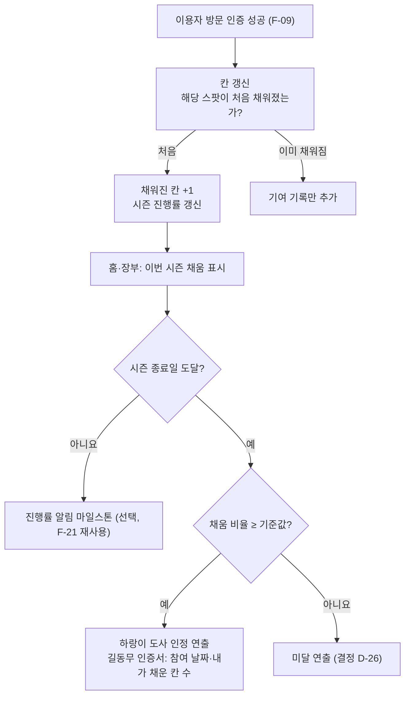

**기술**
- 방문 저장(F-09) 시점에 **시즌 ID와 칸 상태를 함께 갱신**합니다. 나중에 한꺼번에 집계하면 P0에서 쌓은 방문 데이터를 시즌에 연결하지 못할 수 있으므로, **P0부터 방문 기록에 시즌 ID를 붙입니다** (구현은 P2여도 데이터는 지금).
- 집계는 서버가 확정한 방문만 사용합니다. 앱이 보내는 값으로 칸을 채우지 않습니다.
- 집계는 익명 합계로 공개합니다(개인 위치·여행 경로를 다른 이용자에게 노출하지 않음). 본인 기여(채운 칸 수)만 개인 화면·인증서에 표시합니다.
- 기준값·칸 목록·시즌 기간은 설정 테이블(`seasons`, `rule_config`)로 두고 운영자 웹(F-18)에서 이력과 함께 변경합니다.
- 도사 인정 판정은 **규칙 코드**가 합니다. 연출 문장(하랑이 대사)만 승인 대사를 씁니다. LLM이 판정에 관여하지 않습니다.
- 위조 방지: 공동 비율은 한 명이 모의 위치로 칸을 채울 수 있습니다. **모의 위치 탐지는 보류(16-3)** 했으므로, 이 기능을 켜기 전(P2)에 다시 검토해야 합니다. 임시 완화책으로 ‘N명 이상 방문 시 채움’(D-25)이 있습니다.

**시연 단계 주의**: 사용자가 적을 때의 비율은 의미가 없습니다. 시연에서는 시드 데이터로 임계값 직전·직후를 보여 주고, 시드 데이터임을 화면에 표시합니다 (시연값 구분 원칙, F-19와 동일).

| 담당 | 할 일 |
|---|---|
| PM | D-25·D-26 결정, 기준값·칸 정의 승인 |
| CON | 도사 인정·미달·마일스톤 연출 대사(승인 대사), 길동무 인증서 문구, 세계관과 규칙 일치 확인 |
| DES | 시즌 진행 표시(홈·장부), 도사 인정 연출, 인증서 |
| BE | `seasons`·`ledger_cells` 스키마, 방문 시 칸 갱신, 판정, 설정·이력 |
| FE | 진행률 표시, 인증서·연출 화면 |
| RES | 칸(스팟) 목록과 운영 상태 정리, 시드 데이터 시나리오 실행 (T-17) |

- 수용 기준: ① 같은 스팟을 여러 명이 방문해도 채워진 칸은 1번만 센다. ② 시즌 종료 시 비율이 기준값 이상이면 인정, 미만이면 미달 연출이 나온다. ③ 기준값을 바꾸면 이력이 남고 새 시즌부터 적용된다. ④ 다른 이용자의 개인 경로가 노출되지 않는다.

### F-18 운영자 웹 (P0)

- 동작: 운영자가 장소·경로·대사를 검수·게시, 운영 중단·재개 반영. 사용자 앱의 코스 목록·추천 경로·변경 안내에 반영.
- 기술: 운영자 전용 인증, 권한 검사(참여자 세션의 수정 요청은 거절), 변경 이력 기록.
- P0 최소 범위 `[결정 D-03]`: 장소 운영 상태 변경(운영·일시 중단·미확인)과 저장 결과 표시. 코스·미션 전체 편집은 후속 (서비스 명세 v0).

| 담당 | 할 일 |
|---|---|
| PM | 운영자 역할 정의, 실제 운영자 지정 `[확인 필요: 누가 맡나]` |
| DES | 운영자 화면 3종 (S-11~S-13) |
| FE | 운영자 웹 화면 |
| BE | 운영자 인증·권한, 상태 변경 API(실패 시 직전 값 유지), 이력 |
| CON | 대사 검수·게시 화면 요건 정의 |

- 수용 기준: ① 참여자 계정으로 상태 변경이 거절된다. ② 저장 실패 시 직전 값이 유지된다. ③ 저장 후 앱 재평가 시 대체 길이 안내된다.

### F-19 규칙 엔진·날씨 연동 (P0)

- 입력: 위치(사용 중에만), 기상 예보·특보, 요일, 시각, 장소 운영 상태, 예상 도착시각.
- 출력: 모드, 사용 가능한 경로, 사유 코드, 기준 시각.
- 우선순위: 위험이 겹치면 가장 안전한 규칙 먼저 (고객 전략 HTML의 호우·낙뢰 규칙과 동일). 날씨 데이터를 못 얻으면 ‘확인 불가’로 처리하고 추측하지 않음.
- 시연 모드: 실시간 연동 전에는 시연 값으로 표시하고 화면에 시연값임을 명시 (서비스 명세 v0).

| 담당 | 할 일 |
|---|---|
| BE | 규칙 함수·설정표, 날씨 어댑터, 시연 값 주입 스위치, 단위 테스트 |
| RES | 기준 수치 출처 확인 |
| PM | 규칙표 승인 |

- 수용 기준: 같은 입력이면 항상 같은 모드가 나오는 단위 테스트가 통과한다.

---

## 7. 콘텐츠·에셋 명세

### 7-1. 캐릭터·그래픽 에셋

| 번호 | 에셋 | 현재 상태 | 필요한 형태 | 담당 |
|---|---|---|---|---|
| A-01 | 하랑이 기준 시트 | 있음 (`brand/character/images/harangi_sheet.webp`) | 기준 이미지 유지 | CON |
| A-02 | 하랑이 표정 | 있음 (`harangi_expressions.webp`: 행복·차분·놀람 `[확인 필요]`) | 표정별 투명 PNG 분리 (최소 5종 `[확인 필요]`: 행복·차분·놀람·응원·쉼터) | CON, DES |
| A-03 | 하랑이 전신 픽셀 | 있음 (`harangi_fullbody_pixel.webp`) | 투명 PNG, 앱 크기별 | CON |
| A-04 | 능금 스탬프 | 있음 (`stamp_nungeum.webp`) | 투명 PNG, 획득 연출용 프레임 | CON, DES |
| A-05 | 스티커 세트 | 있음 (`sticker_set_final_v4.webp`) | 앱 사용 여부 결정 `[결정]` | CON |
| A-06 | 앱 아이콘·스플래시 | Expo 기본 이미지 (`app/assets/`) | 하랑이 기반 교체 | DES |
| A-07 | 코스 썸네일 | 없음 | 코스별 1장, 사용 조건 확인 | DES, RES |
| A-08 | 장소 사진 | 없음 | 저작권·사용 조건 확인된 것만. 직접 촬영 시 위치 정보(EXIF) 제거 | RES |
| A-09 | 실내·야외·쉼터·날씨 아이콘 | 없음 | 아이콘 세트 | DES |
| A-10 | 하랑이 말풍선·컴포넌트 | 없음 | Figma 컴포넌트 | DES |
| A-11 | ‘내 여행 한 장’ 카드 템플릿 | 없음 | 날짜·장소·스탬프 배치 | DES |
| A-12 | 빈 상태·오류 일러스트 | 없음 | 로그인 실패, 기록 없음, 경로 없음 | DES, CON |
| A-13 | 폰트·색상 토큰 | 데모는 임의 값 (`app/App.tsx` 색 상수) `[확인 필요]` | 디자인 토큰 정의 | DES |
| A-14 | 효과음·진동 | 없음 | 진동은 스탬프 ‘쿵’ 연출(17-2)에 사용 검토, 효과음은 `[결정]` | DES, CON |
| A-15 | 하랑이 방향별 이미지 | 없음 | 정면·좌·우 3방향(안), 표정과의 조합은 `[결정 D-31]` | CON, DES |
| A-16 | 코스 지도 핀·내 위치 마커 | 없음 | 장소 번호 핀, 방문 완료 핀(스탬프형), 내 위치 점 | DES |

에셋 규칙
- 이미지 생성 프롬프트는 `brand/character/prompts.md`에 기록합니다.
- 캐릭터 이름에 설비명·상표를 쓰지 않습니다. 실제 가게·인물 이름은 허가 범위 확인 후 사용합니다.
- 장소 사진·이미지는 출처와 사용 조건을 `archive/metadata.csv`에 기록합니다.

### 7-2. 콘텐츠 데이터

| 번호 | 데이터 | 필요한 필드 | 분량(첫 코스 기준) | 담당 |
|---|---|---|---|---|
| C-01 | 장소 마스터 | 장소 ID, 이름, 주소, 좌표, 실내·야외, 운영시간, 휴관일, 출처, 확인일 | 코스 장소 5~6곳 `[결정 D-04]` | RES |
| C-02 | 인증 지점 | 장소 ID, 인증 좌표, 설명, 사진, 실측 오차 | 장소당 1개 | RES |
| C-03 | 경로 | 코스 ID, 경로 유형(기본·그늘·실내·안전), 방문 순서 | 코스당 기본+대체 1개 이상 | PM, RES |
| C-04 | 쉼터 | 쉼터명, 주소, 운영시간, 확인일 | 코스 주변 `[확인 필요]` | RES |
| C-05 | 승인 대사 | 장면·상황 코드, 대사, 표정, 승인일 | 7-3 표 | CON |
| C-06 | 장소 이야기 검수 자료 (P1) | 장소 ID, 문장, 근거 출처 | 장소당 1문서 | CON, RES |
| C-07 | 미스터리 퀴즈 (P1) | 퀴즈, 보기, 정답, 힌트, 근거 | 코스당 1세트 | CON |
| C-08 | 규칙 설정 | 모드 기준 수치, 특보 종류별 처리 | 1세트 | PM, BE |
| C-09 | 추천 규칙표 (F-23) | 시나리오·모드별 허용 장소 유형, 야외 노출 여부, 보류 조건, 경고 문구 | 시나리오 5개(6장 F-23 표) | PM, BE |
| C-10 | 구·군별 추천 후보 장소 (F-23) | 구·군, 장소 ID, 유형(실내·그늘·야외·전시), 모드별 허용, 운영시간, 답사 여부 | 첫 코스 범위부터. 후보는 고객 전략 HTML의 구·군별 예시를 참고하되 **그늘 구간은 답사 후**, 시설 협의가 필요한 곳은 확인 후 사용 | RES |

### 7-3. 하랑이 승인 대사 목록 (장면 × 상황)

각 칸에 후보 2개씩 `[창작]`, 팀이 선택합니다.

| 장면 코드 | 상황 코드 | 출처 |
|---|---|---|
| auth | 로그인 성공 / 실패 / 세션 만료·복구 | 유저 플로우 v1 4장 |
| intro | 첫 만남 / 닉네임 건너뜀 | 〃 |
| route | 정상 추천 / 그늘 / 실내 / 확인 불가+쉼터 | 〃 |
| reroute | 휴관 대체 / 특보 대체 / 대체 없음·보류 / 나중에 이어하기 | 〃 |
| gps | 권한 거부 / 측위 실패 / 거리 문제 / 재로그인 / 응답 누락 복구 | 〃 |
| visit | 방문 성공 / 이미 인증됨 / 다음 장소 / 완주 | 〃 |
| ask (P1) | 근거 없음 / 시간 초과 / 검증 실패 | 〃 |
| safety | 폭염 안전 / 호우·낙뢰 보류 / 쉼터 안내 | 기획서 6-1장 |

- 폭염·한파 안전 문구에는 기준(시각, 운영 시간, AWS 여부)을 함께 적습니다 (`CLAUDE.md` 민감한 소재).

---

## 8. 스토리보드와 설계 문서 현황

| 문서 | 상태 | 다음 할 일 | 담당 |
|---|---|---|---|
| 게임 스토리보드 v1 (`storyboard/20261110_game_storyboard_v1.md`) | 있음. 시스템 흐름·하랑이 트리거 포함 | 유저 플로우 v1(로그인·장부·이어하기)을 반영한 v2 작성 | PM, CON |
| 유저 플로우 v1 | 있음 (루트에 미커밋 파일) | `design/` 또는 `spec/`로 이동 위치 결정 | PM |
| 화면 구조 도식 7장 (`design/user_flow_images/`) | 있음 | Figma 화면과 대조 | DES |
| 고객 여정 지도 (`design/customer_journey_map_v1.html`) | 있음 | 앱 여정 측정 항목과 연결 | PM |
| Figma 시안 | 없음 `[확인 필요]` | 5장 S-01~S-13 | DES |
| 서비스 명세 v0 (`_local_drafts/spec/`) | 로컬 초안 | 이 문서로 흡수할지 결정 | PM |
| 기술 명세 v1 (이 문서) | 작성 | 팀 검토 후 v2 | 전원 |
| 데모 시나리오·검수표 | 14장 | 실기기 기록 | RES |

---

## 9. 데이터 모델 (후보)

DB 제품 결정(D-02) 후 확정합니다. 아래는 개념 모델입니다.

| 테이블 | 주요 필드 | 비고 |
|---|---|---|
| `users` | id, 인증 식별자, 역할(참여자·운영자), 생성일 | 역할은 서버에서만 부여 |
| `profiles` | user_id, nickname, first_visit_done | 닉네임 없으면 ‘길동무’ |
| `places` | id, name, address, district(구·군), lat, lng, indoor, type(실내·그늘·야외·전시), mode_allowed, verified_at, source | C-01, C-10 |
| `place_status` | place_id, status(운영·일시 중단·미확인), updated_at, updated_by | 운영자 변경, 이력 별도 |
| `verification_points` | place_id, lat, lng, description, photo | C-02 |
| `courses` | id, title, theme, duration_min, start_place_id, published | |
| `course_routes` | id, course_id, type, ordered_place_ids | 기본·대체 경로 |
| `trips` | id, user_id, course_id, status, route_id, started_at | 진행·보류·완주 |
| `visits` | id, trip_id, place_id, lat, lng, accuracy, measured_at, created_at | **(trip_id, place_id) 고유** |
| `stamps` | id, user_id, trip_id, place_id, issued_at | |
| `seasons` (F-17) | id, name, start_at, end_at, threshold(기준 비율 설정), cell_unit, status | 기준값은 예시 값 아님, 설정으로 |
| `ledger_cells` (F-17) | season_id, place_id, first_filled_at, filled_by_count, removed_reason | 한 스팟 = 한 칸. 분모 변경 이력 필요 |
| `season_results` (F-17) | season_id, filled, total, ratio, decided_at, outcome | 시즌 종료 판정 기록 |
| `visits`·`trips`에 `season_id` 추가 | — | **P0부터 붙임** (나중 집계 대비) |
| `journal_entries` | id, trip_id, summary, completed_at | ‘내 여행 한 장’ |
| `approved_lines` | id, scene, situation, text, expression, approved_by, approved_at | F-13 |
| `rule_config` | key, value, version | 수치는 확정 후 입력 |
| `weather_snapshots` | fetched_at, source, payload | 기준 시각 표기용 |
| `audit_log` | actor, action, target, at | 운영자 변경 이력 |
| `device_tokens` (P1) | user_ref, token, platform, updated_at | F-21 푸시 |
| `notification_log` (P1) | target, reason, sent_at, result | F-21 빈도 제한·점검 |
| `events` (P1) | name, at, pseudo_user_key, props | F-22 (좌표·이메일·닉네임 제외) |
| `quiz_items` (P1) | id, place_id, question, options, answer, hint | |
| `place_docs` (P1) | place_id, text, source | 검색용 |

개인정보: 위치 좌표는 방문 검증에 필요한 최소 기간만 보관하고 보관 기간은 팀이 정합니다 `[결정]`. 실제 사용자 데이터는 저장소에 올리지 않습니다 (`CLAUDE.md` 개인정보).

---

## 10. API 후보

| 구분 | 메서드·경로 | 설명 | 기능 |
|---|---|---|---|
| 인증 | 인증 서비스 SDK 또는 `POST /auth/*` | 로그인·가입·로그아웃 | F-01 |
| 프로필 | `GET /me`, `PATCH /me` | 닉네임, 첫 방문 플래그 | F-02, F-12 |
| 코스 | `GET /courses`, `GET /courses/:id` | 게시된 코스만 | F-03, F-04 |
| 추천 | `POST /recommendations` | 본문: 구·군 코드 또는 좌표·정확도. **좌표는 저장·로그하지 않음** | F-23 |
| 경로 | `POST /courses/:id/route` | 오늘의 길 평가 | F-05 |
| 여행 | `POST /trips`, `GET /trips/active`, `PATCH /trips/:id` | 시작·이어하기·보류 | F-06 |
| 재평가 | `POST /trips/:id/route-check`, `POST /trips/:id/reroute/accept` | 조건 변경 | F-08 |
| 방문 | `POST /trips/:id/visits`, `GET /trips/:id/visits` | 멱등, 응답 누락 복구 | F-09 |
| 장부 | `GET /journal`, `GET /journal/:id`, `GET /stamps` | | F-10, F-11 |
| 대사 | `GET /lines?scene=&situation=` | 승인 대사 | F-13 |
| 질의 | `POST /harangi/ask` | P1 | F-14 |
| 퀴즈 | `POST /quiz/:id/answer` | P1 | F-15 |
| 운영자 | `PATCH /admin/places/:id/status`, `POST /admin/lines/:id/publish` 등 | 운영자 권한만 | F-18 |

- 모든 API는 서버에서 계정·소유권을 확인합니다. 앱 화면에서 숨기는 것만으로 권한을 대신하지 않습니다.
- 방문 API 응답 코드: `created`, `existing`, `too_far`, `low_accuracy`, `route_changed`, `auth_required` (유저 플로우 v1 3장의 분기에 대응).

---

## 11. 단계별 계획과 담당별 체크리스트

기한은 정하지 않았습니다. PM이 이슈에 담당·기한을 채웁니다 (`.github/ISSUE_TEMPLATE/task.md`).

### 단계 0. 결정과 준비

- [ ] PM: 13장 D-01~D-06 결정 회의, 결과 기록
- [ ] PM: 역할별 이름 확정(2장), 이슈 등록
- [ ] RES: 첫 코스 장소 현장 답사 계획
- [ ] DES: Figma 파일·토큰 생성
- [ ] BE: DB 제품 후보 시험(인증·고유 제약·권한)

### 단계 1. 기반

- [ ] RES: C-01·C-02·C-04 입력(출처·확인일 포함)
- [ ] BE: 스키마·시드, 인증, 코스·장소 조회 API
- [ ] DES: S-01~S-04 시안
- [ ] CON: C-05 승인 대사 1차, A-02 표정 분리
- [ ] FE: 앱 구조(탐색·상태 관리), 로그인·홈·코스 화면

### 단계 2. 핵심 흐름 (P0 본체)

- [ ] BE: 규칙 엔진·날씨 연동(시연 값 스위치 포함), 여행 API, 방문 API, 완주 판정
- [ ] FE: 여행 지도, GPS 인증, 스탬프, 완주, 장부
- [ ] PM·RES·BE·FE·DES·CON: F-23 위치·날씨 추천 (구·군 선택 방식부터 만들고, 현재 위치는 권한 처리와 함께 추가)
- [ ] DES: S-05~S-10 시안
- [ ] RES: 실기기 GPS 시험, 인증 오차 기록 → D-05 근거
- [ ] CON: 한 장 카드 문구, 에러 대사

### 단계 3. 운영자 웹과 변경 흐름

- [ ] BE: 운영자 권한, 상태 변경 API, 재평가 API
- [ ] FE: 운영자 웹, 경로 변경 화면
- [ ] DES: S-11~S-13
- [ ] RES: 휴관 → 대체 길 → 이어하기 시나리오 실행

### 단계 4. 검수와 시연 준비

- [ ] RES: 14장 6개 시나리오 실행, 기기·OS·빌드 버전 기록
- [ ] PM: 수용 기준 대조, 미확인 항목 정리
- [ ] 전원: 발표·시연 영상 소재 정리 (`presentation/` 연결)

### 단계 5. P1 (P0 통과 후)

- [ ] AI·CON·RES·BE: F-14 하랑이 질의 (세부 단계는 15-12)
- [ ] AI·CON·PM: F-20 대사 초안 제작 파이프라인
- [ ] CON·RES·BE·FE: F-15 미스터리

### 단계 6. 푸시 알림·이벤트 분석 (P0 본체 이후, 16장)

- [ ] (P0 중) PM·FE·BE: 16-2 이벤트 정의표 확정, 앱에 이벤트 호출 위치만 먼저 심기
- [ ] BE·FE: F-21 푸시 알림
- [ ] BE·PM: F-22 이벤트 저장·지표 집계

---

## 12. 위험

| 위험 | 영향 | 대응 | 담당 |
|---|---|---|---|
| GPS 오차(실내·도심 건물 사이) | 정상 방문이 실패 | 인증 지점을 실외로 설정, 현장 실측 후 기준 확정, 재측위 안내 | RES, BE |
| 위치 권한 거부 | 이탈 | 사용 중에만 수집 원칙 안내, 거부 시 설정 안내 | FE, CON |
| 운영 정보 오래됨 | 헛걸음 | 확인일 표기, 운영자 상태 변경, 미확인 표시 | RES |
| AI 오답·지어내기 | 신뢰 하락 | 검수 자료만 근거, 검증 실패 시 승인 대사 | AI |
| 인증 응답 누락 중복 | 스탬프 중복 | 고유 제약·멱등 처리 | BE |
| 날씨 API 장애 | 경로 미확정 | ‘확인 불가’ 처리, 시연 값 스위치 | BE |
| 안전 책임 | 폭염 사고 | 안전 규칙은 규칙 엔진, 면책·법률 검토 `[확인 필요]` (기획서 9장) | PM |
| 경쟁사가 비슷한 기능 보유 | 차별화 약화 | 같은 휴관 상황 비교 시연 (고객 전략 HTML 경쟁 비교 기준) | PM |
| 범위 팽창 | 일정 초과 | P0 범위 고정, P1은 통과 후 | PM |

---

## 13. 결정 필요

| ID | 결정 | 후보 2개 | 필요한 단계 |
|---|---|---|---|
| D-01 | 로그인 방식 | A 이메일·비밀번호 / B 소셜 1종 | 단계 0 |
| D-02 | 서버·DB 제품 | A Firebase / B Supabase | 단계 0 |
| D-03 | 운영자 웹 형태·범위 | A Expo web 재사용, 상태 변경만 / B 별도 웹, 코스·대사 편집 포함 | 단계 0 |
| D-04 | 첫 코스와 실내 대안 | A 코스 A 중구 30분(기존 데모) / B 파일럿 생활권 코스(답사 후) | 단계 0 |
| D-05 | 인증 방식과 GPS 반경·정확도 기준 | A GPS만(현재 개발안) / B GPS+현장 단서 선택 | 단계 2(현장 시험 후) |
| D-06 | 모드 기준(체감온도·특보) | A 기획서 6-1장 수치 그대로 / B 기상청·보건 기준 확인 후 수정 | 단계 0 |
| D-07 | 방문 순서 강제 | A 순서 강제 / B 자유 순서 | 단계 1 |
| D-08 | 진행 중 신규 여행 허용 | A 1개만 / B 여러 개 | 단계 1 |
| D-09 | AI 질의·미스터리 시연 범위 | A P1로 미루고 승인 대사만 / B 시연에 질의 1개 포함 | 단계 2 |
| D-10 | 검수 자료 검색 방식(P1) | A 키워드·장소별 문서 직접 주입 / B 벡터 검색 | P1 시작 전 |
| D-11 | 수익 모델과 앱 방식 | A 무료 MVP(유저 플로우 v1) / B 유료 팀권 파일럿(고객 전략 HTML). 두 문서가 다름 | 단계 0 |
| D-12 | 인증 매체 통일 | 고객 전략 HTML 파일럿은 QR 인증, 유저 플로우 v1은 GPS가 P0, QR은 P2. 어느 쪽에 맞출지 | 단계 0 |
| D-13 | LLM 제공자·모델 | A Claude API(서버에서 호출, 모델 등급은 15-8 비교) / B 다른 LLM 제공자 `[확인 필요: 이 문서는 A 기준으로만 검토]` | P1 시작 전 |
| D-14 | 오케스트레이션 방식 | A LangGraph 상태 그래프 / B 서버 코드에서 순서를 직접 구현(상태 기계) | P1 시작 전 |
| D-15 | 멀티 에이전트 범위 | A 에이전트 3개(검색·작성·검증)만 / B A + 대사 초안 제작 파이프라인(F-20) | P1 시작 전 |
| D-16 | 질문 입력 방식 | A 버튼 2개만(‘내 진행’, ‘장소 이야기’) / B 자유 입력 허용 | P1 시작 전 |
| D-17 | LLM에 보낼 개인 정보 범위 | A 닉네임·여행 요약만, 좌표·계정 식별자 제외 / B 닉네임도 제외하고 호칭 코드만 | P1 시작 전 |
| D-18 | 하랑이 페르소나 확정 | 성격 축 메인 3개, 말버릇 A/B, 대구 습관 2개 이내 (`brand/character/harangi_personality_v1.md` 6장) | P1 시작 전 (승인 대사 작성 전이 더 좋음) |
| D-19 | 응답 제한 시간·재시도 횟수 | 초 단위 값은 현장 시험 후 정함 | P1 구현 중 |
| D-20 | 근거 표시 방식 | A 모델 인용 기능 사용 / B 구조화 출력에 근거 ID 필드를 두고 서버가 검증 | P1 시작 전 |
| D-21 | 푸시 알림 방식 | A 앱 개발 도구가 제공하는 푸시 서비스 / B 서버가 모바일 OS 푸시 서비스에 직접 발송 `[확인 필요: 제품·설정 방법]` | 단계 6 |
| D-22 | 이벤트 분석 방식과 수집 범위 | A 자체 DB에 이벤트 테이블 + 집계 질의 / B 외부 분석 서비스 `[확인 필요: 제품·약관]`. 공통: 좌표 제외, 사용자 식별자 가명화 | 이벤트 정의표는 단계 1, 구현은 단계 6 |
| D-23 | 추천의 위치 입력 방식 | A 구·군 선택만 / B 현재 위치만 / C 현재 위치 + 거부 시 구·군 선택(제안) | 단계 1 |
| D-24 | 추천 단위와 범위 | A 코스 단위(코스 안 대표 장소 표시) / B 장소 단위. 반경·개수는 현장 확인 후 | 단계 1 |
| D-25 | 도사 인정 규칙(칸·채움·기준값) | 칸: A 스팟 1곳=1칸 / B 권역 단위. 채움: A 1명 방문 / B N명 이상 방문. 운영 중단 칸: A 분모에서 제외 / B 유지. 기준값은 팀이 정함(70%는 예시) | 단계 1 (데이터 구조), 값은 P2 전 |
| D-26 | 판정 시점·미달 연출·시즌 길이 | 판정: A 시즌 종료 1회 / B 중간 인정도 허용. 미달: A 인정 보류 후 다음 시즌 이어가기 / B 별도 연출 | P2 전 |
| D-27 | 앱 내 지도 방식 (17-2) | A 핀·순서선·내 위치만(턴바이턴은 외부 지도 앱) / B A + 도보 경로선(경로 API 필요). SDK 선택은 17-2 표에서 시험 후 | 단계 1 |
| D-28 | 경로 없음 처리 (17-1) | A 7단계 완화(대체→실내→부분→원격·보류→열리는 시각→쉼터→쉼터 없음) / B 단순형(대체 1개 → 쉼터) | 단계 0 |
| D-29 | 대체 길 반영 수준 (17-3) | A 재평가 시점만(P0 현재안) / B A + 앱을 열어 둔 동안 실시간 반영 1종 시연 | 단계 3 |
| D-30 | 인증 대체 수단·건너뛰기 (17-4) | A 현장 단서 입력 + 건너뛰기 허용(‘미인증’ 표시, 완주 인정) / B 현장 단서 입력만, 건너뛰기 불가 | 단계 1 (D-05와 함께) |
| D-31 | 하랑이 표시 방식 (17-5) | A 정면 + 표정 변화 / B 정면·좌·우 3방향 + 표정 / C 걷기 프레임 애니메이션 | 단계 1 (에셋 규격) |
| D-32 | 디지털 팀권 정의·결제 방식 (17-6) | 팀 단위: A 구매자 1명이 팀 코드 발급 / B 인원별 개별 구매. 결제: A 앱 스토어 결제 / B 웹 결제 + 코드 / C 시연은 가짜 결제 화면. **D-11 선행** | D-11 결정 후 |
| D-33 | AI 에이전트 범위 확장 (17-8) | A 마스코트 교체 구조(브랜드 팩) + 캐릭터 생성 에이전트는 도식만 / B A + 성과 보고서 초안 에이전트까지 | P1 시작 전 |

- D-11·D-12는 문서 간 불일치입니다. 팀이 한 방향으로 정리해야 발표와 구현이 어긋나지 않습니다.
- 기획서 11장의 미결 항목(앱 안 도시 이름 ‘대프리카’ 치환 범위, 발표 대본 ‘퀘스트 이용은 무료입니다’ 문장 등)도 함께 처리합니다.

---

## 14. 시연·검수 시나리오

| 번호 | 시나리오 | 확인할 것 | 담당 |
|---|---|---|---|
| T-01 | 첫 로그인 → 하랑이 첫 만남 → 코스 시작 → 완주 | 흐름 끊김 없음, 한 장 생성 | RES |
| T-02 | 앱 종료·재실행 | 여행·스탬프 복구 | RES |
| T-03 | 장소 휴관(운영자 변경) → 대체 길 수락 | 남은 경로만 변경, 스탬프 보존 | RES, BE |
| T-04 | 위치 권한 거부 → 설정에서 복귀 → 인증 | 재시도 성공 | RES, FE |
| T-05 | 인증 요청 후 응답 누락(네트워크 차단 시뮬레이션) | 장부 재조회로 중복 없이 복구 | RES, BE |
| T-06 | 세션 만료 → 같은 계정 재로그인 | 여행 복구 | RES |
| T-07 | 참여자 계정으로 운영자 API 호출 | 거절 | BE |
| T-08 | 날씨 API 불가 | ‘확인 불가’와 쉼터 안내 | BE |
| T-09 (P1) | 근거 없는 장소 질문 | 지어내지 않고 ‘근거 없음’ 승인 대사 | AI, RES |
| T-10 (P1) | 생성 시간 초과·검증 실패 강제 | 승인 대사가 표시됨 | AI |
| T-11 (P1) | LLM 끄기(`llm_enabled` 해제) | 모든 장면이 승인 대사로 동작 | AI, BE |
| T-12 (P1) | 닉네임에 지시문을 넣고 질문 | 규칙·금칙어·페르소나 유지 | AI |
| T-13 (P1) | 운영자 중단 → 푸시 수신 → 탭 / 알림 권한 거부 | 알림 탭 시 재평가 화면, 거부 시에도 재평가로 같은 결과 | RES, BE |
| T-14 (P1) | 시나리오 1회 실행 후 이벤트 확인 | 정의표 이벤트가 순서대로 기록, 좌표·이메일 없음 | RES, BE |
| T-15 | 위치 권한 거부 → 구·군 선택 → 추천 | 추천이 표시되고 사유·기준 시각이 보임 | RES, FE |
| T-16 | 시연 날씨를 호우·낙뢰로 변경 후 추천 | 야외 추천 숨김, 이동 보류 안내. 서버 로그·DB에 좌표 없음 | RES, BE |
| T-17 (P2) | 시드 데이터로 기준값 직전·직후 시즌 종료, 운영 중단 칸 처리 | 직전은 미달, 직후는 도사 인정. 중복 방문은 1칸. 분모 변경 이력 기록 | RES, BE |
| T-18 | 모든 장소 중단 → 쉼터도 전부 닫힘 (시연 값) | 빈 화면 없이 완화 단계별 코스 또는 ‘이용 가능한 쉼터 없음’ 안내, 기준 시각 표시 | RES, BE |
| T-19 | GPS 정확도 낮음 → 현장 단서 입력으로 인증 | 단서 정답이면 방문 저장, 오답이면 재시도, 건너뛰기 시 ‘미인증’ 표시 | RES, FE, BE |
| T-20 | 코스 지도에서 내 위치 이동 → 인증 성공 | 내 위치 표시 갱신, 핀이 스탬프로 바뀌고 ‘쿵’ 연출, 진동 | RES, FE |
| T-21 (P1) | 마스코트 팩 교체 | 대사·표정·이름이 팩 기준으로 바뀌고 안전 대사 규칙은 그대로 | AI, FE |

- 위 6개(T-01~T-06)는 유저 플로우 v1 ‘피그마·데모 검수’ 항목과 대응합니다.
- 검수 기록: 기기·OS·빌드 버전, 결과, 실패·미확인 항목을 함께 적습니다 (서비스 명세 v0 완료 기준).
- 이 문서는 아직 어떤 것도 실행·검증하지 않았습니다.

---

## 15. 에이전트·LLM 기술 스택 (페르소나 · RAG · 멀티 에이전트 · LangGraph)

범위: P0는 LLM 없이 승인 대사로 시연하고, P1에서 하랑이 질의(F-14)와 대사 초안 제작(F-20)을 붙입니다. 이 장은 **어떤 기능에 무엇이 들어가는지**를 먼저 정리하고, 구성 요소별 설계로 내려갑니다.

### 15-1. 설계 원칙 (모든 기능 공통)

| 원칙 | 의미 | 근거 |
|---|---|---|
| 규칙이 결정하고 LLM은 문장만 쓴다 | 경로 열림·잠금, 운영 여부, 안전 판단, 인증 판정은 규칙 엔진·서버가 함. LLM은 이미 정해진 결과를 하랑이 말투로 말할 뿐 | 기획서 8장, 스토리보드 A-4 |
| 변하는 사실은 조회, 변하지 않는 사실은 RAG | 운영 상태·여행 진행 = DB 조회 도구. 장소 이야기 = 검수 자료 검색 | 유저 플로우 v1 4장 |
| 모든 생성은 검증을 통과해야 보인다 | 형식·근거·금칙어·안전 문구 검사 후 표시. 실패·시간 초과 시 승인 대사 | 유저 플로우 v1 4장 |
| 안전·인증·기본 안내는 항상 승인 대사 | 생성하지 않음 | 〃 |
| LLM은 서버에서만 호출 | 키를 앱·저장소에 넣지 않음 | 4-1 |
| 사용자 계정 범위 밖 데이터 접근 금지 | 조회 도구의 사용자 식별자는 서버 세션에서 주입. 모델이 정하지 않음 | 보안 원칙 |
| 아무것도 못 하면 승인 대사로 내려간다 | LLM이 꺼져도 앱이 동작 | F-13 |

### 15-2. 기능별로 들어가는 AI 구성 요소

● 필수 · ○ 선택(P1 이후) · — 해당 없음

| 기능 | 페르소나 | RAG | 조회 도구 | 그래프(오케스트레이션) | 멀티 에이전트 | 규칙 엔진 | LLM 호출 |
|---|---|---|---|---|---|---|---|
| F-01 로그인 | ● 승인 대사 | — | — | — | — | — | 없음 |
| F-02 첫 만남 | ● 승인 대사, 호칭 규칙 | — | — | — | — | — | 없음 |
| F-03 홈 | ● 승인 대사 | — | — | — | — | — | 없음 |
| F-05 오늘의 길 | ● 사유 문구(슬롯 채우기) | — | ● 날씨·운영 상태 | — | — | ● 모드·경로 결정 | 없음(P0) / ○ 윤문(P1) |
| F-08 경로 변경 | ● 사유별 승인 대사 | — | ● 운영 상태 | — | — | ● 재평가 | 없음 |
| F-09 GPS 인증 | ● 실패 사유별 승인 대사 | — | — | — | — | 서버 검증 | **없음 (안전·인증 안내)** |
| F-10 완주 | ● 마무리 대사 | — | ● 방문 기록 | ○ | — | ● 완주 판정 | 없음(P0) / ○ 개인화(P1) |
| F-13 대사 엔진 | ● 시스템 지침의 원천 | — | — | — | — | 장면 코드·표정 선택 | 없음 |
| F-14 질의 | ● 시스템 지침·검증 | ● (장소 이야기) | ● (내 진행) | ● | ● (검색·작성·검증) | ● 안전 분기 | ● P1 |
| F-15 미스터리 | ● 힌트 말투 | ○ 근거 확인 | ● 풀이 진행 | ○ | ○ | ● 정답 채점·잠금 | ○ 힌트 생성(정답 누설 금지) |
| F-18 운영자 웹 | — | ○ 대사 검수 시 근거 대조 | — | — | — | — | 없음(F-20이 별도) |
| F-19 규칙 엔진 | — | — | — | — | — | ● 전부 | **없음 (LLM이 바꾸지 못함)** |
| F-23 위치 추천 | ● 추천 사유 승인 대사(빈칸 채우기) | — | ● 날씨·운영 상태 | — | — | ● 후보 필터·정렬 | 없음(P0) / ○ 윤문(P1). **좌표는 LLM에 보내지 않음** |
| F-20 대사 초안 파이프라인 | ● | ● (근거 문서) | — | ● | ● (초안·톤·사실 검수) | — | ● P1, 운영자 승인 필수 |

- 읽는 법: P0에서 LLM이 필요한 기능은 없습니다. 페르소나는 **승인 대사를 쓰는 기준**으로 먼저 쓰이고, P1에서 같은 기준이 LLM 지침이 됩니다.

### 15-3. 페르소나 (하랑이)

**목적**: 모든 장면에서 같은 캐릭터로 말하게 하고, 생성 대사와 승인 대사가 서로 어긋나지 않게 합니다.

**페르소나 사양서에 들어갈 항목** (저장소 파일로 확정 후 프롬프트로 변환)

| 항목 | 내용 | 현재 상태 |
|---|---|---|
| 정체·역할 | 대프리카 골목에 바람을 전하는 바람 도사 견습생, 골목의 작은 단서를 모아 주는 안내자 | 팀 자료에 정리됨 (`brand/character/harangi_personality_v1.md` 1장). 이름은 가칭 |
| 성격 축 | 호기심, 외향·붙임성, 덜렁댐, 귀찮음, T 같은 직설, 자부심, 자각 (7개, 창작) | 메인 3개 선택 필요 `[결정 D-18]` |
| 핵심 균형 | 자부심 + 자각. 직설은 해결책과 함께, 차갑게 읽히지 않게 | 정리됨 (2장) |
| 말투 규칙 | 존댓말, 짧은 문장, 한 문장 두 줄 이내, 과장 금지, 근거 없는 역사 금지 | 스토리보드 B-3, 브랜드 스킬 톤 |
| 말버릇·자부심 대사 | 후보 A/B 2개씩 | 선택 필요 `[결정 D-18]` |
| 호칭 | 닉네임, 건너뛰면 ‘길동무’ | 유저 플로우 v1 |
| 금칙어 | 유일, 최초, 최고 (브랜드 스킬·`CLAUDE.md`). 스토리보드 P-4에는 가장·최대도 포함 | 범위 통일 필요 `[확인 필요]` |
| 금기 | 상표·로고, 기존 IP와 유사한 이름, 참사·더위를 웃음거리로 쓰기 | 정리됨 (5장) |
| 표정 | 장면 규칙이 정함(행복·차분·놀람 등). **LLM이 정하지 않음** | 스토리보드 B-1·B-2 |
| 장면별 톤 | 아래 표 | 새로 정리 |

**장면별 톤 규칙** (제안, 팀 확인 필요)

| 장면 | 허용하는 성격 | 쓰지 않는 것 |
|---|---|---|
| 안전·폭염·보류·쉼터 | 직설(결론부터), 차분 | 농담, 귀찮음 투덜거림, 덜렁댐 |
| 인증 실패·권한 거부 | 직설 + 해결책 + 사과, 약간의 덜렁댐 | 사용자 탓 |
| 방문 성공·완주 | 호기심, 붙임성, 자부심 | 과장·최상급 |
| 장소 이야기 | 호기심, 덜렁댐(틀리지 않는 범위) | 근거 없는 사실, 설화를 사실처럼 |
| 첫 만남 | 외향·붙임성, 자부심, 자각 | 긴 설명 |

**페르소나를 시스템에 넣는 방법**
1. 확정 전에는 후보 문구를 프롬프트에 넣지 않습니다 (창작 후보는 팀 결정 전).
2. 확정본을 `brand/character/persona_prompt_v1.md` 같은 한 파일로 만들고, 이 파일이 **시스템 지침의 단일 출처**가 되도록 합니다.
3. 시스템 지침은 고정 문구로 두고 장면·근거·호칭은 요청마다 바뀌는 입력으로 분리합니다 (프롬프트 캐싱에 유리, 15-8).
4. 승인 대사 중 대표 예시를 지침에 예시로 넣습니다. 승인 대사 세트와 생성 대사가 같은 목소리가 되도록 합니다.
5. 생성 결과는 15-7 검증을 통과해야 합니다 (페르소나 이탈 방지는 지침이 아니라 검증기가 보증).

| 담당 | 할 일 |
|---|---|
| CON | 페르소나 사양서 확정안 작성, 장면별 톤 표 보완, 승인 대사 예시 선정 |
| PM | D-18 결정, 금칙어 범위 통일 |
| AI | 사양서 → 시스템 지침 변환, 페르소나 점검용 질문 세트 |
| DES | 표정·말풍선 규격 |

### 15-4. RAG (검수 자료 검색)

**무엇을 검색하나**: 장소 이야기(C-06). 운영 상태·여행 기록은 RAG가 아니라 조회 도구입니다.

**구조**

| 단계 | 내용 | 비고 |
|---|---|---|
| 코퍼스 | 장소별 이야기 문서. 항목: 장소 ID, 문장, 출처(파일·URL), 확인일, 민감 주의 표시 | 코스 장소 5~6곳 규모로 시작 (C-06) |
| 청킹 | 장소 문서를 문단·항목 단위로 나눔. 문장마다 근거 ID 부여 | 문서가 짧아 큰 분할 불필요 |
| 인덱스 | D-10: A 장소 ID 필터 + 키워드 검색(또는 전체 주입) / B 임베딩 벡터 검색 | 임베딩 제공자·벡터 저장소는 `[확인 필요]` |
| 검색 | **장소 ID로 먼저 한정**한 뒤 그 안에서 검색 | 엉뚱한 장소 이야기 섞임 방지 |
| 근거 부족 | 검색 결과가 없거나 질문과 맞지 않으면 생성하지 않고 ‘근거 없음’ 승인 대사 | 지어내기 방지 |
| 출처 표시 | 응답에 근거 ID를 포함하고 앱의 ‘이야기와 출처 보기’에 표시 | 유저 플로우 v1 4장 |
| 갱신 | 문서 수정 시 버전 올리고 재색인. 확인일 표기 | |

규칙
- 코퍼스에는 **검수한 문장만** 넣습니다. 근거 없는 역사·유래·설화는 넣지 않습니다 (`CLAUDE.md`).
- 식민지 시기·전쟁·참사 등 민감 소재는 `주의` 표시를 달고, 공포·참사를 연출 소재로 쓰지 않는 규칙을 검증기에 반영합니다.
- 능금 유명세, 사과 도입 시기 등 미검증 항목은 코퍼스에 ‘설’ 표기로만 넣습니다 (`harangi_personality_v1.md` 3-4).

| 담당 | 할 일 |
|---|---|
| CON | 장소 이야기 문서 작성(문장 단위 근거 ID) |
| RES | 사실 대조, 출처·확인일 기록, 민감 주의 표시 |
| AI | 청킹 규칙, 검색 구현, 검색 품질 점검(질문 세트로 근거가 잡히는지) |
| BE | `place_docs` 저장, 재색인 작업 |
| PM | D-10, D-20 결정 |

### 15-5. 조회 도구 (개인 진행·상태)

| 도구 | 입력 | 출력 | 보안 |
|---|---|---|---|
| `get_my_progress` | (없음, 서버 세션에서 사용자 식별) | 진행 중 여행의 방문 장소·스탬프 수·다음 장소 | 모델이 사용자 ID를 넘기지 못함 |
| `get_place_status` | 장소 ID | 운영 상태·확인일 | 읽기 전용 |
| `get_next_hint` (P1, 미스터리) | 퀴즈 ID | 단계별 힌트 | 정답 문자열을 반환하지 않음 |

- 도구는 **읽기 전용**입니다. 도구로 상태를 바꾸지 않습니다.
- 도구 결과의 값(장소·방문 수)을 모델이 바꿔 말하지 못하도록 검증기가 응답 속 값과 도구 결과를 대조합니다.

### 15-6. 오케스트레이션: 상태 그래프 (LangGraph)

하랑이 안내·질문 도식(4-7)을 그래프로 옮긴 설계입니다. 노드는 각각 **한 가지 일만** 합니다.

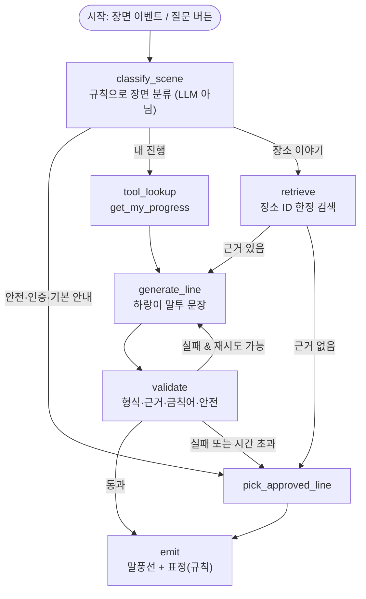

**상태(State)에 들어가는 값**

| 키 | 설명 |
|---|---|
| `scene`, `situation` | 장면·상황 코드 (7-3 표와 같은 코드) |
| `call_context` | 호칭(닉네임/‘길동무’), 현재 장소 ID, 여행 ID (서버가 주입) |
| `tool_results` | 조회 도구 결과(ID, 값) |
| `retrieved` | 검색된 근거 문장 ID와 본문 |
| `draft` | 생성된 문장과 근거 ID |
| `validation` | 검사별 통과·실패와 사유 |
| `attempts` | 시도 횟수 (상한은 `[결정 D-19]`) |
| `fallback_reason` | 승인 대사로 내려간 이유 (근거 없음/검증 실패/시간 초과/오류/거부) |
| `final_line`, `expression` | 표시할 문장과 규칙이 정한 표정 |

**그래프가 꼭 지켜야 하는 것**
- 어느 경로로 가도 마지막은 `emit`이고, 실패 경로는 항상 `pick_approved_line`으로 닫힙니다.
- 전체 제한 시간을 넘기면 현재 노드를 끊고 승인 대사로 내려갑니다.
- 상태에 개인 식별 정보를 넣지 않습니다(D-17).
- 노드 단위로 입출력을 로그에 남기고, 개인 정보는 마스킹합니다.

**LangGraph를 쓸 때의 판단** `[결정 D-14]`

| 선택 | 장점 | 주의 |
|---|---|---|
| A LangGraph | 도식을 그대로 노드·엣지로 구현, 분기·재시도·체크포인트·추적이 갖춰져 있음, 팀이 아는 도구면 시연·설명에 유리 | 의존성 추가, 서버 런타임에 따라 Python판/JS판 선택 필요 `[확인 필요: 버전·서버 런타임]`, 노드가 7~8개인 작은 흐름에서는 과할 수 있음 |
| B 직접 구현 | 의존성 없음, 단순 | 분기·재시도·추적을 직접 만들어야 함. P1이 커지면 부담 |

- 어느 쪽이든 **노드 이름·상태 키·검증 규칙은 위 표를 기준**으로 하면 나중에 바꿔도 비용이 작습니다.

| 담당 | 할 일 |
|---|---|
| AI | 그래프 설계·구현, 상태 스키마, 제한 시간·재시도 처리, 로그 |
| BE | 서버 런타임 결정(D-02와 연계), 그래프를 호출하는 API(`POST /harangi/ask`), 세션 주입 |
| FE | 질문 버튼, 로딩·실패 상태 |
| PM | D-14, D-16, D-19 결정 |

### 15-7. 멀티 에이전트 설계

**원칙**: 에이전트는 **필요한 만큼만** 나눕니다. 에이전트가 많을수록 지연·비용·장애 지점이 늘어납니다. 안전 판단은 에이전트가 아니라 규칙 엔진입니다.

**하랑이 질의(F-14) — 에이전트 3개** `[결정 D-15]`

| 에이전트 | 하는 일 | 하지 않는 일 | 도구 |
|---|---|---|---|
| 근거 수집(Retriever) | 장면에 맞는 도구 호출·검색, 근거 정리 | 문장 작성, 판단 | 조회 도구, 검색 |
| 대사 작성(Persona Writer) | 근거와 호칭을 받아 하랑이 말투로 한두 문장 작성, 사용한 근거 ID 표기 | 근거 밖 사실 추가, 표정 결정, 안전 판단 | 없음 |
| 검증(Verifier) | 규칙 검사 + (필요 시) 판정용 모델로 근거 일치 확인 | 문장 고쳐 쓰기 | 근거 원문 |

- 검증은 **2단**입니다. ① 코드 규칙(형식·길이·금칙어·근거 ID 존재·도구 값 일치) ② 필요할 때만 판정용 LLM(근거 문장이 대사를 뒷받침하는가). ①이 실패하면 ②를 호출하지 않고 바로 폴백합니다.
- 작성 에이전트와 검증 에이전트는 **서로 다른 지침**을 씁니다 (작성자가 자기 결과를 스스로 승인하지 않음).

**대사 초안 제작 파이프라인(F-20) — 운영자용, P1**

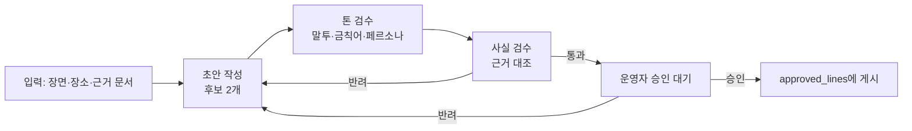

- 스토리보드 A-1·A-2의 ‘문장 생성 → 사실 검수 → 운영자 승인’을 구체화한 것입니다.
- 승인 전 초안은 참여자에게 노출되지 않습니다. 승인된 문장만 `approved_lines`에 들어가 P0 시연의 안전망이 됩니다.
- 운영자 웹 S-13에 ‘초안 → 검수 결과 → 승인·반려’ 화면이 필요합니다.

**미스터리(F-15) — 선택**: 힌트 작성은 Persona Writer를 재사용하고, 정답 문자열을 입력에서 제외합니다. 단계별 힌트(약함 → 강함)를 퀴즈 데이터에 미리 쓰고 LLM은 말투만 입힙니다 `[결정]`.

**에이전트를 쓰지 않는 곳**: 경로 결정(규칙 엔진), GPS 검증(서버), 완주 판정(서버), 안전 안내(승인 대사).

**검토했으나 쓰지 않는 것**
- Managed Agents(서버가 에이전트 루프와 작업 공간을 운영하는 방식): 이 서비스는 파일·셸 작업이 필요 없고 흐름이 고정이어서 과함.
- 에이전트가 스스로 도구를 골라 반복하는 자율 루프: 흐름이 도식으로 정해져 있어 그래프로 충분. 자유 입력(D-16 B)을 허용할 때 다시 검토.

| 담당 | 할 일 |
|---|---|
| AI | 에이전트별 지침, 검증 규칙, 판정 지침 |
| CON | 톤 검수 기준, 반려 사유 목록 |
| RES | 사실 검수 기준 |
| BE | 초안·검수·승인 상태 저장, 감사 로그 |
| FE | 운영자 초안 검수 화면 |
| PM | D-15 결정, 승인 책임자 지정 |

### 15-8. LLM 호출 스택

모델 정보는 Claude API 참고 자료의 모델 표(2026-11-03 기준 캐시)를 인용했습니다. 공식 가격 페이지는 직접 열어 확인하지 못했으므로 도입 전에 재확인합니다 `[확인 필요]`.

**모델 후보** `[결정 D-13]`

| 후보 | 모델 ID | 입력/출력 (100만 토큰당) | 성격 |
|---|---|---|---|
| 작은 모델 | `claude-haiku-5-5` | $0.10 / $0.50 (프롬프트 10만 토큰 이하) | 짧은 대사·검증에 비용·지연 이점 |
| 중간 | `claude-sonnet-5-5` | $2 / $10 | 판단·근거 일치 확인에 여유 |
| 큰 모델 | `claude-opus-5-5` | $4 / $20 | 품질 우선 비교 기준 |

- 역할별 배치 제안 `[창작: 팀 결정]`: 작성·검증 모두 같은 모델로 시작해 품질을 비교하고, 15-9의 질문 세트로 측정해 모델을 정합니다. 처음부터 여러 모델을 섞으면 캐시·비교가 복잡해집니다.
- 호출 단위당 토큰 수는 아직 측정하지 않았습니다. 측정 전에는 비용 수치를 쓰지 않습니다.

**호출 설정(참고 자료 기준)**

| 항목 | 방침 |
|---|---|
| 호출 위치·SDK | 서버에서만, 공식 TypeScript SDK(서버가 Python이면 해당 SDK). 앱에 키 없음 |
| 출력 형식 | 구조화 출력(`output_config.format`)으로 `{line, used_evidence_ids, tone}` 같은 고정 형식 |
| 근거 표시 | D-20. 모델 인용 기능(citations)은 구조화 출력과 **함께 쓸 수 없음** → 인용 기능을 쓰면 자유 문장, 구조화 출력을 쓰면 근거 ID 필드 + 서버 검증 |
| 사고(thinking)·effort | 짧은 대사는 effort를 낮게. 일부 모델은 사고를 끌 수 없고 effort 기본값이 `medium`이므로 명시적으로 설정 |
| 샘플링 값 | `temperature` 등은 일부 모델에서 기본값 외 설정이 거부되므로 보내지 않음 |
| 강제 도구 호출 | 일부 모델에서 불가. 도구 선택은 그래프가 하므로 모델에게 강제하지 않음 |
| 이전 응답 미리 채우기(prefill) | 사용 불가. 형식은 구조화 출력·지침으로 제어 |
| 응답 거부(`stop_reason: refusal`) | 항상 확인하고 승인 대사로 폴백. 서버 측 대체 모델 설정 여부는 `[확인 필요]` |
| 프롬프트 캐싱 | 페르소나 지침(고정)을 앞에, 장면·근거·호칭을 뒤에. 캐시되는 최소 길이는 모델별로 다르므로 지침이 짧으면 효과 없을 수 있음 → `usage`의 캐시 읽기 토큰으로 확인 |
| 제한 시간·재시도 | SDK 기본 재시도가 있으나 시간 초과도 재시도되어 체감 시간이 길어질 수 있음. 사용자 대기 시간 상한에 맞춰 조정 `[결정 D-19]` |
| 로그 | 모델 ID, 입력·출력 토큰, 캐시 토큰, 지연, 폴백 이유. 대화 원문은 개인 정보를 마스킹 |
| 킬 스위치 | `rule_config`의 `llm_enabled` 값을 끄면 모든 장면이 승인 대사로 동작 |

**개인 정보**
- 외부 LLM에 보내는 값은 최소화합니다: 호칭(또는 호칭 코드), 장소 이름, 근거 문장, 장면 코드. **좌표·계정 식별자·이메일은 보내지 않습니다** `[결정 D-17]`.
- 외부 서비스 보관·학습 정책은 계약·약관에서 확인해야 합니다 `[확인 필요]`.

**임베딩·벡터 저장**: D-10이 B일 때만 필요. 임베딩 모델 제공자와 저장소(DB 확장 또는 별도 저장소)는 `[확인 필요]`.

**추적·관측**: LangGraph를 쓰면 그래프 단위 추적 도구를 쓸 수 있고, 그렇지 않으면 노드 로그를 직접 남깁니다. 도구 선택은 `[확인 필요]`.

### 15-9. 평가 (P1 시작 전에 질문 세트를 먼저 만든다)

| 평가 | 내용 | 담당 |
|---|---|---|
| 페르소나 일관성 | 같은 장면에서 승인 대사와 생성 대사를 나란히 보고 같은 캐릭터인지 팀이 판정 | CON, PM |
| 근거 정확성 | 질문 세트(근거 있는 질문, 근거 없는 질문, 미검증 항목 질문)로 지어내기·근거 불일치 여부 확인 | RES, AI |
| 금칙어·안전 | 금칙어·안전 문구 금지 항목이 출력에 없는지 자동 점검 | AI |
| 폴백 | 시간 초과·검증 실패·거부 상황을 일부러 만들어 승인 대사가 나오는지 확인 | AI, RES |
| 지연 | 요청부터 말풍선까지 시간 | AI, BE |
| 개인 정보 | 로그·요청에 좌표·식별자가 없는지 점검 | BE |
| 인젝션 | 질문·닉네임에 지시문을 넣어도 규칙을 지키는지 (D-16 B일 때 필수) | AI |

- 목표 수치는 이 문서에 적지 않습니다 (기획 단계). 측정 결과를 본 뒤 팀이 정합니다.
- 닉네임은 사용자가 입력하는 값이므로 프롬프트에 넣을 때 **지시문이 아닌 데이터**로 취급하고 길이·문자 제한을 둡니다.

### 15-10. 구성 요소별 담당 요약

| 구성 요소 | 책임(R) | 협력 |
|---|---|---|
| 페르소나 사양서·승인 대사 | CON | PM(승인), AI(지침 변환), DES(표정) |
| 장소 이야기 코퍼스 | CON, RES | AI(색인), BE(저장) |
| 조회 도구 | BE | AI |
| 그래프·에이전트·검증기 | AI | BE, FE |
| LLM 계정·키·비용 관리 | BE | PM |
| 운영자 초안 검수 화면 | FE | DES, CON |
| 평가 질문 세트 | RES | AI, CON |
| 결정 D-13~D-20 | PM | 전원 |

### 15-11. 필요한 자산 (AI 기능용)

| 번호 | 자산 | 상태 | 담당 |
|---|---|---|---|
| AI-01 | 페르소나 사양서 확정안 | 후보 상태 (`harangi_personality_v1.md`) | CON |
| AI-02 | 시스템 지침(페르소나) | 없음 | AI |
| AI-03 | 승인 대사 세트(7-3) | 없음 | CON |
| AI-04 | 장소 이야기 코퍼스(C-06) | 없음 | CON, RES |
| AI-05 | 금칙어·금지 표현 목록 | 후보(범위 불일치) | PM |
| AI-06 | 평가 질문 세트 | 없음 | RES |
| AI-07 | 검증 규칙표(형식·금칙어·근거·안전) | 없음 | AI |
| AI-08 | 폴백 이유별 대사 | AI-03에 포함 | CON |
| AI-09 | 그래프 상태 스키마·노드 목록 | 15-6 초안 | AI |
| AI-10 | 로그 항목 정의(개인 정보 마스킹 규칙) | 없음 | BE |

### 15-12. 단계 (P1 세부)

- [ ] **5-A 페르소나 확정**: CON·PM이 D-18 결정 → 사양서 확정 → 승인 대사 세트 작성 (P0에서도 필요하므로 가장 먼저)
- [ ] **5-B 코퍼스**: CON·RES가 코스 장소 문서 작성·사실 대조 → AI가 색인
- [ ] **5-C 조회 도구**: BE가 읽기 전용 도구 구현, 권한 점검
- [ ] **5-D 그래프 골격**: AI가 노드·상태·폴백 먼저 구현(생성 노드는 임시로 승인 대사 반환) → 폴백이 항상 동작함을 먼저 확인
- [ ] **5-E 생성·검증 연결**: 지침 적용, 구조화 출력, 규칙 검증, 판정 검증
- [ ] **5-F 평가**: 질문 세트로 15-9 실행, 결과 기록(통과·실패·미확인)
- [ ] **5-G F-20**: 초안 파이프라인과 운영자 검수 화면
- [ ] **5-H 통합**: 앱 질문 버튼 연결, 킬 스위치 확인, 시연 시나리오 추가(14장 T-09 이상)

> 순서의 핵심은 **폴백이 먼저, 생성은 나중**입니다. LLM이 없어도 동작하는 상태에서 생성 노드를 붙입니다.

---

## 16. 후속 기술 (P0 본체 이후)

팀 검토 결과: **푸시 알림과 이벤트 분석은 필요**, 모의 위치 탐지 등 나머지는 **나중에 검토**합니다.

### 16-1. 푸시 알림 (F-21, P1)

- 목적: 운영자가 장소를 중단·재개했을 때, 재평가 시점을 기다리지 않고 영향받는 참여자에게 알립니다 (F-08 보완).
- 흐름

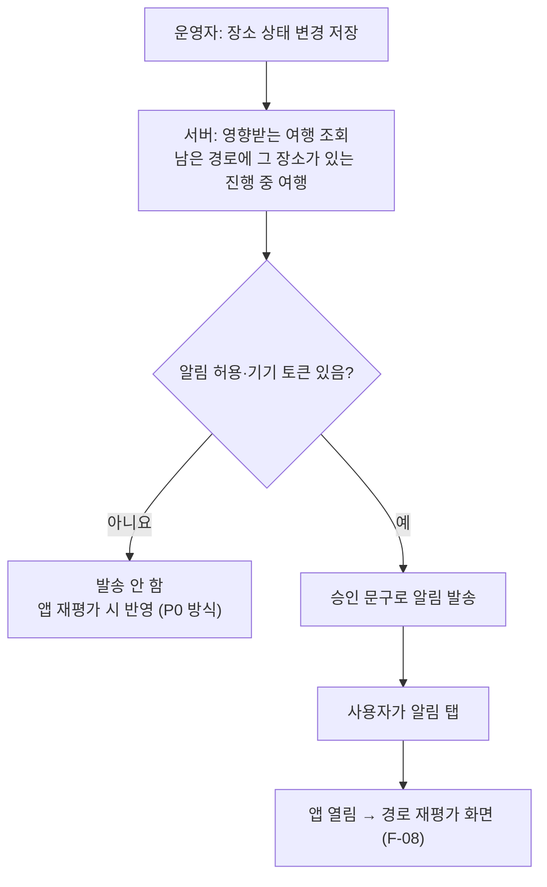

| 항목 | 내용 |
|---|---|
| 데이터 | `device_tokens`(사용자, 토큰, 플랫폼, 갱신일), `notification_log`(대상, 사유, 발송 시각, 결과) |
| 권한 | 알림 권한은 사용자가 허용할 때만. 거부해도 앱 기능은 동일 (재평가로 대체) |
| 문구 | **승인 대사만** 사용(생성 안 함). 장소 중단 사유별 문구, 하랑이 말투 |
| 내용 제한 | 좌표·개인정보 없음. 장소 이름과 ‘다시 확인’ 안내까지만 |
| 빈도 제한 | 같은 여행·같은 사유로 반복 발송 방지 `[결정]` |
| 알림 탭 | 앱을 열고 해당 여행의 경로 재평가 화면으로 이동 |
| 한계 | 알림은 보조 수단. 알림을 못 받아도 앱 재평가는 항상 동작해야 함 |
| 확인 필요 | 기기 OS별 설정·테스트 방법 `[확인 필요]`, 개발 빌드와 앱 스토어 빌드 차이 `[확인 필요]` |

| 담당 | 할 일 |
|---|---|
| PM | D-21 결정, 알림 문구 목록 확정 요청 |
| CON | 사유별 알림 문구(승인 대사), 길이 제한 확인 |
| BE | 대상 조회, 토큰 저장 API, 발송, 로그, 빈도 제한 |
| FE | 권한 요청 시점·문구, 토큰 등록, 알림 탭 이동 |
| DES | 권한 요청 화면, 알림 아이콘 |
| RES | 실기기 수신·탭 이동·거부 시 시나리오 (T-13) |

수용 기준: ① 운영자가 중단하면 영향받는 진행 중 여행 사용자에게만 알림이 간다. ② 알림 권한을 거부한 사용자는 알림 없이도 재평가로 같은 결과를 본다. ③ 알림 탭 후 경로 재평가 화면이 열린다.

### 16-2. 이벤트 분석 (F-22, P1 · 이벤트 정의표는 P0)

- 목적: 고객 전략 문서의 파일럿 지표를 실제로 측정합니다.
- **이벤트 이름·속성은 P0 개발 중에 심어야** 하므로 정의표를 먼저 확정합니다. 저장·집계 도구는 나중에 정해도 됩니다.

| 이벤트 | 속성(좌표·식별자 제외) | 연결 지표·용도 |
|---|---|---|
| `app_open` | 세션 유무 | 진입 |
| `login_result` | 성공/실패 | 로그인 이탈 |
| `first_meet_done` | 닉네임 설정/건너뜀 | 첫 만남 |
| `recommend_view` | 모드, 위치 방식(현재 위치/구·군), 결과 유무 (**좌표 제외**) | 추천 이용 |
| `recommend_select` | 코스 ID, 목록 순위 | 추천 → 코스 선택 전환 |
| `course_view` | 코스 ID | 코스 관심 |
| `route_check` | 결과(경로 있음/확인 불가), 모드 | 오늘의 길 |
| `trip_start` | 코스 ID, 경로 유형 | **첫 인증률·완주율의 분모(퀘스트 시작 인원)** |
| `reroute_shown` | 사유 코드, 대체 길 유무 | **변경 후 재개율의 분모(변경 안내를 받은 인원)** |
| `reroute_accept` | 코스 ID | **변경 후 재개율의 분자(대체 미션 시작 인원)** |
| `visit_attempt` | 결과 코드(created·existing·too_far·low_accuracy·route_changed·auth_required) | 인증 실패 사유 |
| `visit_success` | 장소 ID, 순번 | **첫 인증률의 분자(첫 인증 성공 인원)** |
| `trip_complete` | 코스 ID | **완주율의 분자** |
| `journal_open` | — | 장부 이용 |
| `harangi_ask` (P1) | 질문 유형, 폴백 이유 | 질의 품질·폴백 비율 |
| `admin_status_change` | 장소 ID, 상태 | **운영 시간 지표(상태 변경~안내까지)의 시작** |
| `push_sent` / `push_opened` (P1) | 사유 | 운영 시간 지표의 끝, 알림 효과 |

지표 정의는 고객 전략 문서를 따릅니다: 첫 인증률 = 첫 인증 성공 인원 ÷ 퀘스트 시작 인원, 변경 후 재개율 = 대체 미션 시작 인원 ÷ 변경 안내를 받은 인원, 완주율 = 완주 인원 ÷ 퀘스트 시작 인원.

| 항목 | 내용 |
|---|---|
| 저장 | D-22. A 자체 DB의 `events` 테이블(이벤트명, 시각, 가명화한 사용자 키, 속성) / B 외부 분석 서비스 |
| 개인정보 | 좌표·이메일·닉네임을 이벤트에 넣지 않음. 사용자 키는 가명화. 수집 동의·고지 방식 `[확인 필요]` |
| 규칙 | 이벤트는 서버가 확정한 결과(방문 성공 등)를 기준으로 기록. 앱 단독 기록은 보조 |
| 집계 | 지표 3개와 운영 시간을 일·코스·장소별로 볼 수 있는 질의 또는 대시보드 `[결정]` |
| 한계 | 사용자 수가 적은 시연 단계의 수치는 통계적 의미가 없음. 흐름 점검 용도로 사용 |

| 담당 | 할 일 |
|---|---|
| PM | 이벤트 정의표 확정, 지표 정의 승인, D-22 결정 |
| FE | 이벤트 호출 위치 반영(P0 중), 전송 실패 시 재시도 |
| BE | 서버 확정 이벤트 기록, `events` 저장, 집계 질의 |
| RES | 시연 중 이벤트가 정의대로 쌓이는지 확인 |
| DES | (선택) 집계 화면 |

수용 기준: ① 시연 시나리오 1회를 실행하면 정의표의 이벤트가 순서대로 기록된다. ② 이벤트에 좌표·이메일·닉네임이 없다. ③ 세 지표를 이벤트만으로 계산할 수 있다.

### 16-3. 나중에 검토할 기술 (보류)

| 기술 | 보류 이유 | 다시 볼 시점 |
|---|---|---|
| 모의 위치(GPS 스푸핑) 탐지·기기 무결성 확인 | 첫 시연 범위에서는 우선순위가 낮다고 팀이 판단. 단, **GPS 인증은 ‘현장 방문 확정’이 아니라 ‘현장 근처 확인’**임을 문서·발표에서 구분해야 함 | 외부 사용자 모집·보상 연계 전 |
| 오프라인·재전송 큐 | 응답 누락은 장부 재조회로 우선 대응(F-09) | 현장 시험에서 네트워크 문제가 확인될 때 |
| 원격 설정·기능 플래그 | 킬 스위치는 `rule_config` 값으로 우선 대체 | 앱 재배포 부담이 커질 때 |
| 자동 평가(회귀 테스트) | 질문 세트를 먼저 만든 뒤 자동화 | P1 평가(15-9) 이후 |
| 추적·비용 대시보드 | 초기에는 노드 로그로 대체 | LLM 호출량이 늘 때 |
| 사전 생성 대사 풀·응답 캐시 | 승인 대사 세트를 먼저 완성 | P1 안정화 후 |
| 하이브리드 검색·재순위 | 장소 문서가 적은 동안 불필요 | 코퍼스가 늘 때(D-10) |
| 조회 도구 표준화(MCP) | 도구가 3개 이하 | 도구가 늘 때 |
| 모델 라우팅·장애 대체 | 폴백이 승인 대사로 이미 있음 | 지연·장애가 문제 될 때 |
| 멀티모달(사진 단서)·음성 합성 | 범위 밖(P2) | 미스터리 확장 시 |
| 예보 수집 스케줄러·레이트 리밋 | 시연 규모에서는 직접 호출로 충분 | 호출 한도·비용 이슈 발생 시 |
| 접근성(스크린리더 등) | 시기 미정 `[확인 필요]` | 외부 공개 전 |

---

## 17. 발표 피드백 반영 (2026-11-13)

- 피드백 8건(심사·청취자 의견, 원문은 대화에서 받음 — 이 저장소에 원문 파일 없음 `[확인 필요: feedback/에 저장]`)을 기능·기술·결정으로 옮겼습니다.
- **표기 주의**: 이 장의 라이브러리·서비스 이름은 후보이며, 이 세션에서 공식 문서를 열어 확인하지 않았습니다. 버전 호환·약관·가격은 전부 `[확인 필요]`. 추천 문장은 `[추측]`으로 표시했습니다.
- 현재 앱에 설치된 것은 `expo`, `react-native`, `react-native-web`, `expo-status-bar` 뿐입니다 (`app/package.json`). 아래 후보 라이브러리는 **모두 미설치**입니다.

### 17-0. 피드백 → 반영 위치 한눈에

| # | 피드백 요지 | 반영 | 우선순위 | 새 결정 |
|---|---|---|---|---|
| 1 | 경로가 없어도 코스는 줘야 함. 쉼터까지 전부 닫았으면 그렇게 말하면 됨 | 17-1, F-05 수용 기준 ④ | P0 | D-28 |
| 2 | 하랑이 안내 방식(지도?), 코스 + 내 위치 표시, 스탬프 ‘쿵’ | 17-2, F-24 | P0 | D-27 |
| 3 | ‘대체 길 안내’가 뭔지, 실시간인지 | 17-3 (F-08 설명 보강) | P0 / P1 | D-29 |
| 4 | 방문 인증이 안 되는 경우 | 17-4, F-25 | P0 | D-30 |
| 5 | 택시앱처럼 하랑이가 계속 정면? 몸을 돌리기? 표정 변화 | 17-5, F-26 | P0 표정 / P1 방향 | D-31 |
| 6 | 디지털 팀권, 시장, 적정가 | 17-6, F-27 (**가격은 기술 문서 범위 밖**) | P2 | D-32 (D-11 선행) |
| 7 | 리얼월드 설명 (실제 플레이 불가 → 설명 페이지만) | 17-7 | 발표 | — |
| 8 | 유저플로우 외 AI 에이전트 활용, 마스코트 교체·캐릭터 생성 에이전트 | 17-8, F-28 | 구조 P1 / 생성 P2 | D-33 |

### 17-1. 경로가 없을 때도 코스를 준다 (피드백 1)

- 현재 spec: 경로 없음·확인 불가 → 사유와 확인된 쉼터 안내 (F-05, 4-4 ②).
- 변경: **쉼터 안내는 마지막 단계**로 내리고, 그 앞에 코스를 주는 단계를 둡니다. 안전 규칙은 완화하지 않습니다 (호우·낙뢰·폭염특보에서 야외로 되돌리지 않음, F-19).
- 판정은 규칙 엔진이 합니다. LLM은 쓰지 않고 문구는 승인 대사에서 고릅니다 (15-1 원칙).

| 단계 | 내용 | 조건 |
|---|---|---|
| 1 | 오늘 모드의 기본 경로 | 기본 경로의 모든 장소가 운영 중 |
| 2 | 검수된 대체 경로 | 기본 경로에 닫힌 장소가 있음 |
| 3 | 실내·그늘 대체 경로 | 모드가 야외를 막음 (폭염·약한 비 등) |
| 4 | 부분 코스 | 열린 장소만 이어서 방문, 닫힌 장소는 건너뜀 (완주 조건 `[결정]`) |
| 5 | 원격·보류 코스 | 호우·낙뢰 등 이동 보류 → 있는 곳에서 볼 수 있는 이야기와 ‘나중에 이어하기’ (F-23 표의 ‘실내·원격 단서’, 콘텐츠 필요) |
| 6 | 열리는 시각 안내 | 야간·휴관일이라 전부 닫음 → 다음에 열리는 시각과 그때의 코스 미리 보기 (운영시간 데이터 필요, C-01) |
| 7 | 쉼터 안내 → 쉼터도 전부 닫힘이면 **“지금 이용 가능한 쉼터가 없습니다”** + 기준 시각 + 안전 안내 | 모든 단계 불가. 안전 연락처·행동요령 문구는 출처 확인 후 `[확인 필요]` |

- 기술: 규칙 엔진에 후보 경로를 순서대로 평가하는 함수, 응답에 `fallback_level`(1~7) 포함, 이벤트 `route_fallback` 추가 (16-2).
- 데이터: 쉼터(C-04)의 운영시간·확인일, 24시간 이용 가능한 쉼터 여부 `[확인 필요: 공공 쉼터 데이터 범위]`, 원격 단서 콘텐츠(CON).
- 야간 전체 휴관은 ‘예외’가 아니라 **매일 생기는 정상 상황**입니다. 6단계가 이를 처리합니다.

| 담당 | 할 일 |
|---|---|
| PM | D-28 결정, 완주 조건(부분 코스) 결정 |
| BE | 단계 평가 함수, `fallback_level`, 단위 테스트(T-18) |
| FE | 단계별 안내 화면(‘다른 코스’ / ‘나중에 이어하기’ / ‘쉼터 없음’) |
| CON | 단계별 승인 대사, 원격 단서 콘텐츠 |
| RES | 쉼터·운영시간 사실 확인, 안전 안내 문구 출처 |

- 수용 기준: ① 모든 장소가 중단돼도 빈 화면이 나오지 않는다. ② 폭염·호우 상황에서 완화 단계가 야외 경로를 열지 않는다. ③ 쉼터까지 전부 닫으면 그 사실과 기준 시각이 보인다.

### 17-2. 앱 내 코스 지도·내 위치·스탬프 ‘쿵’ (피드백 2, F-24)

- 현재: 길찾기는 외부 지도 앱 열기만 있고 앱 내 지도는 없습니다 (4-1, F-07).
- 제안: 여행 지도(S-05)를 **코스 지도 화면**으로 확장합니다. 턴바이턴 길찾기는 외부 앱에 맡기고, 앱은 “코스와 지금 어디까지 왔나”를 보여 줍니다.

| 요소 | 동작 |
|---|---|
| 장소 핀 | 방문 순서 번호 핀, 다음 장소는 강조 |
| 순서선 | 장소를 순서대로 잇는 선. **직선 연결이며 실제 도보 경로가 아님**을 화면에 표시 (P0) |
| 내 위치 | 앱 사용 중에만 위치 갱신 (기획서 8장). 이동할 때마다 점이 움직임 |
| 방문 완료 | 핀이 능금 스탬프로 바뀜 |
| 하랑이 | 하단 시트에 말풍선·다음 장소·남은 직선거리 (17-5) |
| 길찾기 버튼 | 외부 지도 앱 열기 (기존 F-07) |

**지도 구현 후보** (전부 `[확인 필요: Expo SDK 58·RN 0.88 호환, 키 발급, 약관]`)

| 후보 | 장점 | 확인할 점 |
|---|---|---|
| A. `react-native-maps` | 네이티브 마커·선 지원 | Expo Go에서 되는지, 기기별 지도 제공자, 키 설정 |
| B. WebView + 카카오 지도 JS SDK | 국내 지도 사용 | 앱 키·도메인 등록, WebView와 앱 사이 메시지 연결, 약관 |
| C. 네이버 지도 RN 커뮤니티 라이브러리 | 국내 지도 | 유지보수 상태, 개발 빌드 필요 여부 |
| D. WebView + Leaflet + OSM 타일 | 키 불필요 | 타일 이용 정책, 한국어 표기 품질 |

- 선택은 `[추측]`: 시연 규모에서는 팀이 가장 빨리 돌려 본 후보를 고르고, **실기기 시험 1회로 결정**합니다 (D-27). 웹 미리보기(react-native-web)에서는 네이티브 지도가 안 될 수 있어 `[확인 필요]`.
- 도보 경로선(실제 길 따라 그리기)은 별도 경로 API가 필요합니다 (T맵 보행자 경로 등 `[확인 필요]`). P1로 둡니다.
- 내 위치: `expo-location`의 위치 구독 `[확인 필요: 모듈·권한 문구]`. 좌표는 화면 표시에만 쓰고 저장하지 않습니다 (추천과 같은 원칙, F-23). 방문 인증 시에만 F-09 규칙으로 서버에 보냅니다.

**스탬프 ‘쿵’ 연출**
- 트리거: 방문 API가 `created`를 반환했을 때 (`existing`이면 연출 없이 기존 스탬프 표시).
- 구성: 스탬프 크게 → 제자리로 눌리며 확대·축소, 약한 흔들림, 진동 1회, (선택) 효과음.
- 기술 후보: RN 기본 `Animated` 또는 `react-native-reanimated`, 진동 `expo-haptics`, 효과음 `expo-audio` `[확인 필요: 전부 미설치, SDK 58 호환]`.
- 접근성: 기기의 ‘동작 줄이기’ 설정이면 확대·흔들림을 생략 `[확인 필요: 구현 방법]`.
- 에셋: 능금 스탬프 투명 PNG (A-04), 핀·내 위치 마커 (A-16).

| 담당 | 할 일 |
|---|---|
| FE | 지도 후보 시험·구현, 위치 구독, 핀·선·내 위치, 스탬프 연출 |
| DES | 지도 화면, 핀·마커, 스탬프 연출 타이밍 |
| BE | 장소 좌표·순서 API 응답에 포함, 좌표 미저장 확인 |
| RES | 실기기에서 내 위치 갱신·지도 표시 시험 (T-20) |

- 수용 기준: ① 코스 장소가 순서대로 지도에 보인다. ② 이동하면 내 위치가 갱신된다. ③ 인증 성공 시 핀이 스탬프로 바뀌며 연출이 나온다. ④ 지도를 못 불러와도 주소·인증 지점 설명으로 진행된다 (F-07 폴백). ⑤ 순서선이 실제 도보 경로가 아님이 표시된다.

### 17-3. ‘대체 길 안내’란 무엇이고 실시간으로 되나 (피드백 3)

**발표에서 설명할 정의**: 코스 안의 어느 장소가 닫히거나 날씨가 바뀌면, **남은 코스만** 열린 장소로 다시 짜서 하랑이가 이유와 함께 알려 주는 것입니다. 이미 받은 스탬프는 유지됩니다 (F-08, 4-4).

**“실시간”은 세 단계로 나눠 생각합니다**

| 단계 | 방식 | 범위 | 난이도 `[추측]` |
|---|---|---|---|
| L0 | 앱이 다음 장소 안내 시점·앱 복귀 시점에 서버에 재평가 요청 | P0 (현재안) | 낮음 |
| L1 | 앱을 열어 둔 동안 장소 상태 변경을 즉시 받아 배너 표시 (DB 변경 구독) | P0 시연 1종 선택 가능 `[결정 D-29]` | 중간. 서버·DB 제품의 구독 기능 사용법 확인 필요 (D-02) |
| L2 | 앱이 닫혀 있어도 푸시 알림 | P1 (F-21, 16-1) | 중간 |

- 답: **구현이 불가능해서 미루는 것이 아니라 단계로 나눈 것**입니다. 어려운 부분은 기술이 아니라 데이터입니다.
- 장소의 실제 휴관·혼잡 정보를 자동으로 주는 공공 데이터는 이 세션에서 확인하지 못했습니다 `[확인 필요]`. 기상 정보는 공공 API로 받지만, 장소 운영 상태는 **운영자가 입력**하는 것이 전제입니다 (F-18; 고객 전략 문서도 대행사의 상태 변경 → 다음 거점 안내 흐름, `plan/treagent_customer_strategy_v1.md:69`).
- 이동 중인 사용자의 교통·혼잡을 반영한 실시간 길 안내는 이 프로젝트 범위 밖입니다.

| 담당 | 할 일 |
|---|---|
| PM | D-29 결정, 발표 설명 문장 확정 |
| BE | (L1 선택 시) 상태 변경 구독 또는 짧은 주기 확인 방식 시험 |
| FE | 변경 배너·수락 화면 |

### 17-4. 방문 인증이 안 될 때 (피드백 4, F-25)

**인증이 막히는 경우**

| 경우 | 현재 처리 (F-09) |
|---|---|
| 위치 권한 거부 | 설정 안내 후 재시도 |
| 정확도 낮음 (실내·건물 사이) | 재측위 안내 |
| 거리 밖 | 사유별 안내 |
| 기기 GPS 꺼짐·통신 불가 | 응답 누락 처리 |
| 현장 변경 (공사·출입 통제) | 처리 없음 → 추가 필요 |

**대안 순서 (제안, `[결정 D-30]`)**

| 순서 | 수단 | 내용 | 범위 |
|---|---|---|---|
| 1 | GPS 자동 | 기존 F-09 | P0 |
| 2 | 현장 단서 입력 | 인증 지점의 표지판·간판 글자·숫자 등 **현장에서만 보이는 것**을 선택·입력. 서버가 채점 (D-05 B안) | P0 |
| 3 | QR | 현장 부착물 필요, 분실·훼손 관리 필요 | P2 (F-16) |
| 4 | 건너뛰기 | 스탬프 없이 다음 장소로. 화면에 ‘미인증’ 표시 | P0 (D-30 A안일 때) |
| 보류 | 사진 인증 | 개인정보(타인 얼굴·EXIF)와 자동 판독 부담 때문에 보류 `[추측]` | 후순위 |

- 기술: 방문 API에 인증 수단 필드(`gps` / `clue` / `skip`), `verification_points`에 단서 문구·정답 해시 칼럼 추가 (9장). 채점은 서버가 하고 정답을 앱에 내려보내지 않습니다.
- 건너뛴 장소의 완주 인정 여부는 `[결정 D-30]`. F-17 시즌 칸은 **GPS·단서 인증만 채움**, 건너뛰기는 채우지 않는 것을 제안합니다 `[추측]`.
- 한계: 단서 정답을 다른 사람에게 알려 주면 현장에 없어도 인증됩니다. GPS 위조 탐지를 보류한 것(16-3)과 같은 수준의 한계이며, **‘현장 근처 확인’이지 ‘현장 방문 확정’이 아님**을 발표에서 구분합니다.

| 담당 | 할 일 |
|---|---|
| PM | D-30·D-05 결정, 건너뛴 장소의 완주 규칙 |
| RES | 장소별 단서 문구·정답 현장 확인, 단서가 바뀔 가능성 기록 |
| BE | 단서 채점, 수단 필드, 응답 코드 보강 |
| FE | 인증 실패 시 대안 화면(단서 입력·건너뛰기) |
| CON | 대안 안내 승인 대사 |
| DES | 대안 선택 화면 |

- 수용 기준: ① GPS가 실패해도 대안으로 인증하거나 건너뛰고 코스를 이어갈 수 있다. ② 단서 오답이면 재시도 안내가 나온다. ③ 건너뛴 장소는 장부에 ‘미인증’으로 남고 시즌 칸을 채우지 않는다.

### 17-5. 하랑이 표시: 표정·방향 (피드백 5, F-26)

- 목표: 안내 중 하랑이가 계속 같은 얼굴로 서 있지 않게 합니다. 택시 호출 화면처럼 **하단 시트에 하랑이·다음 장소·남은 거리·말풍선**을 두고, 상황에 따라 바뀝니다.

| 안 | 내용 | 에셋 규모 | 구현 | 범위 |
|---|---|---|---|---|
| A | 정면 고정 + 표정 변화 | 표정 5종 `[확인 필요: 기존 3종 외 추가]` (A-02) | 장면 코드 → 표정 매핑 (F-13) | P0 |
| B | 정면·좌·우 3방향 + 표정 | 방향×표정 (최소화하면 방향별 기본 표정만) | 내 위치 → 다음 장소 방위각으로 방향 선택 | P1 |
| C | 걷기 프레임 애니메이션 | 방향별 걷기 프레임 | 스프라이트 시트 재생 | 후순위 |
| D | 스켈레톤 애니메이션 도구 | 도구 학습·제작 필요 | Rive·Lottie 등 `[확인 필요]` | 후순위 |

- 현재 에셋: 기준 시트·표정·전신 픽셀·스탬프·스티커 (7-1). 전신 픽셀 이미지가 방향·프레임 시트인지 `[확인 필요]`.
- 방향 계산: 내 위치와 다음 장소 좌표로 방위각을 구해 화면 좌·우·정면으로 단순화. 기기 나침반을 쓸지, 화면 기준 좌우로 단순화해도 이해되는지는 `[확인 필요: 사용성 시험]`.
- 이미지 생성으로 방향·표정 세트를 늘릴 때 캐릭터 일관성이 유지되는지는 시험 전에는 알 수 없습니다 `[미검증]`. 프롬프트는 `brand/character/prompts.md`에 기록합니다.
- 표정은 장면 규칙이 정하고 LLM이 정하지 않습니다 (15-3).
- `[추측]` 시간이 부족하면 A로 시연하고, B는 “확장 계획”으로 발표합니다.

| 담당 | 할 일 |
|---|---|
| PM | D-31 결정 |
| DES | 하단 시트 레이아웃, 방향·표정 에셋 규격 (A-02, A-15) |
| CON | 표정·방향 이미지 제작, 장면→표정 표 |
| FE | 표정 매핑, (B안) 방위각 계산·이미지 선택 |

- 수용 기준: ① 장면(인증 성공·실패·경로 변경·보류)마다 표정이 바뀐다. ② (B안) 다음 장소가 왼쪽에 있으면 하랑이가 왼쪽을 본다.

### 17-6. 디지털 팀권 (피드백 6, F-27)

- 근거(사실): 고객 전략 문서가 **디지털 팀권 14,900원을 첫 가격 실험값**으로 제안하고, 유료 체험의 비교 단위가 달라 동일 시장가로 해석하지 않는다고 적었습니다 (`plan/treagent_customer_strategy_v1.md:201`). 공개 가격 비교는 같은 문서 `:165-171` (퀘스투어 1인 10,000원, 수원문화재단 테마당 7,500원, 리얼월드 부산 정가 35,900원/얼리버드 14,900원 등).
- **적정가는 팀이 정할 일입니다.** 이 문서는 가격을 정하지 않고, 팀권이 들어가면 필요한 기술만 정리합니다.
- 현재 spec은 무료 MVP(유저 플로우 v1)와 유료 팀권(고객 전략)이 충돌합니다 (D-11). **D-11이 결정되기 전에는 구현하지 않습니다.**

| 항목 | 내용 |
|---|---|
| 팀권 단위 | A 구매자 1명이 팀 코드를 만들고 팀원이 코드로 합류 / B 인원별 개별 구매 `[결정 D-32]` |
| 데이터(안) | `orders`, `tickets`(팀 코드·유효 기간), `ticket_members` (9장에 추가 필요) |
| 진행·스탬프 | 개인 기록 vs 팀 공동 기록 `[결정 D-32]` |
| 결제 후보 | A 앱 스토어 결제: 실물 장소 체험권이 디지털 상품 규정에 해당하는지 `[확인 필요]` / B 웹 결제 페이지 + 코드 발급: 국내 결제 대행사(토스페이먼츠·포트원 등) `[확인 필요: 약관·수수료]` / C 시연은 **가짜 결제 화면**(실제 결제 아님을 화면에 표시) |
| 정산·환불·세금 | 고객 전략 문서도 수수료·환불·세금 반영 전 예시라고 밝힘 (`:201`). 환불 규정 `[확인 필요: 법률 검토]` |
| 시연 권장 `[추측]` | C안. 결제 연동은 P0 일정에 넣지 않음 |

### 17-7. 리얼월드 설명 (피드백 7)

- 사실: 유니크굿컴퍼니의 리얼월드는 B2B 솔루션으로 지역 맞춤 콘텐츠, AI 스토리 분기, 대화형 NPC, QR/GPS/NFC, 콘텐츠 실시간 변경을 **공개 소개**하고 있고, 우리 고객 전략은 이를 기획·기술이 모두 겹치는 직접 경쟁사로 분류했습니다 (`plan/treagent_customer_strategy_v1.md:100`).
- 한계(사실): 팀이 **실제로 플레이해 보지 못했고** 공개 설명 페이지만 확인했습니다. 휴관 반영 코스 전환·진행 복구의 실제 구현 수준은 미확인입니다 (같은 줄).
- 발표 답변 후보 `[창작: 후보 2개, 팀이 선택]`
  - A: “리얼월드는 직접 플레이해 보지 못해 공개된 설명 페이지 기준으로 비교했습니다. 그 범위에서 AI 분기와 실시간 변경이 소개되어 있고, 저희는 휴관 시 남은 코스 재편과 진행 복구를 시연으로 보여 드립니다.”
  - B: “플레이 체험은 못 했습니다. 그래서 ‘있다/없다’가 아니라 공개 자료에 적힌 기능과 저희 기능을 나란히 놓고, 확인 못 한 부분은 미확인으로 표시했습니다.”
- 대응 기능: 인증 수단(QR/GPS/NFC) ↔ 17-4, 실시간 변경 ↔ 17-3, AI NPC ↔ 15장.

### 17-8. 유저플로우 밖의 AI 에이전트 활용: 마스코트 교체 (피드백 8, F-28)

- 전제(가설): 대구시 등 발주처의 요청을 받아 대행사 납품 형태로 만든다고 가정합니다. 고객 전략에서 행사 대행사 납품은 판매 경로 중 하나입니다 (`plan/treagent_customer_strategy_v1.md:160`, `:187`).
- 현재 spec의 AI 활용(F-14, F-15, F-20)은 모두 **하랑이 한 캐릭터 기준 + 사용자 흐름 안**입니다.
- 피드백 의견: 발주처가 “하랑이 말고 다른 마스코트”를 요청할 수 있으니 캐릭터 생성도 에이전트로 하면 어떤가. 단, 시간이 없으니 집중.

**유저플로우 밖 AI 활용 후보** `[결정 D-33]`

| 후보 | 내용 | 기존 연결 | 범위 `[추측]` |
|---|---|---|---|
| a. 마스코트 교체 구조 | 하랑이 정보를 코드에서 분리한 ‘브랜드 팩’ | 15-3 페르소나 단일 출처 | **구조 P1** |
| b. 캐릭터 생성 에이전트 | 발주 브리프 → 페르소나 사양 → 이미지 → 표정 세트 → 사람 승인 | 15-3, 7-1, F-20 | 발표는 도식, 구현 P2 |
| c. 코스·대사 초안 | 새 지역·새 마스코트 톤으로 초안 생성, 운영자 승인 | F-20 | P1 (이미 있음) |
| d. 변경 공지·성과 보고서 초안 | 이벤트·변경 이력을 요약해 발주처 보고용 초안 | 16-2, `plan/treagent_customer_strategy_v1.md:69,92` | P2 `[확인 필요: 실제 보고 양식]` |

**마스코트 교체 구조 (브랜드 팩)**
- 브랜드 팩에 담을 것: 이름, 페르소나 사양서(15-3 항목), 표정·방향 에셋 세트(A-02, A-15), 말버릇, 금칙어 추가분, 호칭 규칙, 색 토큰.
- 지금 하랑이가 박혀 있는 곳을 팩 ID 참조로 바꿔야 합니다: `approved_lines`에 `pack_id` 추가, 페르소나 프롬프트 파일을 팩별로 분리, 앱 에셋 경로를 팩에서 읽기 (9장·15-3 반영 필요).
- **바뀌지 않는 것**: 안전·인증·규칙 엔진, 안전 대사의 틀(결론부터, 농담 금지). 마스코트가 바뀌어도 안전 규칙은 팩이 바꾸지 못합니다.

**캐릭터 생성 에이전트 (도식안)**

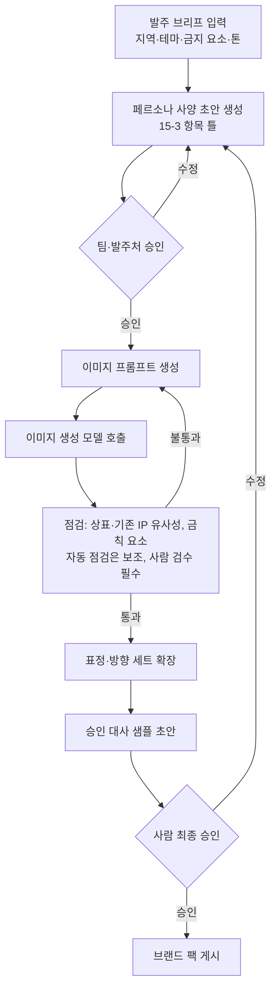

- 이미지 생성: 이 문서가 참고한 Claude API 자료는 텍스트 중심이며 이미지 생성은 **별도 이미지 생성 모델**이 필요합니다. 제공자·상업적 이용 약관·결과물 권리 귀속은 `[확인 필요]`. 앞서 멀티모달을 P2로 보류한 것(16-3)과 일치합니다.
- 위험: ① 캐릭터 일관성(표정·방향 세트에서 얼굴이 달라짐 `[미검증]`) ② 상표·기존 IP와 유사한 결과 (`CLAUDE.md` 금기: 이름에 설비명·상표 사용 금지) ③ 발주처 요구사항·저작권 귀속 `[확인 필요: 법률 검토]`.
- 규칙: 생성 결과는 **사람이 승인하기 전에는 앱에 반영되지 않습니다** (F-20과 같은 원칙).
- 집중 방안 `[추측]`: 시간이 없으면 ‘브랜드 팩’ 구조 1장과 위 도식을 발표에 넣고, 실제 생성 구현은 하지 않습니다. 구현으로 보여 줘야 하면 하랑이 팩 1개 + 가짜 팩 1개로 교체 시연(T-21)이 가장 작은 범위입니다.

| 담당 | 할 일 |
|---|---|
| PM | D-33 결정, 발표 범위 |
| AI | 팩 구조 설계, (P2) 생성 파이프라인 |
| CON | 팩 사양서 틀, 하랑이를 첫 팩으로 정리 |
| BE | `mascot_packs`·`pack_id` 스키마 |
| FE | 팩 기준 에셋·대사 로드 |
| DES | 에셋 규격 (A-02, A-15) |

### 17-9. 가능 기술 총정리 (전부 `[확인 필요]`)

| 기능 | 기술 후보 | 앱 설치 상태 | 근거 수준 |
|---|---|---|---|
| 내 위치 표시 | `expo-location` | 미설치 | 후보. SDK 58 호환·권한 문구 확인 |
| 앱 내 지도 | 17-2의 A~D | 미설치 | 후보. 실기기 시험 후 D-27 |
| 도보 경로선 | 보행자 경로 API (T맵 등) | — | 후보. 약관·호출 한도 확인 (P1) |
| 스탬프 연출 | RN `Animated` 또는 `react-native-reanimated` | 미설치(기본 `Animated`는 RN 내장) | 후보 |
| 진동·효과음 | `expo-haptics`, `expo-audio` | 미설치 | 후보 |
| 하랑이 방향 | 방위각 계산 + 방향별 이미지 | — | 직접 구현 가능 `[추측]`, 에셋이 병목 |
| 실시간 반영(L1) | DB 변경 구독 (D-02 제품 기능) | — | 제품 선택 후 확인 |
| 푸시(L2) | 16-1 | — | D-21 |
| 인증 대안 | 서버 채점 + 단서 데이터 | — | 직접 구현 |
| 결제 | 앱 스토어 결제 / 웹 결제 + 코드 | — | 약관·정책 확인 필요 (P2) |
| 캐릭터 생성 | 이미지 생성 모델 + 15-3 사양 + 사람 승인 | — | 제공자·약관 확인 (P2) |

### 17-10. 단계 반영 (11장 보강)

- 단계 0: PM이 D-28·D-30을 D-01~D-06과 함께 정리.
- 단계 1: 지도 후보 1~2개 실기기 시험(FE), 하랑이 에셋 규격 D-31(DES·CON), 단서 데이터 구조(BE).
- 단계 2: 코스 지도·내 위치·스탬프 연출(F-24), 경로 완화 단계(F-05), 인증 대안(F-25).
- 단계 3: (선택) L1 실시간 반영 1종 시연.
- P1: 방향 연출, 브랜드 팩 구조. P2: 팀권·QR·캐릭터 생성 에이전트.

---

## 출처

- Claude API 참고 자료(이 세션에서 불러온 `claude-api` 스킬 문서): 모델 ID·가격 표(2026-11-03 캐시), 구조화 출력·인용 기능 제약, 일부 모델의 사고·샘플링·강제 도구 호출·prefill 제약, 거부 처리, 프롬프트 캐싱, 에이전트 구성 방식 비교. 공식 문서 페이지는 직접 열지 않음
- `brand/character/harangi_personality_v1.md`, `brand/character/harangi_character.md` (페르소나), `.claude/skills/brand-daeprica/SKILL.md` (톤·금칙어), `storyboard/20261110_game_storyboard_v1.md` B-1~B-3, P-4 (표정 규칙, 대사 생성 구조, 프롬프트 초안), `plan/daeprica_hidden_quest_plan.md` 8장 (AI 에이전트 구조)
- LangGraph: 상태 그래프·조건부 분기·체크포인트 개념 수준으로만 인용. 버전·API 상세는 확인하지 않음 `[확인 필요]`
- `TREAGENT_User_Flow_v1.md` 1~6장 (사용자 흐름, 화면·버튼, P0~P2, 팀 확정 항목, 검수 항목)
- `design/user_flow_images/00_App_Structure.png` ~ `06_Mystery.png` (4장의 컬러 도식 7장, 내용 동일 확인)
- 사용자 제공 회색 워크플로우 3장(앱 실행, GPS 서버 처리, 하랑이 로직)은 내용을 4-2, 4-5, 4-7 Mermaid에 합쳤고 이미지는 문서에 넣지 않음
- 4-9 운영자 웹 도식은 제공 도식이 없어 유저 플로우 v1 6장과 서비스 명세 v0에서 작성한 초안
- `plan/treagent_customer_strategy_visualization_v1.html` (사용자 다운로드본 `C:\Users\sojnl\Downloads\...`, 날씨·경로 시뮬레이션, 고객 여정, 경쟁사, 파일럿 지표, 출처 절의 공공 API 링크)
- `plan/daeprica_hidden_quest_plan.md` 5-1, 6-1, 6-2, 7, 8, 10, 11장
- `storyboard/20261110_game_storyboard_v1.md` A-1~A-4
- `_local_drafts/spec/spec.md`, `ia.md`, `userflow.md` (Day14 서비스 명세 v0)
- `app/package.json`, `app/App.tsx`, `app/src/data/courseA.ts` (현재 앱 데모)
- `brand/character/prompts.md`, `brand/character/images/` 파일 목록, `brand/game_items_v1.md`
- `.github/ISSUE_TEMPLATE/task.md`, `git-convention.md`, `CLAUDE.md`
- 17장 발표 피드백 8건: 사용자가 대화로 전달한 의견(원문 파일 없음). 사실 근거는 `plan/treagent_customer_strategy_v1.md` 줄 69·92(대행사 변경·보고), 100(리얼월드), 160·187(대행사 납품), 165-171(가격 비교), 201(디지털 팀권 14,900원 실험값)과 `app/package.json`(설치 라이브러리). 17장의 라이브러리·결제·이미지 생성 서비스는 **공식 문서를 열어 확인하지 않은 후보**
- `feedback/발표_피드백_v1.md`는 이전 라운드 피드백(멀티 에이전트·보상 카드·상권 연계)이며 17장 8건과 별개
- 확인하지 못한 자료: 외부 `TREAGENT 무료 MVP 기능 명세`, 외부 발표안 링크(ChatGPT 라이브러리), 기상청 API 상세 사양, Figma 시안
