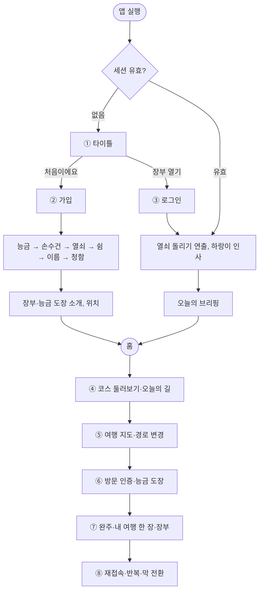
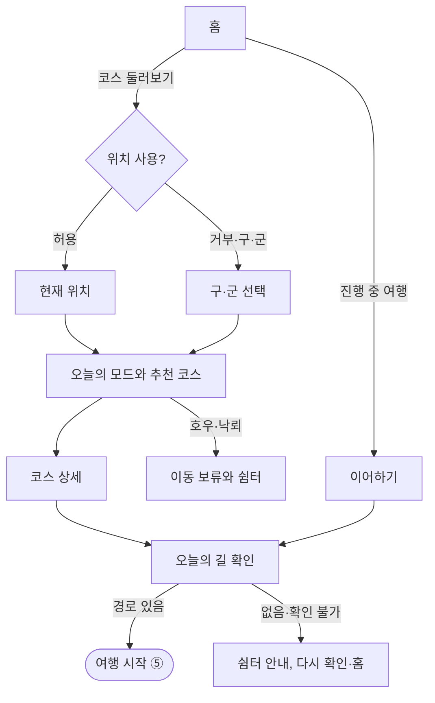
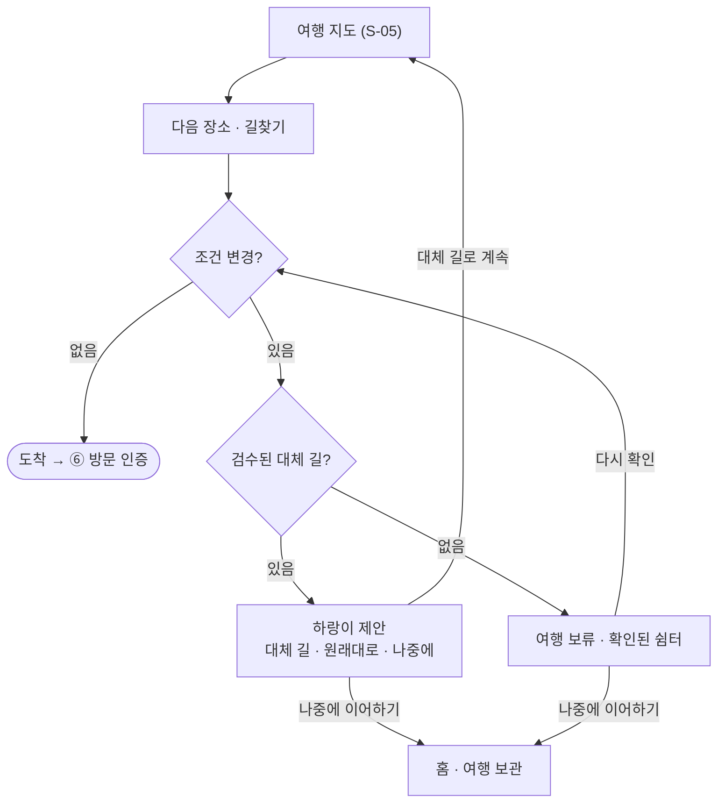
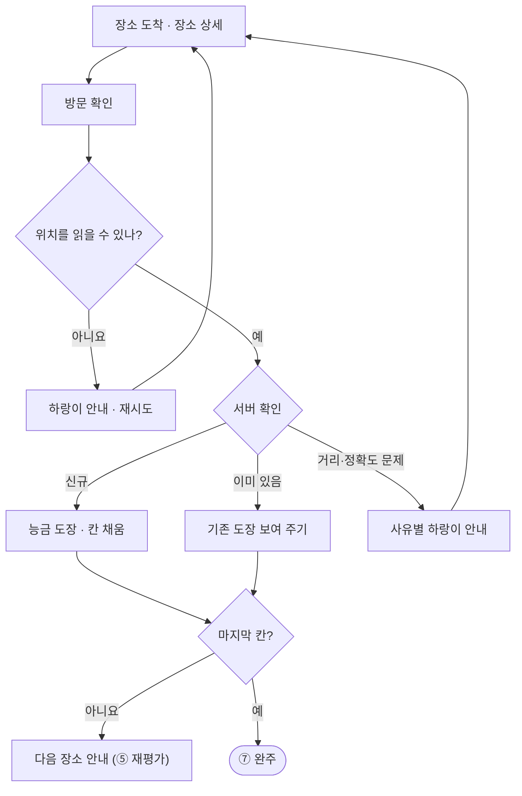
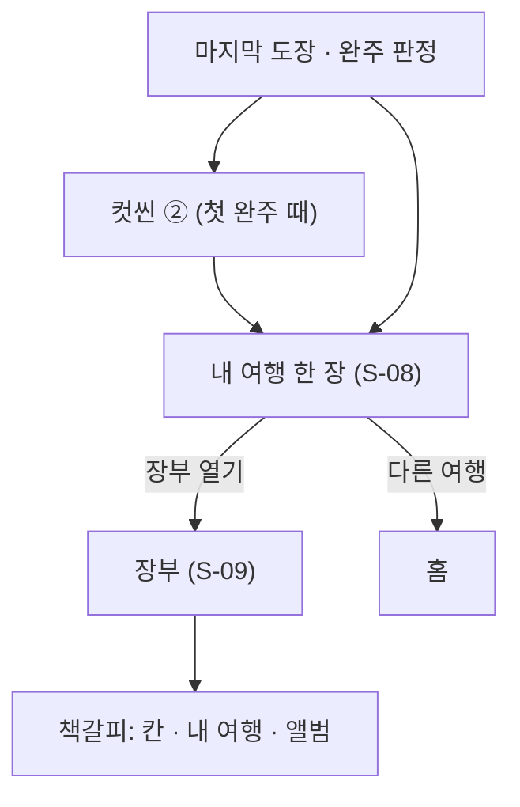
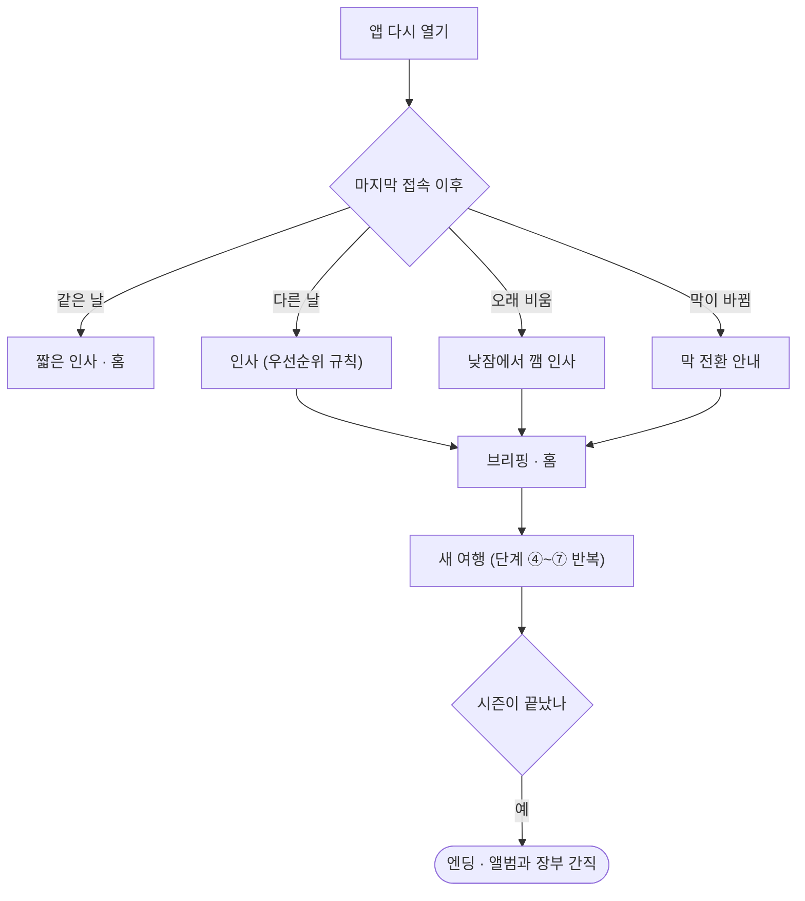

# 게임 흐름 스토리 v1 (타이틀부터 홈까지)

- 작성일: 2026-11-16
- 상태: 단계 ①~⑧ 초안 (전 단계 초안 완료). 확정 항목은 `[확정]`, 나머지는 창작 후보이며 결정은 팀이 합니다.
- 짝 문서: brand/worldview.md (세계관), brand/character/harangi_character.md (하랑이, 예문), brand/game_concept.md (컨셉), plan/spec/treagent_tech_spec_v1.md (화면 S-01~S-14, 기능 F-01~F-23)
- 표기: **사실** (근거 파일:행), **사용자 제공**, **창작** (후보), `[확인 필요]`
- 목적: 앱의 클릭 하나하나에 이야기를 입힙니다. 행마다 이용자 동작, 이야기 속 의미, 하랑이 대사·연출, 규칙을 적습니다.
- 대사는 승인 대사 후보 초안입니다 (명세 F-13). 최종 승인은 팀이 합니다. P1에서 LLM이 대사를 생성하더라도 harangi_character.md 7절 말투 규칙과 금칙어를 따릅니다 (dev/CLAUDE.md의 AI 절).

---

## 1. 이 문서가 따르는 전제

- 로그인 전 타이틀에서는 하랑이가 **보이지 않고** 꼬리, 능금, 닫힌 장부, 바람의 흔적만 보입니다. 로그인(가입)하면 앱이 장부의 창으로 열려 하랑이가 보입니다 (worldview.md 2-3절, 2-4절) `[확정]`.
- 장부 본문은 **열쇠**를 사람 손으로 돌려야 열립니다. 열쇠는 이용자의 주머니 깊숙이 있던 **손수건 안**에 싸여 있습니다 (worldview.md 5-5절) `[확정]`.
- 이용자는 처음에 **낯선 탐험가**이고, 첫 칸을 채운 뒤 **길동무**가 됩니다 (worldview.md 4-5절, 4-7절) `[확정]`.
- 이야기 속에서 하랑이는 이용자와 **단둘이** 다닙니다 (worldview.md 4-10절) `[확정]`.
- 용어: **능금 도장**은 스팟에서 방문 인증이 되면 장부 칸에 찍히는 것입니다. 하랑이가 들고 다니는 **능금**은 실제 과일이며 도장과 무관합니다 `[확정, 사용자 결정 2026-11-16]`. 다른 문서의 "능금 스탬프" 표기는 일괄 정리가 필요합니다 (별도 작업).
- 안전 정보(특보, 쉼터 운영 시간)는 이야기 설정보다 먼저이며 기준(시각, 운영 시간, AWS 여부)을 함께 적습니다 (CLAUDE.md).
- 이용자가 앱에서 직접 메모를 쓰는 일은 없습니다. 기록은 자동입니다 (worldview.md 4절).

## 2. 흐름 한눈에

- 대응: 명세 4-3 로그인·첫 만남 도식과 F-01, F-02, F-03, F-23, 화면 S-01, S-02, S-03, S-14. 순서가 바뀐 곳은 12절에 적었습니다.

---

## 3. 단계 ① 타이틀 화면 (로그인 전, S-01 앞면)

| 요소 | 연출 | 이야기 속 의미 |
|---|---|---|
| 로딩 | 바람이 화면을 한 번 지나갑니다 | 날씨 안내의 은유로 시작 (worldview.md 1절) |
| 타이틀 | "대프리카 히든 퀘스트 (가칭)" | |
| 배경 | 한지 질감 크림색에 능금 빨강 포인트 | 시각 방향 후보 1 (harangi_character.md 6-3절) `[결정 필요]` |
| 닫힌 장부 | 표지 가운데에 열쇠 구멍 (바람결 문양) | 열쇠가 있어야 열린다는 암시 |
| 꼬리 | 화면 모서리에서 크림색 꼬리 끝이 살랑이다 능금을 보고 쏙 숨음 | 하랑이는 있지만 아직 안 보임 |
| 능금 | 화면 아래에서 굴러와 로고 옆에서 멈춤 | 하랑이의 능금. 가입 뒤 같은 능금이 다시 굴러 장면이 이어짐 |
| 문구 | "하랑이와 함께 오늘 날씨에 맞는 길을 찾아 걸어요." | 확정 캐치프레이즈 |
| 버튼 (창작 후보 2개) | 후보 A: [장부 열기](기존), [처음이에요](신규). 후보 B: [로그인], [시작하기] | 후보 A는 이야기에 맞고, 기능은 작은 보조 글씨("로그인", "가입")로 분명하게 표시 |

- 하랑이 대사는 없습니다 (아직 보이지 않음). 소리를 쓴다면 바람 소리 정도입니다 (P0에서는 제외 가능, 명세 A-14).
- 필요한 에셋: 꼬리, 능금, 닫힌 장부(열쇠 구멍) 분리 이미지 (명세 A-03, A-04와 별도).

---

## 4. 단계 ② 신규 이용자: 가입과 첫 만남 (S-01 가입, S-02)

| # | 이용자 동작 | 이야기 속 의미 | 하랑이 대사·연출 | 규칙·주의 |
|---|---|---|---|---|
| 2-1 | [처음이에요] → 가입 화면 | 여행을 시작할 준비 | 하랑이 안 보임. 안내 문구는 짧게 (예: "하랑이와 걷기 전에 이메일과 비밀번호를 정해요") | 개인정보는 이메일·비밀번호만. 로그인 방식은 `[결정 D-01]` |
| 2-2 | [가입하기] 성공 | 장부의 창이 열림 | 타이틀에서 멈춰 있던 능금이 다시 굴러 들어오고 하랑이가 처음 나타남. "으앗, 기다려! 내 능금~!!" (혼잣말) | 가입 실패는 11절 |
| 2-3 | [능금 주워 주기] | 이용자가 먼저 하랑이를 도움 | "엇, 주워주신 거예요?! 고마워요... 후아, 너무 서둘렀는지 숨이 차네요!" 이파리가 처짐 | 숨을 고르는 정도로 가볍게 (CLAUDE.md 민감한 소재) |
| 2-4 | [주머니 열기] → 깊숙이 있던 손수건 → [건네기] | 이용자 쪽 호의 | 주머니를 뒤지는 짧은 연출 | 주머니는 이용자 인벤토리의 이름 (컨셉 문서 10절). 하랑이의 능금과 별개 |
| 2-5 | (자동) 하랑이가 손수건을 펼침 | 열쇠 발견. 이용자도 몰랐음 | "우와, 손수건이에요? 고마워요, 잠깐만 빌릴게요! ...어? 안에 뭐가 싸여 있어요. 열쇠?!" | 손수건은 빌린 상태가 됨 (5-5절) |
| 2-6 | [열쇠 받기] | 열쇠가 이용자 것이 됨 | "이 바람결 문양... 도사 짝만 가졌다던 열쇠예요! 제 장부는 한 번도 안 열렸거든요. 사람 손으로 돌려야 열린대요. 저, 이거 열어 줄 사람 계속 기다렸어요! 한번 돌려 주실래요?" | 열쇠는 주머니에 담기는 상징 1개 |
| 2-7 | [열쇠 돌리기] | 장부 본문이 처음 열림 | 열쇠가 돌아가며 날짜가 새겨지고 빈 칸이 펼쳐짐. "열렸다! {날짜}, 오늘 처음 열렸네요. 이제 바람 도사 실습을 시작할 수 있어요! 저 이날 기억할래요, 헤헤!" | 날짜는 서버 시각 기준. 날씨 확인 가능 시 함께 새김 |
| 2-8 | (자동) 그늘로 이동 | 둘이 함께 숨 돌림 | "일단 이쪽 그늘로 가요, 얼른! ...후아, 이제 좀 살겠다." 이파리 회복 | 지친 일의 이유는 꺼내지 않음 (컷씬 ①에서 암시) |
| 2-9 | 이름 입력 / [건너뛰기] | 이름을 묻는 첫 대화 | "그러고 보니 이름도 안 물어봤네요! 뭐라고 불러요?" | 건너뛰면 기본 이름 "길동무"를 이름 자리에 써서 "길동무 님"으로 부름. 길이·금칙어 규칙은 F-02 `[확인 필요]` |
| 2-10 | [같이 가요] (선택지 하나) | 파트너가 됨 | "{이름} 님! 저는 하랑이예요, 바람 도사 견습생! 언젠가 진짜 도사가 될 거예요, 후훗! 열쇠로 장부를 열어 준 사람이랑 다니면 실습을 무사히 마친다는 얘기가 있거든요. 저, 그 사람 기다렸어요! 마침 오늘 같은 조건은 칸이 비어 있었어요. 같이 가 줄래요, 탐험가 {이름} 님?" | 이 이야기는 견습생들 사이의 창작 설정이며 대프리카 전승처럼 말하지 않음. 가짜 선택지를 만들지 않음. 청함은 "탐험가 {이름} 님", 이름을 건너뛰면 "길동무 님". 공식 길동무 호칭은 첫 칸 뒤(예문 12) |
| 2-11 | (자동) 장부·능금 도장 소개 | 칸과 도장의 의미 | "이게 제 장부예요. 칸 하나가 한 곳, 한 날씨예요. 스팟에 도착하면 여기에 능금 도장이 찍혀요! 아직 다 비었어요, 같이 채워요!" | 연습용 가짜 칸은 만들지 않음 (기록이 거짓이 됨) |
| 2-12 | [현재 위치 사용] / [구·군 선택하기] | 오늘의 길을 고르기 위한 질문 | "오늘의 길을 고르려면 어디쯤인지 알아야 해요. 위치는 앱 쓰는 동안만 쓰고 저장은 안 해요!" | 거부해도 구·군 선택으로 진행. 좌표는 저장하지 않음 (F-23). 앱의 기존 위치 화면 사용 |
| 2-13 | (자동) 오늘의 바람 한마디 | 날씨에 맞는 길이 있다는 첫 안내 | 오늘 날씨와 모드를 한 줄로. 폭염특보면 안전 안내가 먼저 (예문 4) | 기준 시각 표시. 확인 불가면 승인 대사와 쉼터 안내 (명세 T-08) |
| 2-14 | [홈으로] | 여행 시작 전 | 호칭은 아직 "탐험가 {이름} 님"(이름을 건너뛰면 "길동무 님"). 첫 칸을 채우면 "제 공식 길동무" (예문 12) | 코스 선택은 홈에서 시작 (튜토리얼 이탈 방지) |

- 대사는 한 번에 1~2문장입니다. 길어지면 교육적으로 느껴지므로 줄입니다.
- **기다림 설정 `[확정, 사용자 결정 2026-11-16]`**: 하랑이는 장부를 열어 줄 사람을 기다리고 있었고 오늘 이용자를 만나 실습을 시작할 수 있게 됩니다. 2-6 대사 끝의 "저, 이거 열어 줄 사람 계속 기다렸어요!", 2-7의 "이제 바람 도사 실습을 시작할 수 있어요!", 2-10의 "저, 그 사람 기다렸어요!"로 반영했습니다. "한참" 대신 "계속"을 써서 기간을 정하지 않습니다 (하랑이는 막 견습생이 된 설정). "당신이 처음" 같은 독점 표현은 쓰지 않습니다 (worldview.md 4-6절).
- 소요: 화면 14행이지만 자동 장면이 많아 이용자 탭은 6~7번입니다.
- 중간 종료 시: 열쇠를 돌리기 전에 앱을 닫으면 처음부터, 이후에 닫으면 이어서 시작하는 안을 제안합니다 `[확인 필요: FE, BE]`.
- 첫 방문 플래그는 2-7(열쇠 돌리기) 완료 때 올리는 안을 제안합니다 `[확인 필요]`.

---

## 5. 단계 ③ 기존 이용자: 로그인과 오늘의 브리핑 (S-01, 홈 앞)

| # | 이용자 동작 | 이야기 속 의미 | 하랑이 대사·연출 | 규칙·주의 |
|---|---|---|---|---|
| 3-1 | [장부 열기] → 로그인 화면 | 장부를 열러 옴 | 하랑이 안 보임. 입력 화면은 간결하게 | 세션이 유효하면 이 화면을 건너뜀 (F-01) |
| 3-2 | [로그인] 성공 | 열쇠를 돌려 장부를 엶 | 열쇠를 돌리는 1초 안팎 연출. 새겨진 날짜가 스쳐 지나감 | 세션이 유효해 로그인을 건너뛴 경우는 더 짧게 |
| 3-3 | (자동) 하랑이 인사 | 다시 만남 | 기본: "어서 와요, {이름} 님!" (아래 변형 참조) | 이름 규칙은 4-7절 그대로 |
| 3-4 | (자동) 오늘의 브리핑 | 바람 도사 견습의 일 | 하랑이의 바람 한마디, 오늘 기온·체감, 특보 여부, **기준 시각**, 기상 기준 지점(AWS 여부), 오늘의 모드와 한 줄 방향 | 브리핑 기온의 기준(현재 위치/구·군)은 `[확인 필요]` |
| 3-5 | [홈으로] / [건너뛰기] | | 브리핑은 하루 한 번 전체, 이후는 짧게 | **폭염특보면 건너뛸 수 없음** (예문 4). 확인 불가면 승인 대사와 쉼터 안내 |
| 3-6 | 홈 | 오늘의 길로 | 진행 중인 여행이 있으면 "이어하기"를 앞에 둠 | F-03 |

**3-3 인사 변형**
| 상황 | 대사·연출 | 근거 |
|---|---|---|
| 첫 여행 뒤 처음 다시 열었을 때 | **손수건 반납**: "어서 와요! 이거 지난번에 빌린 손수건이에요. 깨끗이 빨아서 바짝 말렸어요, 헤헤!" (후보 A) / "앗, 왔어요! 손수건 돌려줘야 하는데... 잠깐만요, 여기 있어요! 열심히 빨았어요, 후훗!" (후보 B) | 첫날은 계속 함께 다녀 빨 시간이 없었음 (사용자 결정) |
| 한동안 비웠다 돌아왔을 때 | **낮잠에서 깸**: "으음... 5분만... 앗, 벌써 왔어요?! 헤헤, 잠깐 눈 붙인다는 게 그만..." | 예문 17. 몇 분 이상 비운 경우인지 `[확인 필요]` |
| 같은 날 다시 열었을 때 | 짧은 인사만 하고 브리핑은 줄임 | 하루 한 번 원칙 |
| 호칭이 "탐험가"인 이용자(첫 칸 전) | "탐험가 {이름} 님"으로 부름. 이름을 건너뛴 이용자는 "길동무 님" | 4-7절 이름 규칙 |

## 6. 단계 ④ 홈, 코스 둘러보기, 오늘의 길 (S-03, S-14, S-04)

- 대응: 명세 4-4 ①②, F-03~F-06, F-23, 화면 S-03, S-04, S-14.
- 홈은 **펼친 장부의 오늘 페이지**로 표현하는 안을 제안합니다. 하랑이가 장부 옆에 앉아 있고, 오늘 조건의 빈 칸이 보입니다.

### 6-1. 홈 (S-03)

| # | 이용자 동작 | 이야기 속 의미 | 하랑이 대사·연출 | 규칙·주의 |
|---|---|---|---|---|
| 4-1 | 홈 도착 (브리핑 뒤) | 펼친 장부의 오늘 페이지 | 하랑이가 장부 옆에서 한마디 (6-4 변형 표) | 화면 구성은 명세 F-03 |
| 4-2 | (자동) 오늘의 칸 카드 | 오늘 조건(요일, 시간대, 날씨)에 맞는 칸이 비어 있음 (worldview.md 4-3절) | "오늘 이 조건의 칸이 아직 [N]곳 비어 있어요! 앞서 걸은 길동무는 [N]명이에요." | 숫자는 실제 집계만. 0이면 "아직 아무도 안 걸은 칸이에요!" (worldview.md 5-3절). 개인 식별 정보 없음 |
| 4-3 | [이어하기] (진행 중 여행이 있을 때) | 걷던 길을 이어 감 | "어서 와요! 아까 하던 길, 이어서 걸을까요?" → 오늘의 길 재확인(4-13) | 받은 능금 도장 유지 (F-06). 진행 중 여행이 있을 때 새 여행 허용 여부 `[결정 D-08]` |
| 4-4 | [코스 둘러보기] (진행 중 여행이 없을 때 주 버튼) | 오늘의 길을 고르러 감 | 4-7로 | |
| 4-5 | [장부] / [주머니] (홈에서 따로 들어감) | 기록과 이야기를 보거나, 내 물건을 봄 | 단계 ⑦에서 작성 | 장부 안에 책갈피 [칸] [내 여행] [앨범], 주머니는 물건 (9-2절). 열쇠는 주머니의 상징 1개 |
| 4-6 | [내 계정] | 이름 바꾸기, 로그아웃 | 이름을 바꾸면 "이제 {새 이름} 님이라고 부를게요!" / 로그아웃은 장부를 덮는 연출과 "또 만나요!" | 열쇠에 새긴 날짜는 그대로. 로그아웃하면 타이틀로 돌아가 하랑이가 다시 안 보임 (F-12) |

### 6-2. 코스 둘러보기 (S-14)

| # | 이용자 동작 | 이야기 속 의미 | 하랑이 대사·연출 | 규칙·주의 |
|---|---|---|---|---|
| 4-7 | [코스 둘러보기] → 위치 확인 | 오늘의 길을 고르려면 어디쯤인지 필요 | 이미 허용한 경우 "어디쯤인지 볼게요!", 처음이면 튜토리얼(2-12)과 같은 문구 | 좌표는 추천 계산에만 쓰고 저장하지 않음. 앱 쓰는 동안만 사용 (F-23) |
| 4-8 | [현재 위치 사용] / [구·군 선택하기] | | 거부·실패: "괜찮아요! 구·군을 골라 줄래요?" | 위치 허용을 기다리지 않고 두 버튼을 같이 보여 줌 (현재 앱 방식). 입력 방식 `[결정 D-23]` |
| 4-9 | (자동) 오늘의 모드 판정 | 하랑이가 바람을 읽음 | "바람 읽는 중이에요... 킁킁!" | 결과는 **항상 실제 기상 데이터와 같게** 말함 (바람 냄새 규칙, harangi_personality_v1.md) |
| 4-10 | 추천 코스 목록 보기 | 하랑이가 오늘 맞는 길을 골라 둠 | 카드마다 한 줄 사유. 예: "오늘은 그늘이 많은 길이 맞아요!" / "실내 위주로 골랐어요. 더운 날엔 이게 맞아요, 진짜로!" | 카드에 기준 시각 표시. 사유는 승인 대사의 빈칸 채우기 (F-23). 위치 있으면 거리순, 없으면 선택한 구·군 |
| 4-11 | [코스 선택] | 가 볼 길을 정함 | "이 길 좋아요! 자세히 볼까요?" | 추천 단위는 코스 `[결정 D-24]` |

- 카드 구성(제안): 코스 이름, 걸리는 시간(30·60·90분 중 하나, plan/daeprica_hidden_quest_plan.md:148), 실내·그늘·야외 아이콘, 하랑이의 한 줄 사유, 기준 시각, 앞서 확인한 길동무 수(합계).
- 트랙 구분: 기본 트랙(가칭 "스탬프 코스")을 먼저 보여 줍니다. 미스터리 코스(가칭)는 P1이라 준비 중으로 표시합니다 (컨셉 문서 2-5절).
- 순서는 권장이고 바꿔도 인증되는 안(컨셉 문서 2-3절 후보 A)을 따라 "추천 순서"로 표기합니다 `[결정 D-07]`.

### 6-3. 코스 상세와 오늘의 길 (S-04)

| # | 이용자 동작 | 이야기 속 의미 | 하랑이 대사·연출 | 규칙·주의 |
|---|---|---|---|---|
| 4-12 | 코스 상세 보기 | 하랑이가 짠 방문 순서 | 코스 소개 한마디 + 장소마다 한 줄 | 테마, 소요 시간, 출발 장소, 장소별 출처·확인일 (F-04). 데모 코스 A의 이야기("사라진 비밀 레시피")는 구컨셉이라 새로 써야 함 `[창작]` |
| 4-13 | [오늘의 길 확인] | 오늘 날씨에 맞는지 마지막 확인 | "한 번 더 바람 읽을게요!" → 확인 중 | 날씨, 특보, 도착 예정 시각, 운영 시간 확인 (F-05) |
| 4-14 | 결과: 경로 있음 | 오늘의 길이 정해짐 | "오늘의 길이에요! [사유]. 첫 곳은 [스팟]이에요. [기준 시각] 기준이에요!" | 기준 시각과 사유 표시. 야외 구간은 연속 15분 이하 (plan:145) |
| 4-15 | [여행 시작] | 길동무와 첫 걸음 | 첫 칸 전: "첫 칸 채우러 가요!" / 이후: "가요, 가요!" | 여행 상태가 '진행'이 됨 (F-06). 단계 ⑤로 이어짐. 버튼 문구는 [같이 걸어요!] / [여행 시작] `[창작 후보 2개]` |
| 4-16 | 결과: 경로 없음·확인 불가 | 오늘은 쉬는 날 | "엇, 오늘 바람이 잘 안 읽혀요... 확인된 쉼터부터 알려 줄게요. 이따 다시 확인해요!" + [다시 확인] / [홈으로] | 추측하지 않음 (명세 T-08) |

### 6-4. 홈 한마디 변형

| 상황 | 대사 후보 |
|---|---|
| 첫 칸 전, 일반 날씨 | "첫 칸 채우러 가요! 오늘 바람이 좋아요!" |
| 첫 칸 뒤, 일반 날씨 | "{이름} 님, 오늘은 어느 길로 갈까요?" |
| 선선한 저녁 | 예문 2 계열: "우와, 오늘 바람 진짜 좋은데요?! 이런 날은 해 지고 나서 걷는 게 딱이죠!" |
| 더운 날(그늘·실내 모드) | "오늘은 쉬엄쉬엄 가요! 실내 길로 골라 놨어요." |
| 폭염특보 | 예문 4 계열. 야외 길 안내를 멈추고 [쉼터 보기]를 앞에 둠. 기준 시각과 운영 시간 포함 |
| 호우·낙뢰 | 신규 이동 보류, 확인된 쉼터. "으악, 오늘은 밖에 나가면 안 돼요! 이건 양보 못 해요!" |
| 진행 중 여행 있음 | "어서 와요! 아까 하던 길, 이어서 걸을까요?" |

- 위 대사는 P0에서는 승인 대사이고, P1에서 LLM이 생성해도 같은 말투 규칙(harangi_character.md 7절)과 금칙어를 따릅니다 (dev/CLAUDE.md의 AI 절).
---

## 7. 단계 ⑤ 여행 시작, 여행 지도, 경로 변경 (S-05, S-07)

- 대응: 명세 4-4 ②, F-06~F-08, F-19, 화면 S-05, S-07. 재경로는 `dev/CLAUDE.md` 규칙에 따라 **제안만 하고 자동으로 바꾸지 않습니다.**
- 하랑이의 이동 방식은 옆에서 걷기가 기본이고, 쉬는 장면에서는 어깨나 가방에 올라타는 안입니다 (harangi_character.md 6-4절, 결정 대기).

### 7-1. 여행 시작과 여행 지도 (S-05)

| # | 이용자 동작 | 이야기 속 의미 | 하랑이 대사·연출 | 규칙·주의 |
|---|---|---|---|---|
| 5-1 | [여행 시작] 직후 | 오늘 걸을 칸들이 장부에 한 줄로 펼쳐짐 | "출발해요! 첫 곳은 [스팟]이에요!" 하랑이가 지도 화면 아래에서 이용자 옆을 총총 걸음 | 여행 상태 '진행' (F-06) |
| 5-2 | 여행 지도 보기 (자동) | 오늘 걸을 칸과 받은 도장을 한눈에 | 진행률, 다음 장소 카드(이름, 실내·야외, 도착 예정 시각, 운영 상태, 인증 지점 설명) | 도장 슬롯은 능금 도장이 찍히는 자리 (F-10). 진행률은 여행 1회 기준이며 공동 장부 비율과 별개 (worldview.md 5-4절) |
| 5-3 | [길찾기] | 외부 지도 앱으로 길을 찾음 | "지도 앱 열어 줄게요! 저는 옆에서 따라갈게요!" | 열기 실패 시 "지도가 안 열려요... 주소로 알려 줄게요!" + 주소와 인증 지점 설명 (F-07) |
| 5-4 | 걷는 동안 앱을 다시 열기 | 하랑이가 옆에서 걷고 있음 | 짧은 한마디. 안전과 무관한 곳에서만 한눈팔기(예문 2). 설계된 그늘·실내 지점 근처에서는 이파리가 처지며 쉼을 권함 ("제 이파리가 처졌어요, 같이 쉴까요?", 예문 18) | 이파리는 하랑이 자신의 신호 연출이며 이용자의 건강 상태를 판단하지 않음. 쉼 권유 지점은 코스에서 정함 `[결정 필요]` |
| 5-5 | 추천 순서와 다른 곳에 먼저 도착 | 순서는 권장 | "엇, 이쪽 먼저요? 좋아요, 이 길도 좋아요!" | 순서 자유 여부 `[결정 D-07]` (컨셉 문서 2-3절 후보 A) |
| 5-6 | 다음 장소에 가까워짐 | 도착을 알아챔 | "다 왔어요! [방문 확인]을 눌러 봐요!" | 도착 판정을 기기에서 할지 서버에서 할지 `[결정 필요]` (dev/CLAUDE.md). 인증은 단계 ⑥ |
| 5-7 | [여기서 그만하기] | 오늘은 여기까지 | "괜찮아요, 오늘은 여기까지! 받은 도장은 그대로 장부에 있어요!" | 명세에 중단 흐름이 없음. 여행 상태 '보류'와 같게 처리하는 안 `[확인 필요]` |

### 7-2. 조건이 바뀌었을 때 (S-07)

- 재평가 시점: 다음 장소를 안내할 때, 앱이나 지도에서 돌아올 때 (F-08). 날씨 확인 주기와 위치 이탈 기준은 아직 정해지지 않았습니다 `[결정 필요]` (dev/CLAUDE.md).
- 이 흐름의 하랑이는 사유를 설명하고 **제안**하며, 이용자의 선택을 기다립니다.

| 상황 (사유) | 하랑이 제안 대사 | 선택지 | 규칙·주의 |
|---|---|---|---|
| 장소 휴관·운영 변경 | "엇, [스팟]이 오늘 문을 닫았대요! 바로 옆 [대체 스팟]은 열려 있어요. 그쪽으로 갈까요?" | [대체 길로 계속] [나중에 이어하기] | 운영자가 바꾼 상태가 다음 재평가 때 반영됨 (F-08, F-18). 푸시는 P1 (F-21) |
| 폭염특보 | 예문 4 계열. "으아, 폭염특보가 떴어요! [기준 시각] 기준이에요. 바깥 길은 멈출게요. 가까운 쉼터는 [운영 시간]까지 열려 있대요!" | [실내 길로 계속] (있을 때) [쉼터 보기] [나중에 이어하기] | 기준 시각과 운영 시간 필수. "원래 길 유지"는 보여 주지 않는 안 `[결정 필요]` |
| 호우·낙뢰 | "으악, 밖에 나가면 안 돼요! 이건 양보 못 해요!" | 이동 보류와 확인된 쉼터 | 신규 이동 보류 (F-23) |
| 날씨 변화 (일반) | "엇, 바람이 바뀌었어요! 이쪽 그늘 길이 더 맞아요. 바꿔 볼까요?" | [대체 길로 계속] [원래대로 계속] [나중에 이어하기] | 안전 위험이 없는 변화일 때만 "원래대로" 선택 가능 |
| 혼잡 | "여기 사람이 너무 많대요! 조금 돌아서 갈까요?" | 위와 같음 | 혼잡 분산 모드 (storyboard/20261110_game_storyboard_v1.md A-3) |
| 위치 이탈 | "어라, 길이 달라졌네요! 괜찮아요, 다시 찾아볼까요?" | [원래 길로 돌아가기] [여기서 길 다시 짜기] | 이용자를 탓하는 말은 쓰지 않음. 이탈 기준(거리, 시간)은 `[결정 필요]` |

| # | 이용자 동작 | 이야기 속 의미 | 하랑이 대사·연출 | 규칙·주의 |
|---|---|---|---|---|
| 5-8 | [대체 길로 계속] | 남은 칸만 바뀜 | "좋아요! 받은 도장은 그대로예요. 남은 길만 바꿨어요!" | 남은 경로만 교체하고 도장·방문 기록 보존 (F-08). 제안의 경로 버전이 서버와 다르면 무효 (dev/CLAUDE.md 절대 규칙 5) |
| 5-9 | [원래대로 계속] | 이용자가 직접 정함 | "알겠어요! 대신 힘들면 바로 말해 줘요!" | 안전 위험이 없는 경우에만 (위 표) |
| 5-10 | [나중에 이어하기] | 오늘은 장부에 접어 둠 | "알겠어요, 장부에 접어 둘게요. 이따 다시 읽어요!" → 홈 | 여행 상태 '보류', 도장 보존 (F-06). 돌아오면 홈의 이어하기 (4-3) |
| 5-11 | 대체 길 없음 | 오늘은 쉬는 날 | "으악, 오늘은 이어 갈 길이 없어요... 확인된 쉼터에서 쉬어요! 이건 양보 못 해요!" + [다시 확인] [나중에 이어하기] | 추측하지 않음. 쉼터는 운영 시간과 기준 시각 포함 (명세 T-03, T-08) |

- 푸시(P1)가 켜지면 문구는 "[스팟]에 변화가 생겼어요. 같이 다시 확인해요!" 정도로 짧게 둡니다. 하랑이가 자기 이름으로 자신을 부르지 않는 규칙을 알림에도 적용합니다. 알림을 거부해도 앱을 열면 같은 재평가 결과가 나옵니다 (명세 T-13).
- 중간에 앱을 닫았다 다시 열면 홈의 이어하기로 이어지고 도장이 그대로 보입니다 (명세 T-02).
---

## 8. 단계 ⑥ 방문 인증과 능금 도장 (S-06)

- 대응: 명세 4-5, F-09, F-10, 화면 S-06. 인증은 위치(GPS)가 P0이고 QR은 P2입니다 (F-16, 컨셉 문서 5-3절의 방식 결정은 보류).
- **능금 도장은 스팟이 찍어 주는 방문 증거**이고, 하랑이가 직접 찍지 않습니다. 하랑이의 능금(과일)과 무관합니다 `[확정]`. 도장은 실제 도장이 아니라 **앱 화면에서 찍히는 연출**이고, 문양은 스팟마다 다르지 않고 모두 같습니다 `[확정, 사용자 결정 2026-11-16]`. 스팟 이름과 날짜를 함께 새기는 안은 제안입니다 `[확인 필요]`.
- 서버가 소유권, 경로, 거리, 정확도, 측정 시각을 확인하고, 방문 저장과 완주 판정을 한 번에 처리합니다 (F-09). 좌표는 저장하지 않습니다 (dev/CLAUDE.md).

### 8-1. 인증이 될 때

| # | 이용자 동작 | 이야기 속 의미 | 하랑이 대사·연출 | 규칙·주의 |
|---|---|---|---|---|
| 6-1 | 도착해 장소 상세를 봄 | 스팟에 닿음 | "여기가 [스팟]이에요! [한 줄 소개] 저 [인증 지점]에서 눌러 봐요!" | 장소 이야기는 한두 문장만 (교육적으로 길어지지 않게). 근거 있는 검수 자료만 씀. 인증 지점이 실내일 때 출입구 같은 실외 지점으로 둘지 `[확인 필요]` (F-09) |
| 6-2 | [방문 확인] | 도장을 받으러 감 | "잠깐만요, 지금 어디 있는지 볼게요!" 확인 중 연출 | 좌표·정확도·측정 시각을 서버로 보냄. 화면에 좌표 숫자를 보여 주지 않음 |
| 6-3 | (자동) 신규 인증 성공 | 스팟이 길동무를 알아보고 도장을 찍어 줌 | 능금 도장이 칸 위로 내려와 찍히고 스팟 이름과 날짜가 남음. 하랑이가 장부에 한 줄을 적음. 예문 6: "찍었다! 이 시간대 이 자리는 장부에 처음이에요. 헤헤, 한 칸 채웠어요!!" | 칸의 한 줄은 연출이고 안내 정보는 검수된 DB에서만 (worldview.md 5-3절). 이용자는 아무것도 쓰지 않음 |
| 6-4 | (자동) 이번이 첫 칸일 때 | 낯선 탐험가가 길동무가 됨 | 예문 12: "한 칸 채웠어요! 히히, 이제 {이름} 님은 탐험가가 아니라 제 공식 길동무예요!" 이어서 "이 칸은 {이름} 님이랑 처음 채운 칸이에요!" | 이름을 입력한 이용자는 이 시점부터 "길동무 {이름} 님". 이름을 건너뛴 이용자(이미 "길동무 님")에게는 "한 칸 채웠어요! 히히, 이제 정식으로 제 공식 길동무예요!"로 말함 `[확인 필요]` (worldview.md 4-7절). 호칭 변경은 한 번만 |
| 6-5 | (자동) 두 번째 이후 칸 | 길이 이어짐 | "한 칸 더 채웠어요! 이 길은 길동무 [N]명이 확인했어요." (N이 1 이상일 때) | 숫자는 실제 집계만. 0이면 "아직 아무도 안 걸은 칸이었는데, {이름} 님이 처음 채웠어요!"가 되며 독점 표현은 쓰지 않음 |
| 6-6 | (자동) 첫 쉼터에 도착 | 하랑이가 지친 일을 슬쩍 비침 | **컷씬 ①** 재생. 예문 13: "후아, 여기 그늘 좋죠? ...사실 저, 견습생이 되기 전에 서두르다 한참 앉아 있어야 했거든요. 아, 아니에요, 그 얘기는 나중에요!" | 미리 만든 고정 컷씬, 첫 여행에서 한 번 (worldview.md 3-5절). 재생한 컷씬은 앨범에 저장 (9-2절). 가볍게 쓰고 쓰러지는 연출은 쓰지 않음 |
| 6-7 | (자동) 이미 도장을 받은 곳 | 이미 와 본 칸 | "어라, 여기는 이미 도장이 찍혀 있어요! 장부에 그대로 있어요." | 같은 여행·장소는 한 번만 저장되고 기존 기록을 보여 줌 (F-09 멱등) |
| 6-8 | (자동) 마지막 칸이 아닐 때 | 다음 칸으로 | "다음은 [스팟]이에요! [운영 상태]" | 다음 장소 안내 시점에 재평가 (단계 ⑤ 7-2절) |
| 6-9 | (자동) 마지막 칸일 때 | 길을 다 걸음 | 단계 ⑦ 완주로 이어짐 | 완주 판정은 방문 저장과 같은 처리 (F-10) |

### 8-2. 인증이 안 될 때 (명세 장면 코드 `gps`)

| 상황 (응답) | 하랑이 대사 | 선택지 | 규칙·주의 |
|---|---|---|---|
| 위치 권한 거부 | "위치를 못 읽어서 도장을 못 찍어요... 설정에서 허용해 줄 수 있어요?" | [설정 열기] [돌아가기] | 설정에서 돌아오면 다시 시도됨 (명세 T-04). 앱을 쓰는 동안만 위치를 씀 |
| 위치 읽기 실패 | "엇, 지금 위치가 잘 안 잡혀요! 하늘이 트인 곳에서 다시 해 볼래요?" | [다시 시도] | 실내에서 오차가 큼 `[확인 필요]` |
| 너무 멀다 (`too_far`) | "아직 [스팟]이 아니에요! 조금만 더 가까이 와 줘요. 인증 지점은 [설명]이에요!" | [다시 확인] | 인증 반경 수치는 현장 시험 후 정함 `[결정 D-05]`. 수치는 대사에 쓰지 않음 |
| 정확도 부족 (`low_accuracy`) | "위치가 흐릿해요... 잠깐 기다렸다가 다시 눌러 볼까요?" | [다시 시도] | |
| 경로가 바뀜 (`route_changed`) | "어라, 길이 바뀌었어요! 다시 확인할게요." | 단계 ⑤의 재평가로 | 경로 버전이 다르면 인증하지 않음 (dev/CLAUDE.md) |
| 세션 문제 (`auth_required`) | "다시 열쇠를 돌려 줄래요? 걸은 길은 그대로예요!" | [로그인] | 재로그인하면 같은 여행이 복구됨 (명세 T-06) |
| 응답이 오지 않음 | "잠깐만요, 장부를 다시 볼게요... 도장이 찍혀 있네요!" / "아직 안 찍혔어요, 한 번 더 해 봐요!" | 자동 재조회 후 필요할 때만 재시도 | 장부 재조회를 먼저 하고 기록이 없을 때만 재요청 (명세 T-05) |

- 오류 대사에서 이용자를 탓하지 않습니다. 감정은 크게 드러내되 안내는 정확하게 씁니다.
---

## 9. 단계 ⑦ 완주, 내 여행 한 장, 장부와 주머니 (S-08, S-09)

- 대응: 명세 4-6, F-10, F-11, 화면 S-08, S-09. 서버가 방문 저장과 같은 처리에서 완주를 판정합니다.
- 완주의 단위는 시즌이 아니라 **이용자의 여행 1회**이며, 한 장은 실제로 방문한 장소와 날짜만 담습니다 (worldview.md 5-4절, F-10). 대체 길로 완주해도 마찬가지입니다. 경로별 완주 조건은 `[결정]`입니다 (F-10).
- 이 단계에서는 도사 인정 진행률을 보여 주지 않습니다 (도사 인정 방식 보류, worldview.md 3-2절).

### 9-1. 완주와 내 여행 한 장 (S-08)

| # | 이용자 동작 | 이야기 속 의미 | 하랑이 대사·연출 | 규칙·주의 |
|---|---|---|---|---|
| 7-1 | (자동) 마지막 도장이 찍힘 | 오늘 걸을 칸이 모두 채워짐 | 길 위의 칸들이 한 줄로 이어지며 빛남 | 완주 판정은 서버. 방문 저장과 같은 처리 (F-10) |
| 7-2 | (자동) **첫 완주**일 때 컷씬 ② | 하랑이가 쉬어 가게 하고 싶은 이유가 풀림 | 납작만두 가게 앞 그늘 회상 (아래 컷씬 초안) | 미리 만든 고정 컷씬. 재생 시점은 `[결정]`(아래). 건너뛰어도 앨범에 저장됨 (9-2절) |
| 7-3 | (자동) 하랑이의 마무리 | 오늘 걸은 길이 한 장이 됨 | "다 걸었어요! 우와, 오늘 길이 한 장이 됐어요!! 후훗, 여기 {이름} 님의 한 장이에요!" | 호칭은 "{이름} 님"(이미 길동무) |
| 7-4 | 내 여행 한 장 보기 | 오늘 한 일을 돌려받음 | 하랑이가 한 줄을 돌려줌: "오늘은 이 칸들을 채웠어요! 제 장부에 이 시간 그늘이 하나 늘었어요!" | 카드에는 날짜, 걸은 장소, 능금 도장, 오늘의 날씨 한 줄(기준 시각), 하랑이의 한 줄 (A-11). 좌표는 담지 않음 |
| 7-5 | (첫 여행만) 헤어짐 인사 | 손수건 반납의 씨앗 | "오늘은 여기까지 해요, 푹 쉬어요! 이건 양보 못 해요! 손수건은 제가 빨아 둘게요. 다음에 오면 돌려줄게요!" | 첫날은 빨 시간이 없어 다음 접속 때 반납 (단계 ③ 인사 변형). 완주 뒤 바로 다음 여행을 권하지 않고 쉼을 먼저 권함 |
| 7-6 | [장부 열기] | 내 기록을 보러 감 | 하랑이가 장부를 펼쳐 줌 | 9-2절로 |
| 7-7 | [다른 여행] | 다음 길을 고르러 감 | "또 걸어 볼래요? 오늘은 쉬어도 좋아요!" | 같은 날 연속 이용은 막지 않지만 쉼 권유를 먼저 보임 `[확인 필요]` |
| 7-8 | [공유하기] (후보) | 한 장을 자랑함 | "자랑해도 돼요! 후훗!" | 팀 논의 필요. 공유 이미지에 위치 정보(EXIF)와 정확한 장소·시각이 남지 않게 해야 함 (CLAUDE.md 개인정보). 발표 피드백의 카드 공유 제안과 연결 (plan/feedback/20261113_external_feedback_v1.md) |

- **컷씬 ② 재생 시점 (창작 후보 2개)**:
  - 후보 A **첫 여행 완주 직후 (추천)**: 한 번만 와도 쉬어 가게 하고 싶은 이유와 포쉐트의 유래를 알게 되어 개인 층이 한 편으로 끝맺습니다 (worldview.md 5-4절 후보 A와 이어짐).
  - 후보 B **두 번째 여행을 시작할 때**: 다시 오게 하는 이유가 되지만 한 번만 오는 이용자는 못 봅니다. 손수건 반납이 이미 재방문 이유라서 이야기가 몰릴 수 있습니다.
- **컷씬 ② 초안 (창작, 후보, 하랑이의 회상)** — 지친 일은 숨을 고르는 정도로 가볍게 쓰고, 가게 주인은 손이나 그림자로만 나옵니다 (worldview.md 3-5절):
  > 그때 저, 서두르다 더는 못 걷겠어서 가게 앞 그늘에 털썩 앉았어요. 그런데 거기에 의자랑 물 한 컵이 놓여 있었어요. 아무도 저를 못 봤을 텐데, 누가 쉬어 가라고 내놓은 것 같았죠. 옆에는 납작만두가 천 주머니에 싸여 있었고요. 그 주머니가 지금 제 포쉐트예요, 헤헤. 그날 생각했어요. 나도 누군가를 쉬게 해 주는 도사가 되고 싶다고!

### 9-2. 장부, 앨범, 주머니 (S-09)

- **구성 `[확정, 사용자 결정 2026-11-16]`**: 확인한 **사실**은 **장부**, 미리 만든 **이야기**는 **앨범**, 이용자가 받은 **물건**은 **주머니**입니다 (worldview.md 5-1절).

| 이름 | 안에 있는 것 | 홈에서 들어가는 곳 |
|---|---|---|
| 장부 | 책갈피 3개: [칸] 공동 장부의 칸, [내 여행] 내 여행 한 장 모음, [앨범] 고정 컷씬 | 홈 [장부] |
| 주머니 | 열쇠, 손수건, 배지·인증서 | 홈 [주머니] |

- [앨범]은 장부에 끼워 둔 장으로 종이 색을 달리 표현하고, **안내 정보가 없음**을 분명히 합니다. 안내에 쓰는 정보는 [칸]과 [내 여행](검수된 정보)에서만 나옵니다.
- 도장 모음 화면은 따로 두지 않고, [칸]의 "내가 채운 칸만 보기"로 대신합니다 (도장이 칸에 찍히는 설정과 맞고 화면이 하나 줄어듭니다).

| # | 이용자 동작 | 이야기 속 의미 | 하랑이 대사·연출 | 규칙·주의 |
|---|---|---|---|---|
| 7-9 | [내 여행] 책갈피 보기 | 지난 여행들이 한 장씩 쌓임 | 한 장 카드가 날짜순으로 쌓임. 하랑이: "벌써 이만큼 걸었어요!" | 본인 소유의 여행만 조회 (F-11) |
| 7-10 | 한 장 상세 보기 | 그날을 다시 봄 | 날짜, 장소, 도장, 하랑이의 한 줄. 재방문이면 예문 7 계열 한마디 | 장소와 도장은 실제 방문 기록만 |
| 7-11 | [칸] 책갈피 보기, "내가 채운 칸만 보기" | 장부의 칸들과 내가 찍은 도장을 봄 | 필터를 켜면 "이 도장들이 다 {이름} 님이 걸은 길이에요!" | 칸마다 상태 한 줄, 앞서 확인한 길동무 수, 내가 채웠다면 도장과 날짜. 명세 F-11의 "수집 스탬프 보기"를 이 필터로 대신함 |
| 7-12 | 홈의 [주머니] 열기 | 내가 가진 것 | 열쇠(날짜 각인 확인 가능), 손수건(반납 전에는 "하랑이가 빌려 감"), 배지·인증서(받았을 때) | 열쇠는 상징 1개, 모으는 재화가 아님. 인증서·배지는 잠정 (worldview.md 4-4절) |
| 7-13 | 열쇠를 눌러 봄 | 처음 열린 날을 떠올림 | "그 열쇠는 {날짜}에 처음 열렸어요. 저 이날 기억해요, 헤헤!" `[창작]` | 날짜는 새겨진 값이며 오늘 날짜로 말하지 않음. 첫날에만 "오늘 처음 열렸네요"를 씀 (예문 1-5) |
| 7-14 | 기록이 하나도 없을 때 | 아직 빈 장부 | "아직 빈 칸뿐이에요! 첫 길 걸으러 갈까요?" | 빈 상태 일러스트 (명세 A-12) |
| 7-15 | [앨범] 열기 (장부 안 책갈피) | 하랑이의 기억을 모아 둔 곳 | "이거, 제가 간직한 이야기예요. 좀 쑥스럽지만... 헤헤!" 해금한 컷씬이 장면 한 컷(썸네일)과 제목으로 나열됨 | 장부는 하랑이의 기록, 앨범은 하랑이의 기억. 해금한 것만 보임 `[확정]` |
| 7-16 | 컷씬 선택 → [다시 보기] | 그날의 장면을 다시 봄 | 같은 고정 컷씬을 재생하고 건너뛰기 가능. 끝나면 "다시 봐도 좀 쑥스럽네요!" | 에이전트가 생성하지 않는 고정 컷씬이라 매번 같음 (worldview.md 3-5절) |
| 7-17 | (자동) 컷씬을 처음 재생하거나 건너뛴 직후 | 앨범에 담김 | "이 이야기, 앨범에 넣어 둘게요!" 장부의 [앨범] 책갈피에 새 표시 | 건너뛰어도 저장됨. 앨범 위치는 첫 저장 때만 알려 줌 |
| 7-18 | 앨범이 비어 있을 때 | 아직 모은 이야기가 없음 | "아직 앨범이 비어 있어요! 같이 걸으면 이야기가 생겨요." | 컷씬 제목과 내용은 미리 보여 주지 않음(스포일러 방지). 빈 상태 일러스트 (명세 A-12) |

- **앨범 규칙 (사용자 결정 2026-11-16, 세부는 제안)**:
  - 위치: 장부 안의 책갈피로 둡니다. 장부를 펼치는 일이 하랑이와 이야기를 되짚는 일이 되고, 홈이 복잡해지지 않습니다. 홈에서 따로 들어가는 안은 쓰지 않습니다.
  - 저장 대상: 컷씬 ①(첫 쉼터), ②(납작만두 가게 회상)와 이후 추가되는 고정 컷씬입니다. 처음에는 2개로 시작해 제작 부담을 줄입니다.
  - 저장 시점: 재생이 시작되면 해금하고, 건너뛰어도 저장합니다. 완주 직후에 길게 보고 싶지 않은 이용자가 나중에 앨범에서 볼 수 있습니다.
  - 잠긴 칸 `[확정, 사용자 결정 2026-11-16]`: **해금한 것만 보입니다.** 게임 요소가 늘지 않고 스포일러를 막습니다. 잠긴 칸을 흐리게 보이는 안은 쓰지 않습니다 (앨범을 채워야 한다는 압박이 생김).
  - 저장 데이터 `[확정, 사용자 결정 2026-11-16]`: **로그인한 계정 기준**으로 컷씬 번호와 해금 시각만 저장하며 좌표는 없습니다. 기기를 바꿔도 같은 계정으로 로그인하면 앨범이 유지됩니다.
  - 공유: 컷씬 이미지 공유는 하지 않습니다. 한 장 공유(7-8행)와 함께 팀 논의 항목입니다.
  - 명세에는 앨범 화면이 없어 새 화면으로 추가해야 합니다 (12절).
- 권역 완주 배지(컨셉 문서 7절, 예문 10)는 시즌 공동 장부 규칙과 함께 P2라서 이 단계에서는 자리만 둡니다 (명세 F-17).
---

## 10. 단계 ⑧ 재접속, 반복, 막 전환

- 대응: worldview.md 4-10절(두 층 서사), 5-4절(여행 1회와 시즌), game_concept.md 3절(시즌 구조), 8절(엔딩).
- 이 단계는 **개인 층(여행 1회마다 끝맺음)** 과 **시즌 층(3막, 공동 장부)** 이 이어지는 곳입니다. 도사 인정 방식이 보류라서 엔딩은 틀만 잡았습니다.

### 10-1. 재접속 인사의 우선순위

| 순서 | 상황 | 하랑이가 먼저 꺼내는 말 | 비고 |
|---|---|---|---|
| 1 | 폭염특보, 호우·낙뢰 등 안전 | 안전 브리핑 (예문 4) | 항상 최우선이며 건너뛸 수 없음. 다른 인사와 함께 표시 |
| 2 | 첫 여행 뒤 처음 다시 열었을 때 (다른 날) | 손수건 반납 (예문 19) | 한 번만 |
| 3 | 막이 바뀐 뒤 처음 열었을 때 | 막 전환 안내 (10-3절) | 막이 바뀔 때마다 한 번 |
| 4 | 한동안 비웠다 돌아왔을 때 | 낮잠에서 깸 (예문 17) | 비운 시간 기준 `[확인 필요]` |
| 5 | 그 밖 | 기본 인사 "어서 와요, {이름} 님!" + 방문 기억 (10-2절) | |

- **한 번 접속에 안전을 뺀 이야기는 많아야 2가지**만 꺼냅니다. 설명서처럼 길어지지 않게 하고, 못 꺼낸 것은 다음 접속에서 이어 말합니다.
- 같은 날 다시 열면 인사만 짧게 하고 브리핑은 줄입니다 (단계 ③).

### 10-2. 반복해도 새롭게 (반복 이용자의 변주)

| # | 상황 | 이야기 속 의미 | 하랑이 대사·연출 | 규칙·주의 |
|---|---|---|---|---|
| 8-1 | 같은 스팟이지만 조건이 다름 | 같은 곳도 새 칸이 됨 | "어라, 여기 또 왔네요! 근데 지난번엔 오후였죠? 오늘은 아침이라 새 칸이에요!" | 칸은 스팟 × 날씨·시간대·요일이라 조건이 다르면 새 칸 (worldview.md 5-1절). 같은 조합이면 이미 찍힌 칸 (6-7행) |
| 8-2 | 방문 기억 꺼내기 | 하랑이가 이용자의 기록을 먼저 꺼냄 (4-3절 개인 장부) | 예문 7: "지난번엔 오후였죠? 그땐 그늘이 한 뼘도 없었는데 오늘은 좀 낫다!" | 내 여행 기록의 사실만. 계정 기준 |
| 8-3 | 방문이 쌓임 | 조심스럽던 사이가 편해짐 | 처음: "첫 칸 채우러 가요!" / 중간: "{이름} 님, 오늘은 어느 길로 갈까요?" / 자주: "또 왔네요! 이제 이 골목은 {이름} 님이 저보다 잘 알겠어요, 헤헤!" | 호감 수치나 게이지는 두지 않음. 단계를 나누는 횟수는 정하지 않음 `[확인 필요]` |
| 8-4 | (후보) 2막부터 오늘의 길을 먼저 짐작해 보기 | 이용자가 날씨와 시간을 읽는 눈이 생김 (worldview.md 4-10절) | "오늘은 어떤 길이 맞을 것 같아요? [실내] [그늘] [야외]" → 맞으면 "우와, 맞아요! 바람을 읽을 줄 아네요, 후훗!" / 틀리면 "아깝다! 오늘은 [모드]예요!" | 장난 요소이며 실제 추천은 규칙 엔진 결과 그대로 (틀려도 안전 안내 동일). 게임 요소 최소 방향과 맞는지 팀 논의 `[창작 후보]` |

### 10-3. 막 전환 (시즌 층)

- 이용자에게 보이는 막은 3개이고, 절기 6파트는 내부 단위입니다 (game_concept.md 3-2절). **앱 화면에는 파트 6개를 보이지 않고**, 절기 이름은 하랑이 대사에서만 가볍게 꺼냅니다.
- 막이 바뀐 뒤 처음 접속할 때 한 번, 한두 문장으로 안내합니다.

| # | 시점 | 이야기 속 의미 | 하랑이 대사·연출 | 규칙·주의 |
|---|---|---|---|---|
| 8-5 | 1막 → 2막 (7/23 이후 첫 접속) | 한여름으로 들어감 | "벌써 대서가 됐어요! 한낮엔 쉬엄쉬엄 가요. 새 길도 들어왔어요!" | 새 길 세트 안내. 지금까지 채워진 칸 합계(실제 집계) 한 줄 |
| 8-6 | 2막 → 3막 (8/23 이후 첫 접속) | 계절이 바뀌는 때 | "절기로는 처서래요! 바람이 슬슬 바뀌는 때라고 하더라고요. 새 길이 들어왔어요!" | 같은 규칙. 오늘 날씨의 사실은 브리핑이 말함 (절기 대사로 날씨를 단정하지 않음) |
| 8-7 | 전환 안내의 합계 | 함께 쌓은 칸을 돌아봄 | "여기까지 칸이 [N]곳 채워졌어요. 고마워요!" | 칸을 더 채우라는 요청 대사는 쓰지 않음 (worldview.md 5-3절 보조 규칙). 개인 식별 정보 없음 |

- 절기 날짜 중 소서·대서·백로는 대략의 날짜입니다 `[확인 필요: 한국천문연구원 월력요항]`. 삼복은 파트 안의 이벤트입니다.
- 막별 컷씬(5-4절 후보 B)을 쓸지는 팀 논의입니다. 채택하면 막이 바뀔 때 앨범에 새 컷씬이 해금되고, 채택하지 않으면 컷씬은 개인 진행으로 해금되는 ①②뿐입니다.
- **진행 중 여행과 막 전환**: 길 세트가 바뀔 때 이미 시작한 여행이 사라지지 않도록, 그 여행은 끝까지 걸을 수 있게 유지하거나 '보류'로 보관하는 안을 제안합니다 `[결정 필요]`.

### 10-4. 시즌 끝과 엔딩

- 하랑이의 도사 인정 방식은 보류입니다 (worldview.md 3-2절). 엔딩의 **틀**만 정하고 인정 연출은 후보별로 둡니다.

| # | 시점 | 이야기 속 의미 | 하랑이 대사·연출 | 규칙·주의 |
|---|---|---|---|---|
| 8-8 | 시즌 마지막 주 | 여름이 끝나 감 | "이번 여름도 곧 끝나요! 마지막 길도 같이 걸어요!" | 시즌 종료일은 추분 9/23 |
| 8-9 | 시즌 종료 뒤 처음 접속 | 엔딩 | 하랑이의 소감. 예문 11은 임시 대사이며 인정 방식(아래)에 따라 달라짐 | 비율·숫자는 정책이 정해진 뒤 표시 |
| 8-10 | 엔딩 화면 | 이번 여름을 정리함 | 내 여행 한 장의 개수, 걸은 날, 길동무 인증서(배지, 획득 조건 미정), 주머니의 열쇠(날짜 각인 그대로) | 인증서와 배지는 잠정 (worldview.md 4-4절) |
| 8-11 | 엔딩 뒤 접속 | 간직함 | 장부·앨범·주머니는 열람 가능. 새 길은 없음 안내: "또 만나요!" | 다음 시즌 계획은 정해지지 않아 "다음 계절" 같은 약속 표현은 쓰지 않음 `[확인 필요]` |
| 8-12 | 엔딩 이후의 목적 (떡밥) | 이야기가 이어질 여지 | 후보: 빈 칸 찾기(추천) / 장부 인계 (game_concept.md 8절) | 시즌 1에서는 떡밥만 남김 |

| 도사 인정 후보 (worldview.md 3-2절) | 엔딩 연출 |
|---|---|
| 1 공동 장부 칸 비율 | 시즌 마지막에 하랑이가 결과를 알림 (예문 11). 비율 표시 여부는 정책 결정 후 |
| 2 조건 없음, 소감만 달라짐 | 모든 이용자에게 인정 엔딩. 공동 장부 진행에 따라 소감 문구만 변동 |
| 3 이용자별 과목 통과 | 첫 완주 때마다 과목 통과 연출이 있고, 시즌 끝에는 개인 총정리가 엔딩. 이용자마다 엔딩 시점이 다름 |

### 10-5. 오랜만에 돌아온 이용자

| # | 상황 | 이야기 속 의미 | 하랑이 대사·연출 | 규칙·주의 |
|---|---|---|---|---|
| 8-13 | 막이 지나간 뒤 오랜만에 접속 | 놓친 시간을 짧게 알려 줌 | "오랜만이에요! 그 사이 바람이 많이 바뀌었어요. 지금은 [막 이름]이에요!" | 막 이름은 이야기용 제목이며 창작 `[결정 필요]`. 낮잠 인사와 겹치면 낮잠을 짧게 먼저 |
| 8-14 | 놓친 컷씬 | 이야기를 뒤늦게 봄 | 개인 진행으로 해금되는 컷씬은 시기와 무관하게 앨범에서 볼 수 있음 | 막별 컷씬을 채택하면 지나간 막의 컷씬도 해금할지 정해야 함 |
---

---

## 11. 단계 ①~⑧의 예외와 오류

| 상황 | 이야기 처리 | 비고 |
|---|---|---|
| 입력 오류 (이메일 형식 등) | 시스템 문구로 이유를 분명히 안내. 하랑이는 안 보임 | |
| 로그인 실패 | 장부가 살짝 흔들리고 "이메일 또는 비밀번호가 맞지 않아요" 같은 명확한 문구 + [다시 시도] | 명세 7-3의 `auth` 실패 대사는 하랑이 말풍선이라 이 설정과 맞지 않음. 시스템 문구로 바꾸는 조정 필요 `[확인 필요]` |
| 가입 실패 (이미 있는 이메일 등) | 같은 방식. 이미 가입했다면 [장부 열기]로 안내 | |
| 세션 만료 | 로그인 화면으로 돌아가 다시 열쇠를 돌림. 같은 계정의 여행이 복구됨 | F-01, T-06. 복구 후 하랑이 인사는 "다시 만났네요" 계열 후보 `[창작]` |
| 위치 권한 거부 | 하랑이: "괜찮아요! 그럼 구·군을 골라 줄래요?" | 로그인 후라 하랑이가 보임. 설정 열기는 명세 F-09와 같은 방식 |
| 날씨 확인 불가 | 추측하지 않음. 승인 대사 + 확인된 쉼터 | 명세 T-08 |
| 폭염특보 | 안전 브리핑이 먼저, 건너뛰기 불가, 기준 시각과 운영 시간 포함 | 예문 4 |
| 호우·낙뢰 | 신규 이동 보류 안내와 확인된 쉼터 | 명세 F-23 |
| 추천 코스 없음 | "엇, 오늘은 이 동네에 맞는 길이 없어요... 다른 구·군을 볼까요?" + [다른 구·군 보기], 쉼터 안내 | 명세 F-23 폴백 |
| 게시된 코스 없음 (운영자 미게시) | "아직 준비 중이에요! 조금만 기다려 줘요" 같은 빈 상태 | 빈 상태 화면 (명세 A-12) `[창작]` |
| 진행 중 여행이 있는데 날씨가 바뀜 | 이어하기 때 오늘의 길을 다시 확인하고, 변경이 있으면 단계 ⑤의 경로 변경 흐름으로 | 명세 F-08 |
| 시즌 시작 전(6/21 이전)에 접속 | 가입과 타이틀은 열리고 길은 "곧 열려요" 안내 | 시즌 시작 전 가입 허용 여부 `[확인 필요]` |
| 시즌이 끝난 뒤 접속 | 장부·앨범·주머니 열람, 새 길 없음 안내 (10-4절) | 다음 시즌 계획은 미정 |
| 막이 바뀔 때 진행 중이던 여행 | 끝까지 걷게 하거나 '보류'로 보관 (10-3절) | `[결정 필요]` |

---

## 12. 명세와 달라지는 점 (조정 필요)

- 순서: 명세 4-3은 "로그인 → 첫 만남 닉네임 → 홈"이고 현재 앱은 "로그인 → 위치 확인"이 첫 화면입니다. 이 문서는 "가입 → 첫 만남(능금·손수건·열쇠) → 위치 → 홈"입니다. 앱은 `dev/app/src/app/index.tsx`가 위치 화면이라 신규 이용자는 튜토리얼을 먼저 거치도록 바꿔야 합니다 `[확인 필요: 개발 담당]`.
- 닉네임 → 이름: 명세는 "닉네임"이고 이 문서는 "이름 입력(건너뛰기 가능)"입니다. 이름을 입력하면 "탐험가 {이름} 님"에서 "길동무 {이름} 님"으로 바뀌고, 건너뛰면 기본 이름 "길동무"를 써서 "길동무 님"입니다. 명세 F-02의 "건너뛰면 길동무"와 같은 방향입니다.
- 하랑이 로그인 전 표정: 명세 S-01은 하랑이 표정(차분)을 에셋으로 두지만, 이 문서는 로그인 전에 하랑이가 보이지 않습니다.
- 승인 대사 장면 코드(`auth`, `intro` 등)에 재접속 인사(`return`: 손수건 반납, 낮잠 깸)를 추가하는 안을 제안합니다 `[확인 필요]`.
- 홈의 "오늘의 칸" 카드(오늘 조건의 빈 칸과 앞서 확인한 길동무 수)는 명세 F-03에 없습니다. 세계관 4-3절 "오늘의 빈 칸"의 구현으로 추가를 제안합니다 `[확인 필요: 팀 동의]`.
- 데모 코스 A의 이야기("사라진 대구의 비밀 레시피", `dev/app/src/data/courseA.ts`)는 구컨셉(단서 탐정)이라 코스 소개문을 새 설정에 맞게 다시 써야 합니다. 장소 순서와 폭염 경로는 `[추정]` 그대로입니다.
- 명세 F-11은 "장부·주머니" 한 화면(S-09)과 "수집 스탬프 보기"를 두지만, 이 문서는 **장부(책갈피 3개)와 주머니를 나누고** 도장 모음을 [칸] 필터로 대신합니다 `[확인 필요: 팀 동의]`.
- 앨범(장부 안 책갈피)과 컷씬 해금 저장은 명세에 없는 화면·기능입니다. 새 화면(가칭 S-15 앨범)과 해금 기록 저장을 추가해야 합니다 `[확인 필요: 팀 동의, 개발 범위]`.
- 재접속 인사 우선순위, 막 전환 안내, 시즌 끝 엔딩 화면은 명세에 없습니다. 홈 앞 단계에 안내 화면과 엔딩 화면을 추가해야 합니다 `[확인 필요: 팀 동의, 개발 범위]`.
- 에셋 추가: 꼬리·능금·닫힌 장부 이미지, 손수건, 열쇠(로즈골드), 열쇠 구멍, 날짜 각인 연출.

## 13. 이 문서 이후 할 일

| 순서 | 할 일 | 비고 |
|---|---|---|
| 1 | 팀 논의로 14절의 결정 필요 항목 정리 | 서사 완결 방식, 도사 인정 방식, 방문 목적 받는 방식, 인앱 재화 등 |
| 2 | 하랑이 대사를 승인 대사 표(장면 × 상황 코드)로 옮기기 | 명세 7-3의 장면 코드에 `return`(재접속) 추가 제안 포함 |
| 3 | 컷씬과 에셋 제작 목록 만들기 | 컷씬 2개(① ②), 열쇠·손수건·꼬리·능금·닫힌 장부 이미지, 능금 도장 연출 |
| 4 | 기술 명세에 반영 | 첫 화면 순서, 이름 입력, 앨범 화면, 책갈피 구성 (12절) |
| 5 | 다른 문서의 "능금 스탬프" 표기를 "능금 도장"으로 일괄 정리 | 컨셉 문서, 소품 문서, 기획서, 기술 명세, 발표 자료 |
| 6 | 코스 소개문을 새 설정에 맞게 다시 쓰기 | 데모 코스 A의 이야기는 구컨셉 |

## 14. 결정 필요

- [x] 타이틀 요소(꼬리, 능금, 닫힌 장부, 바람), 첫 만남 흐름, 열쇠·손수건 (1~4절, worldview.md 5-5절)
- [ ] 타이틀 버튼 문구: 후보 A [장부 열기]/[처음이에요] / 후보 B [로그인]/[시작하기]
- [ ] 가입 안내 문구와 로그인 실패 문구 (UX 카피)
- [ ] 손수건 반납 대사: 후보 A / 후보 B, 같은 날 재접속 처리
- [ ] 튜토리얼 중간 종료 재개 위치, 첫 방문 플래그 시점
- [ ] 브리핑 기온의 기준(현재 위치/구·군)과 기준 지점 표시 방식
- [ ] 낮잠 인사가 나오는 비운 시간
- [ ] 명세 조정: 첫 화면 순서, 닉네임 → 이름, `auth` 실패 대사, `return` 장면 코드
- [ ] 열쇠 손잡이 문양: 평행 곡선 결 / 부채살 곡선 (worldview.md 5-5절)
- [ ] 홈 화면 형태: 펼친 장부의 오늘 페이지, "오늘의 칸" 카드 도입 여부 (6-1절)
- [ ] 코스 소개문 새로 쓰기와 첫 코스 확정 (`[결정 D-04]`, 6-3절)
- [ ] [여행 시작] 버튼 문구: [같이 걸어요!] / [여행 시작] (6-3절)
- [ ] 오늘의 사정(시간·동행) 선택을 코스 둘러보기 앞에 둘지 (worldview.md 4-9절, 팀 논의 필요)
- [ ] 마지막으로 고른 구·군을 기기에 기억할지 (좌표는 저장하지 않음) `[확인 필요]`
- [ ] 진행 중 여행이 있을 때 새 여행 허용 여부 (`[결정 D-08]`)
- [x] 기다림 설정과 대사 반영 (2-6, 2-7, 2-10, worldview.md 4-6절)
- [ ] 재경로: 안전 위험 시 "원래 길 유지" 선택을 숨길지, 날씨 확인 주기, 위치 이탈 기준 (7-2절)
- [ ] 도착 판정 위치(기기/서버), 쉼 권유 지점을 코스에서 정하는 방식 (7-1절)
- [ ] "여기서 그만하기"를 '보류'와 같게 처리할지 (7-1절)
- [x] 능금 도장: 앱 화면에서 찍히는 연출, 문양은 모두 같음 (8절)
- [ ] 인증 지점이 실내일 때 출입구 같은 실외 지점으로 둘지, 인증 반경 (`[결정 D-05]`, 8-1절)
- [x] 호칭: 이름이 있으면 "탐험가 {이름} 님"에서 "길동무 {이름} 님"으로, 건너뛰면 처음부터 "길동무 님" (2-9, 2-10)
- [ ] 이름을 건너뛴 이용자의 호칭 변경 연출 문구 (6-4, 예문 12 후보)
- [ ] 컷씬 ① 재생 지점(첫 쉼터)을 코스에서 어떻게 표시할지 (6-6)
- [ ] 컷씬 ② 재생 시점: 첫 여행 완주 직후(추천) / 두 번째 여행 시작 때 (9-1절)
- [x] 컷씬은 앨범(장부 안 책갈피)에 저장되어 다시 볼 수 있음, 건너뛰어도 저장 (9-2절)
- [x] 앨범: 잠긴 칸은 보이지 않음(해금한 것만), 저장은 로그인 계정 기준 (9-2절)
- [ ] 앨범 화면을 명세에 추가하는 승인 (9-2절, 12절)
- [ ] 재접속 인사의 우선순위와 "한 번에 이야기 2가지" 규칙 (10-1절)
- [ ] 오늘의 길 짐작해 보기(8-4)를 넣을지, 방문 횟수에 따른 말투 단계 (10-2절)
- [ ] 막별 컷씬 채택 여부, 막 이름(제목) (10-3절, 10-5절)
- [ ] 막이 바뀔 때 진행 중이던 여행의 처리 (10-3절)
- [ ] 엔딩: 도사 인정 방식(보류)에 따른 연출, 인증서 획득 조건, 엔딩 뒤 앱 상태 (10-4절)
- [ ] 시즌 시작 전 가입 허용, 시즌 종료 후 이용 범위 (11절)
- [ ] 경로별 완주 조건(대체 길 포함) (`[결정]`, F-10)
- [ ] 한 장 공유하기 도입 여부와 개인정보 처리 (7-8행, 팀 논의 필요)
- [x] 장부 한 책 + 책갈피 3개([칸] [내 여행] [앨범]), 주머니는 따로, 도장 모음 화면은 [칸] 필터로 대신 (9-2절)
- [ ] 열쇠를 다시 눌렀을 때 대사, 같은 날 연속 여행 시 쉼 권유 방식 (7-7행, 7-13행)

## 출처

- brand/worldview.md (2-3절, 2-4절, 4-5절, 4-7절, 4-10절, 5-5절)
- brand/character/harangi_character.md (7절 말투 규칙, 8절 예문 1, 4, 12, 17, 18, 19)
- brand/game_concept.md (10절 주머니)
- plan/spec/treagent_tech_spec_v1.md (4-3, 4-4, 5, 6장 F-01~F-03, F-23, 7-3, 14장)
- dev/app/src/app/index.tsx, login.tsx, signup.tsx (현재 앱의 위치 화면, 로그인, 가입)
- dev/app/src/data/courseA.ts (데모 코스 A, 날씨별 경로)
- plan/spec/treagent_tech_spec_v1.md 4-5 GPS 방문 인증, F-09, F-10, S-06, T-04~T-06 (단계 ⑥)
- plan/spec/treagent_tech_spec_v1.md 4-6, F-10, F-11, S-08, S-09, A-11 (단계 ⑦)
- plan/feedback/20261113_external_feedback_v1.md (카드 공유 제안)
- brand/game_concept.md (2절 길, 2-3절 순서, 2-5절 트랙 2종, 3절 시즌 구조, 8절 엔딩)
- dev/CLAUDE.md (AI 대사, 좌표 미저장, 재경로 제안 규칙)
- 사용자 제공 (대화, 2026-11-16): 타이틀 요소, 신규 튜토리얼, 기존 이용자 브리핑, 열쇠·손수건·능금 흐름, 첫 대사, 손수건 반납 시점
